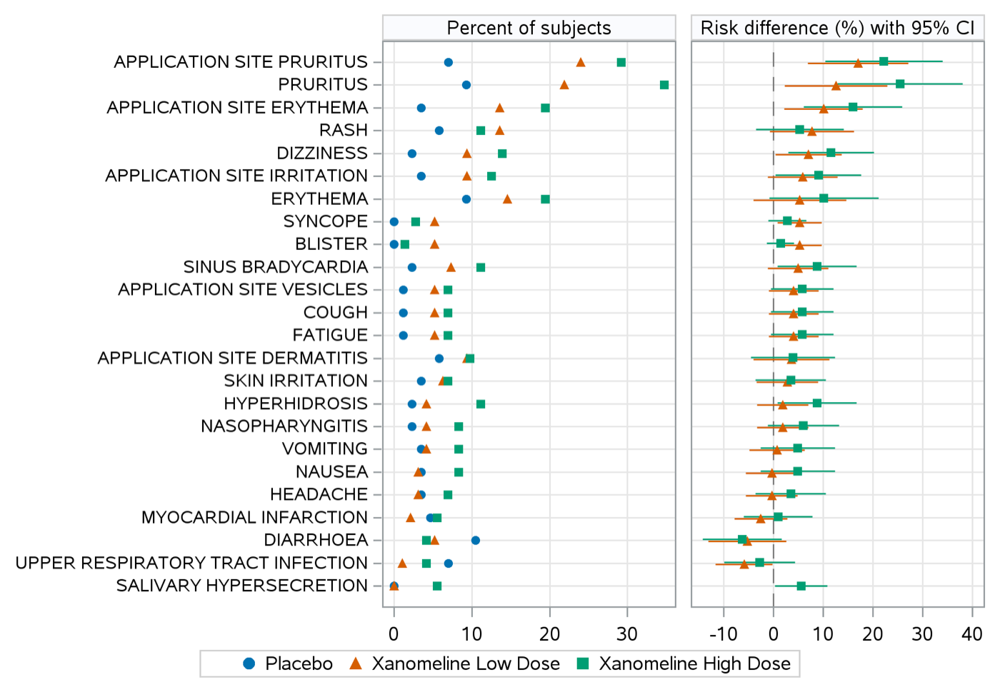
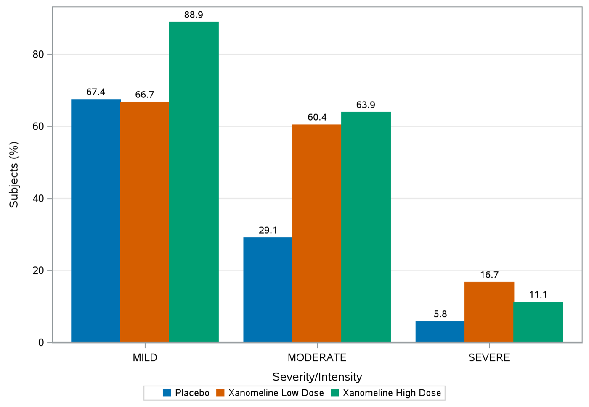
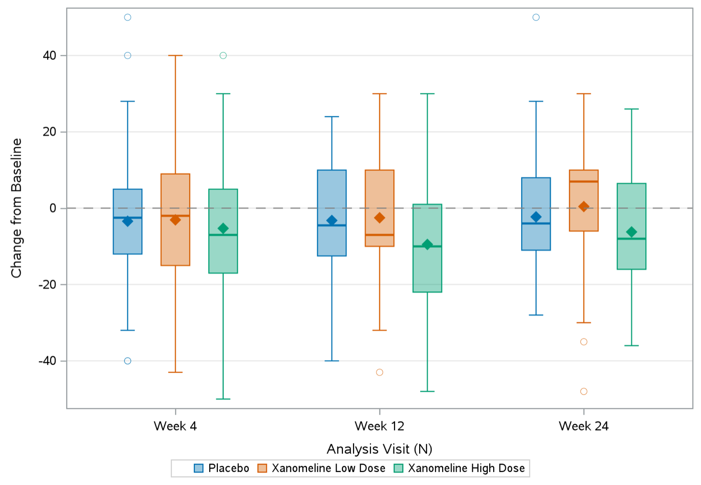
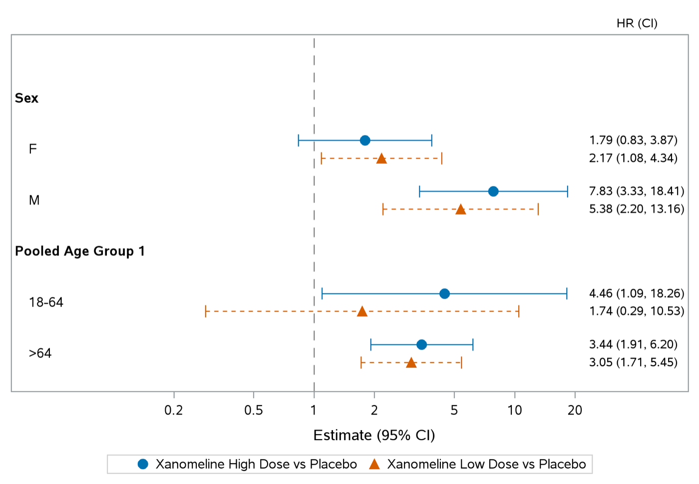
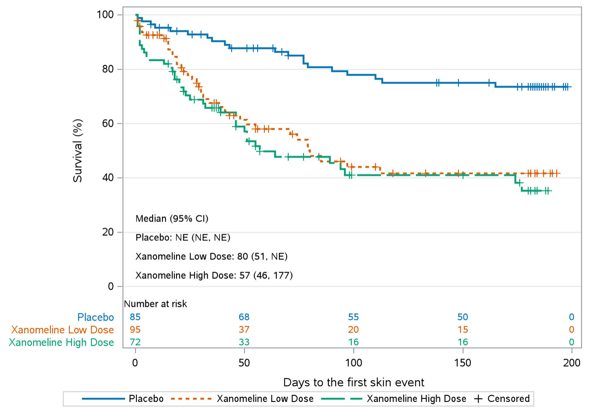
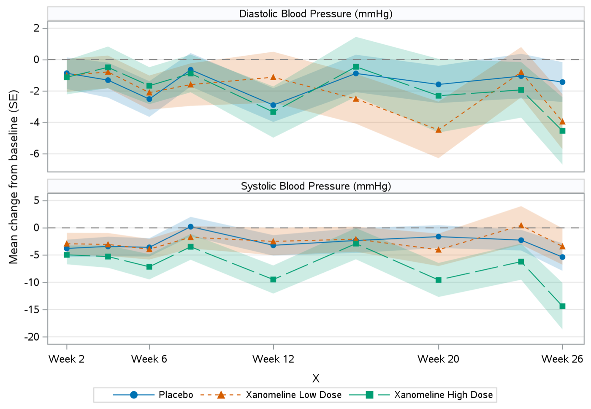
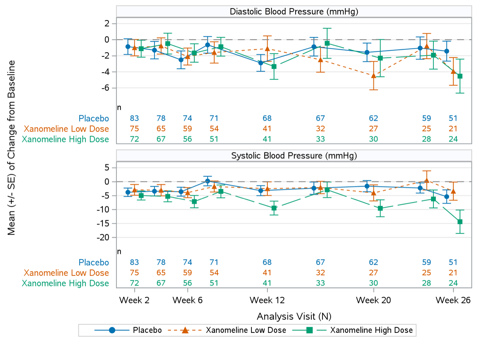
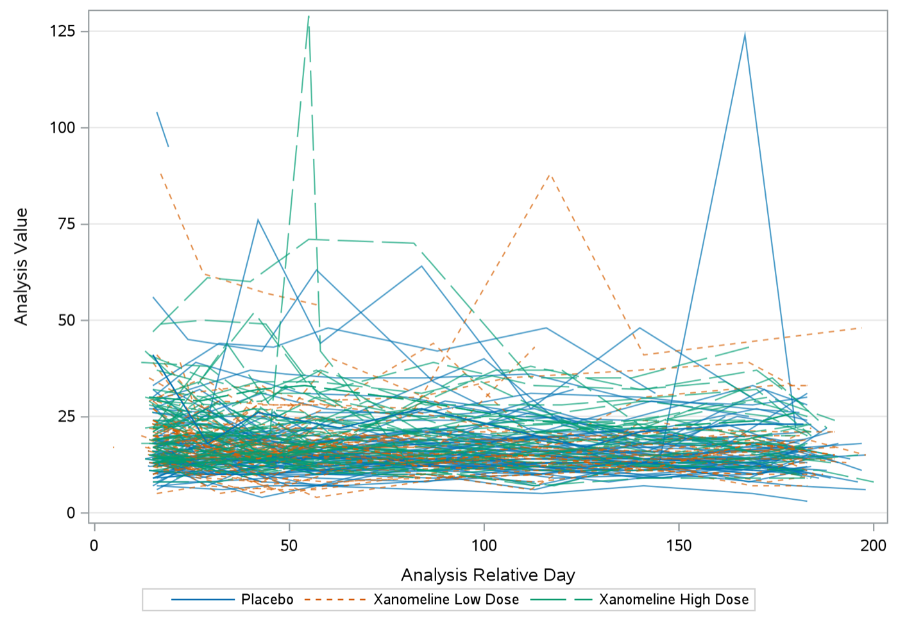
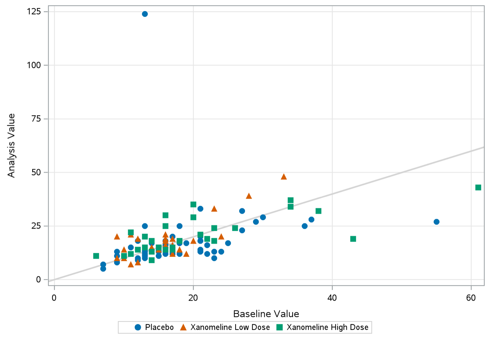

# The SAS macros: the reference manual

Made by `node tools/sas_macros_doc.ts` from the headers of `sas/macros/` (the macro library 1.9.1); do not edit it. How a macro is
written: [sas-style.md](sas-style.md); what the library computes and how a program reads: [sas.md](sas.md). The same as data for an
agent: `sas/macros/index.json` (and `sapling find <macro>`, the MCP tool `sapling_sas_macros`).

Every macro a person calls checks its parameters first and stops with one line that names the parameter and the fix
(`ERROR: [describe] var=AGEX is not a variable of adsl: give var= a variable of data=`), writes a begin and an end line
in the log (`%LET spl_quiet = yes;` keeps them out), and keeps its work data sets with `debug=yes`.

## The examples

The example of every macro a person calls runs on the example data of the library, `examples/data`: data sets of the
R packages pharmaverseadam and pharmaversesdtm (the subjects of the CDISC pilot study; `examples/data/NOTICE`). Run
`examples/setup.sas` first (set `spl_root` in it to the folder that holds `macros/` and `examples/`); it makes the
WORK data sets `adsl` (the safety population), `adae`, `advs`, `adlb`, `adtte` and `adrs`, the library `sdtm` (DS, EX)
and the formats `VISIT.` and `$SEXF.`. Then run the examples in this order, in one SAS session: an example may use
the results of the examples before it. An example of a step of an ADaM program, which changes a data set in place,
first copies the records it needs into a data set of its own (`vs`, `lb`, `sl`, `tt`), so that `advs`, `adlb`, `adsl`
and `adtte` stay as `setup.sas` made them.

`%import_xpt`, `%study`, `%tte`, `%describe`, `%anova`, `%freq`, `%chisq`, `%worst`, `%termflags`, `%fisher`, `%cmh`, `%proportion`, `%risk`, `%logistic`, `%rate`, `%rateratio`, `%ancova`, `%lsmeans`, `%adjust`, `%mmrm`, `%ttest`, `%wilcoxon`, `%interaction_glm`, `%interaction_logistic`, `%interaction_genmod`, `%km`, `%logrank`, `%cox`, `%interaction_phreg`, `%stack`, `%columns`, `%ard`, `%layout`, `%print`, `%table`, `%csv`, `%kmplot`, `%forestplot`, `%meanplot`, `%lineplot`, `%boxplot`, `%barplot`, `%aeplot`, `%profileplot`, `%scatterplot`, `%table_summary`, `%table_ae`, `%table_visit`, `%table_model`, `%table_response`, `%table_tte`, `%table_shift`, `%merge_subject`, `%pick`, `%summarize`, `%flag_if_any`, `%pool`, `%param_wide`, `%summarize_groups`, `%visits`, `%windows`, `%locf`, `%baseline`, `%flag_first`, `%relchange`

Under each example is what it gave: its result data sets (their first rows), the listing of a table, the figure. They
ran on SAS 9.4 M9 on 2026-11-27 (`node tools/macro_examples_sas.ts`; `npm test` fails when an example changed
after its output was recorded).

## The global macro variables

| Variable | It is |
|---|---|
| `SPL_ROOT` | the folder of the study on the SAS server (the one line a program sets: %LET spl_root = ...;) |
| `SPL_STUDY` | the study, set by %study |
| `SPL_OUT` | the output folder, set by %study |
| `SPL_PROGRAM` | the name of the program, set by %study |
| `SPL_QUIET` | yes: no begin and end lines of the macros in the log (%LET spl_quiet = yes; before the calls) |

## Setting up a program

| Macro | It does |
|---|---|
| [`%import_xpt`](#importxpt) | Read SAS transport files (XPORT version 5) into SAS data sets (PROC COPY) |
| [`%study`](#study) | Start a program: the ADaM library, the output folder, the options |

## The statistics macros (one block of a table each)

| Macro | It does |
|---|---|
| [`%adjust`](#adjust) | The adjusted p-values of a family of pairs of groups (PROC MULTTEST) |
| [`%ancova`](#ancova) | The Type III test of a term in a linear model (PROC GLM) |
| [`%anova`](#anova) | The F test of a one-way analysis of variance (PROC GLM) |
| [`%ard`](#ard) | Every number of a table as a CSV file, with every digit (DATA steps) |
| [`%chisq`](#chisq) | The Pearson chi-square test of groups against categories (PROC FREQ) |
| [`%cmh`](#cmh) | The Cochran-Mantel-Haenszel test of groups against categories in strata (PROC FREQ) |
| [`%columns`](#columns) | The columns of a table and the N of each (PROC SUMMARY) |
| [`%cox`](#cox) | The hazard ratio of pairs of groups from a Cox model (PROC PHREG) |
| [`%csv`](#csv) | The records of a listing as a CSV file (DATA steps) |
| [`%describe`](#describe) | Descriptive statistics of a variable in each group (PROC MEANS) |
| [`%fisher`](#fisher) | Fisher exact test of subjects with a record against those without (PROC FREQ) |
| [`%freq`](#freq) | Frequencies of subjects in each group and category (PROC FREQ) |
| [`%interaction_genmod`](#interactiongenmod) | The likelihood-ratio test of the treatment-by-factor interaction, counts (PROC GENMOD) |
| [`%interaction_glm`](#interactionglm) | The F test of the treatment-by-factor interaction in a linear model (PROC GLM) |
| [`%interaction_logistic`](#interactionlogistic) | The likelihood-ratio test of the treatment-by-factor interaction (PROC LOGISTIC) |
| [`%interaction_phreg`](#interactionphreg) | The likelihood-ratio test of the treatment-by-factor interaction (PROC PHREG) |
| [`%km`](#km) | The Kaplan-Meier summary of a time in each group (PROC LIFETEST) |
| [`%layout`](#layout) | The display data set of a table: its rows and a column per group (DATA steps) |
| [`%logistic`](#logistic) | The odds ratio of pairs of groups from a logistic regression (PROC LOGISTIC) |
| [`%logrank`](#logrank) | The log-rank test of a time between groups (PROC LIFETEST) |
| [`%lsmeans`](#lsmeans) | The differences of the LS means of pairs of groups in a linear model (PROC MIXED) |
| [`%mmrm`](#mmrm) | The mixed model for repeated measures: LS means and differences at a visit (PROC MIXED) |
| [`%proportion`](#proportion) | The percent of subjects in each category and group with its interval (PROC FREQ) |
| [`%rate`](#rate) | The exposure-adjusted incidence rate of each group, exact Poisson limits (PROC FREQ) |
| [`%rateratio`](#rateratio) | The rate ratio of pairs of groups, Poisson or negative binomial model (PROC GENMOD) |
| [`%risk`](#risk) | The risk difference, relative risk or odds ratio of pairs of groups (PROC FREQ) |
| [`%table`](#table) | A table in one call: %columns, %ard, %layout and %print |
| [`%table_ae`](#tableae) | An adverse event table in one call: subjects by the levels of var= |
| [`%table_model`](#tablemodel) | A model table in one call: descriptive blocks, then ANCOVA or MMRM |
| [`%table_response`](#tableresponse) | A responder table in one call: percent with interval, comparison, adjusted odds ratio |
| [`%table_shift`](#tableshift) | A shift table in one call: the category at baseline against the category after it |
| [`%table_summary`](#tablesummary) | A summary table in one call: the variables, # after a categorical one |
| [`%table_tte`](#tablette) | A time-to-event table in one call: Kaplan-Meier, the log-rank test, the hazard ratio |
| [`%table_visit`](#tablevisit) | A table by visit in one call: each variable of vars= by parameter and visit |
| [`%termflags`](#termflags) | The flag Y or N of each term for every subject of the population (PROC SORT, MERGE) |
| [`%ttest`](#ttest) | The two-sample t-test of each pair of groups (PROC TTEST) |
| [`%wilcoxon`](#wilcoxon) | The Wilcoxon rank-sum test and Hodges-Lehmann shift of pairs (PROC NPAR1WAY) |
| [`%worst`](#worst) | The records of each subject at its worst level (PROC SORT, a DATA step) |

## Tables and listings

| Macro | It does |
|---|---|
| [`%print`](#print) | Print a table or a listing into RTF and a monospace listing (PROC REPORT) |
| [`%stack`](#stack) | Put results one under another: the blocks of a table (a DATA step) |

## Figures (one macro per figure: docs/sas.md "Figures")

| Macro | It does |
|---|---|
| [`%aeplot`](#aeplot) | Adverse events: percent by group and risk difference (PROC SUMMARY, PROC SGPANEL) |
| [`%barplot`](#barplot) | Bars of the categories of a variable in each group (PROC FREQ, PROC SGPANEL) |
| [`%boxplot`](#boxplot) | Box plots by group and visit (PROC MEANS, PROC SGPANEL) |
| [`%forestplot`](#forestplot) | Forest plot of results in the levels of subgroups (PROC SGPLOT) |
| [`%kmplot`](#kmplot) | Kaplan-Meier curves with the number at risk (PROC LIFETEST, PROC SGPANEL) |
| [`%lineplot`](#lineplot) | Lines through values given, with their interval (PROC SGPANEL) |
| [`%meanplot`](#meanplot) | Mean or median by visit with error bars (PROC MEANS, PROC SGPANEL) |
| [`%profileplot`](#profileplot) | One line per subject by visit, coloured by group (PROC MEANS, PROC SGPANEL) |
| [`%scatterplot`](#scatterplot) | Two variables against each other by group (PROC REG, PROC SGPANEL) |

## The steps of an ADaM program

| Macro | It does |
|---|---|
| [`%baseline`](#baseline) | Give every record of a group the value of its baseline record (PROC SORT, MERGE) |
| [`%flag_first`](#flagfirst) | Flag the first or last record of each group that meets a condition (PROC SORT, MERGE) |
| [`%flag_if_any`](#flagifany) | Flag the subjects with a record in another data set that meets a condition (PROC SORT) |
| [`%locf`](#locf) | Last observation carried forward into the analysis windows, as new records (PROC SORT) |
| [`%merge_subject`](#mergesubject) | Copy variables from another data set by subject (PROC SORT, MERGE) |
| [`%param_wide`](#paramwide) | The values of several parameters side by side, one record per group (PROC SORT, MERGE) |
| [`%pick`](#pick) | The value of the first or last record of each subject in another data set (PROC SORT) |
| [`%pool`](#pool) | Pool small groups into one pooled group (PROC FREQ, PROC SUMMARY, MERGE) |
| [`%relchange`](#relchange) | New records of the change from the record before, relative to the normal range (LAG) |
| [`%summarize`](#summarize) | The sum or mean of the records of each subject in another data set (PROC SUMMARY) |
| [`%summarize_groups`](#summarizegroups) | One record per group with the sum, mean, largest or smallest value (PROC SUMMARY) |
| [`%tte`](#tte) | One time-to-event parameter: the first event, else the latest censoring (PROC SORT) |
| [`%visits`](#visits) | Give each record its analysis visit by its visit (a DATA step) |
| [`%windows`](#windows) | Put each record in its analysis window by its study day (a DATA step) |

## The inner parts (a person does not call them)

| Macro | It does |
|---|---|
| [`%_spl_arg`](#splarg) | One parameter of a call in the long program of a one-call table (DATA step statements) |
| [`%_spl_begin`](#splbegin) | The begin line of a macro in the log |
| [`%_spl_call`](#splcall) | One call of a macro in the long program of a one-call table (DATA step statements) |
| [`%_spl_chars`](#splchars) | The character variables among some variables of a data set |
| [`%_spl_csv`](#splcsv) | Write a data set as a CSV file (DATA steps) |
| [`%_spl_empty`](#splempty) | The result shape without a row: no data qualified |
| [`%_spl_end`](#splend) | The end line of a macro in the log |
| [`%_spl_figure_attrs`](#splfigureattrs) | The colours, markers and line patterns of the groups of a figure |
| [`%_spl_figure_close`](#splfigureclose) | Close the destinations of a figure and set back what it changed |
| [`%_spl_figure_dodge`](#splfiguredodge) | Move the groups of a figure a little apart on the x axis |
| [`%_spl_figure_label`](#splfigurelabel) | The label of an axis, in quotes |
| [`%_spl_figure_nodata`](#splfigurenodata) | The figure and the result when no record qualified |
| [`%_spl_figure_open`](#splfigureopen) | Open the PNG and RTF destinations of a figure |
| [`%_spl_figure_outpar`](#splfigureoutpar) | Write the drawing parameters of a figure macro as a data set |
| [`%_spl_figure_par`](#splfigurepar) | Read par= and the defaults of a figure macro, and check plot= |
| [`%_spl_folder`](#splfolder) | Make the folder of a file and the folders above it that are missing |
| [`%_spl_levels`](#spllevels) | The planned categories of some variables as rows (DATA step statements) |
| [`%_spl_need`](#splneed) | Check the parameters a macro needs |
| [`%_spl_nobs`](#splnobs) | The number of rows of a data set |
| [`%_spl_oneof`](#sploneof) | Check that a parameter is one of a list |
| [`%_spl_pairlist`](#splpairlist) | The pairs of groups of a parameter as rows _K _A _B (DATA step statements) |
| [`%_spl_pairs`](#splpairs) | The differences of the pairs of groups asked for, from the table Diffs of a procedure |
| [`%_spl_program`](#splprogram) | The fixed parts of the long program of a one-call table (DATA step statements) |
| [`%_spl_quote`](#splquote) | The value of a parameter as a text in single quotes (DATA step code) |
| [`%_spl_rows`](#splrows) | The result shape: one row per statistic (DATA step statements) |
| [`%_spl_stackpairs`](#splstackpairs) | The records of each pair of groups asked for, one under the other |
| [`%_spl_text`](#spltext) | The text of a number by its pattern (DATA step statements) |
| [`%_spl_total`](#spltotal) | The name of the group of all groups together, from total= |
| [`%_spl_vars`](#splvars) | Check that variables are in a data set |
| [`%_spl_windows`](#splwindows) | The rows of windows= or visits= of a call as a data set |

### %_spl_arg

<a id="splarg"></a>

One parameter of a call that a one-call table writes into its long program: its name and its value. A parameter without a value is left out.

**File:** `sas/macros/_spl_arg.sas` (16NOV2026)

| Parameter | Default | It is |
|---|---|---|
| `_name` | **required** | The name of the parameter in the call; without _value also the parameter of the calling macro whose value is written |
| `_value` |  | A DATA step expression with the value (a text) |

```sas
%_spl_arg(data, "&rec.")
%_spl_arg(where)
```

**Output:** CODE: DATA step statements that add the parameter to the arrays PN and PV of %_spl_program(begin).

### %_spl_begin

<a id="splbegin"></a>

The begin line of a macro in the log, with the version of the macro library; it gives the time it began, for the end line (%_spl_end). The version below is the one place of the version of the library: every header says the same.

**File:** `sas/macros/_spl_begin.sas` (16NOV2026)

| Parameter | Default | It is |
|---|---|---|
| `_macro` | **required** | The name of the calling macro |

```sas
%LET t0 = %_spl_begin(describe);
```

**Output:** TEXT: the text of the time it began (seconds); the line NOTE: [describe] begins (Sapling macro library 1.1.0). in the log, unless SPL_QUIET is yes (a global macro variable: %LET spl_quiet = yes; before the calls keeps the log short).

### %_spl_call

<a id="splcall"></a>

One call of a macro in the long program of a one-call table: the parameters given by %_spl_arg since the last call, one per line, the equal signs under each other.

**File:** `sas/macros/_spl_call.sas` (16NOV2026)

| Parameter | Default | It is |
|---|---|---|
| `_macro` | **required** | The name of the macro called, without the percent sign |

```sas
%_spl_call(freq)
```

**Output:** CODE: DATA step statements that write the call to the file of the long program and start the next list of parameters.

### %_spl_chars

<a id="splchars"></a>

The character variables among some variables of a data set (their names, separated by blanks). The statistics macros give them one length ($200) in their results, so that results stack without a cut value.

**File:** `sas/macros/_spl_chars.sas` (16NOV2026)

| Parameter | Default | It is |
|---|---|---|
| `data` | **required** | The data set (data set options after it are ignored) |
| `vars` | **required** | The variables |

```sas
%LET chars = %_spl_chars(adae, TRT01A AEBODSYS AEDECOD AVISITN);
```

**Output:** TEXT: the names of the character variables among VARS, separated by blanks (a variable not in DATA is left out).

### %_spl_csv

<a id="splcsv"></a>

Write a data set as a CSV file: a line with the names of the variables, then one line per row (a DATA step; values with a comma or a quote are quoted).

**File:** `sas/macros/_spl_csv.sas` (16NOV2026)

| Parameter | Default | It is |
|---|---|---|
| `data` | **required** | The data set (data set options such as KEEP= are allowed) |
| `file` | **required** | The CSV file to write |

```sas
%_spl_csv(data=l14_3_1(KEEP=usubjid aedecod), file=&spl_out./listings/l14_3_1.csv)
```

**Output:** FILE:  a line with the names of the variables, then one line per row.

### %_spl_empty

<a id="splempty"></a>

The result of a statistics macro when no record qualifies: the result shape without a row, and a NOTE that says so. A procedure never runs on no record, so the log has no error of one.

**File:** `sas/macros/_spl_empty.sas` (16NOV2026)

| Parameter | Default | It is |
|---|---|---|
| `keep` |  | The group variables of the result (BY, WITHIN) |
| `macro` | **required** | The name of the calling macro |
| `like` | **required** | The records (without a row): the types and lengths of the group variables |
| `add` |  | Character group variables the records do not have (VERSUS) |
| `out` | **required** | The result to write |

```sas
%_spl_empty(macro=cox, out=&out., like=_cox_records, keep=&by. &within., add=versus)
```

**Output:** OUT: KEEP, ADD, GROUPS, BLOCK, STAT, VALUE and TEXT and no row; the line NOTE: [macro] No data qualified ... in the log.

### %_spl_end

<a id="splend"></a>

The end line of a macro in the log: its run time since its begin line (%_spl_begin), and with debug=yes that its work data sets are kept.

**File:** `sas/macros/_spl_end.sas` (16NOV2026)

| Parameter | Default | It is |
|---|---|---|
| `_macro` | **required** | The name of the calling macro |
| `_start` | **required** | The time it began (%_spl_begin) |
| `_debug` |  | The debug= of the calling macro |

```sas
%_spl_end(describe, &t0., &debug.)
```

**Output:** LOG: NOTE: [describe] ends after 0.42 seconds. in the log, unless SPL_QUIET is yes; with debug=yes always the line that names the kept work data sets.

### %_spl_figure_attrs

<a id="splfigureattrs"></a>

The look of the groups of a figure: an attribute map (DATTRMAP=) that gives each value of the group variable a colour, a marker and a line pattern, in the order of the columns of %columns (columns=; a value not in it after them), else in the order the values come in the data. Eight colours safe for colour blindness (Okabe and Ito, without the yellow, and a grey), each with another marker and line pattern, so that groups differ in black and white too; a ninth group starts the list again. ID grp has all attributes; ID grpcol the colours only, solid lines (an error bar; a marker of its own, such as the censoring mark: give it to a copy of the group variable, as SGPLOT takes one ID per variable). The data get _ORDER, the place of their group.

**File:** `sas/macros/_spl_figure_attrs.sas` (16NOV2026)

| Parameter | Default | It is |
|---|---|---|
| `data` | **required** | The rows of the figure: they get _ORDER |
| `columns` |  | The columns of %columns (COL, COLVALUE) |
| `var` | **required** | The group variable |
| `out` | **required** | The attribute map |

```sas
%_spl_figure_attrs(data=_kmplot_plot, columns=&columns., var=&by., out=_kmplot_attrs)
```

**Output:** OUT: the attribute map: ID, VALUE, _ORDER and the attributes; DATA: data= with _ORDER.

### %_spl_figure_close

<a id="splfigureclose"></a>

Close the destinations of a figure (%_spl_figure_open) and set back what it changed: the RTF file closed, LISTING closed and opened again (its style LISTING) when it was open before, the options of ODS GRAPHICS reset.

**File:** `sas/macros/_spl_figure_close.sas` (16NOV2026)

| Parameter | Default | It is |
|---|---|---|
| `listing` | `no` | yes: LISTING was open before the figure |

```sas
%_spl_figure_close(listing=&listing.)
```

**Output:** CODE: the ODS statements that close the destinations.

### %_spl_figure_dodge

<a id="splfiguredodge"></a>

Move the groups a little apart on a numeric x axis, so that their error bars do not overlap: _XPLOT = x + (_ORDER - (G + 1) / 2) * STEP, G the number of groups, STEP the smaller of half the smallest distance of two x values divided by G - 1 and 3% of the range of x. The x of the data stays as it is. With offset= the room the axis needs at each end, so that the outer groups are not cut at the edge of the plot.

**File:** `sas/macros/_spl_figure_dodge.sas` (16NOV2026)

| Parameter | Default | It is |
|---|---|---|
| `data` | **required** | The rows of the figure, with _ORDER (%_spl_figure_attrs) |
| `x` | **required** | The numeric x variable |
| `offset` |  | A macro variable of the caller: it gets the offset of each end of the axis (OFFSETMIN=, OFFSETMAX= of COLAXIS), a fraction of its length |

```sas
%_spl_figure_dodge(data=_meanplot_plot, x=x, offset=xoff)
```

**Output:** DATA: data= with _XPLOT; with offset= that macro variable.

### %_spl_figure_label

<a id="splfigurelabel"></a>

The label of an axis, as a text in quotes: the text given (in quotes, or put in quotes), else the label of the variable, else its name.

**File:** `sas/macros/_spl_figure_label.sas` (16NOV2026)

| Parameter | Default | It is |
|---|---|---|
| `_data` | **required** | The data set |
| `_var` |  | The variable of the axis |
| `_text` |  | The text given, or nothing |

```sas
%LET xlabel = %_spl_figure_label(&data., &time., %SUPERQ(xlabel));
```

**Output:** TEXT: the label in double quotes.

### %_spl_figure_nodata

<a id="splfigurenodata"></a>

No record qualified for a figure: out= in the shape of the figure with no row, the NOTE No data qualified, and the figure that says so (a blank plot with the text, in the PNG and the RTF of file=, under the titles of the program).

**File:** `sas/macros/_spl_figure_nodata.sas` (16NOV2026)

| Parameter | Default | It is |
|---|---|---|
| `keep` |  | The variables of like= kept in out= |
| `macro` | **required** | The name of the calling macro |
| `like` | **required** | The records, without a row |
| `chars` |  | Character variables of out= ($200) |
| `nums` |  | Numeric variables of out= |
| `file` | **required** | The output without its extension |
| `width` | **required** | The width of the figure |
| `height` | **required** | The height of the figure |
| `out` |  | The result to write (none: no data set) |

```sas
%_spl_figure_nodata(
    keep   = &by.
  , macro  = kmplot
  , like   = _kmplot_records
  , chars  = kind
  , nums   = x y n censored
  , file   = &file.
  , width  = &width.
  , height = &height.
  , out    = &out.
)
```

**Output:** OUT: no row; FILE: <file>.png and <file>.rtf with the text.

### %_spl_figure_open

<a id="splfigureopen"></a>

Open the destinations of one figure: the PNG image (the LISTING destination with GPATH=, 300 dpi, image name and size from ODS GRAPHICS) and the RTF file with the figure on a page (the titles and footnotes of the program as text of the page: NOGTITLE NOGFOOTNOTE). The PNG carries the titles and the footnotes in the image (LISTING draws them in the graph, as SAS does by default), so a PNG alone says what it is. Both use the style HTMLBLUE: tick values 9pt, axis labels and legend 10pt, titles 11pt. It notes in the macro variable named by state= whether LISTING was open, for %_spl_figure_close.

**File:** `sas/macros/_spl_figure_open.sas` (16NOV2026)

| Parameter | Default | It is |
|---|---|---|
| `file` | **required** | The output without its extension: <file>.png and <file>.rtf |
| `width` | **required** | The width of the figure |
| `height` | **required** | The height of the figure |
| `state` | **required** | The name of a local macro variable of the caller: yes when LISTING was open, else no |

```sas
%_spl_figure_open(file=&file., width=&width., height=&height., state=LISTING)
```

**Output:** CODE: the ODS statements that open the destinations.

### %_spl_figure_outpar

<a id="splfigureoutpar"></a>

The drawing parameters of a figure macro as a data set (its outpar=): one row per parameter in the order of the signature, PARAMETER its name in lower case and VALUE its value as the macro draws it (given, from par=, the default, or made by the macro: the label of an axis, the format of the ticks). par= of a later call reads it back.

**File:** `sas/macros/_spl_figure_outpar.sas` (16NOV2026)

| Parameter | Default | It is |
|---|---|---|
| `names` | **required** | The drawing parameters of the caller, in their order (names= of %_spl_figure_par) |
| `out` |  | The data set to write; blank: none |

```sas
%_spl_figure_outpar(names=&drawn., out=&outpar.)
```

**Output:** DATA: out= with PARAMETER ($32) and VALUE ($500).

### %_spl_figure_par

<a id="splfigurepar"></a>

The parameters of a figure macro, before its checks. With plot= (draw the out= of a call again): data= is not given, plot= has the variables of out=, and each parameter of the computation that has a value gets a NOTE (it is not used). With par= (the outpar= of a call): each drawing parameter that the call leaves blank gets the VALUE of its row; a row that names no drawing parameter is an error. Then each parameter still blank gets its default from draw= or compute=. So a value in the call wins over a row of par=, and a row of par= over the default: the defaults of these parameters are here, not in the signature of the macro.

**File:** `sas/macros/_spl_figure_par.sas` (27NOV2026)

| Parameter | Default | It is |
|---|---|---|
| `macro` | **required** | The name of the calling macro |
| `draw` | **required** | Its drawing parameters in the order of its signature, each as name or name=default |
| `compute` |  | Its parameters of the computation that plot= does not use, each as name or name=default |
| `shape` | **required** | The variables of its out= that plot= must have |
| `names` | **required** | The name of a local macro variable of the caller: the names of the drawing parameters |
| `state` | **required** | The name of a local macro variable of the caller: 1 when the parameters are right, else 0 |

```sas
%_spl_figure_par(
    macro   = kmplot
  , draw    = columns by panel atrisk=yes xlabel ylabel="Survival (%)" file
  , compute = where time cnsr=CNSR
  , shape   = kind x y lower upper n censored
  , names   = drawn
  , state   = ok
)
```

**Output:** LOG: one ERROR with its fix for a wrong plot= or par=, a NOTE for each parameter not used. The local macro variables of the caller: the parameters set from par= and from the defaults, state= and names=.

### %_spl_folder

<a id="splfolder"></a>

Make the folder of a file the macro writes, and each folder above it that is missing, with a NOTE that names the folder made. A path that starts with ~ is in the home folder. Nothing is made when the folder is there or the file has no folder.

**File:** `sas/macros/_spl_folder.sas` (16NOV2026)

| Parameter | Default | It is |
|---|---|---|
| `_macro` | **required** | The name of the calling macro |
| `_file` | **required** | The file the macro writes: a path |

```sas
%_spl_folder(print, %SUPERQ(file).rtf)
```

**Output:** LOG: NOTE: [print] made the folder ~/study/out/tlf. for a folder it made; a WARNING when the folder cannot be made.

### %_spl_levels

<a id="spllevels"></a>

The planned categories of some variables as rows: every combination of their values, by DO loops. A character variable gets the length $200.

**File:** `sas/macros/_spl_levels.sas` (16NOV2026)

| Parameter | Default | It is |
|---|---|---|
| `data` | **required** | The data set of the variables (it tells which ones are character) |
| `levels` | **required** | Each variable followed by its values: a text in quotes, a number without |
| `order` |  | A prefix: the place of each value in its list as the variables <prefix>1, <prefix>2 ... (one for each variable, in the order of levels=) |

```sas
DATA levels;
 %_spl_levels(levels=bnrind 'LOW' 'NORMAL' 'HIGH' anrind 'LOW' 'NORMAL' 'HIGH', data=adlbc)
RUN;
```

**Output:** CODE: DATA step statements: LENGTH of the character variables ($200), then DO loops that output every combination of the planned values (DO BNRIND = ...; DO ANRIND = ...; OUTPUT; END; END;); with order= also the place of each value in its list.

### %_spl_need

<a id="splneed"></a>

Check the parameters a macro needs: each must have a value, and a data set of data=, denom=, columns= or from= must exist. For each one that does not it writes one line that names the parameter and the fix: ERROR: [describe] data= is required: give data=<value> ... ERROR: [describe] data=adsx does not exist: give data= ... It gives 1 when all are there, 0 when one is not: the caller then stops (%RETURN).

**File:** `sas/macros/_spl_need.sas` (16NOV2026)

| Parameter | Default | It is |
|---|---|---|
| `_macro` | **required** | The name of the calling macro (for the message) |
| `_params` | **required** | The names of its parameters that must have a value |

```sas
%IF not %_spl_need(describe, data var by out) %THEN %RETURN;
```

**Output:** TEXT: 1 or 0, as text.

### %_spl_nobs

<a id="splnobs"></a>

The number of rows of a data set (with the WHERE= of its data set options, when it has one); 0 when the data set does not exist.

**File:** `sas/macros/_spl_nobs.sas` (16NOV2026)

| Parameter | Default | It is |
|---|---|---|
| `_data` | **required** | The data set |

```sas
%IF %_spl_nobs(_describe_values) = 0 %THEN %DO;
```

**Output:** TEXT: the number, as text.

### %_spl_oneof

<a id="sploneof"></a>

Check that the value of a parameter is one of a list (in any case). When it is not it writes one line that names the parameter and the fix: ERROR: [cox] ties=fast is not one of efron breslow exact ... It gives 1 or 0: the caller then stops (%RETURN).

**File:** `sas/macros/_spl_oneof.sas` (16NOV2026)

| Parameter | Default | It is |
|---|---|---|
| `_macro` | **required** | The name of the calling macro (for the message) |
| `_param` | **required** | The parameter |
| `_list` | **required** | Its values, separated by blanks |

```sas
%IF not %_spl_oneof(cox, ties, efron breslow exact discrete) %THEN %RETURN;
```

**Output:** TEXT: 1 or 0, as text.

### %_spl_pairlist

<a id="splpairlist"></a>

The pairs of groups of a parameter as rows: _K (the place of the pair), _A (the group) and _B (the group it is compared with). The pairs are separated by #, one pair per line, the first group against the second; a value with a blank or a hyphen is in quotes: pairs = "Xanomeline High Dose" "Placebo" # "Xanomeline Low Dose"  "Placebo" The form of version 1.0 is still read: "A"-"B" "C"-"D" (no #, every item a pair joined by a hyphen outside quotes).

**File:** `sas/macros/_spl_pairlist.sas` (16NOV2026)

| Parameter | Default | It is |
|---|---|---|
| `list` | **required** | The parameter of the calling macro that holds the pairs (pairs, family) |

```sas
DATA _pairs_asked;
 %_spl_pairlist(list=pairs)
 KEEP _a _b;
RUN;
```

**Output:** CODE: DATA step statements: one row (OUTPUT) per pair with _K, _A and _B ($200).

### %_spl_pairs

<a id="splpairs"></a>

The differences of the pairs of groups asked for, from the table Diffs of PROC MIXED (it has each pair once, in one direction). It computes nothing: a difference the other way round is the same difference with its sign and its limits turned.

**File:** `sas/macros/_spl_pairs.sas` (16NOV2026)

| Parameter | Default | It is |
|---|---|---|
| `by` | **required** | The groups: a character variable |
| `within` |  | The variables of the separate models (BY groups of PROC MIXED) |
| `diffs` | **required** | The Diffs table (the group in BY, the group it is compared with in _BY) |
| `records` | **required** | The records of the model (for the groups and their order) |
| `pairs` | **required** | all: each later group against each earlier one, in the order of ORDER (else of the values); or the pairs separated by #, the group first, then the group it is compared with (%_spl_pairlist reads them, and the form "A"-"B" of 1.0) |
| `order` |  | A numeric variable of the records with one value per group |
| `out` | **required** | The data set: WITHIN, BY (the group), VERSUS (the group it is compared with), diff, diff_se, lcl, ucl, pval |

```sas
%_spl_pairs(
    by      = trt01p
  , within  =
  , diffs   = _lsmeans_diffs
  , records = _lsmeans_records
  , pairs   = all
  , order   = trt01pn
  , out     = _lsmeans_pairs
)
```

**Output:** OUT: WITHIN, BY (the group), VERSUS (the group it is compared with), diff, diff_se, lcl, ucl, pval: one row per pair asked for (in each group of WITHIN).

### %_spl_program

<a id="splprogram"></a>

The fixed parts of the DATA step with which a one-call table writes its long program: begin (the file and the variables), records (the population and the records, from the parameters ADSL, POP, DATA, WHERE and NAME of the calling macro), table (the %table call, from BY, ORDER, TOTAL, FORMAT, FILE, NAME and DEBUG, with the TITLE and FOOTNOTE statements of TITLE and FOOTNOTE before it and their clearing after it), titles and untitled (those statements alone), end (the routine that writes a call). It computes nothing.

**File:** `sas/macros/_spl_program.sas` (16NOV2026)

| Parameter | Default | It is |
|---|---|---|
| `_part` | **required** | begin, names, label, records, table, titles, untitled or end |
| `_var` |  | With label: the variable of the block, in lower case |

```sas
DATA _NULL_;
 %_spl_program(begin)
 %_spl_program(records)
 %_spl_arg(data, "&rec.")
 %_spl_call(freq)
 %_spl_program(table)
 %_spl_program(end)
RUN;
```

**Output:** CODE: DATA step statements. It reads the macro variables REC (the records the calls read), POPN (the data set with the N of the columns), DS and NAMES of the calling macro.

### %_spl_quote

<a id="splquote"></a>

The value of a parameter as a text in single quotes, for a DATA step: each single quote in it doubled, nothing in it resolved. The code the macro writes holds the value itself (SYMGET would read it when the step runs), so that the flat program (the code the macros wrote, without a macro) has it too. An empty value gives a blank text.

**File:** `sas/macros/_spl_quote.sas` (27NOV2026)

| Parameter | Default | It is |
|---|---|---|
| `_param` | **required** | The name of the parameter (label, pairs) |

```sas
block = DEQUOTE(%_spl_quote(label));
```

**Output:** TEXT: a text in single quotes: 'Age (years)', '"A" "B" # "C" "B"'.

### %_spl_rows

<a id="splrows"></a>

The result shape: one row per statistic of the row just read. Each statistic is a numeric variable of the same name (n, mean, pval ...); the row gets STAT (its name), VALUE (its number), PATTERN and TEXT (the number as printed, %_spl_text: a p value, pval or padj, never as 0 or 1).

**File:** `sas/macros/_spl_rows.sas` (16NOV2026)

| Parameter | Default | It is |
|---|---|---|
| `missing` |  | The text of a statistic without a value (default blank; %km gives NE: not estimable) |
| `stats` | **required** | The statistics in their order, each with its pattern (mean="XX.X") or without (the default pattern of the statistic below) |

```sas
DATA result;
 SET means;
 %_spl_rows(stats=n="XX" mean="XX.X" sd)
RUN;
```

**Output:** CODE: DATA step statements: one row per statistic with STAT, VALUE and TEXT. The default patterns: XX for n, events, min, max; XX.X for mean, median, q1, q3, lsmean, diff, estimate, lcl, ucl; (XX.X%) for pct; X.XXX for pval; XX.XX for sd, se, lsmean_se, diff_se and any other statistic.

### %_spl_stackpairs

<a id="splstackpairs"></a>

The records of each pair of groups asked for, one under the other: the pair (_PAIR), its group (_A) and the group it is compared with (_B), and the side of each record (_SIDE: 1 in _A, 2 in _B). A procedure then runs BY _PAIR _A _B on the 2 groups of each pair, the group first. It computes nothing.

**File:** `sas/macros/_spl_stackpairs.sas` (27NOV2026)

| Parameter | Default | It is |
|---|---|---|
| `by` | **required** | The groups: a character variable |
| `records` | **required** | The records (one per subject) |
| `pairs` | **required** | all: each later group against each earlier one, in the order of ORDER (else of the values); or the pairs separated by #, the group first, then the group it is compared with (%_spl_pairlist reads them, and the form "A"-"B" of 1.0) |
| `order` |  | A numeric variable of the records with one value per group |
| `macro` | **required** | The macro that calls (for the message) |
| `out` | **required** | The data set: the records of each pair with _PAIR, _A, _B, _SIDE, sorted by them |

```sas
%_spl_stackpairs(
    macro   = ttest
  , records = _ttest_records
  , by      = trt01p
  , pairs   = all
  , order   = trt01pn
  , out     = _ttest_pairs
)
```

**Output:** OUT: the records of each pair with _PAIR, _A, _B and _SIDE (1 in _A, 2 in _B), sorted by them. The macro variable PAIRSOK of the caller: 1, or 0 when a pair names a group that no record has (an error in the log).

### %_spl_text

<a id="spltext"></a>

The text of a number by its pattern. A pattern shows one number as one group of X: XX, XX.X, (XX.X%), (N=XX). The number is rounded (ROUND) to the decimals of the X group, right aligned in its width and put in its place; the text is trimmed. A p value never prints as 0 or 1: rounded to 0 it is < and the smallest step (X.XXX: <0.001), rounded to 1 it is > and one step less (>0.999). The number is unchanged.

**File:** `sas/macros/_spl_text.sas` (16NOV2026)

| Parameter | Default | It is |
|---|---|---|
| `value` | **required** | The numeric variable |
| `pattern` | **required** | The character variable with the pattern |
| `text` | **required** | The character variable to write (blank when the number is missing) |
| `pvalue` | `0` | A condition that is true when the number is a p value (STAT IN ('pval' 'padj')) |

```sas
DATA result;
 SET rows;
 %_spl_text(
     value   = value
   , pattern = pattern
   , text    = text
   , pvalue  = stat IN ('pval' 'padj')
 )
RUN;
```

**Output:** CODE: DATA step statements: TEXT is the number of VALUE as its PATTERN shows it (9.46 with (XX.X%) gives ( 9.5%); 86 with (N=XX) gives (N=86); 3 with XX gives 3; a p value 0.00004 with X.XXX gives <0.001).

### %_spl_total

<a id="spltotal"></a>

The name of the group of all groups together, from total=: nothing for no, Total for yes, else the text in quotes.

**File:** `sas/macros/_spl_total.sas` (16NOV2026)

| Parameter | Default | It is |
|---|---|---|
| `total` | **required** | The value of total= (no, yes, or a name in quotes) |

```sas
%LET totlab = %_spl_total(%SUPERQ(total));
```

**Output:** TEXT: nothing for no (or empty), Total for yes, else the text of the quotes.

### %_spl_vars

<a id="splvars"></a>

Check that the variables of some parameters are variables of a data set. For each one that is not it writes one line that names the parameter and the fix: ERROR: [describe] var=AGEX is not a variable of adsl: give ... It gives 1 when all are there, 0 when one is not: the caller then stops (%RETURN). A data set that cannot be opened is the business of %_spl_need. With _also (the subjects adsl= of a one-call table, whose variables go to the records) a variable of either data set is there.

**File:** `sas/macros/_spl_vars.sas` (16NOV2026)

| Parameter | Default | It is |
|---|---|---|
| `_macro` | **required** | The name of the calling macro (for the message) |
| `_data` | **required** | The parameter that names the data set (data, denom) |
| `_params` | **required** | The parameters whose values are variables of it |
| `_also` |  | The parameter that names a second data set where the variables may be (adsl) |

```sas
%IF not %_spl_vars(describe, data, var by) %THEN %RETURN;
%IF not %_spl_vars(table_ae, data, var by, adsl) %THEN %RETURN;
```

**Output:** TEXT: 1 or 0, as text.

### %_spl_windows

<a id="splwindows"></a>

The rows of windows= (or visits=) of a call as a data set: one row per window, the rows of the call separated by #, the values of a row by blanks, a text in quotes, a missing number as a period.

**File:** `sas/macros/_spl_windows.sas` (16NOV2026)

| Parameter | Default | It is |
|---|---|---|
| `_macro` | **required** | The macro that calls |
| `_name` | **required** | The name of its parameter with the rows |
| `_kind` | **required** | day: AVISITN AVISIT AWLO AWHI AWTARGET AWRANGE; visit: VISIT AVISITN AVISIT |
| `_out` | **required** | The data set of the rows |

```sas
%_spl_windows(windows, windows, day, _windows_rows)
```

**Output:** DATA: _out, one row per window in the order of the call. The macro variable ROWSOK of the caller: 1, or 0 when a row has not its number of values (an error in the log).

### %adjust

<a id="adjust"></a>

Adds the adjusted p-values of a family of pairs of groups to a result: one row padj per pair. Use it after %lsmeans, %mmrm, %cox, %logistic, %risk, %rateratio, %ttest or %wilcoxon: it reads their rows with STAT pval. The family is the hypotheses of one multiplicity block: the pairs of family=, in their order. method= gives the adjustment:

- bonferroni: Bonferroni (PROC MULTTEST); with weights=, the weighted Bonferroni test in a DATA step (the p-value divided by its weight, at most 1)
- holm: Holm, the step-down Bonferroni test (PROC MULTTEST STEPBON)
- hochberg: Hochberg (PROC MULTTEST)
- hierarchy: the fixed sequence in a DATA step; each adjusted p-value is the largest p-value of its hypothesis and of the hypotheses before it

Every row of data= with STAT pval and a pair of family= is one hypothesis of the family. When data= has a pair in several rows (the terms, visits or subgroups of within=), all of them are adjusted together, as one family. For a family in each term, call %adjust once per term, on a data set with only the rows of that term (a DATA step with WHERE first).

**Procedure:** PROC MULTTEST (INPVALUES=); a DATA step  
**Proven:** the known answer of the method riskdiff (src/methods.ts, worked out by tools/method_answers.R; node tools/methods_sas.ts) with the adjusted p-values of a family; ran on SAS 9.4 M9, 2026-11-12  
**File:** `sas/macros/adjust.sas` (27NOV2026)

| Parameter | Default | It is |
|---|---|---|
| `data` | **required** | A result of pairs with the variables of by=, VERSUS, STAT and VALUE: the out= of %lsmeans, %mmrm, %cox and the other macros of pairs |
| `by` | **required** | The groups: the variable of data= with the group of each pair (by = trt01p) |
| `family` | **required** | The pairs of the family in their order, separated by #: each the group first and then the group it is compared with, each value in quotes: family = "High" "Placebo" # "Low" "Placebo". The old form "A"-"B" is still read. |
| `method` | **required** | The adjustment: bonferroni, holm, hochberg or hierarchy |
| `weights` |  | The weights of a weighted Bonferroni test: one number per pair, in the order of family=, separated by blanks (weights = 0.8 0.2). Only with method=bonferroni. |
| `pattern` | `"X.XXX"` | The pattern of the printed adjusted p-value, in quotes |
| `out` | **required** | The name of the result data set |
| `debug` | `no` | yes: keep the work data sets _adjust_* |

```sas
%adjust(
    data   = sbp_ls
  , by     = trt01p
  , family = "Xanomeline High Dose" "Placebo"
           # "Xanomeline Low Dose"  "Placebo"
  , method = hochberg
  , out    = sbp_adj
)
```

**Output:** OUT: the rows of data=, then one row per pair of the family with STAT padj, VALUE the adjusted p-value and TEXT the printed value. When data= has no p-value of a pair of family=, out= is data= as it is and the log has a NOTE.

**The output of the example:**

```text
sbp_adj, the rows of the p-values where stat IN ('pval' 'padj'): 5 rows
TRT01P                VERSUS               GROUPS         STAT         VALUE   TEXT
Xanomeline High Dose  Placebo              TRT01P VERSUS  pval  0.0383969398  0.038
Xanomeline High Dose  Xanomeline Low Dose  TRT01P VERSUS  pval  0.0707974243  0.071
Xanomeline Low Dose   Placebo              TRT01P VERSUS  pval  0.9584423033  0.958
Xanomeline High Dose  Placebo              TRT01P VERSUS  padj  0.0767938796  0.077
Xanomeline Low Dose   Placebo              TRT01P VERSUS  padj  0.9584423033  0.958
```

### %aeplot

<a id="aeplot"></a>

Draws the percent and risk difference of each adverse event as PNG and RTF files and returns the numbers drawn. Use %barplot for the percents of the categories of one variable without a difference. The figure has two panels side by side that share the axis of the terms. The left panel shows the percent of the subjects of each group with the term, as dots. The right panel shows the risk difference of each group against the reference group, with its confidence interval and a line at 0. The flags are those of %termflags and the risk differences those of %risk (ci=, level=), so the figure and a table made with them cannot differ. The terms are those that reach threshold=, in the order of sort=, at most max= of them. To draw the figure again without computing, give plot= the out= and par= the outpar= of an earlier call.

**Procedure:** PROC SUMMARY, PROC SGPANEL (and PROC FREQ in %risk)  
**Proven:** its known answer in tools/figures_sas.ts (percents and Wald intervals worked out by hand); not yet run on a SAS server  
**File:** `sas/macros/aeplot.sas` (27NOV2026)

| Parameter | Default | It is |
|---|---|---|
| `data` | **required** | The input data set: the adverse event records |
| `plot` |  | Draw again: the out= of an earlier %aeplot call, changed or not. It is drawn as it is, and no statistic is computed. Give it instead of data=. |
| `par` |  | The drawing parameters of an earlier %aeplot call: its outpar=. A drawing parameter given in the call wins over its row of par=. |
| `columns` |  | The data set of %columns: it gives the order of the groups and their colours. When not given, the groups come in the order of denom=. |
| `denom` | **required** | The population: a data set with one row per subject and the variable of by= |
| `where` |  | The records to use: a condition in parentheses, such as where = (trtemfl = 'Y') |
| `term` | `AEDECOD` | The term of a row: one variable of data= (term = aebodsys) |
| `by` | **required** | The groups: one character variable of denom= |
| `reference` | **required** | The reference group of the risk difference: a value of by=, in quotes (reference = 'Placebo') |
| `threshold` |  | A percent: only the terms that this percent of the subjects of a group or more have, in at least one group (threshold = 5) |
| `sort` | `difference` | The order of the terms from the top: difference (the risk difference of the first group that is not the reference, the largest first), frequency (the percent of all subjects, the largest first) or alphabetical |
| `ci` | `wald` | The type of the interval of the risk difference, as ci= of %risk |
| `level` | `0.95` | The confidence level: a number between 0 and 1 |
| `max` | `30` | The most terms to show: a positive whole number. The first terms in the order of sort= are shown. |
| `xlabel` |  | The heading of the right panel: a text in quotes. When not given, Risk difference (%) with 95% CI, with the level of level=. |
| `file` | **required** | The output file without its extension: the macro writes <file>.png (300 dpi) and <file>.rtf |
| `width` | `6.5in` | The width of the figure: a length with its unit (width = 9in) |
| `height` | `4.5in` | The height of the figure: a length with its unit (height = 6in) |
| `out` |  | The name of the data set of the numbers drawn. When not given, they are not kept. |
| `outpar` |  | The name of the data set of the drawing parameters, one row each. Give it to par= of a later call to draw the figure again. |
| `debug` | `no` | yes: keep the work data sets _aeplot_* |

```sas
%aeplot(
    data      = adae
  , columns   = t14_2_1_cols
  , denom     = adsl
  , where     = (trtemfl = 'Y')
  , term      = aedecod
  , by        = trt01a
  , reference = "Placebo"
  , threshold = 5
  , file      = &spl_out./figures/f_ae_risk
  , out       = f_ae_risk
)
```

**Output:** OUT: the variable of term=, the variable of by=, KIND, X, LOWER, UPPER and N. A row of KIND percent is one term and group: X is the percent of its subjects and N the subjects with the term. A row of KIND difference is one term and group that is not the reference: X is the risk difference in percent (100 x RD of %risk), and LOWER and UPPER its limits in percent. OUTPAR: one row per drawing parameter, in the order of the table: PARAMETER ($32), its name, and VALUE ($500), its value as drawn (a label in quotes). FILE: <file>.png and <file>.rtf.

**The output of the example:**



### %ancova

<a id="ancova"></a>

Returns the Type III p-value of a numeric term in a linear model, such as a test of dose response. Use %lsmeans for the differences between pairs of groups, and %mmrm for a model of repeated visits. The model is PROC GLM: the class factors, the covariates and the tested term, one record per subject (the first with a value; when where= leaves a second record of a subject, the log has a NOTE with their number). Give a where= that leaves one record per subject, such as one parameter at one visit with anl01fl = 'Y'; otherwise each subject has the first of its records in the order of data=, whichever it is. The coefficient of the term, its standard error and its confidence limits come when stats= asks for them. The macro writes a result: a data set with one row per number (the result shape, see %stack).

**Procedure:** PROC GLM  
**Proven:** the known answer of the method ancova (src/methods.ts, worked out by tools/method_answers.R; node tools/methods_sas.ts); ran on SAS 9.4 M9, 2026-11-12  
**File:** `sas/macros/ancova.sas` (27NOV2026)

| Parameter | Default | It is |
|---|---|---|
| `data` | **required** | The input data set, with USUBJID |
| `where` |  | The records to use: a condition in parentheses, such as where = (paramcd = 'SYSBP' AND avisit = 'Week 12') |
| `var` | **required** | The response: one numeric variable |
| `covars` |  | The covariates: numeric variables separated by blanks (covars = base) |
| `class` |  | The class factors: variables separated by blanks (class = sex) |
| `test` | **required** | The tested term: one numeric variable, such as a dose or the number of a treatment (test = trt01pn) |
| `level` | `0.95` | The confidence level of the limits: a number between 0 and 1 |
| `stats` | `pval="X.XXX"` | The statistics, in the order of the rows: each name with the pattern of its printed number, separated by blanks. The names are pval, estimate, se, lcl and ucl. A name without a pattern takes its default pattern (n="XX", mean="XX.X", pval="X.XXX" ...; see %describe). |
| `label` |  | The label of the block in the table: a text in quotes. A block is the rows of one call in the table. |
| `out` | **required** | The name of the result data set |
| `debug` | `no` | yes: keep the work data sets _ancova_* |

```sas
%ancova(
    data   = advs
  , where  = (paramcd = 'SYSBP' AND avisit = 'Week 12' AND anl01fl = 'Y')
  , var    = chg
  , covars = base
  , test   = trt01pn
  , label  = "Dose response"
  , out    = sbp_dose
)
```

**Output:** OUT: the result shape (see %stack): one row per statistic, of all subjects together (GROUPS is blank). STAT is pval, estimate, se, lcl or ucl.

**The output of the example:**

```text
sbp_dose: 1 row
GROUPS  BLOCK          STAT         VALUE   TEXT
        Dose response  pval  0.0682011221  0.068
```

### %anova

<a id="anova"></a>

Returns the p-value of the F test of a one-way analysis of variance of a variable between the groups. Use %ttest or %wilcoxon to compare pairs of groups, and %ancova when the model has covariates. The macro writes a result: a data set with one row per number (the result shape, see %stack). The model is var= by by= (PROC GLM). The p-value is that of the model, one test of all the groups together. A record with a missing value or a missing group is not used.

**Procedure:** PROC GLM  
**Proven:** the known answer of the method anova (src/methods.ts, worked out by tools/method_answers.R; node tools/methods_sas.ts); ran on SAS 9.4 M9, 2026-11-12  
**File:** `sas/macros/anova.sas` (27NOV2026)

| Parameter | Default | It is |
|---|---|---|
| `data` | **required** | The input data set |
| `where` |  | The records to use: a condition in parentheses, such as where = (anl01fl = 'Y') |
| `var` | **required** | The variable to analyse: one numeric variable |
| `by` | **required** | The groups to compare: one variable |
| `stats` | `pval="X.XXX"` | The statistic with its pattern of the printed number: pval |
| `label` |  | The label of the block in the table: a text in quotes. A block is the rows of one call in the table. |
| `out` | **required** | The name of the result data set |
| `debug` | `no` | yes: keep the work data sets _anova_* |

```sas
%anova(
    data  = adsl
  , var   = age
  , by    = trt01a
  , label = "Age (years)"
  , out   = age_anova
)
```

**Output:** OUT: the result shape (see %stack), one row: STAT pval, with GROUPS blank (all the groups together), BLOCK, VALUE and TEXT. When no record qualifies, the result has no row.

**The output of the example:**

```text
age_anova: 1 row
GROUPS  BLOCK        STAT         VALUE   TEXT
        Age (years)  pval  0.2346471181  0.235
```

### %ard

<a id="ard"></a>

Writes every number of a table to a CSV file, the numbers file. Use %csv for the records of a listing or the numbers of a figure. The numbers file has one line per number: the result it comes from, its statistic, the values of its groups, and the number as stored and as printed. The number as stored is the value as SAS keeps it, written with the format BEST32. (up to 15 significant digits); the number as printed is the TEXT of the result. It reads the results, never the printed page, so that a second program, in SAS or R, can compare its numbers with this file.

- With columns=, the first lines are the N of each column (the result N).
- A number has the values of at most five groups (g1_value to g5_value), in the order of GROUPS.

**Procedure:** DATA steps (FILE, PUT)  
**Proven:** the tables of the dummy study SYNHTN01 (759 of 759 numbers the same as those of a second program in R); ran on SAS 9.4 M9, 2026-11-12  
**File:** `sas/macros/ard.sas` (27NOV2026)

| Parameter | Default | It is |
|---|---|---|
| `data` | **required** | The stacked results (out= of %stack) |
| `columns` |  | The columns (out= of %columns). When given, the N of each column comes first, as the result N. |
| `file` |  | The name of the numbers file, without its extension. When not given, it is the name of the program that %study set; without %study, file= is required. |

```sas
%ard(data=t14_2_1, columns=t14_2_1_cols, file=t14_2_1)
```

**Output:** FILE: <out>/ard/<file>.csv, where <out> is the output folder that %study set and <file> is in lower case. Its columns: result, stat, g1_value ... g5_value, raw (the number with all its digits) and formatted (the number as printed).

**The output of the example:**

```text
ard/t14_2_1.csv: the first 40 of 47 lines
result,stat,g1_value,g2_value,g3_value,g4_value,g5_value,raw,formatted
N,n,Placebo,,,,,86,(N=86)
N,n,Xanomeline Low Dose,,,,,96,(N=96)
N,n,Xanomeline High Dose,,,,,72,(N=72)
N,n,Total,,,,,254,(N=254)
AGE_DESCRIBE,n,Placebo,,,,,86,86
AGE_DESCRIBE,mean,Placebo,,,,,75.2093023255814,75.2
AGE_DESCRIBE,sd,Placebo,,,,,8.59016712714192,8.59
AGE_DESCRIBE,median,Placebo,,,,,76,76.0
AGE_DESCRIBE,min,Placebo,,,,,52,52
AGE_DESCRIBE,max,Placebo,,,,,89,89
AGE_DESCRIBE,n,Total,,,,,254,254
AGE_DESCRIBE,mean,Total,,,,,75.0866141732283,75.1
AGE_DESCRIBE,sd,Total,,,,,8.24623389621605,8.25
AGE_DESCRIBE,median,Total,,,,,77,77.0
AGE_DESCRIBE,min,Total,,,,,51,51
AGE_DESCRIBE,max,Total,,,,,89,89
AGE_DESCRIBE,n,Xanomeline High Dose,,,,,72,72
AGE_DESCRIBE,mean,Xanomeline High Dose,,,,,73.7777777777777,73.8
AGE_DESCRIBE,sd,Xanomeline High Dose,,,,,7.94385620024704,7.94
AGE_DESCRIBE,median,Xanomeline High Dose,,,,,75.5,75.5
AGE_DESCRIBE,min,Xanomeline High Dose,,,,,56,56
AGE_DESCRIBE,max,Xanomeline High Dose,,,,,88,88
AGE_DESCRIBE,n,Xanomeline Low Dose,,,,,96,96
AGE_DESCRIBE,mean,Xanomeline Low Dose,,,,,75.9583333333333,76.0
AGE_DESCRIBE,sd,Xanomeline Low Dose,,,,,8.11355807037846,8.11
AGE_DESCRIBE,median,Xanomeline Low Dose,,,,,78,78.0
AGE_DESCRIBE,min,Xanomeline Low Dose,,,,,51,51
AGE_DESCRIBE,max,Xanomeline Low Dose,,,,,88,88
AGE_ANOVA,pval,,,,,,0.23464711808588,0.235
SEX_FREQ,n,Placebo,F,,,,53,53
SEX_FREQ,pct,Placebo,F,,,,61.6279069767441,(61.6%)
SEX_FREQ,n,Placebo,M,,,,33,33
SEX_FREQ,pct,Placebo,M,,,,38.3720930232558,(38.4%)
SEX_FREQ,n,Total,F,,,,143,143
SEX_FREQ,pct,Total,F,,,,56.2992125984252,(56.3%)
SEX_FREQ,n,Total,M,,,,111,111
SEX_FREQ,pct,Total,M,,,,43.7007874015748,(43.7%)
SEX_FREQ,n,Xanomeline High Dose,F,,,,35,35
SEX_FREQ,pct,Xanomeline High Dose,F,,,,48.6111111111111,(48.6%)
```

### %barplot

<a id="barplot"></a>

Draws bars of the percent of each category by group as PNG and RTF files and returns the numbers drawn. Use %aeplot for adverse events with their risk differences. With denom=, a bar is the percent of the subjects of the group in the population, and a subject counts once in a category; without it, the percent of the records of the group. stat=count gives the count instead of the percent. The groups stand side by side, or stacked in one bar with stacked=yes; the value is written on each bar. A record with a missing category, group or panel is not used. To draw the figure again without computing, give plot= the out= and par= the outpar= of an earlier call.

**Procedure:** PROC FREQ, PROC SGPANEL  
**Proven:** its known answer in tools/figures_sas.ts (counts and percents worked out by hand); not yet run on a SAS server  
**File:** `sas/macros/barplot.sas` (27NOV2026)

| Parameter | Default | It is |
|---|---|---|
| `data` | **required** | The input data set: one record per subject and category, or per event |
| `plot` |  | Draw again: the out= of an earlier %barplot call, changed or not. It is drawn as it is, and no statistic is computed. Give it instead of data=. |
| `par` |  | The drawing parameters of an earlier %barplot call: its outpar=. A drawing parameter given in the call wins over its row of par=. |
| `columns` |  | The data set of %columns: it gives the order of the groups and their colours. When not given, the groups come in the order of the data. |
| `denom` |  | The population: a data set with one row per subject (USUBJID) and the variable of by=. Its subjects in a group are the N of the percent. When not given, the N is the records of the group. |
| `where` |  | The records to use: a condition in parentheses, such as where = (anl01fl = 'Y') |
| `var` | **required** | The category: one variable (var = aesev) |
| `by` | **required** | The groups: one variable, one colour per group |
| `panel` |  | A variable: one panel per value (panel = sex) |
| `stat` | `percent` | The statistic of a bar: percent or count |
| `stacked` | `no` | yes: stack the groups in one bar |
| `labels` | `yes` | yes: write the value on each bar |
| `xlabel` |  | The label of the x axis: a text in quotes. When not given, the label of var= (or its name). |
| `ylabel` |  | The label of the y axis: a text in quotes. When not given, Subjects (%) or Records (%) for a percent, Subjects or Records for a count. |
| `ref` |  | Reference lines on the y axis: one value or several, separated by blanks (ref = 0 50) |
| `file` | **required** | The output file without its extension: the macro writes <file>.png (300 dpi) and <file>.rtf |
| `width` | `6.5in` | The width of the figure: a length with its unit (width = 9in) |
| `height` | `4.5in` | The height of the figure: a length with its unit (height = 6in) |
| `out` |  | The name of the data set of the numbers drawn. When not given, they are not kept. |
| `outpar` |  | The name of the data set of the drawing parameters, one row each. Give it to par= of a later call to draw the figure again. |
| `debug` | `no` | yes: keep the work data sets _barplot_* |

```sas
%barplot(
    data    = adae
  , columns = t14_2_1_cols
  , denom   = adsl
  , where   = (trtemfl = 'Y')
  , var     = aesev
  , by      = trt01a
  , file    = &spl_out./figures/f_ae_sev
  , out     = f_ae_sev
)
```

**Output:** OUT: one row per bar: the variables of panel= and by=, KIND (bar), X (the category as printed), Y (the percent or the count), N (the subjects or the records of the bar) and DENOM (the N of the percent). A category with no record in a group has no bar. OUTPAR: one row per drawing parameter, in the order of the table: PARAMETER ($32), its name, and VALUE ($500), its value as drawn (a label in quotes). FILE: <file>.png and <file>.rtf.

**The output of the example:**



### %baseline

<a id="baseline"></a>

Gives every record of a group the value of the group's baseline record, as a new variable such as BASE. The macro does not make the change from baseline: CHG = AVAL - BASE is a DATA step after %baseline (see the how-to guide Derive analysis visits, the baseline and the change from baseline). The baseline record is the one whose flag= variable is 'Y'. A group with no baseline record gets a missing value. The rows of data= keep their order. When a group has two baseline records, the log has an ERROR line that names the group, and data= is not changed.

**Procedure:** PROC SORT, MERGE  
**Proven:** the fixtures of the step kind baseline (src/adam_steps.ts; node tools/adam_steps_sas.ts); ran on SAS 9.4 M9, 2026-11-12  
**File:** `sas/macros/baseline.sas` (27NOV2026)

| Parameter | Default | It is |
|---|---|---|
| `data` | **required** | The data set to change in place, such as advs |
| `value` | **required** | The variable whose baseline value is taken, such as aval |
| `by` | **required** | The groups, each with one baseline record: variables separated by blanks (by = usubjid paramcd) |
| `flag` | `ABLFL` | The baseline flag: a character variable that is 'Y' on the baseline record |
| `replace` | `no` | yes: data= has the variable new= already; the macro drops it and makes it again |
| `new` | **required** | The name of the new variable, such as base |
| `debug` | `no` | yes: keep the work data sets _baseline_* |

```sas
DATA vs;
 SET advs;
 WHERE paramcd = 'SYSBP';
RUN;
%baseline(
    data    = vs
  , value   = aval
  , by      = usubjid paramcd
  , replace = yes
  , new     = base
)
```

**Output:** DATA: data=, changed in place: the variable new= on every record, with the value of value= on the baseline record of its group. A group with no baseline record gets a missing value.

**The output of the example:**

```text
vs: the first 15 of 2926 rows
USUBJID      PARAMCD  AVISIT            ABLFL  AVAL  BASE
01-701-1015  SYSBP                              131   130
01-701-1015  SYSBP                              138   130
01-701-1015  SYSBP    Baseline          Y       130   130
01-701-1015  SYSBP                              137   130
01-701-1015  SYSBP    Week 2                    114   130
01-701-1015  SYSBP    Week 4                    138   130
01-701-1015  SYSBP                              138   130
01-701-1015  SYSBP    Week 6                    148   130
01-701-1015  SYSBP    Week 8                    138   130
01-701-1015  SYSBP    Week 12                   139   130
01-701-1015  SYSBP    End of Treatment          139   130
01-701-1015  SYSBP    Week 16                   163   130
01-701-1015  SYSBP    Week 20                   137   130
01-701-1015  SYSBP    Week 24                   129   130
01-701-1015  SYSBP    Week 26                   127   130
```

### %boxplot

<a id="boxplot"></a>

Draws box plots of a variable in each group as PNG and RTF files and returns the numbers drawn. Use %meanplot for the mean and its error bars only. With x=, there is one box per group at each visit. The box goes from Q1 to Q3, with a line at the median and a marker at the mean. The whiskers go to the most extreme values within 1.5 times the interquartile range of the box; the values beyond them are outliers. The quantiles are those of PROC MEANS with QNTLDEF=5 and of VBOX (its default PERCENTILE=5; R quantile type 2). A record with a missing value, category, group or panel is not used. To draw the figure again without computing, give plot= the out= and par= the outpar= of an earlier call.

**Procedure:** PROC MEANS, PROC SGPANEL  
**Proven:** its known answer in tools/figures_sas.ts (quartiles and whiskers worked out by hand); not yet run on a SAS server  
**File:** `sas/macros/boxplot.sas` (27NOV2026)

| Parameter | Default | It is |
|---|---|---|
| `data` | **required** | The input data set: one record per value |
| `plot` |  | Draw again: the out= of an earlier %boxplot call, changed or not. It is drawn as it is, and no statistic is computed. Give it instead of data=. |
| `par` |  | The drawing parameters of an earlier %boxplot call: its outpar=. A drawing parameter given in the call wins over its row of par=. |
| `columns` |  | The data set of %columns: it gives the order of the groups and their colours. When not given, the groups come in the order of the data. |
| `where` |  | The records to use: a condition in parentheses, such as where = (anl01fl = 'Y') |
| `y` | **required** | The variable of the boxes: one numeric variable (y = aval) |
| `x` |  | The category of the x axis: one variable, such as the visit (x = avisitn). When not given, there is one box per group. |
| `by` | **required** | The groups: one variable, one box per group |
| `panel` |  | A variable: one panel per value, one under the other, each with its own y axis (panel = paramcd) |
| `outliers` | `yes` | yes: show the values beyond the whiskers as markers |
| `mean` | `yes` | yes: show the mean as a marker in the box |
| `xformat` |  | The format of the categories of x, as in a FORMAT statement (xformat = visfmt.). When not given, the format of x. |
| `xlabel` |  | The label of the x axis: a text in quotes. When not given, the label of x= (or its name). |
| `ylabel` |  | The label of the y axis: a text in quotes. When not given, the label of y= (or its name). |
| `ref` |  | Reference lines on the y axis: one value or several, separated by blanks (ref = 0 50) |
| `file` | **required** | The output file without its extension: the macro writes <file>.png (300 dpi) and <file>.rtf |
| `width` | `6.5in` | The width of the figure: a length with its unit (width = 9in) |
| `height` | `4.5in` | The height of the figure: a length with its unit (height = 6in) |
| `out` |  | The name of the data set of the numbers drawn. When not given, they are not kept. |
| `outpar` |  | The name of the data set of the drawing parameters, one row each. Give it to par= of a later call to draw the figure again. |
| `debug` | `no` | yes: keep the work data sets _boxplot_* |

```sas
%boxplot(
    data    = advs
  , columns = t14_2_1_cols
  , where   = (paramcd = 'SYSBP' AND anl01fl = 'Y' AND avisitn IN (4 12 24))
  , y       = chg
  , x       = avisitn
  , by      = trt01a
  , xformat = VISIT.
  , ref     = 0
  , file    = &spl_out./figures/f_sbp_box
  , out     = f_sbp_box
)
```

**Output:** OUT: one row per box: the variables of panel= and by=, KIND (box), X (the category; missing without x=), N, MEAN, MEDIAN, Q1, Q3, MIN, MAX, WLOW and WHIGH. WLOW and WHIGH are the ends of the whiskers: the smallest and the largest value within Q1 - 1.5 IQR and Q3 + 1.5 IQR. OUTPAR: one row per drawing parameter, in the order of the table: PARAMETER ($32), its name, and VALUE ($500), its value as drawn (a label in quotes). FILE: <file>.png and <file>.rtf.

**The output of the example:**



### %chisq

<a id="chisq"></a>

Returns the p-value of the Pearson chi-square test of the groups against the categories of a response. Use %fisher for subjects with a record against subjects without (an adverse event), and %cmh for a test within strata. The test has no continuity correction. Each subject counts once in each group and category. A record with a missing group, category or value of within= is not used. With exact=yes the macro gives Fisher's exact test of the same table. The macro writes a result: a data set with one row per number (the result shape, see %stack).

**Procedure:** PROC FREQ (CHISQ, FISHER)  
**Proven:** the known answer of the methods chisq, fisher (src/methods.ts, worked out by tools/method_answers.R; node tools/methods_sas.ts); ran on SAS 9.4 M9, 2026-11-12  
**File:** `sas/macros/chisq.sas` (27NOV2026)

| Parameter | Default | It is |
|---|---|---|
| `data` | **required** | The input data set: the records, with USUBJID |
| `where` |  | The records to use: a condition in parentheses, such as where = (avisit = 'Week 24') |
| `var` | **required** | The categories of the response: one variable, numeric or character |
| `by` | **required** | The groups to compare: one variable |
| `within` |  | One test in each group of these variables, separated by blanks, such as a parameter and a visit (within = paramcd avisit) |
| `exact` | `no` | yes: Fisher's exact test of the same table instead of the chi-square test |
| `stats` | `pval="X.XXX"` | The statistic pval and the pattern of its printed number, such as stats = pval="X.XXXX" |
| `label` |  | The label of the block in the table: a text in quotes. A block is the rows of one call in the table. |
| `out` | **required** | The name of the result data set |
| `debug` | `no` | yes: keep the work data sets _chisq_* |

```sas
%chisq(
    data  = adsl
  , var   = sex
  , by    = trt01a
  , label = "Sex"
  , out   = sex_chisq
)
%chisq(
    data   = adlb
  , where  = (avisit = 'Week 24')
  , var    = anrind
  , by     = trt01a
  , within = paramcd
  , exact  = yes
  , out    = nr_test
)
```

**Output:** OUT: the result shape (see %stack): one row with STAT pval, or one row per group of within= with the variables of within=. GROUPS has the names of the within= variables. VALUE is missing where PROC FREQ makes no test (a table with one row or one column).

**The output of the example:**

```text
sex_chisq: 1 row
GROUPS  BLOCK  STAT         VALUE   TEXT
        Sex    pval  0.2514896384  0.251

nr_test: 2 rows
PARAMCD  GROUPS   BLOCK  STAT         VALUE   TEXT
ALT      PARAMCD         pval   0.530391367  0.530
AST      PARAMCD         pval  0.8843208549  0.884
```

### %cmh

<a id="cmh"></a>

Returns the p-value of the Cochran-Mantel-Haenszel test of the groups against the categories of a response, within strata. Use %chisq for the same test without strata. Each subject counts once in each group, category and stratum. A record with a missing group, category or value of within= is not used. statistic= chooses the test:

- general: the test of general association
- rowmean: the test that the mean scores of the groups differ; the scores are the values of the numeric response (SCORES=TABLE)

The macro writes a result: a data set with one row per number (the result shape, see %stack).

**Procedure:** PROC FREQ (CMH)  
**Proven:** the known answer of the method cmh (src/methods.ts, worked out by tools/method_answers.R; node tools/methods_sas.ts); ran on SAS 9.4 M9, 2026-11-12  
**File:** `sas/macros/cmh.sas` (27NOV2026)

| Parameter | Default | It is |
|---|---|---|
| `data` | **required** | The input data set: the records, with USUBJID |
| `where` |  | The records to use: a condition in parentheses, such as where = (avisit = 'Week 24') |
| `var` | **required** | The categories of the response: one variable; numeric for statistic=rowmean |
| `by` | **required** | The groups to compare: one variable |
| `strata` |  | The stratification variables, separated by blanks (strata = sitegr1). When not given, the test has one stratum. |
| `within` |  | One test in each group of these variables, separated by blanks, such as a parameter and a visit (within = paramcd avisit) |
| `statistic` | `general` | The test: general (general association) or rowmean (the mean scores of the groups differ) |
| `stats` | `pval="X.XXX"` | The statistic pval and the pattern of its printed number, such as stats = pval="X.XXXX" |
| `label` |  | The label of the block in the table: a text in quotes. A block is the rows of one call in the table. |
| `out` | **required** | The name of the result data set |
| `debug` | `no` | yes: keep the work data sets _cmh_* |

```sas
%cmh(
    data   = adsl
  , var    = eosstt
  , by     = trt01a
  , strata = sex
  , label  = "Discontinued the study"
  , out    = eos_cmh
)
%cmh(
    data      = adsl
  , var       = agegr1
  , by        = trt01a
  , statistic = rowmean
  , label     = "Age group"
  , out       = agegr_cmh
)
```

**Output:** OUT: the result shape (see %stack): one row with STAT pval, or one row per group of within= with the variables of within=. GROUPS has the names of the within= variables. VALUE is missing where PROC FREQ makes no test.

**The output of the example:**

```text
eos_cmh: 1 row
GROUPS  BLOCK                   STAT         VALUE  TEXT
        Discontinued the study  pval  8.4616214E-8  <0.001

agegr_cmh: 1 row
GROUPS  BLOCK      STAT        VALUE   TEXT
        Age group  pval  0.224684028  0.225
```

### %columns

<a id="columns"></a>

Returns the columns of a table: one row per column, with its N and the header that shows the N. A header is the value, a | and the N: Placebo|(N=86). %layout reads it to place each number and to label each column; the N comes from the population of n=, not from the counts of %freq.

- The columns are the values of the column variable in the results and in the population.
- They are in the order of the numeric twin of order=, else of their values; the Total is last.
- The N of a column is the number of subjects of n= with its value; the N of the Total is all subjects of n=.
- Without n= the columns have no N, and the header is the value alone.
- With page= each page has the same columns, and the N of a column is the N of its page: with page = sex on the example data, Placebo|(N=33) on the page of the males and Placebo|(N=53) on the page of the females.

**Procedure:** PROC SUMMARY  
**Proven:** the tables of the dummy study SYNHTN01 (the N of every column the same as that of a second program in R); ran on SAS 9.4 M9, 2026-11-12  
**File:** `sas/macros/columns.sas` (27NOV2026)

| Parameter | Default | It is |
|---|---|---|
| `data` | **required** | The stacked results (out= of %stack) |
| `n` |  | The population: a data set with USUBJID and the column variable, such as adsl. Each subject counts once in the N of its column. When not given, the columns have no N. |
| `var` | **required** | The column variable: one variable, the first variable of by= of the statistics macros (var = trt01a) |
| `order` |  | The numeric twin of var= in n=, such as order = trt01an: the columns are in its order. When not given, the columns are in the order of their values. |
| `page` |  | A variable of the results and of n=, such as page = sex: one page per value. The N of a column is then the N of its page. Give %layout the same page=. |
| `total` | `no` | yes: the results have the group Total (total = yes of the statistics macros); it is the last column, and its N is all subjects of n=. A text in quotes is the other name that the statistics macros gave the Total. |
| `out` | **required** | The name of the data set of the columns |
| `debug` | `no` | yes: keep the work data sets _columns_* |

```sas
%columns(
    data  = t14_2_1
  , n     = adsl
  , var   = trt01a
  , order = trt01an
  , total = yes
  , out   = t14_2_1_cols
)
```

**Output:** OUT: one row per column: COL (its number: 1, 2 ...), COLVALUE (the value of var=), BIGN (the N) and HEADER (the value, a | and (N=86); %print splits a header at the |). With page=: one row per page and column, the page variable first; BIGN is the N of the page (0: no subject of the column on the page).

**The output of the example:**

```text
t14_2_1_cols: 4 rows
HEADER                       COLVALUE              COL  BIGN
Placebo|(N=86)               Placebo                 1    86
Xanomeline Low Dose|(N=96)   Xanomeline Low Dose     2    96
Xanomeline High Dose|(N=72)  Xanomeline High Dose    3    72
Total|(N=254)                Total                   4   254
```

### %cox

<a id="cox"></a>

Returns the hazard ratio of pairs of groups from a Cox proportional hazards model, with its confidence limits and p-value. Use %logrank for the test of all groups together without a model, and %interaction_phreg for the test of a treatment-by-subgroup interaction. The macro writes a result: a data set with one row per number (the result shape, see %stack). The model has the groups, the covariates and the class factors. With strata=, each combination of the values of the strata variables is a stratum with its own baseline hazard. All pairs come from one fit: hr is the hazard ratio, lcl and ucl are its Wald confidence limits, and pval is the Wald p-value of the pair. With pvalue=logrank, pval is the log-rank test of the two groups of the pair, in the same strata (PROC LIFETEST); the hazard ratio and its limits stay those of the model. The model uses one record per subject (in each group of within=). CNSR 0 is an event and any positive value is a censoring, as in ADaM, where the value names the reason of the censoring: a CNSR of 2 is censored as 1 is. A record used with a missing or negative CNSR stops the macro with an ERROR.

**Procedure:** PROC PHREG (LSMEANS); PROC LIFETEST for pvalue=logrank  
**Proven:** the known answer of the method cox (src/methods.ts, worked out by tools/method_answers.R; node tools/methods_sas.ts); ran on SAS 9.4 M9, 2026-11-12  
**File:** `sas/macros/cox.sas` (27NOV2026)

| Parameter | Default | It is |
|---|---|---|
| `data` | **required** | The input data set: one record per subject, with USUBJID, the time and the censoring variable |
| `where` |  | The records to use: a condition in parentheses, such as where = (paramcd = 'TTDE') |
| `var` | **required** | The time: one numeric variable, such as aval |
| `by` | **required** | The groups of the model: one character variable |
| `cnsr` | `CNSR` | The censoring variable: one numeric variable, 0 for an event and a positive value for a censoring (the ADaM CNSR: 1, 2 ... name the reason). A missing or negative value on a record used stops the macro with an ERROR. |
| `within` |  | One model in each group of these variables, separated by blanks (within = sex for the levels of a subgroup). A record with a missing value of one of them is not used. |
| `covars` |  | The numeric covariates of the model, separated by blanks (covars = age) |
| `class` |  | The class factors of the model, separated by blanks (class = sitegr1) |
| `strata` |  | The strata of the model, separated by blanks (strata = sitegr1). When not given, the model has no strata. |
| `pairs` | `all` | The pairs of groups to compare. all: each later group against each earlier one, in the order of order= (or of the values). Or a list of pairs separated by #: the group first, then the group it is compared with, each value in quotes ("Drug" "Placebo" # "High" "Low"). The old form "A"-"B" of version 1.0 is still read. |
| `order` |  | The order of the groups: one numeric variable with one value per group (order = trt01pn) |
| `ties` | `efron` | The method for tied times: efron, breslow, or exact (TIES=DISCRETE of PROC PHREG, which coxph of R calls exact). discrete is accepted as another name of exact |
| `pvalue` | `wald` | The p-value of each pair: wald (the Wald test of the pair in the model) or logrank (the log-rank test of the two groups of the pair, in the strata). logrank is not possible with within= |
| `level` | `0.95` | The confidence level: a number between 0 and 1 |
| `stats` | `hr="XX.XX" lcl="XX.XX" ucl="XX.XX" pval="X.XXX"` | The statistics, in the order of the rows: each name with its pattern of the printed number, separated by blanks. The names are hr, lcl, ucl and pval. A name without a pattern takes its default pattern (n="XX", mean="XX.X", pval="X.XXX" ...; see %describe). |
| `label` |  | The label of the block in the table: a text in quotes. A block is the rows of one call in the table. |
| `out` | **required** | The name of the result data set |
| `debug` | `no` | yes: keep the work data sets _cox_* |

```sas
%cox(
    data   = adttde
  , var    = aval
  , by     = trt01a
  , strata = sex
  , order  = trt01an
  , out    = ttde_hr
)
%cox(
    data   = adttde
  , var    = aval
  , by     = trt01a
  , within = sex
  , pairs  = "Xanomeline High Dose" "Placebo"
           # "Xanomeline Low Dose"  "Placebo"
  , out    = hr_sex
)
%cox(
    data   = adttde
  , var    = aval
  , by     = trt01a
  , within = agegr1
  , pairs  = "Xanomeline High Dose" "Placebo"
           # "Xanomeline Low Dose"  "Placebo"
  , out    = hr_age
)
%cox(
    data   = adttde
  , var    = aval
  , by     = trt01a
  , pairs  = "Xanomeline High Dose" "Placebo"
           # "Xanomeline Low Dose"  "Placebo"
  , ties   = breslow
  , pvalue = logrank
  , out    = ttde_hr_lr
)
```

**Output:** OUT: the result shape (see %stack), one row per pair and statistic: the BY variable (the group), VERSUS (the group it is compared with), the variables of within=, GROUPS, BLOCK, STAT, VALUE and TEXT. GROUPS is the name of the BY variable, VERSUS and the names of within=.

**The output of the example:**

```text
ttde_hr: 12 rows
TRT01A                VERSUS               GROUPS         BLOCK  STAT         VALUE  TEXT
Xanomeline High Dose  Placebo              TRT01A VERSUS         hr    3.7448744721  3.74
Xanomeline High Dose  Placebo              TRT01A VERSUS         lcl   2.1632083763  2.16
Xanomeline High Dose  Placebo              TRT01A VERSUS         ucl   6.4830022692  6.48
Xanomeline High Dose  Placebo              TRT01A VERSUS         pval  2.4097253E-6  <0.001
Xanomeline High Dose  Xanomeline Low Dose  TRT01A VERSUS         hr    1.1572116754  1.16
Xanomeline High Dose  Xanomeline Low Dose  TRT01A VERSUS         lcl   0.7410470208  0.74
Xanomeline High Dose  Xanomeline Low Dose  TRT01A VERSUS         ucl   1.8070902712  1.81
Xanomeline High Dose  Xanomeline Low Dose  TRT01A VERSUS         pval  0.5208169088  0.521
Xanomeline Low Dose   Placebo              TRT01A VERSUS         hr    3.2361188118  3.24
Xanomeline Low Dose   Placebo              TRT01A VERSUS         lcl   1.8648836677  1.86
Xanomeline Low Dose   Placebo              TRT01A VERSUS         ucl   5.6156129982  5.62
Xanomeline Low Dose   Placebo              TRT01A VERSUS         pval   0.000029663  <0.001

hr_sex: the first 15 of 16 rows
TRT01A                VERSUS   SEX  GROUPS             BLOCK  STAT         VALUE  TEXT
Xanomeline High Dose  Placebo  F    TRT01A VERSUS SEX         hr    1.7908593572  1.79
Xanomeline High Dose  Placebo  F    TRT01A VERSUS SEX         lcl   0.8297250323  0.83
Xanomeline High Dose  Placebo  F    TRT01A VERSUS SEX         ucl   3.8653494983  3.87
Xanomeline High Dose  Placebo  F    TRT01A VERSUS SEX         pval  0.1376926451  0.138
Xanomeline High Dose  Placebo  M    TRT01A VERSUS SEX         hr    7.8320389304  7.83
Xanomeline High Dose  Placebo  M    TRT01A VERSUS SEX         lcl    3.332064388  3.33
Xanomeline High Dose  Placebo  M    TRT01A VERSUS SEX         ucl   18.409258245  18.41
Xanomeline High Dose  Placebo  M    TRT01A VERSUS SEX         pval  2.3559352E-6  <0.001
Xanomeline Low Dose   Placebo  F    TRT01A VERSUS SEX         hr    2.1688272277  2.17
Xanomeline Low Dose   Placebo  F    TRT01A VERSUS SEX         lcl   1.0829395982  1.08
Xanomeline Low Dose   Placebo  F    TRT01A VERSUS SEX         ucl    4.343558543  4.34
Xanomeline Low Dose   Placebo  F    TRT01A VERSUS SEX         pval  0.0289016047  0.029
Xanomeline Low Dose   Placebo  M    TRT01A VERSUS SEX         hr    5.3793520332  5.38
Xanomeline Low Dose   Placebo  M    TRT01A VERSUS SEX         lcl   2.1988056105  2.20
Xanomeline Low Dose   Placebo  M    TRT01A VERSUS SEX         ucl   13.160521402  13.16

hr_age: the first 15 of 16 rows
TRT01A                VERSUS   AGEGR1  GROUPS                BLOCK  STAT         VALUE  TEXT
Xanomeline High Dose  Placebo  18-64   TRT01A VERSUS AGEGR1         hr    4.4645904226  4.46
Xanomeline High Dose  Placebo  18-64   TRT01A VERSUS AGEGR1         lcl   1.0914069405  1.09
Xanomeline High Dose  Placebo  18-64   TRT01A VERSUS AGEGR1         ucl   18.263185711  18.26
Xanomeline High Dose  Placebo  18-64   TRT01A VERSUS AGEGR1         pval   0.037373599  0.037
Xanomeline High Dose  Placebo  >64     TRT01A VERSUS AGEGR1         hr     3.442156042  3.44
Xanomeline High Dose  Placebo  >64     TRT01A VERSUS AGEGR1         lcl   1.9100915504  1.91
Xanomeline High Dose  Placebo  >64     TRT01A VERSUS AGEGR1         ucl   6.2030734677  6.20
Xanomeline High Dose  Placebo  >64     TRT01A VERSUS AGEGR1         pval  0.0000389491  <0.001
Xanomeline Low Dose   Placebo  18-64   TRT01A VERSUS AGEGR1         hr    1.7377797438  1.74
Xanomeline Low Dose   Placebo  18-64   TRT01A VERSUS AGEGR1         lcl   0.2868641472  0.29
Xanomeline Low Dose   Placebo  18-64   TRT01A VERSUS AGEGR1         ucl   10.527207626  10.53
Xanomeline Low Dose   Placebo  18-64   TRT01A VERSUS AGEGR1         pval  0.5476632242  0.548
Xanomeline Low Dose   Placebo  >64     TRT01A VERSUS AGEGR1         hr    3.0497171134  3.05
Xanomeline Low Dose   Placebo  >64     TRT01A VERSUS AGEGR1         lcl    1.708031955  1.71
Xanomeline Low Dose   Placebo  >64     TRT01A VERSUS AGEGR1         ucl   5.4453164325  5.45

ttde_hr_lr: 8 rows
TRT01A                VERSUS   GROUPS         BLOCK  STAT         VALUE  TEXT
Xanomeline High Dose  Placebo  TRT01A VERSUS         hr    3.5763638018  3.58
Xanomeline High Dose  Placebo  TRT01A VERSUS         lcl   2.0775962691  2.08
Xanomeline High Dose  Placebo  TRT01A VERSUS         ucl   6.1563347188  6.16
Xanomeline High Dose  Placebo  TRT01A VERSUS         pval  1.0308797E-6  <0.001
Xanomeline Low Dose   Placebo  TRT01A VERSUS         hr    2.9802324855  2.98
Xanomeline Low Dose   Placebo  TRT01A VERSUS         lcl   1.7295616442  1.73
Xanomeline Low Dose   Placebo  TRT01A VERSUS         ucl   5.1352813572  5.14
Xanomeline Low Dose   Placebo  TRT01A VERSUS         pval  0.0000258859  <0.001
```

### %csv

<a id="csv"></a>

Writes the records of a listing, or the numbers of a figure, to a CSV file. Use %ard for the numbers of a table. The first line has the names of the variables, in upper case; then one line per record, in the order of the data. The values are written with their formats, so that a second program, in SAS or R, can compare its listing or figure with this file.

**Procedure:** DATA steps (FILE, PUT)  
**Proven:** the listings of the dummy study SYNHTN01 (the same as the listings of a second program in R); ran on SAS 9.4 M9, 2026-11-12  
**File:** `sas/macros/csv.sas` (27NOV2026)

| Parameter | Default | It is |
|---|---|---|
| `data` | **required** | The records: the data set of the listing, or out= of a figure macro |
| `var` | **required** | The variables to write: names separated by blanks, in the order of the columns |
| `folder` | `listings` | The folder in the outputs: listings or figures |
| `file` | **required** | The name of the CSV file, without its extension |

```sas
%csv(data=adae, var=trt01a usubjid aedecod astdt, file=l14_5_1)
```

**Output:** FILE: <out>/<folder>/<file>.csv, where <out> is the output folder that %study set: a line with the names of var=, then one line per record.

**The output of the example:**

```text
listings/l14_5_1.csv: the first 40 of 1192 lines
TRT01A,USUBJID,AEDECOD,ASTDT
Placebo,01-701-1015,APPLICATION SITE ERYTHEMA,03JAN14
Placebo,01-701-1015,APPLICATION SITE PRURITUS,03JAN14
Placebo,01-701-1015,DIARRHOEA,09JAN14
Placebo,01-701-1023,ERYTHEMA,07AUG12
Placebo,01-701-1023,ERYTHEMA,07AUG12
Placebo,01-701-1023,ERYTHEMA,07AUG12
Placebo,01-701-1023,ATRIOVENTRICULAR BLOCK SECOND DEGREE,26AUG12
Xanomeline High Dose,01-701-1028,APPLICATION SITE ERYTHEMA,21JUL13
Xanomeline High Dose,01-701-1028,APPLICATION SITE PRURITUS,08AUG13
Xanomeline High Dose,01-701-1034,APPLICATION SITE PRURITUS,27AUG14
Xanomeline High Dose,01-701-1034,FATIGUE,02NOV14
Placebo,01-701-1047,HIATUS HERNIA,12FEB13
Placebo,01-701-1047,HIATUS HERNIA,12FEB13
Placebo,01-701-1047,UPPER RESPIRATORY TRACT INFECTION,06MAR13
Placebo,01-701-1047,BUNDLE BRANCH BLOCK LEFT,10MAR13
Xanomeline Low Dose,01-701-1097,PRURITUS GENERALISED,20FEB14
Xanomeline Low Dose,01-701-1097,APPLICATION SITE PRURITUS,21FEB14
Xanomeline Low Dose,01-701-1097,PRURITUS GENERALISED,21MAR14
Xanomeline Low Dose,01-701-1097,PRURITUS GENERALISED,31MAR14
Xanomeline Low Dose,01-701-1097,PRURITUS GENERALISED,19APR14
Xanomeline Low Dose,01-701-1097,ERYTHEMA,03JAN14
Xanomeline Low Dose,01-701-1097,APPLICATION SITE VESICLES,20FEB14
Xanomeline Low Dose,01-701-1097,APPLICATION SITE PRURITUS,21FEB14
Xanomeline Low Dose,01-701-1097,PHARYNGOLARYNGEAL PAIN,19APR14
Xanomeline Low Dose,01-701-1097,NASAL CONGESTION,19APR14
Xanomeline Low Dose,01-701-1111,ARTHRALGIA,13SEP12
Xanomeline Low Dose,01-701-1111,CELLULITIS,13SEP12
Xanomeline Low Dose,01-701-1111,MICTURITION URGENCY,07SEP12
Xanomeline Low Dose,01-701-1115,APPLICATION SITE ERYTHEMA,02DEC12
Xanomeline Low Dose,01-701-1115,APPLICATION SITE PRURITUS,02DEC12
Xanomeline Low Dose,01-701-1115,FATIGUE,14JAN13
Xanomeline Low Dose,01-701-1115,APPLICATION SITE IRRITATION,19JAN13
Xanomeline Low Dose,01-701-1115,APPLICATION SITE DERMATITIS,19JAN13
Xanomeline Low Dose,01-701-1115,APPLICATION SITE ERYTHEMA,02DEC12
Xanomeline Low Dose,01-701-1115,APPLICATION SITE PRURITUS,02DEC12
Xanomeline Low Dose,01-701-1115,APPLICATION SITE IRRITATION,26DEC12
Xanomeline Low Dose,01-701-1115,APPLICATION SITE IRRITATION,26DEC12
Placebo,01-701-1130,URINARY TRACT INFECTION,09MAR14
Placebo,01-701-1130,PYREXIA,09MAR14
```

### %describe

<a id="describe"></a>

Returns the descriptive statistics of a numeric variable in each group: n, mean, SD, median, minimum and maximum. Use %freq for the subjects of each category of a variable. The macro writes a result: a data set with one row per number (the result shape, see %stack). Only the values that are not missing count. Q1, Q3 and the standard error come when stats= asks for them. The default pattern of min and max is XX, a whole number: a lab value of 3.9 prints as 4. Give min="XX.X" max="XX.X" in stats= for values with decimals.

**Procedure:** PROC MEANS  
**Proven:** the known answer of the method contsumm (src/methods.ts, worked out by tools/method_answers.R); ran on SAS 9.4 M9, 2026-11-12  
**File:** `sas/macros/describe.sas` (27NOV2026)

| Parameter | Default | It is |
|---|---|---|
| `data` | **required** | The input data set |
| `where` |  | The records to use: a condition in parentheses, such as where = (anl01fl = 'Y'). When not given, all records are used. |
| `var` | **required** | The variable to describe: one numeric variable |
| `by` | **required** | The groups: one variable or several, separated by blanks. The first variable gives the columns of the table; the others give its rows, such as a parameter and a visit (by = trt01a paramcd avisit). |
| `keep` |  | Other variables to keep in the result, separated by blanks, for the names and the order of the rows (keep = param avisitn). Each gets its largest value in the group (the ID statement of PROC MEANS). |
| `total` | `no` | yes: add the group "Total", all groups of the first BY variable together. A text in quotes gives the Total another name ("All subjects"). A record with a missing group is counted in no group and not in the Total. |
| `qntldef` | `5` | The definition of the quantiles: a number from 1 to 5, as QNTLDEF= of PROC MEANS (5 is the default of SAS) |
| `stats` | `n="XX" mean="XX.X" sd="XX.XX" median="XX.X" min="XX" max="XX"` | The statistics, in the order of the rows: each name with its pattern of the printed number, separated by blanks. The names are n, mean, sd, median, min, max, q1, q3 and se. A name without a pattern takes its default pattern: XX for n, events, min and max; XX.X for mean, median, q1, q3, lsmean, diff, estimate, lcl and ucl; (XX.X%) for pct; X.XXX for pval; XX.XX for the others. |
| `label` |  | The label of the block in the table: a text in quotes. A block is the rows of one call in the table. |
| `out` | **required** | The name of the result data set |
| `debug` | `no` | yes: keep the work data sets _describe_* |

```sas
%describe(
    data  = adsl
  , var   = age
  , by    = trt01a
  , total = yes
  , label = "Age (years)"
  , out   = age_describe
)
%describe(
    data  = advs
  , where = (anl01fl = 'Y')
  , var   = aval
  , by    = trt01a paramcd avisit
  , keep  = param avisitn
  , out   = vs
)
%describe(
    data  = advs
  , where = (paramcd = 'WEIGHT' AND ablfl = 'Y')
  , var   = aval
  , by    = trt01a
  , total = "All subjects"
  , stats = n mean sd se median q1 q3 min="XX.X" max="XX.X"
  , label = "Weight at baseline (kg)"
  , out   = wt_describe
)
```

**Output:** OUT: the result shape (see %stack), one row per group and statistic: the BY variables, the variables of keep=, GROUPS, BLOCK, STAT, VALUE and TEXT. A group with no value has no row. When no record has a value, the result has no row and the log has the NOTE "No data qualified".

**The output of the example:**

```text
age_describe: the first 15 of 24 rows
TRT01A                GROUPS  BLOCK        STAT           VALUE  TEXT
Placebo               TRT01A  Age (years)  n                 86    86
Placebo               TRT01A  Age (years)  mean    75.209302326  75.2
Placebo               TRT01A  Age (years)  sd      8.5901671271  8.59
Placebo               TRT01A  Age (years)  median            76  76.0
Placebo               TRT01A  Age (years)  min               52    52
Placebo               TRT01A  Age (years)  max               89    89
Total                 TRT01A  Age (years)  n                254   254
Total                 TRT01A  Age (years)  mean    75.086614173  75.1
Total                 TRT01A  Age (years)  sd      8.2462338962  8.25
Total                 TRT01A  Age (years)  median            77  77.0
Total                 TRT01A  Age (years)  min               51    51
Total                 TRT01A  Age (years)  max               89    89
Xanomeline High Dose  TRT01A  Age (years)  n                 72    72
Xanomeline High Dose  TRT01A  Age (years)  mean    73.777777778  73.8
Xanomeline High Dose  TRT01A  Age (years)  sd      7.9438562002  7.94

vs: the first 15 of 540 rows
TRT01A   PARAMCD  AVISIT            PARAM                            AVISITN  GROUPS                 BLOCK  STAT           VALUE   TEXT
Placebo  DIABP    End of Treatment  Diastolic Blood Pressure (mmHg)       99  TRT01A PARAMCD AVISIT         n                 74     74
Placebo  DIABP    End of Treatment  Diastolic Blood Pressure (mmHg)       99  TRT01A PARAMCD AVISIT         mean    73.054054054   73.1
Placebo  DIABP    End of Treatment  Diastolic Blood Pressure (mmHg)       99  TRT01A PARAMCD AVISIT         sd      10.172339465  10.17
Placebo  DIABP    End of Treatment  Diastolic Blood Pressure (mmHg)       99  TRT01A PARAMCD AVISIT         median            72   72.0
Placebo  DIABP    End of Treatment  Diastolic Blood Pressure (mmHg)       99  TRT01A PARAMCD AVISIT         min               50     50
Placebo  DIABP    End of Treatment  Diastolic Blood Pressure (mmHg)       99  TRT01A PARAMCD AVISIT         max               99     99
Placebo  DIABP    Week 12           Diastolic Blood Pressure (mmHg)       12  TRT01A PARAMCD AVISIT         n                 68     68
Placebo  DIABP    Week 12           Diastolic Blood Pressure (mmHg)       12  TRT01A PARAMCD AVISIT         mean    72.588235294   72.6
Placebo  DIABP    Week 12           Diastolic Blood Pressure (mmHg)       12  TRT01A PARAMCD AVISIT         sd      10.314799242  10.31
Placebo  DIABP    Week 12           Diastolic Blood Pressure (mmHg)       12  TRT01A PARAMCD AVISIT         median            72   72.0
Placebo  DIABP    Week 12           Diastolic Blood Pressure (mmHg)       12  TRT01A PARAMCD AVISIT         min               50     50
Placebo  DIABP    Week 12           Diastolic Blood Pressure (mmHg)       12  TRT01A PARAMCD AVISIT         max               99     99
Placebo  DIABP    Week 16           Diastolic Blood Pressure (mmHg)       16  TRT01A PARAMCD AVISIT         n                 67     67
Placebo  DIABP    Week 16           Diastolic Blood Pressure (mmHg)       16  TRT01A PARAMCD AVISIT         mean    74.253731343   74.3
Placebo  DIABP    Week 16           Diastolic Blood Pressure (mmHg)       16  TRT01A PARAMCD AVISIT         sd      10.359219702  10.36

wt_describe: the first 15 of 36 rows
TRT01A        GROUPS  BLOCK                    STAT           VALUE   TEXT
All subjects  TRT01A  Weight at baseline (kg)  n                254    254
All subjects  TRT01A  Weight at baseline (kg)  mean    66.595393701   66.6
All subjects  TRT01A  Weight at baseline (kg)  sd      14.123258074  14.12
All subjects  TRT01A  Weight at baseline (kg)  se      0.8861720266   0.89
All subjects  TRT01A  Weight at baseline (kg)  median        66.455   66.5
All subjects  TRT01A  Weight at baseline (kg)  q1             55.34   55.3
All subjects  TRT01A  Weight at baseline (kg)  q3             77.11   77.1
All subjects  TRT01A  Weight at baseline (kg)  min            34.02   34.0
All subjects  TRT01A  Weight at baseline (kg)  max           107.96  108.0
Placebo       TRT01A  Weight at baseline (kg)  n                 86     86
Placebo       TRT01A  Weight at baseline (kg)  mean     62.75744186   62.8
Placebo       TRT01A  Weight at baseline (kg)  sd      12.770388007  12.77
Placebo       TRT01A  Weight at baseline (kg)  se      1.3770663537   1.38
Placebo       TRT01A  Weight at baseline (kg)  median         60.56   60.6
Placebo       TRT01A  Weight at baseline (kg)  q1             53.52   53.5
```

### %fisher

<a id="fisher"></a>

Returns the p-value of Fisher's exact test of the subjects with a record against the subjects without, between groups. Use it for an adverse event between treatments; use %chisq for the categories of a response, and %cmh for a test within strata. Every subject of denom= counts, with a record in data= or without. A subject with a missing group in denom= is not used. With exact=no the macro gives the Pearson chi-square test of the same table. The macro writes a result: a data set with one row per number (the result shape, see %stack).

**Procedure:** PROC FREQ (FISHER, CHISQ)  
**Proven:** the known answer of the method fisher (src/methods.ts, worked out by tools/method_answers.R; node tools/methods_sas.ts); ran on SAS 9.4 M9, 2026-11-12  
**File:** `sas/macros/fisher.sas` (27NOV2026)

| Parameter | Default | It is |
|---|---|---|
| `data` | **required** | The input data set: the records (adverse events), with USUBJID |
| `denom` | **required** | The subjects, one row each, with USUBJID and the variable of by=: a data set, with data set options if needed, such as denom = adsl(where = (saffl = 'Y')) |
| `where` |  | The records to use: a condition in parentheses, such as where = (trtemfl = 'Y') |
| `by` | **required** | The groups to compare: one variable of denom= |
| `within` |  | One test in each group of these variables of data=, separated by blanks, such as each preferred term (within = aedecod) |
| `exact` | `yes` | no: the Pearson chi-square test of the same table instead of Fisher's exact test |
| `stats` | `pval="X.XXX"` | The statistic pval and the pattern of its printed number, such as stats = pval="X.XXXX" |
| `label` |  | The label of the block in the table: a text in quotes. A block is the rows of one call in the table. |
| `out` | **required** | The name of the result data set |
| `debug` | `no` | yes: keep the work data sets _fisher_* |

```sas
%fisher(
    data   = adae
  , denom  = adsl
  , where  = (trtemfl = 'Y')
  , by     = trt01a
  , within = aebodsys
  , out    = soc_test
)
```

**Output:** OUT: the result shape (see %stack): one row with STAT pval, or one row per group of within= with the variables of within=. GROUPS has the names of the within= variables. VALUE is missing where no test can be made (one group, or all subjects with a record, or none).

**The output of the example:**

```text
soc_test: the first 15 of 23 rows
AEBODSYS                                                             GROUPS    BLOCK  STAT         VALUE  TEXT
CARDIAC DISORDERS                                                    AEBODSYS         pval  0.5986482437  0.599
CONGENITAL, FAMILIAL AND GENETIC DISORDERS                           AEBODSYS         pval   0.285309692  0.285
EAR AND LABYRINTH DISORDERS                                          AEBODSYS         pval             1  >0.999
EYE DISORDERS                                                        AEBODSYS         pval             1  >0.999
GASTROINTESTINAL DISORDERS                                           AEBODSYS         pval  0.2343746419  0.234
GENERAL DISORDERS AND ADMINISTRATION SITE CONDITIONS                 AEBODSYS         pval  0.0001157448  <0.001
HEPATOBILIARY DISORDERS                                              AEBODSYS         pval  0.6220472441  0.622
IMMUNE SYSTEM DISORDERS                                              AEBODSYS         pval             1  >0.999
INFECTIONS AND INFESTATIONS                                          AEBODSYS         pval  0.1344802549  0.134
INJURY, POISONING AND PROCEDURAL COMPLICATIONS                       AEBODSYS         pval  0.8342741804  0.834
INVESTIGATIONS                                                       AEBODSYS         pval   0.545272413  0.545
METABOLISM AND NUTRITION DISORDERS                                   AEBODSYS         pval  0.0924515128  0.092
MUSCULOSKELETAL AND CONNECTIVE TISSUE DISORDERS                      AEBODSYS         pval  0.4351627482  0.435
NEOPLASMS BENIGN, MALIGNANT AND UNSPECIFIED (INCL CYSTS AND POLYPS)  AEBODSYS         pval  0.5044571998  0.504
NERVOUS SYSTEM DISORDERS                                             AEBODSYS         pval  0.0014818356  0.001
```

### %flag_first

<a id="flagfirst"></a>

Flags the first or last record of each group, among the records that meet a condition, with Y. Use %pick to copy the value of such a record to a subject. Use %flag_if_any to flag the subjects that have any record that meets a condition. The records of a group are sorted by order=. A missing sort key sorts last. Records with equal keys keep their order. The other records get a blank flag. The rows of data= keep their order.

**Procedure:** PROC SORT, MERGE  
**Proven:** the fixtures of the step kind flag.extreme (src/adam_steps.ts; node tools/adam_steps_sas.ts); ran on SAS 9.4 M9, 2026-11-12  
**File:** `sas/macros/flag_first.sas` (27NOV2026)

| Parameter | Default | It is |
|---|---|---|
| `data` | **required** | The data set to change in place, such as advs |
| `where` |  | The records that can be flagged: a condition in parentheses, such as where = (anl01fl = 'Y'). When not given, all records can be flagged. |
| `by` | **required** | The groups: variables separated by blanks (by = usubjid paramcd) |
| `order` | **required** | The sort keys within a group: variables separated by blanks; write descending before a key as in a BY statement (order = descending adt) |
| `which` | `first` | first or last: the record of the group that gets the flag |
| `new` | **required** | The name of the flag variable to make |
| `debug` | `no` | yes: keep the work data sets _flag_first_* |

```sas
DATA vs;
 SET advs;
 WHERE paramcd = 'SYSBP';
RUN;
%flag_first(
    data  = vs
  , where = (NOT MISSING(avisitn) AND NOT MISSING(aval))
  , by    = usubjid paramcd avisitn
  , order = ady atptn vsseq
  , new   = anl02fl
)
```

**Output:** DATA: data=, changed in place: the character variable new= ($1), Y on the first (or last) record of each group among the records that meet where=, blank on the other records.

**The output of the example:**

```text
vs: the first 15 of 2926 rows
USUBJID      PARAMCD  AVISITN  ADY  ATPTN  AVAL  ANL02FL
01-701-1015  SYSBP              -7    815   131
01-701-1015  SYSBP              -2    815   138
01-701-1015  SYSBP          0    1    815   130  Y
01-701-1015  SYSBP              13    815   137
01-701-1015  SYSBP          2   15    815   114  Y
01-701-1015  SYSBP          4   29    815   138  Y
01-701-1015  SYSBP              31    815   138
01-701-1015  SYSBP          6   42    815   148  Y
01-701-1015  SYSBP          8   63    815   138  Y
01-701-1015  SYSBP         12   84    815   139  Y
01-701-1015  SYSBP         99   84    815   139  Y
01-701-1015  SYSBP         16  126    815   163  Y
01-701-1015  SYSBP         20  140    815   137  Y
01-701-1015  SYSBP         24  168    815   129  Y
01-701-1015  SYSBP         26  182    815   127  Y
```

### %flag_if_any

<a id="flagifany"></a>

Flags with Y every row of each subject that has a record in another data set that meets a condition. Use %flag_first to flag one record of each group instead of a subject. The other subjects get N, or a blank with else=blank. The rows of data= keep their order.

**Procedure:** PROC SORT, MERGE  
**Proven:** the fixtures of the step kinds flag.condition, flag.any (src/adam_steps.ts; node tools/adam_steps_sas.ts); ran on SAS 9.4 M9, 2026-11-12  
**File:** `sas/macros/flag_if_any.sas` (27NOV2026)

| Parameter | Default | It is |
|---|---|---|
| `data` | **required** | The data set to change in place, such as adsl |
| `from` | **required** | The data set of the records, with USUBJID, such as adae |
| `where` | **required** | The condition on the records of from=, in parentheses, such as where = (aesev = 'SEVERE') |
| `else` | `N` | The value for the other subjects: N, or blank for a blank value |
| `new` | **required** | The name of the flag variable to make |
| `debug` | `no` | yes: keep the work data sets _flag_if_any_* |

```sas
DATA sl;
 SET adsl;
 KEEP usubjid eosstt;
RUN;
%flag_if_any(
    data  = sl
  , from  = sdtm.ds
  , where = (dsdecod = 'COMPLETED')
  , new   = complfl
)
```

**Output:** DATA: data=, changed in place: the character variable new= ($1) on every row of a subject, Y when the subject has such a record in from=, N (or blank) when not.

**The output of the example:**

```text
sl: the first 15 of 254 rows
USUBJID      EOSSTT        COMPLFL
01-701-1015  COMPLETED     Y
01-701-1023  DISCONTINUED  N
01-701-1028  COMPLETED     Y
01-701-1033  DISCONTINUED  N
01-701-1034  COMPLETED     Y
01-701-1047  DISCONTINUED  N
01-701-1097  COMPLETED     Y
01-701-1111  DISCONTINUED  N
01-701-1115  DISCONTINUED  N
01-701-1118  COMPLETED     Y
01-701-1130  COMPLETED     Y
01-701-1133  COMPLETED     Y
01-701-1146  DISCONTINUED  N
01-701-1148  COMPLETED     Y
01-701-1153  COMPLETED     Y
```

### %forestplot

<a id="forestplot"></a>

Draws a forest plot of estimates in subgroups as PNG and RTF files and returns the numbers drawn. It computes no statistic: it draws a result of %cox, %logistic, %rateratio, %lsmeans or %risk called with within=, so the figure and the table of the same result cannot differ. A result is the data set a statistics macro writes, one row per number. For the test of the treatment-by-subgroup interaction, use the %interaction_* macros. Each factor of within= has a heading row, with one row per level under it. The estimate is a marker and its confidence interval a bar; a line marks no difference. A ratio has a log axis (scale=log). With text=yes, the estimate and its limits are also written as text at the right. To draw the figure again without computing, give plot= the out= and par= the outpar= of an earlier call.

**Procedure:** PROC SUMMARY, PROC SGPLOT  
**Proven:** its known answer in tools/figures_sas.ts (made-up results, arranged by hand); not yet run on a SAS server  
**File:** `sas/macros/forestplot.sas` (27NOV2026)

| Parameter | Default | It is |
|---|---|---|
| `data` | **required** | The input data set: a result (rows of STAT and VALUE) of a comparison called with within=, with the variables of within= |
| `plot` |  | Draw again: the out= of an earlier %forestplot call, changed or not. It is drawn as it is, and no statistic is computed. Give it instead of data=. |
| `par` |  | The drawing parameters of an earlier %forestplot call: its outpar=. A drawing parameter given in the call wins over its row of par=. |
| `columns` |  | The data set of %columns: it gives the order of the groups and their colours. When not given, the groups come in the order of the data. |
| `where` |  | The rows of the result to use: a condition in parentheses, such as where = (versus = 'Placebo') |
| `estimate` | **required** | The statistic of the estimate: a value of STAT, such as hr, or, irr, rr, rd or diff |
| `lower` | `lcl` | The statistic of the lower limit: a value of STAT |
| `upper` | `ucl` | The statistic of the upper limit: a value of STAT |
| `within` | **required** | The factors: variables of the result separated by blanks, one per factor, in the order of the rows (within = sex agegr1). A row belongs to the first of them that has a value. |
| `group` |  | A variable with the heading of each factor. When not given, the heading is the label of the variable of within=. |
| `by` |  | The group of a pair: a variable of the result. When the result has VERSUS, the pair is the group of by= against VERSUS. Each pair has its own colour. |
| `scale` | `log` | The scale of the x axis: log (for a ratio) or linear (for a difference) |
| `text` | `yes` | yes: write the estimate and its limits, as "estimate (lower, upper)", at the right under the name of the statistic, with the n when the result has a statistic n |
| `xlabel` | `"Estimate (95% CI)"` | The label of the x axis: a text in quotes |
| `ref` | `1` | The line of no difference on the x axis: one value, 1 for a ratio or 0 for a difference |
| `file` | **required** | The output file without its extension: the macro writes <file>.png (300 dpi) and <file>.rtf |
| `width` | `6.5in` | The width of the figure: a length with its unit (width = 9in) |
| `height` | `4.5in` | The height of the figure: a length with its unit (height = 6in) |
| `out` |  | The name of the data set of the numbers drawn. When not given, they are not kept. |
| `outpar` |  | The name of the data set of the drawing parameters, one row each. Give it to par= of a later call to draw the figure again. |
| `debug` | `no` | yes: keep the work data sets _forestplot_* |

```sas
%forestplot(
    data     = hr_sub
  , columns  = t14_2_1_cols
  , estimate = hr
  , within   = sex agegr1
  , by       = trt01a
  , scale    = log
  , ref      = 1
  , file     = &spl_out./figures/f_hr_sub
  , out      = f_hr_sub
)
```

**Output:** OUT: one row per level and pair: FACTOR (the variable of within=), LEVEL (its value as printed), PAIR (the group of by= against VERSUS; blank without by=), KIND (estimate), X (the estimate), LOWER, UPPER and N (missing when the result has no statistic n). OUTPAR: one row per drawing parameter, in the order of the table: PARAMETER ($32), its name, and VALUE ($500), its value as drawn (a label in quotes). FILE: <file>.png and <file>.rtf.

**The output of the example:**



### %freq

<a id="freq"></a>

Counts the subjects in each category and group, with their percent of the subjects of the group. Use %proportion when the percent needs a confidence interval, and %worst for the worst grade of each subject. The macro writes a result: a data set with one row per number (the result shape, see %stack). A subject is counted once in each cell. A record with a missing group or category is not counted. The percent is of the subjects of the group in denom=. Without var=, the macro counts the subjects with any record. The name events in stats= adds the number of records of each cell.

**Procedure:** PROC FREQ  
**Proven:** the known answer of the methods count, catsumm (src/methods.ts, worked out by tools/method_answers.R; node tools/methods_sas.ts); ran on SAS 9.4 M9, 2026-11-12  
**File:** `sas/macros/freq.sas` (27NOV2026)

| Parameter | Default | It is |
|---|---|---|
| `data` | **required** | The input data set: the records to count, with USUBJID |
| `denom` |  | The subjects of each group: the N of the percent and the columns. A data set with one row per subject and the variables of by=; data set options are allowed: adsl(where=(saffl = 'Y')). When not given, the subjects of data= (without where=). |
| `where` |  | The records to count: a condition in parentheses, such as where = (trtemfl = 'Y') |
| `var` |  | The categories: one variable or several, separated by blanks, nested in their order (var = aebodsys aedecod: a term within its class). When not given, the macro counts the subjects with any record. |
| `by` | **required** | The groups: one variable or several, separated by blanks. The first variable gives the columns of the table; the others give its rows or its pages (by = trt01a sex, with page= of %layout). |
| `keep` |  | Other variables to keep with the categories for their names and order, separated by blanks. PARAM and PARAMN go with PARAMCD, AVISITN with AVISIT, any <V>N with V. Each gets the value of the first record of its category. |
| `levels` |  | The planned categories of some variables of var=: each variable followed by its values in quotes (levels = bnrind 'LOW' 'NORMAL' 'HIGH'). A planned category shows also without a subject; a record of another category is not counted. The rows of a planned variable V follow the order given, through its twin VN (1, 2 ...) in out=, unless keep= has VN. The categories of the other variables come from the records counted. |
| `total` | `no` | yes: add the group "Total", all groups of the first BY variable together. A text in quotes gives the Total another name ("All subjects"). The first BY variable must be character. |
| `threshold` |  | A percent (threshold = 5): keep only the categories with this percent of the subjects or more in at least one group (the Total counts as a group). The macro compares the percent itself, not its rounded text. |
| `order` |  | frequency: order the rows of orderof= by their subjects, the most first, and equal counts by their value. The rank goes into the twin <V>N, and %print orders the rows by it. When not given, the rows are in the order of the values. |
| `orderof` |  | The variable of var= whose rows order=frequency ranks: one variable. When not given, the last variable of var=. |
| `orderby` |  | The group whose subjects rank the rows for order=frequency: a value of the first BY variable, in quotes (orderby = "Placebo"). When not given, all groups together, without the Total. |
| `stats` | `n="XX" pct="(XX.X%)"` | The statistics, in the order of the rows: each name with its pattern of the printed number, separated by blanks. The names are n, pct and events. A name without a pattern takes its default pattern (n="XX", mean="XX.X", pval="X.XXX" ...; see %describe). |
| `label` |  | The label of the block in the table: a text in quotes. A block is the rows of one call in the table. |
| `out` | **required** | The name of the result data set |
| `debug` | `no` | yes: keep the work data sets _freq_* |

```sas
%freq(
    data  = adsl
  , var   = sex
  , by    = trt01a
  , total = yes
  , label = "Sex"
  , out   = sex_freq
)
%freq(
    data  = adae
  , denom = adsl
  , where = (trtemfl = 'Y')
  , var   = aebodsys aedecod
  , by    = trt01a
  , stats = n pct events
  , out   = teae
)
%freq(
    data   = adlb
  , denom  = adsl
  , where  = (avisit = 'Week 24')
  , var    = paramcd bnrind anrind
  , by     = trt01a
  , levels = bnrind 'LOW' 'NORMAL' 'HIGH' anrind 'LOW' 'NORMAL' 'HIGH'
  , out    = shift
)
%freq(
    data      = adae
  , denom     = adsl
  , where     = (trtemfl = 'Y')
  , var       = aedecod
  , by        = trt01a
  , threshold = 5
  , order     = frequency
  , out       = common
)
```

**Output:** OUT: the result shape (see %stack), one row per group, category and statistic: the variables of by= and var=, the variables of keep=, GROUPS, BLOCK, STAT, VALUE and TEXT. Every group of denom= has every category: n = 0 when no subject has it. With levels=, the twin <V>N of each planned variable gives its place in levels=; with order=frequency, the twin of orderof= gives the rank.

**The output of the example:**

```text
sex_freq: the first 15 of 16 rows
TRT01A                SEX  GROUPS      BLOCK  STAT         VALUE  TEXT
Placebo               F    TRT01A SEX  Sex    n               53  53
Placebo               F    TRT01A SEX  Sex    pct   61.627906977  (61.6%)
Placebo               M    TRT01A SEX  Sex    n               33  33
Placebo               M    TRT01A SEX  Sex    pct   38.372093023  (38.4%)
Total                 F    TRT01A SEX  Sex    n              143  143
Total                 F    TRT01A SEX  Sex    pct   56.299212598  (56.3%)
Total                 M    TRT01A SEX  Sex    n              111  111
Total                 M    TRT01A SEX  Sex    pct   43.700787402  (43.7%)
Xanomeline High Dose  F    TRT01A SEX  Sex    n               35  35
Xanomeline High Dose  F    TRT01A SEX  Sex    pct   48.611111111  (48.6%)
Xanomeline High Dose  M    TRT01A SEX  Sex    n               37  37
Xanomeline High Dose  M    TRT01A SEX  Sex    pct   51.388888889  (51.4%)
Xanomeline Low Dose   F    TRT01A SEX  Sex    n               55  55
Xanomeline Low Dose   F    TRT01A SEX  Sex    pct   57.291666667  (57.3%)
Xanomeline Low Dose   M    TRT01A SEX  Sex    n               41  41

teae: the first 15 of 2070 rows
TRT01A   AEBODSYS           AEDECOD                               GROUPS                   BLOCK  STAT           VALUE  TEXT
Placebo  CARDIAC DISORDERS  ATRIAL FIBRILLATION                   TRT01A AEBODSYS AEDECOD         n                  1  1
Placebo  CARDIAC DISORDERS  ATRIAL FIBRILLATION                   TRT01A AEBODSYS AEDECOD         pct     1.1627906977  ( 1.2%)
Placebo  CARDIAC DISORDERS  ATRIAL FIBRILLATION                   TRT01A AEBODSYS AEDECOD         events             1  1
Placebo  CARDIAC DISORDERS  ATRIAL FLUTTER                        TRT01A AEBODSYS AEDECOD         n                  0  0
Placebo  CARDIAC DISORDERS  ATRIAL FLUTTER                        TRT01A AEBODSYS AEDECOD         pct                0  ( 0.0%)
Placebo  CARDIAC DISORDERS  ATRIAL FLUTTER                        TRT01A AEBODSYS AEDECOD         events             0  0
Placebo  CARDIAC DISORDERS  ATRIAL HYPERTROPHY                    TRT01A AEBODSYS AEDECOD         n                  1  1
Placebo  CARDIAC DISORDERS  ATRIAL HYPERTROPHY                    TRT01A AEBODSYS AEDECOD         pct     1.1627906977  ( 1.2%)
Placebo  CARDIAC DISORDERS  ATRIAL HYPERTROPHY                    TRT01A AEBODSYS AEDECOD         events             2  2
Placebo  CARDIAC DISORDERS  ATRIOVENTRICULAR BLOCK FIRST DEGREE   TRT01A AEBODSYS AEDECOD         n                  1  1
Placebo  CARDIAC DISORDERS  ATRIOVENTRICULAR BLOCK FIRST DEGREE   TRT01A AEBODSYS AEDECOD         pct     1.1627906977  ( 1.2%)
Placebo  CARDIAC DISORDERS  ATRIOVENTRICULAR BLOCK FIRST DEGREE   TRT01A AEBODSYS AEDECOD         events             1  1
Placebo  CARDIAC DISORDERS  ATRIOVENTRICULAR BLOCK SECOND DEGREE  TRT01A AEBODSYS AEDECOD         n                  1  1
Placebo  CARDIAC DISORDERS  ATRIOVENTRICULAR BLOCK SECOND DEGREE  TRT01A AEBODSYS AEDECOD         pct     1.1627906977  ( 1.2%)
Placebo  CARDIAC DISORDERS  ATRIOVENTRICULAR BLOCK SECOND DEGREE  TRT01A AEBODSYS AEDECOD         events             1  1

shift: the first 15 of 108 rows
TRT01A   PARAMCD  BNRIND  ANRIND  BNRINDN  ANRINDN  GROUPS                        BLOCK  STAT         VALUE  TEXT
Placebo  ALT      HIGH    HIGH          3        3  TRT01A PARAMCD BNRIND ANRIND         n                0  0
Placebo  ALT      HIGH    HIGH          3        3  TRT01A PARAMCD BNRIND ANRIND         pct              0  ( 0.0%)
Placebo  ALT      HIGH    LOW           3        1  TRT01A PARAMCD BNRIND ANRIND         n                0  0
Placebo  ALT      HIGH    LOW           3        1  TRT01A PARAMCD BNRIND ANRIND         pct              0  ( 0.0%)
Placebo  ALT      HIGH    NORMAL        3        2  TRT01A PARAMCD BNRIND ANRIND         n                3  3
Placebo  ALT      HIGH    NORMAL        3        2  TRT01A PARAMCD BNRIND ANRIND         pct    3.488372093  ( 3.5%)
Placebo  ALT      LOW     HIGH          1        3  TRT01A PARAMCD BNRIND ANRIND         n                0  0
Placebo  ALT      LOW     HIGH          1        3  TRT01A PARAMCD BNRIND ANRIND         pct              0  ( 0.0%)
Placebo  ALT      LOW     LOW           1        1  TRT01A PARAMCD BNRIND ANRIND         n                0  0
Placebo  ALT      LOW     LOW           1        1  TRT01A PARAMCD BNRIND ANRIND         pct              0  ( 0.0%)
Placebo  ALT      LOW     NORMAL        1        2  TRT01A PARAMCD BNRIND ANRIND         n                0  0
Placebo  ALT      LOW     NORMAL        1        2  TRT01A PARAMCD BNRIND ANRIND         pct              0  ( 0.0%)
Placebo  ALT      NORMAL  HIGH          2        3  TRT01A PARAMCD BNRIND ANRIND         n                2  2
Placebo  ALT      NORMAL  HIGH          2        3  TRT01A PARAMCD BNRIND ANRIND         pct   2.3255813953  ( 2.3%)
Placebo  ALT      NORMAL  LOW           2        1  TRT01A PARAMCD BNRIND ANRIND         n                1  1

common: the first 15 of 144 rows
TRT01A   AEDECOD                      AEDECODN  GROUPS          BLOCK  STAT         VALUE  TEXT
Placebo  APPLICATION SITE DERMATITIS         6  TRT01A AEDECOD         n                5  5
Placebo  APPLICATION SITE DERMATITIS         6  TRT01A AEDECOD         pct   5.8139534884  ( 5.8%)
Placebo  APPLICATION SITE ERYTHEMA           4  TRT01A AEDECOD         n                3  3
Placebo  APPLICATION SITE ERYTHEMA           4  TRT01A AEDECOD         pct    3.488372093  ( 3.5%)
Placebo  APPLICATION SITE IRRITATION         7  TRT01A AEDECOD         n                3  3
Placebo  APPLICATION SITE IRRITATION         7  TRT01A AEDECOD         pct    3.488372093  ( 3.5%)
Placebo  APPLICATION SITE PRURITUS           2  TRT01A AEDECOD         n                6  6
Placebo  APPLICATION SITE PRURITUS           2  TRT01A AEDECOD         pct    6.976744186  ( 7.0%)
Placebo  APPLICATION SITE VESICLES          16  TRT01A AEDECOD         n                1  1
Placebo  APPLICATION SITE VESICLES          16  TRT01A AEDECOD         pct   1.1627906977  ( 1.2%)
Placebo  BLISTER                            24  TRT01A AEDECOD         n                0  0
Placebo  BLISTER                            24  TRT01A AEDECOD         pct              0  ( 0.0%)
Placebo  COUGH                              17  TRT01A AEDECOD         n                1  1
Placebo  COUGH                              17  TRT01A AEDECOD         pct   1.1627906977  ( 1.2%)
Placebo  DIARRHOEA                           9  TRT01A AEDECOD         n                9  9
```

### %import_xpt

<a id="importxpt"></a>

Copies SAS transport files (XPORT version 5, .xpt) into SAS data sets in a folder. The macro stands alone: a program can include it without the library (00_import.sas). So it calls no other macro of the library and writes no begin and end lines in the log. A member is read from <dir>/<member>.xpt; when that file does not exist, from the same name in lower case.

**Procedure:** LIBNAME XPORT, PROC COPY  
**Proven:** the ADaM and SDTM transport files of the dummy study SYNHTN01 (every program ran with a clean log; 570 of 570 numbers the same as those of a second program in R); ran on SAS 9.4 M9, 2026-11-12  
**File:** `sas/macros/import_xpt.sas` (27NOV2026)

| Parameter | Default | It is |
|---|---|---|
| `dir` | **required** | The folder of the transport files: a path without quotes |
| `members` | **required** | The names of the data sets to read: one name or several, separated by blanks (members = dm ae vs). The file of VTXC is VTXC.xpt or, when that does not exist, vtxc.xpt. |
| `out` | **required** | The folder that gets the data sets: a path without quotes. The folder must exist. |

```sas
%import_xpt(
    dir     = &spl_root./examples/data
  , members = adsl adae advs adlb adtte adrs
  , out     = &spl_root./examples/adam
)
```

**Output:** FILE: one data set <out>/<member>.sas7bdat for each name of members=.

**The output of the example:**

```text
the data sets of &spl_root./examples/adam where libname = 'ADAM': 6 rows
MEMNAME   NOBS  NVAR
ADAE      1191   109
ADLB      5008    36
ADRS       508    21
ADSL       306    58
ADTTE      512    24
ADVS     10140    32
```

### %interaction_genmod

<a id="interactiongenmod"></a>

Returns the p-value of the treatment-by-subgroup interaction in a Poisson or negative binomial model of a count. Use %interaction_glm for a continuous variable, %interaction_logistic for a response, and %interaction_phreg for a time to an event. The macro writes a result: a data set with one row per number (the result shape, see %stack). The macro fits two models with PROC GENMOD, with the logarithm of the exposure as the offset: the groups, the covariates, the class factors and the factor; and the same model with the treatment-by-factor terms. In a negative binomial model, each fit estimates its own dispersion k. pval is the likelihood-ratio test: twice the difference of the full log likelihoods of the two fits, with the difference of the numbers of their estimated coefficients. The models use one record per subject: a record with a missing count, group or level is not used.

**Procedure:** PROC GENMOD  
**Proven:** the known answer of the methods interaction-poisson, interaction-negbin (src/methods.ts, worked out by tools/method_answers.R; node tools/methods_sas.ts); ran on SAS 9.4 M9, 2026-11-12  
**File:** `sas/macros/interaction_genmod.sas` (27NOV2026)

| Parameter | Default | It is |
|---|---|---|
| `data` | **required** | The input data set: one record per subject, with USUBJID |
| `where` |  | The records to use: a condition in parentheses, such as where = (ittfl = 'Y') |
| `var` | **required** | The count: one numeric variable, such as the number of events of each subject |
| `by` | **required** | The groups of the model, the treatment: one variable |
| `factor` | **required** | The factor of the subgroups: one variable whose values are its levels (factor = sex) |
| `exposure` | **required** | The exposure of each subject: a numeric variable, or an expression of it (exposure = trtdurd / 365.25). It must be above 0, because the offset is its logarithm. |
| `covars` |  | The numeric covariates of the model, separated by blanks (covars = base) |
| `class` |  | The other class factors of the model, separated by blanks (class = sitegr1) |
| `dist` | `poisson` | The distribution of the count: poisson or negbin (nb is accepted as another name of negbin) |
| `stats` | `pval="X.XXX"` | The statistic with its pattern of the printed number: pval |
| `label` |  | The label of the block in the table: a text in quotes. A block is the rows of one call in the table. |
| `out` | **required** | The name of the result data set |
| `debug` | `no` | yes: keep the work data sets _interaction_genmod_* |

```sas
%interaction_genmod(
    data     = adsl
  , where    = (trtdurd > 0)
  , var      = teaecnt
  , by       = trt01a
  , factor   = sex
  , exposure = trtdurd / 365.25
  , dist     = negbin
  , label    = "Sex"
  , out      = ae_int
)
```

**Output:** OUT: the result shape (see %stack), one row for all groups and levels together: GROUPS (blank), BLOCK, STAT (pval), VALUE and TEXT.

**The output of the example:**

```text
ae_int: 1 row
GROUPS  BLOCK  STAT         VALUE   TEXT
        Sex    pval  0.3675383843  0.368
```

### %interaction_glm

<a id="interactionglm"></a>

Returns the p-value of the treatment-by-subgroup interaction in a linear model of a continuous variable. Use %interaction_logistic for a response, %interaction_genmod for a count with its exposure, and %interaction_phreg for a time to an event. The macro writes a result: a data set with one row per number (the result shape, see %stack). The model has the groups, the covariates, the class factors, the factor and the treatment-by-factor terms. pval is the Type III F test of the treatment-by-factor terms (PROC GLM). For this term of the highest order, the test is the same as the F test of the model with the terms against the model without them. The model uses one record per subject: a record with a missing value, group or level is not used.

**Procedure:** PROC GLM  
**Proven:** the known answer of the method interaction-lm (src/methods.ts, worked out by tools/method_answers.R; node tools/methods_sas.ts); ran on SAS 9.4 M9, 2026-11-12  
**File:** `sas/macros/interaction_glm.sas` (27NOV2026)

| Parameter | Default | It is |
|---|---|---|
| `data` | **required** | The input data set: one record per subject, with USUBJID |
| `where` |  | The records to use: a condition in parentheses, such as where = (ittfl = 'Y') |
| `var` | **required** | The variable of the model: one numeric variable, such as chg |
| `by` | **required** | The groups of the model, the treatment: one variable |
| `factor` | **required** | The factor of the subgroups: one variable whose values are its levels (factor = sex) |
| `covars` |  | The numeric covariates of the model, separated by blanks (covars = base) |
| `class` |  | The other class factors of the model, separated by blanks (class = sitegr1) |
| `stats` | `pval="X.XXX"` | The statistic with its pattern of the printed number: pval |
| `label` |  | The label of the block in the table: a text in quotes. A block is the rows of one call in the table. |
| `out` | **required** | The name of the result data set |
| `debug` | `no` | yes: keep the work data sets _interaction_glm_* |

```sas
%interaction_glm(
    data   = advs
  , where  = (paramcd = 'SYSBP' AND avisit = 'Week 12' AND anl01fl = 'Y')
  , var    = chg
  , by     = trt01p
  , factor = sex
  , covars = base
  , label  = "Sex"
  , out    = sbp_int
)
```

**Output:** OUT: the result shape (see %stack), one row for all groups and levels together: GROUPS (blank), BLOCK, STAT (pval), VALUE and TEXT.

**The output of the example:**

```text
sbp_int: 1 row
GROUPS  BLOCK  STAT         VALUE   TEXT
        Sex    pval  0.1755140868  0.176
```

### %interaction_logistic

<a id="interactionlogistic"></a>

Returns the p-value of the treatment-by-subgroup interaction in a logistic regression of a response. Use %interaction_glm for a continuous variable, %interaction_genmod for a count with its exposure, and %interaction_phreg for a time to an event. The macro writes a result: a data set with one row per number (the result shape, see %stack). The macro fits two models with PROC LOGISTIC: the groups, the covariates, the class factors and the factor; and the same model with the treatment-by-factor terms. pval is the likelihood-ratio test: the difference of the likelihood-ratio chi-squares of the two fits, with the difference of their degrees of freedom. The models use one record per subject: a record with a missing response, group or level is not used.

**Procedure:** PROC LOGISTIC  
**Proven:** the known answer of the method interaction-logistic (src/methods.ts, worked out by tools/method_answers.R; node tools/methods_sas.ts); ran on SAS 9.4 M9, 2026-11-12  
**File:** `sas/macros/interaction_logistic.sas` (27NOV2026)

| Parameter | Default | It is |
|---|---|---|
| `data` | **required** | The input data set: one record per subject, with USUBJID |
| `where` |  | The records to use: a condition in parentheses, such as where = (ittfl = 'Y') |
| `var` | **required** | The response: one variable, such as avalc |
| `event` | `"Y"` | The value of the response that is the event: a text in quotes ("Y") |
| `by` | **required** | The groups of the model, the treatment: one variable |
| `factor` | **required** | The factor of the subgroups: one variable whose values are its levels (factor = sex) |
| `covars` |  | The numeric covariates of the model, separated by blanks (covars = base) |
| `class` |  | The other class factors of the model, separated by blanks (class = sitegr1) |
| `stats` | `pval="X.XXX"` | The statistic with its pattern of the printed number: pval |
| `label` |  | The label of the block in the table: a text in quotes. A block is the rows of one call in the table. |
| `out` | **required** | The name of the result data set |
| `debug` | `no` | yes: keep the work data sets _interaction_logistic_* |

```sas
%interaction_logistic(
    data   = adsl
  , var    = eosstt
  , event  = "DISCONTINUED"
  , by     = trt01a
  , factor = sex
  , covars = age
  , label  = "Sex"
  , out    = eos_int
)
```

**Output:** OUT: the result shape (see %stack), one row for all groups and levels together: GROUPS (blank), BLOCK, STAT (pval), VALUE and TEXT.

**The output of the example:**

```text
eos_int: 1 row
GROUPS  BLOCK  STAT         VALUE   TEXT
        Sex    pval  0.3541949314  0.354
```

### %interaction_phreg

<a id="interactionphreg"></a>

Returns the p-value of the treatment-by-subgroup interaction in a Cox model of a time to an event. Use %interaction_glm for a continuous variable, %interaction_logistic for a response, and %interaction_genmod for a count with its exposure. The macro writes a result: a data set with one row per number (the result shape, see %stack). The macro fits two models with PROC PHREG, in the strata of strata=: the groups, the covariates, the class factors and the factor; and the same model with the treatment-by-factor terms. pval is the likelihood-ratio test: the difference of the likelihood-ratio chi-squares of the two fits (twice the difference of the log partial likelihoods), with the difference of their degrees of freedom. The models use one record per subject: a record with a missing time, group or level is not used. CNSR 0 is an event and any positive value is a censoring, as in ADaM, where the value names the reason of the censoring: a CNSR of 2 is censored as 1 is. A record used with a missing or negative CNSR stops the macro with an ERROR.

**Procedure:** PROC PHREG  
**Proven:** the known answer of the method interaction-cox (src/methods.ts, worked out by tools/method_answers.R; node tools/methods_sas.ts); ran on SAS 9.4 M9, 2026-11-12  
**File:** `sas/macros/interaction_phreg.sas` (27NOV2026)

| Parameter | Default | It is |
|---|---|---|
| `data` | **required** | The input data set: one record per subject, with USUBJID, the time and the censoring variable |
| `where` |  | The records to use: a condition in parentheses, such as where = (ittfl = 'Y') |
| `var` | **required** | The time: one numeric variable, such as aval |
| `by` | **required** | The groups of the model, the treatment: one variable |
| `factor` | **required** | The factor of the subgroups: one variable whose values are its levels (factor = sex) |
| `cnsr` | `CNSR` | The censoring variable: one numeric variable, 0 for an event and a positive value for a censoring (the ADaM CNSR: 1, 2 ... name the reason). A missing or negative value on a record used stops the macro with an ERROR. |
| `covars` |  | The numeric covariates of the model, separated by blanks (covars = base) |
| `class` |  | The other class factors of the model, separated by blanks (class = sitegr1) |
| `strata` |  | The strata of the models, separated by blanks (strata = sitegr1). When not given, the models have no strata. |
| `ties` | `efron` | The method for tied times: efron, breslow, or exact (TIES=DISCRETE of PROC PHREG). discrete is accepted as another name of exact |
| `stats` | `pval="X.XXX"` | The statistic with its pattern of the printed number: pval |
| `label` |  | The label of the block in the table: a text in quotes. A block is the rows of one call in the table. |
| `out` | **required** | The name of the result data set |
| `debug` | `no` | yes: keep the work data sets _interaction_phreg_* |

```sas
%interaction_phreg(
    data   = adttde
  , var    = aval
  , by     = trt01a
  , factor = sex
  , label  = "Sex"
  , out    = ttde_int
)
```

**Output:** OUT: the result shape (see %stack), one row for all groups and levels together: GROUPS (blank), BLOCK, STAT (pval), VALUE and TEXT.

**The output of the example:**

```text
ttde_int: 1 row
GROUPS  BLOCK  STAT         VALUE   TEXT
        Sex    pval  0.0656344881  0.066
```

### %km

<a id="km"></a>

Returns the Kaplan-Meier summary of a time in each group: subjects, events, the median time and its confidence limits. Use %kmplot to draw the curve, and %table_tte for the whole table of a time to event in one call. The macro writes a result: a data set with one row per number (the result shape, see %stack). The statistics are n (the subjects), events, median, lcl and ucl. The limits of the median are those of Brookmeyer and Crowley, from PROC LIFETEST. A median or a limit that the curve does not reach has a missing VALUE and the TEXT NE (not estimable). Without time=, lcl and ucl are the limits of the median. With time=, surv is the survival at that time in percent, and lcl and ucl are the limits of that survival, in percent, not of the median; the default stats= has no surv, so give stats= with surv to show it. A record with a missing time or a missing group is not used. CNSR 0 is an event and any positive value is a censoring, as in ADaM, where the value names the reason of the censoring: a CNSR of 2 is censored as 1 is. A record used with a missing or negative CNSR stops the macro with an ERROR.

**Procedure:** PROC LIFETEST  
**Proven:** the known answer of the methods km, kmrate (src/methods.ts, worked out by tools/method_answers.R; node tools/methods_sas.ts); ran on SAS 9.4 M9, 2026-11-12  
**File:** `sas/macros/km.sas` (27NOV2026)

| Parameter | Default | It is |
|---|---|---|
| `data` | **required** | The input data set: one record per subject, with the time and the censoring variable |
| `where` |  | The records to use: a condition in parentheses, such as where = (paramcd = 'TTDE') |
| `var` | **required** | The time: one numeric variable, such as aval |
| `by` | **required** | The groups: one variable |
| `cnsr` | `CNSR` | The censoring variable: one numeric variable, 0 for an event and a positive value for a censoring (the ADaM CNSR: 1, 2 ... name the reason). A missing or negative value on a record used stops the macro with an ERROR. |
| `time` |  | One time at which to give the survival: a number, such as time = 180. When not given, the result has no survival. |
| `conftype` | `linear` | The transformation of the confidence interval: linear, log or loglog, as CONFTYPE= of PROC LIFETEST (the default of PROC LIFETEST itself is loglog) |
| `level` | `0.95` | The confidence level: a number between 0 and 1 |
| `stats` | `n="XX" events="XX" median="XX.X" lcl="XX.X" ucl="XX.X"` | The statistics, in the order of the rows: each name with its pattern of the printed number, separated by blanks. The names are n, events, median, lcl, ucl and, with time=, surv. A name without a pattern takes its default pattern (n="XX", mean="XX.X", pval="X.XXX" ...; see %describe). |
| `label` |  | The label of the block in the table: a text in quotes. A block is the rows of one call in the table. |
| `out` | **required** | The name of the result data set |
| `debug` | `no` | yes: keep the work data sets _km_* |

```sas
%km(
    data  = adttde
  , var   = aval
  , by    = trt01a
  , label = "Time to the first skin event (days)"
  , out   = ttde_km
)
%km(
    data  = adtte
  , where = (paramcd = 'OS')
  , var   = aval
  , by    = trt01p
  , time  = 182
  , stats = n="XX" events="XX" surv="XX.X" lcl="XX.X" ucl="XX.X"
  , out   = os_km
)
%km(
    data     = adttde
  , var      = aval
  , by       = trt01a
  , conftype = loglog
  , level    = 0.90
  , out      = ttde_km90
)
```

**Output:** OUT: the result shape (see %stack), one row per group and statistic: the BY variable, GROUPS, BLOCK, STAT, VALUE and TEXT. When no record qualifies, the result has no row and the log has the NOTE "No data qualified".

**The output of the example:**

```text
ttde_km: 15 rows
TRT01A                GROUPS  BLOCK                                STAT    VALUE  TEXT
Placebo               TRT01A  Time to the first skin event (days)  n          85  85
Placebo               TRT01A  Time to the first skin event (days)  events     20  20
Placebo               TRT01A  Time to the first skin event (days)  median         NE
Placebo               TRT01A  Time to the first skin event (days)  lcl            NE
Placebo               TRT01A  Time to the first skin event (days)  ucl            NE
Xanomeline High Dose  TRT01A  Time to the first skin event (days)  n          72  72
Xanomeline High Dose  TRT01A  Time to the first skin event (days)  events     39  39
Xanomeline High Dose  TRT01A  Time to the first skin event (days)  median     57  57.0
Xanomeline High Dose  TRT01A  Time to the first skin event (days)  lcl        46  46.0
Xanomeline High Dose  TRT01A  Time to the first skin event (days)  ucl       177  177.0
Xanomeline Low Dose   TRT01A  Time to the first skin event (days)  n          95  95
Xanomeline Low Dose   TRT01A  Time to the first skin event (days)  events     39  39
Xanomeline Low Dose   TRT01A  Time to the first skin event (days)  median     80  80.0
Xanomeline Low Dose   TRT01A  Time to the first skin event (days)  lcl        51  51.0
Xanomeline Low Dose   TRT01A  Time to the first skin event (days)  ucl            NE

os_km: 15 rows
TRT01P                GROUPS  BLOCK  STAT           VALUE   TEXT
Placebo               TRT01P         n                 86     86
Placebo               TRT01P         events             2      2
Placebo               TRT01P         surv    97.148554337   97.1
Placebo               TRT01P         lcl     93.189710174   93.2
Placebo               TRT01P         ucl              100  100.0
Xanomeline High Dose  TRT01P         n                 84     84
Xanomeline High Dose  TRT01P         events             0      0
Xanomeline High Dose  TRT01P         surv             100  100.0
Xanomeline High Dose  TRT01P         lcl              100  100.0
Xanomeline High Dose  TRT01P         ucl              100  100.0
Xanomeline Low Dose   TRT01P         n                 84     84
Xanomeline Low Dose   TRT01P         events             1      1
Xanomeline Low Dose   TRT01P         surv    98.245614035   98.2
Xanomeline Low Dose   TRT01P         lcl     94.837376767   94.8
Xanomeline Low Dose   TRT01P         ucl              100  100.0

ttde_km90: 15 rows
TRT01A                GROUPS  BLOCK  STAT    VALUE  TEXT
Placebo               TRT01A         n          85  85
Placebo               TRT01A         events     20  20
Placebo               TRT01A         median         NE
Placebo               TRT01A         lcl            NE
Placebo               TRT01A         ucl            NE
Xanomeline High Dose  TRT01A         n          72  72
Xanomeline High Dose  TRT01A         events     39  39
Xanomeline High Dose  TRT01A         median     57  57.0
Xanomeline High Dose  TRT01A         lcl        46  46.0
Xanomeline High Dose  TRT01A         ucl       177  177.0
Xanomeline Low Dose   TRT01A         n          95  95
Xanomeline Low Dose   TRT01A         events     39  39
Xanomeline Low Dose   TRT01A         median     80  80.0
Xanomeline Low Dose   TRT01A         lcl        48  48.0
Xanomeline Low Dose   TRT01A         ucl            NE
```

### %kmplot

<a id="kmplot"></a>

Draws the Kaplan-Meier curve of each group as PNG and RTF files and returns the numbers drawn. Use %km for the Kaplan-Meier estimates in a table; %kmplot computes its own curve with PROC LIFETEST. The survival is in percent, drawn as steps, with a mark at each censored time. Under the axis is the number at risk at each tick: the subjects whose time is that tick or later. With median=yes, the plot also shows the median time of each group and its confidence interval (NE: not reached). A record with a missing time, group or panel is not used. CNSR 0 is an event and any positive value is a censoring, as in ADaM, where the value names the reason of the censoring: a CNSR of 2 is censored as 1 is. A record used with a missing or negative CNSR stops the macro with an ERROR. To draw the figure again without computing, give plot= the out= and par= the outpar= of an earlier call.

**Procedure:** PROC LIFETEST, PROC SUMMARY, PROC SGPANEL  
**Proven:** its known answer in tools/figures_sas.ts (survival and number at risk worked out by hand); not yet run on a SAS server  
**File:** `sas/macros/kmplot.sas` (27NOV2026)

| Parameter | Default | It is |
|---|---|---|
| `data` | **required** | The input data set: one record per subject, such as a time-to-event data set. Required unless plot= is given. |
| `plot` |  | Draw again: the out= of an earlier %kmplot call, changed or not. It is drawn as it is, and no statistic is computed. Give it instead of data=. |
| `par` |  | The drawing parameters of an earlier %kmplot call: its outpar=. A drawing parameter given in the call wins over its row of par=. |
| `columns` |  | The data set of %columns: it gives the order of the groups and their colours. When not given, the groups come in the order of the data. |
| `where` |  | The records to use: a condition in parentheses, such as where = (anl01fl = 'Y') |
| `time` | **required** | The time variable: one numeric variable (time = aval). Required unless plot= is given. |
| `cnsr` | `CNSR` | The censoring variable: one numeric variable, 0 for an event and a positive value for a censoring (the ADaM CNSR: 1, 2 ... name the reason). A missing or negative value on a record used stops the macro with an ERROR. |
| `by` | **required** | The groups: one variable, one curve per group |
| `panel` |  | A variable: one panel per value (panel = sex) |
| `atrisk` | `yes` | yes: show the number at risk under the axis |
| `times` |  | The ticks of the x axis and the times of the number at risk: numbers separated by blanks (times = 0 30 60 90). When not given, the ticks go from 0 by a round step (1, 2, 2.5 or 5 times a power of 10) to the first tick at or after the longest time. |
| `median` | `no` | yes: show the median time of each group and its confidence interval as text in the plot |
| `conftype` | `linear` | The type of the confidence interval of the median, as CONFTYPE= of PROC LIFETEST: linear, log, loglog, asinsqrt or logit |
| `level` | `0.95` | The confidence level of the interval of the median: a number between 0 and 1 |
| `xlabel` |  | The label of the x axis: a text in quotes. When not given, the label of time= (or its name). |
| `ylabel` | `"Survival (%)"` | The label of the y axis: a text in quotes |
| `ref` |  | Reference lines on the y axis: one value or several, separated by blanks (ref = 0 50) |
| `file` | **required** | The output file without its extension: the macro writes <file>.png (300 dpi) and <file>.rtf |
| `width` | `6.5in` | The width of the figure: a length with its unit (width = 9in) |
| `height` | `4.5in` | The height of the figure: a length with its unit (height = 6in) |
| `out` |  | The name of the data set of the numbers drawn. When not given, they are not kept. |
| `outpar` |  | The name of the data set of the drawing parameters, one row each. Give it to par= of a later call to draw the figure again. |
| `debug` | `no` | yes: keep the work data sets _kmplot_* |

```sas
%kmplot(
    data    = adttde
  , columns = t14_2_1_cols
  , time    = aval
  , by      = trt01a
  , median  = yes
  , xlabel  = "Days to the first skin event"
  , file    = &spl_out./figures/f_ttde
  , out     = f_ttde
)
```

**Output:** OUT: one row per number drawn, with the variables of panel= and by=, KIND, X, Y, LOWER, UPPER, N and CENSORED. In a row of KIND curve, X is a time (0 and each time with an event or a censoring), Y the survival in percent after it, and CENSORED is 1 when a subject is censored at it. In a row of KIND atrisk, X is a tick and N the number at risk. In a row of KIND median, X is the median and LOWER and UPPER its limits (missing: not reached). OUTPAR: one row per drawing parameter, in the order of the table: PARAMETER ($32), its name, and VALUE ($500), its value as drawn (a label in quotes). FILE: <file>.png and <file>.rtf.

**The output of the example:**



### %layout

<a id="layout"></a>

Returns the display data set of a table: one row per printed line and one column per group. %print prints it; %table runs %columns, %ard, %layout and %print in one call. The display data set is the table as the shells show it: each row a printed line, each cell a text. %layout computes nothing: every number is the TEXT of a result. The rows:

- Each block starts with its label, with a blank row between two blocks.
- The levels of the groups other than the column variable are indented by two blanks each: a term under its class, a visit under its parameter, vs B under A.
- The levels are in the order of their numeric twin (AVISITN for AVISIT, PARAMN for PARAMCD: the name with an N added), else of their values. A level of PARAMCD shows its PARAM.
- A frequency block (only the statistics n, pct, events, lcl and ucl) has one line per category. Any other block has one line per kind of statistic, by the line table below.
- The p-value of each category (a test of each term, in a block of the same label) stands in the row of its category.
- A result has at most four groups besides the column variable and the page variable.

The columns:

- C1 ... Cn: one column per group, with its header and N from %columns.
- C99, All groups: the numbers of a result without the column variable, such as a p-value of all groups.

The line table: the order of a line, its label, then its template.

- 0, a category of a frequency block: {n} {pct} {events} ({lcl}, {ucl})
- 1, n: {n}
- 2, Events: {events}
- 2.5, Patient-years: {exposure}
- 3, Mean (SD): {mean} ({sd}) [{se}]. With se and no sd the label is Mean (SE); with both, Mean (SD) [SE].
- 4, Median: {median}
- 5, Q1, Q3: {q1}, {q3}
- 6, Min, Max: {min}, {max}
- 7, LS mean (SE): {lsmean} ({lsmean_se})
- 8, Difference (SE): {diff} ({diff_se})
- 9, the estimate, labelled by its STAT (hr Hazard ratio, or Odds ratio, irr Rate ratio, rd Risk difference, rr Relative risk, rate Rate per 100 patient-years, else Estimate): {estimate}
- 10, Confidence interval: ({lcl}, {ucl})
- 11, p-value: {pval}
- 11.5, Adjusted p-value: {padj}
- 12, any other STAT, labelled by its name: {value}

In a template:

- A part that is missing leaves out its piece with its brackets or its comma: a confidence interval without its upper limit prints the lower limit alone.
- A TEXT that has the brackets of its piece already is not bracketed twice.
- The counts of a frequency block are right aligned to the widest count.

The setup (setup=):

- The global macro variable keeps the parameters of %print for out=: data=, by=row, var=c:, together=grp and label=row=" " with the labels of label=; also page=, rows=, file= and nodata= when they are given to %layout. A NOTE in the log shows it.
- %print(&name.) prints the display data set again after a change. A parameter that is not in the setup is added after it: %print(&name., file=...).
- A parameter that is in the setup cannot be given again, as SAS stops a call that has a keyword twice: give it to %layout, or write the whole %print call.

When data= has no row, the display data set has no row, and %print prints the text of nodata=.

**Procedure:** DATA steps, PROC FORMAT, PROC SORT, PROC TRANSPOSE  
**Proven:** the tables of the dummy study SYNHTN01 (every program ran with a clean log, also as a program without a macro, 12 of 12) and the cases of setup= in node tools/print_sas.ts; ran on SAS 9.4 M9, 2026-11-12; the 12 tables of the CDISC pilot (the p value of each term in T14_5_2), 2026-11-13  
**File:** `sas/macros/layout.sas` (27NOV2026)

| Parameter | Default | It is |
|---|---|---|
| `data` | **required** | The stacked results (out= of %stack) |
| `columns` | **required** | The columns (out= of %columns): the place, the header and the N of each column |
| `var` | **required** | The column variable of the results: the same variable as var= of %columns |
| `page` |  | A group variable of the results, such as page = sex: one page per value, in the order of its numeric twin (SEXN), else of its values. It is no level of the rows; each page starts with its first block, and the header of a column on a page has the N of that page. Give %columns the same page=. It goes into the setup. |
| `format` |  | The labels of categories: pairs of a variable and a character format, as in a FORMAT statement (format = sex $sexf. race $racef.). A value that the format decodes shows its label. |
| `label` |  | Column labels for %print: name="text" pairs, separated by blanks. They go into the setup after row=" ". |
| `rows` |  | The rows of a page for %print (rows= of %print): a whole number. It goes into the setup. |
| `file` |  | The output of %print: a path without its extension (file= of %print). It goes into the setup. |
| `nodata` |  | The text that %print prints when there is no row (nodata= of %print). It goes into the setup. |
| `setup` |  | The name of a global macro variable that keeps the %print call of out=: a SAS name that does not start with SYS or SPL_. When not given, no setup is made. |
| `out` | **required** | The name of the display data set |
| `debug` | `no` | yes: keep the work data sets _layout_* |

```sas
%layout(
    data    = t14_2_1
  , columns = t14_2_1_cols
  , var     = trt01a
  , format  = sex $sexf.
  , file    = &spl_out./tlf/t14_2_1
  , setup   = t14_2_1_print
  , out     = t14_2_1_display
)
```

**Output:** OUT: the display data set, one row per printed line: GRP (the rows that stay on one page: a block, or a level of its first group; a row of a value of all groups, such as a p-value in C99 only, has the GRP of the rows of its block before it), ROW (the label of the line, indented, with the format $CHARw.), C1 ... Cn (the cells, labelled with the header of their column) and C99 (All groups: only when a result has a number without the column variable). With page=: also the page variable (with its format of format=) and HEAD_C1 ... HEAD_Cn, the header of each column on its page; C1 ... Cn are then labelled with the column value. SETUP: with setup=, the global macro variable of that name.

**The output of the example:**

```text
t14_2_1_display: 11 rows
GRP  ROW          C1           C2           C3           C4             C99
  1  Age (years)
  1  n            86           96           72           254
  1  Mean (SD)    75.2 (8.59)  76.0 (8.11)  73.8 (7.94)  75.1 (8.25)
  1  Median       76.0         78.0         75.5         77.0
  1  Min, Max     52, 89       51, 88       56, 88       51, 89
  1  p-value                                                          0.235
  2
  2  Sex
  2  Female       53 (61.6%)   55 (57.3%)   35 (48.6%)   143 (56.3%)
  3  Male         33 (38.4%)   41 (42.7%)   37 (51.4%)   111 (43.7%)
  3  p-value                                                          0.251
```

### %lineplot

<a id="lineplot"></a>

Draws lines through given values, one line per group, as PNG and RTF files and returns the numbers drawn. It computes nothing: use it for values computed before (the LS means of %lsmeans or %mmrm by visit, a rate by month), and %meanplot to compute the mean of the records. The interval of lower= and upper= is drawn as error bars, with the groups a little apart on the x axis, or as a band. A row with a missing x, group or panel is not used. To draw the figure again without computing, give plot= the out= and par= the outpar= of an earlier call.

**Procedure:** PROC SGPANEL  
**Proven:** its known answer in tools/figures_sas.ts (the values given); not yet run on a SAS server  
**File:** `sas/macros/lineplot.sas` (27NOV2026)

| Parameter | Default | It is |
|---|---|---|
| `data` | **required** | The input data set: one row per group and x |
| `plot` |  | Draw again: the out= of an earlier %lineplot call, changed or not. It is drawn as it is, and no statistic is computed. Give it instead of data=. |
| `par` |  | The drawing parameters of an earlier %lineplot call: its outpar=. A drawing parameter given in the call wins over its row of par=. |
| `columns` |  | The data set of %columns: it gives the order of the groups and their colours. When not given, the groups come in the order of the data. |
| `where` |  | The rows to use: a condition in parentheses, such as where = (paramcd = 'SYSBP') |
| `x` | **required** | The x: one numeric variable (x = avisitn) |
| `y` | **required** | The value: one numeric variable (y = estimate) |
| `by` | **required** | The groups: one variable, one line per group |
| `panel` |  | A variable: one panel per value, one under the other, each with its own y axis (panel = paramcd) |
| `lower` |  | The lower end of the interval: one numeric variable. Give upper= with it. |
| `upper` |  | The upper end of the interval: one numeric variable. Give lower= with it. |
| `band` | `no` | yes: draw the interval as a band; no: as error bars |
| `xformat` |  | The format of the ticks of x, as in a FORMAT statement (xformat = visfmt.). When not given, the format of x. |
| `xlabel` |  | The label of the x axis: a text in quotes. When not given, the label of x= (or its name). |
| `ylabel` |  | The label of the y axis: a text in quotes. When not given, the label of y= (or its name). |
| `ref` |  | Reference lines on the y axis: one value or several, separated by blanks (ref = 0 50) |
| `file` | **required** | The output file without its extension: the macro writes <file>.png (300 dpi) and <file>.rtf |
| `width` | `6.5in` | The width of the figure: a length with its unit (width = 9in) |
| `height` | `4.5in` | The height of the figure: a length with its unit (height = 6in) |
| `out` |  | The name of the data set of the numbers drawn. When not given, they are not kept. |
| `outpar` |  | The name of the data set of the drawing parameters, one row each. Give it to par= of a later call to draw the figure again. |
| `debug` | `no` | yes: keep the work data sets _lineplot_* |

```sas
%lineplot(
    data    = f_bp_mean
  , columns = t14_2_1_cols
  , x       = x
  , y       = y
  , by      = trt01a
  , panel   = param
  , lower   = lower
  , upper   = upper
  , band    = yes
  , xformat = VISIT.
  , ylabel  = "Mean change from baseline (SE)"
  , ref     = 0
  , file    = &spl_out./figures/f_bp_line
  , out     = f_bp_line
)
```

**Output:** OUT: one row per panel, group and x: the variables of panel= and by=, KIND (line), X, Y, LOWER and UPPER. OUTPAR: one row per drawing parameter, in the order of the table: PARAMETER ($32), its name, and VALUE ($500), its value as drawn (a label in quotes). FILE: <file>.png and <file>.rtf.

**The output of the example:**



### %locf

<a id="locf"></a>

Adds last-observation-carried-forward records (DTYPE = 'LOCF') to the analysis windows in which a group has no analysed record. Use %windows first: it gives each record the AVISITN of its window. The rule:

- An analysed record has flag= equal to 'Y' and a window after baseline.
- For each window, from the second window after baseline on, that has no analysed record of the group, the macro copies the last analysed record before it and moves the copy to that window.
- Baseline is not carried forward, and the first window after baseline is not filled.

The new records get the window variables of their window and DTYPE = 'LOCF'; the other records get a blank DTYPE.

**Procedure:** PROC SORT, a DATA step (SET POINT=)  
**Proven:** the fixtures of the step kind impute (src/adam_steps.ts; node tools/adam_steps_sas.ts); ran on SAS 9.4 M9, 2026-11-12  
**File:** `sas/macros/locf.sas` (27NOV2026)

| Parameter | Default | It is |
|---|---|---|
| `data` | **required** | The data set to change in place, such as advs: the new records are added to it |
| `windows` | **required** | The windows, in the form of windows= of %windows: baseline first, then one window or more after it |
| `where` |  | The records to carry forward: a condition in parentheses, such as where = (paramcd = 'SYSBP'). When not given, all analysed records count. |
| `by` | `USUBJID PARAMCD` | The groups, each carried forward by itself: variables separated by blanks |
| `flag` | `ANL01FL` | The flag of the analysed records: a character variable that is 'Y' on them |
| `day` | `ADY` | The numeric variable of the study day: it gives AWTDIFF of a new record |
| `length` | `$8` | The length of DTYPE, such as $8 |
| `debug` | `no` | yes: keep the work data sets _locf_* |

```sas
DATA vs;
 SET advs;
 WHERE paramcd = 'SYSBP' AND avisitn IN (0 4 12 24);
RUN;
%locf(
    data    = vs
  , windows = 0  "Baseline" .   1   1   "<=1"
            # 4  "Week 4"   2   42  28  "2-42"
            # 12 "Week 12"  43  126 84  "43-126"
            # 24 "Week 24"  127 210 168 "127-210"
  , where   = (paramcd = 'SYSBP')
  , length  = $7
)
```

**Output:** DATA: data=, changed in place: the new records are added, and all records are sorted by the groups, AVISITN and DTYPE.

**The output of the example:**

```text
vs where dtype = 'LOCF': the first 15 of 158 rows
USUBJID      PARAMCD  ADY  AVISIT   AVISITN  AVAL  DTYPE
01-701-1115  SYSBP     27  Week 12       12   115  LOCF
01-701-1115  SYSBP     27  Week 24       24   115  LOCF
01-701-1146  SYSBP     28  Week 12       12   121  LOCF
01-701-1146  SYSBP     28  Week 24       24   121  LOCF
01-701-1180  SYSBP     28  Week 12       12   124  LOCF
01-701-1180  SYSBP     28  Week 24       24   124  LOCF
01-701-1188  SYSBP     30  Week 12       12   145  LOCF
01-701-1188  SYSBP     30  Week 24       24   145  LOCF
01-701-1211  SYSBP     27  Week 12       12   115  LOCF
01-701-1211  SYSBP     27  Week 24       24   115  LOCF
01-701-1275  SYSBP     86  Week 24       24   123  LOCF
01-701-1294  SYSBP     83  Week 24       24   123  LOCF
01-701-1302  SYSBP     69  Week 24       24   115  LOCF
01-701-1429  SYSBP     29  Week 12       12   172  LOCF
01-701-1429  SYSBP     29  Week 24       24   172  LOCF
```

### %logistic

<a id="logistic"></a>

Returns the odds ratios of pairs of groups from a logistic regression, with their Wald confidence limits and p-values. Use %risk for a risk difference, relative risk or odds ratio from the 2 x 2 table of a pair, without a model. The model is PROC LOGISTIC of a response with two values: the probability of the event of event= on the groups, the class factors and the covariates, one record per subject (the first with a response). All pairs come from one fit. The macro writes a result: a data set with one row per number (the result shape, see %stack).

**Procedure:** PROC LOGISTIC (LSMEANS)  
**Proven:** the known answer of the method logistic (src/methods.ts, worked out by tools/method_answers.R; node tools/methods_sas.ts); ran on SAS 9.4 M9, 2026-11-12  
**File:** `sas/macros/logistic.sas` (27NOV2026)

| Parameter | Default | It is |
|---|---|---|
| `data` | **required** | The input data set, with USUBJID |
| `where` |  | The records to use: a condition in parentheses, such as where = (paramcd = 'RESP') |
| `var` | **required** | The response: one variable with two values, numeric or character |
| `event` | `"Y"` | The value of var= that is the event, in quotes; for a number also in quotes (event = "1"). PROC LOGISTIC alone models the first value in sort order. |
| `by` | **required** | The groups of the model: one character variable |
| `within` |  | One model in each group of these variables, separated by blanks, such as the levels of a subgroup (within = sex) |
| `covars` |  | The covariates: numeric variables separated by blanks (covars = age) |
| `class` |  | The class factors besides the groups: variables separated by blanks (class = sex) |
| `pairs` | `all` | The pairs of groups to compare. all: each later group against each earlier one, in the order of order= (or of the values). Or the pairs separated by #, each the group first and then the group it is compared with, a value with a blank or a hyphen in quotes: pairs = "Drug" "Placebo" # "High" "Low". The old form "A"-"B" is still read. |
| `order` |  | The order of the groups: one numeric variable with one value per group (order = trt01pn) |
| `level` | `0.95` | The confidence level of the limits: a number between 0 and 1 |
| `stats` | `or="XX.XX" lcl="XX.XX" ucl="XX.XX" pval="X.XXX"` | The statistics, in the order of the rows: each name with the pattern of its printed number, separated by blanks. The names are or, lcl, ucl and pval. A name without a pattern takes its default pattern (n="XX", mean="XX.X", pval="X.XXX" ...; see %describe). |
| `label` |  | The label of the block in the table: a text in quotes. A block is the rows of one call in the table. |
| `out` | **required** | The name of the result data set |
| `debug` | `no` | yes: keep the work data sets _logistic_* |

```sas
%logistic(
    data   = adsl
  , var    = eosstt
  , event  = "DISCONTINUED"
  , by     = trt01a
  , covars = age
  , class  = sex
  , order  = trt01an
  , out    = eos_or
)
%logistic(
    data   = adsl
  , var    = eosstt
  , event  = "DISCONTINUED"
  , by     = trt01a
  , within = sex
  , pairs  = "Xanomeline High Dose" "Placebo"
           # "Xanomeline Low Dose"  "Placebo"
  , out    = eos_or_sex
)
```

**Output:** OUT: the result shape (see %stack), one row per pair and statistic: the group in the by= variable, the group it is compared with in VERSUS, and the variables of within=. GROUPS is the by= variable, VERSUS and the within= variables.

**The output of the example:**

```text
eos_or: 12 rows
TRT01A                VERSUS               GROUPS         BLOCK  STAT         VALUE  TEXT
Xanomeline High Dose  Placebo              TRT01A VERSUS         or    3.5771402807  3.58
Xanomeline High Dose  Placebo              TRT01A VERSUS         lcl   1.8361365787  1.84
Xanomeline High Dose  Placebo              TRT01A VERSUS         ucl   6.9689437792  6.97
Xanomeline High Dose  Placebo              TRT01A VERSUS         pval  0.0001797931  <0.001
Xanomeline High Dose  Xanomeline Low Dose  TRT01A VERSUS         or    0.6112659206  0.61
Xanomeline High Dose  Xanomeline Low Dose  TRT01A VERSUS         lcl   0.3137784513  0.31
Xanomeline High Dose  Xanomeline Low Dose  TRT01A VERSUS         ucl   1.1907956847  1.19
Xanomeline High Dose  Xanomeline Low Dose  TRT01A VERSUS         pval  0.1479745838  0.148
Xanomeline Low Dose   Placebo              TRT01A VERSUS         or    5.8520198165  5.85
Xanomeline Low Dose   Placebo              TRT01A VERSUS         lcl   3.0717911672  3.07
Xanomeline Low Dose   Placebo              TRT01A VERSUS         ucl   11.148588582  11.15
Xanomeline Low Dose   Placebo              TRT01A VERSUS         pval  7.7570593E-8  <0.001

eos_or_sex: the first 15 of 16 rows
TRT01A                VERSUS   SEX  GROUPS             BLOCK  STAT         VALUE   TEXT
Xanomeline High Dose  Placebo  F    TRT01A VERSUS SEX         or     3.028340081   3.03
Xanomeline High Dose  Placebo  F    TRT01A VERSUS SEX         lcl   1.2483932973   1.25
Xanomeline High Dose  Placebo  F    TRT01A VERSUS SEX         ucl   7.3461173381   7.35
Xanomeline High Dose  Placebo  F    TRT01A VERSUS SEX         pval  0.0142595202  0.014
Xanomeline High Dose  Placebo  M    TRT01A VERSUS SEX         or     4.380952381   4.38
Xanomeline High Dose  Placebo  M    TRT01A VERSUS SEX         lcl   1.5891752186   1.59
Xanomeline High Dose  Placebo  M    TRT01A VERSUS SEX         ucl   12.077172825  12.08
Xanomeline High Dose  Placebo  M    TRT01A VERSUS SEX         pval  0.0043000381  0.004
Xanomeline Low Dose   Placebo  F    TRT01A VERSUS SEX         or               4   4.00
Xanomeline Low Dose   Placebo  F    TRT01A VERSUS SEX         lcl   1.7948200154   1.79
Xanomeline Low Dose   Placebo  F    TRT01A VERSUS SEX         ucl   8.9145428858   8.91
Xanomeline Low Dose   Placebo  F    TRT01A VERSUS SEX         pval  0.0006977303  0.001
Xanomeline Low Dose   Placebo  M    TRT01A VERSUS SEX         or              11  11.00
Xanomeline Low Dose   Placebo  M    TRT01A VERSUS SEX         lcl   3.7062356935   3.71
Xanomeline Low Dose   Placebo  M    TRT01A VERSUS SEX         ucl   32.647680829  32.65
```

### %logrank

<a id="logrank"></a>

Returns the p-value of the log-rank test that compares the time to an event between the groups. Use %km for the medians of the groups, and %cox for a hazard ratio with its confidence interval. The macro writes a result: a data set with one row per number (the result shape, see %stack). The test uses one record per subject: when a subject has several records, the first one in the order of USUBJID is used, so where= must select one parameter. With strata=, the test is the stratified log-rank test: each combination of the values of the strata variables is one stratum (STRATA strata / GROUP=by of PROC LIFETEST). With only one group there is no test, and the p-value is missing. CNSR 0 is an event and any positive value is a censoring, as in ADaM, where the value names the reason of the censoring: a CNSR of 2 is censored as 1 is. A record used with a missing or negative CNSR stops the macro with an ERROR.

**Procedure:** PROC LIFETEST (STRATA)  
**Proven:** the known answer of the method logrank (src/methods.ts, worked out by tools/method_answers.R; node tools/methods_sas.ts); ran on SAS 9.4 M9, 2026-11-12  
**File:** `sas/macros/logrank.sas` (27NOV2026)

| Parameter | Default | It is |
|---|---|---|
| `data` | **required** | The input data set: one record per subject, with USUBJID, the time and the censoring variable |
| `where` |  | The records to use: a condition in parentheses, such as where = (paramcd = 'TTDE') |
| `var` | **required** | The time: one numeric variable, such as aval |
| `by` | **required** | The groups to compare: one variable |
| `cnsr` | `CNSR` | The censoring variable: one numeric variable, 0 for an event and a positive value for a censoring (the ADaM CNSR: 1, 2 ... name the reason). A missing or negative value on a record used stops the macro with an ERROR. |
| `strata` |  | The strata of a stratified test: one variable or several, separated by blanks (strata = sitegr1). When not given, the test is not stratified. |
| `stats` | `pval="X.XXX"` | The statistic with its pattern of the printed number: pval |
| `label` |  | The label of the block in the table: a text in quotes. A block is the rows of one call in the table. |
| `out` | **required** | The name of the result data set |
| `debug` | `no` | yes: keep the work data sets _logrank_* |

```sas
%logrank(
    data   = adttde
  , var    = aval
  , by     = trt01a
  , strata = sex
  , out    = ttde_test
)
```

**Output:** OUT: the result shape (see %stack), one row for all groups together: GROUPS (blank), BLOCK, STAT (pval), VALUE and TEXT.

**The output of the example:**

```text
ttde_test: 1 row
GROUPS  BLOCK  STAT         VALUE  TEXT
               pval  1.4463308E-6  <0.001
```

### %lsmeans

<a id="lsmeans"></a>

Returns the differences of the LS means of pairs of groups in a linear model, with confidence limits and p-values. Use %ancova for the test of one numeric term, and %mmrm for repeated visits of a subject. The model is PROC MIXED without a random effect (least squares): the covariates, the class factors and the groups, one record per subject (the first with a value; when where= leaves a second record of a subject, the log has a NOTE with their number). Give a where= that leaves one record per subject, such as one parameter at one visit with anl01fl = 'Y'; otherwise each subject has the first of its records in the order of data=, whichever it is. The LS mean of each group comes when stats= asks for it. The macro writes a result: a data set with one row per number (the result shape, see %stack).

**Procedure:** PROC MIXED (LSMEANS)  
**Proven:** the known answer of the method lsmeans (src/methods.ts, worked out by tools/method_answers.R; node tools/methods_sas.ts); ran on SAS 9.4 M9, 2026-11-12  
**File:** `sas/macros/lsmeans.sas` (27NOV2026)

| Parameter | Default | It is |
|---|---|---|
| `data` | **required** | The input data set, with USUBJID |
| `where` |  | The records to use: a condition in parentheses, such as where = (paramcd = 'SYSBP' AND avisit = 'Week 12') |
| `var` | **required** | The response: one numeric variable |
| `by` | **required** | The groups of the model: one character variable |
| `within` |  | One model in each group of these variables, separated by blanks (within = paramcd) |
| `covars` |  | The covariates: numeric variables separated by blanks (covars = base) |
| `class` |  | The class factors besides the groups: variables separated by blanks (class = sex) |
| `pairs` | `all` | The pairs of groups to compare. all: each later group against each earlier one, in the order of order= (or of the values). Or the pairs separated by #, each the group first and then the group it is compared with, a value with a blank or a hyphen in quotes: pairs = "Drug" "Placebo" # "High" "Low". The old form "A"-"B" is still read. |
| `order` |  | The order of the groups: one numeric variable with one value per group (order = trt01pn) |
| `level` | `0.95` | The confidence level of the limits: a number between 0 and 1 |
| `stats` | `diff="XX.X" diff_se="XX.XX" lcl="XX.X" ucl="XX.X" pval="X.XXX"` | The statistics, in the order of the rows: each name with the pattern of its printed number, separated by blanks. The names are diff, diff_se, lcl, ucl, pval, lsmean, lsmean_se, lsmean_lcl and lsmean_ucl. A name without a pattern takes its default pattern (n="XX", mean="XX.X", pval="X.XXX" ...; see %describe). |
| `label` |  | The label of the block in the table: a text in quotes. A block is the rows of one call in the table. |
| `out` | **required** | The name of the result data set |
| `debug` | `no` | yes: keep the work data sets _lsmeans_* |

```sas
%lsmeans(
    data   = advs
  , where  = (paramcd = 'SYSBP' AND avisit = 'Week 12' AND anl01fl = 'Y')
  , var    = chg
  , by     = trt01p
  , covars = base
  , class  = sex
  , pairs  = all
  , order  = trt01pn
  , out    = sbp_ls
)
%lsmeans(
    data   = advs
  , where  = (paramcd = 'SYSBP' AND avisit = 'Week 12' AND anl01fl = 'Y')
  , var    = chg
  , by     = trt01p
  , covars = base
  , pairs  = "Xanomeline High Dose" "Placebo"
           # "Xanomeline Low Dose"  "Placebo"
  , order  = trt01pn
  , level  = 0.90
  , stats  = lsmean lsmean_se diff lcl ucl pval
  , out    = sbp_ls90
)
```

**Output:** OUT: the result shape (see %stack). A row of a difference has the group in the by= variable and the group it is compared with in VERSUS; a row of an LS mean has VERSUS blank. GROUPS is the by= variable, VERSUS and the within= variables.

**The output of the example:**

```text
sbp_ls: 15 rows
TRT01P                VERSUS               GROUPS         BLOCK  STAT            VALUE   TEXT
Xanomeline High Dose  Placebo              TRT01P VERSUS         diff     -5.237880107   -5.2
Xanomeline High Dose  Placebo              TRT01P VERSUS         diff_se  2.5065985028   2.51
Xanomeline High Dose  Placebo              TRT01P VERSUS         lcl      -10.19207069  -10.2
Xanomeline High Dose  Placebo              TRT01P VERSUS         ucl      -0.283689527   -0.3
Xanomeline High Dose  Placebo              TRT01P VERSUS         pval     0.0383969398  0.038
Xanomeline High Dose  Xanomeline Low Dose  TRT01P VERSUS         diff     -5.107252039   -5.1
Xanomeline High Dose  Xanomeline Low Dose  TRT01P VERSUS         diff_se  2.8059410396   2.81
Xanomeline High Dose  Xanomeline Low Dose  TRT01P VERSUS         lcl      -10.65308104  -10.7
Xanomeline High Dose  Xanomeline Low Dose  TRT01P VERSUS         ucl      0.4385769613    0.4
Xanomeline High Dose  Xanomeline Low Dose  TRT01P VERSUS         pval     0.0707974243  0.071
Xanomeline Low Dose   Placebo              TRT01P VERSUS         diff     -0.130628069   -0.1
Xanomeline Low Dose   Placebo              TRT01P VERSUS         diff_se  2.5025212718   2.50
Xanomeline Low Dose   Placebo              TRT01P VERSUS         lcl      -5.076760167   -5.1
Xanomeline Low Dose   Placebo              TRT01P VERSUS         ucl      4.8155040297    4.8
Xanomeline Low Dose   Placebo              TRT01P VERSUS         pval     0.9584423033  0.958

sbp_ls90: 14 rows
TRT01P                VERSUS   GROUPS         BLOCK  STAT              VALUE   TEXT
Placebo                        TRT01P VERSUS         lsmean      -3.19678836   -3.2
Placebo                        TRT01P VERSUS         lsmean_se  1.5750339768   1.58
Xanomeline High Dose           TRT01P VERSUS         lsmean     -8.924823955   -8.9
Xanomeline High Dose           TRT01P VERSUS         lsmean_se  2.0294106838   2.03
Xanomeline Low Dose            TRT01P VERSUS         lsmean      -3.11464901   -3.1
Xanomeline Low Dose            TRT01P VERSUS         lsmean_se  2.0295585525   2.03
Xanomeline High Dose  Placebo  TRT01P VERSUS         diff       -5.728035595   -5.7
Xanomeline High Dose  Placebo  TRT01P VERSUS         lcl        -9.980368028  -10.0
Xanomeline High Dose  Placebo  TRT01P VERSUS         ucl        -1.475703163   -1.5
Xanomeline High Dose  Placebo  TRT01P VERSUS         pval       0.0272855793  0.027
Xanomeline Low Dose   Placebo  TRT01P VERSUS         diff       0.0821393501    0.1
Xanomeline Low Dose   Placebo  TRT01P VERSUS         lcl        -4.170619641   -4.2
Xanomeline Low Dose   Placebo  TRT01P VERSUS         ucl        4.3348983413    4.3
Xanomeline Low Dose   Placebo  TRT01P VERSUS         pval       0.9745379028  0.975
```

### %meanplot

<a id="meanplot"></a>

Draws the mean or median of each group by visit as PNG and RTF files and returns the numbers drawn. It computes the statistic from the records; use %lineplot for values computed before (the LS means of %mmrm by visit) and %profileplot for the line of each subject. The error bars are the SE, the SD or the confidence interval of the mean, or Q1 and Q3 of the median. The points of a group are joined by a line, and the groups stand a little apart on the x axis so that their bars do not overlap. With ntable=yes, the n of each visit and group is shown under the axis. The quantiles are those of PROC MEANS with QNTLDEF=5 (R quantile type 2). A record with a missing value, visit, group or panel is not used. To draw the figure again without computing, give plot= the out= and par= the outpar= of an earlier call.

**Procedure:** PROC MEANS, PROC SGPANEL  
**Proven:** its known answer in tools/figures_sas.ts (means, SE, SD, limits worked out by hand); not yet run on a SAS server  
**File:** `sas/macros/meanplot.sas` (27NOV2026)

| Parameter | Default | It is |
|---|---|---|
| `data` | **required** | The input data set: one record per subject and visit |
| `plot` |  | Draw again: the out= of an earlier %meanplot call, changed or not. It is drawn as it is, and no statistic is computed. Give it instead of data=. |
| `par` |  | The drawing parameters of an earlier %meanplot call: its outpar=. A drawing parameter given in the call wins over its row of par=. |
| `columns` |  | The data set of %columns: it gives the order of the groups and their colours. When not given, the groups come in the order of the data. |
| `where` |  | The records to use: a condition in parentheses, such as where = (anl01fl = 'Y') |
| `y` | **required** | The variable to summarize: one numeric variable (y = aval) |
| `x` | **required** | The visit: one numeric variable (x = avisitn). Its values are the ticks, printed with xformat=. |
| `by` | **required** | The groups: one variable, one line per group |
| `panel` |  | A variable: one panel per value, one under the other, each with its own y axis (panel = paramcd) |
| `stat` | `mean` | The statistic: mean or median |
| `error` | `se` | The error bars: se, sd or ci for the mean; iqr (Q1 and Q3) for the median; or none |
| `level` | `0.95` | The confidence level of error=ci: a number between 0 and 1 |
| `connect` | `yes` | yes: join the points of a group by a line |
| `ntable` | `no` | yes: show the n of each visit and group under the axis |
| `xformat` |  | The format of the ticks of x, as in a FORMAT statement (xformat = visfmt.). When not given, the format of x. |
| `xlabel` |  | The label of the x axis: a text in quotes. When not given, the label of x= (or its name). |
| `ylabel` |  | The label of the y axis: a text in quotes. When not given, the statistic, the error bars and the label of y=. |
| `ref` |  | Reference lines on the y axis: one value or several, separated by blanks (ref = 0 50) |
| `file` | **required** | The output file without its extension: the macro writes <file>.png (300 dpi) and <file>.rtf |
| `width` | `6.5in` | The width of the figure: a length with its unit (width = 9in) |
| `height` | `4.5in` | The height of the figure: a length with its unit (height = 6in) |
| `out` |  | The name of the data set of the numbers drawn. When not given, they are not kept. |
| `outpar` |  | The name of the data set of the drawing parameters, one row each. Give it to par= of a later call to draw the figure again. |
| `debug` | `no` | yes: keep the work data sets _meanplot_* |

```sas
%meanplot(
    data    = advs
  , columns = t14_2_1_cols
  , where   = (paramcd IN ('SYSBP' 'DIABP') AND anl01fl = 'Y' AND avisitn < 99)
  , y       = chg
  , x       = avisitn
  , by      = trt01a
  , panel   = param
  , ntable  = yes
  , xformat = VISIT.
  , ref     = 0
  , file    = &spl_out./figures/f_bp_mean
  , out     = f_bp_mean
)
```

**Output:** OUT: one row per panel, group and visit: the variables of panel= and by=, KIND (mean or median), X (the visit), Y (the statistic), LOWER and UPPER (the ends of the error bar; missing for se, sd and ci when there is one value) and N. OUTPAR: one row per drawing parameter, in the order of the table: PARAMETER ($32), its name, and VALUE ($500), its value as drawn (a label in quotes). FILE: <file>.png and <file>.rtf.

**The output of the example:**



### %merge_subject

<a id="mergesubject"></a>

Copies variables from a data set with one row per subject to every row of that subject, matched by USUBJID. Use %pick when the other data set has more rows per subject and one of them gives the value. The rows of data= keep their order. A subject that from= does not have gets missing values. The macro stops with an ERROR when from= has two rows of one subject, or when a variable of vars= is not in from=.

**Procedure:** PROC SORT, MERGE  
**Proven:** the fixtures of the step kinds copy, period (src/adam_steps.ts; node tools/adam_steps_sas.ts); ran on SAS 9.4 M9, 2026-11-12  
**File:** `sas/macros/merge_subject.sas` (27NOV2026)

| Parameter | Default | It is |
|---|---|---|
| `data` | **required** | The data set to change in place, such as adsl or adae |
| `from` | **required** | The data set to copy from: one row per subject, with USUBJID |
| `vars` | **required** | The variables to copy, separated by blanks. new=old copies the variable old under the name new (vars = trtsdt trt01a=arm) |
| `debug` | `no` | yes: keep the work data sets _merge_subject_* |

```sas
DATA tt;
 SET adtte;
 KEEP usubjid paramcd aval cnsr;
RUN;
%merge_subject(
    data = tt
  , from = adsl
  , vars = agegr1 race trtp=trt01p trtpn=trt01pn
)
```

**Output:** DATA: data=, changed in place: the variables of vars= added to every row, with the values of the subject in from=. A subject not in from= gets missing values.

**The output of the example:**

```text
tt: the first 15 of 512 rows
USUBJID      PARAMCD  AVAL  CNSR  AGEGR1  RACE   TRTP                  TRTPN
01-701-1015  OS        182     1  18-64   WHITE  Placebo                   0
01-701-1015  PFS        64     1  18-64   WHITE  Placebo                   0
01-701-1015  RSD         1     1  18-64   WHITE  Placebo                   0
01-701-1023  OS         29     1  18-64   WHITE  Placebo                   0
01-701-1023  PFS         1     1  18-64   WHITE  Placebo                   0
01-701-1028  OS        180     1  >64     WHITE  Xanomeline High Dose     81
01-701-1028  PFS        43     0  >64     WHITE  Xanomeline High Dose     81
01-701-1033  OS         28     1  >64     WHITE  Xanomeline Low Dose      54
01-701-1033  PFS         1     1  >64     WHITE  Xanomeline Low Dose      54
01-701-1034  OS        183     1  >64     WHITE  Xanomeline High Dose     81
01-701-1034  PFS        43     1  >64     WHITE  Xanomeline High Dose     81
01-701-1047  OS         55     1  >64     WHITE  Placebo                   0
01-701-1047  PFS         1     1  >64     WHITE  Placebo                   0
01-701-1097  OS        190     1  >64     WHITE  Xanomeline Low Dose      54
01-701-1097  PFS        22     1  >64     WHITE  Xanomeline Low Dose      54
```

### %mmrm

<a id="mmrm"></a>

Returns the differences of the LS means of pairs of groups at one visit from a repeated measures mixed model. Use %lsmeans for one record per subject, and %ancova for the test of one numeric term. The model is PROC MIXED with a REPEATED statement: one record per subject and visit (the first with a value). When the covariance structure of type= does not converge, the macro tries the structures of fallback= in their order. The log names the structure used, in a NOTE such as "[mmrm] The covariance structure TYPE=un converged." (a structure that did not converge has its own NOTE, and the WARNING lines of PROC MIXED of that fit are not used). The macro adds visit= to the class factors: class= needs only the others. The LS mean of each group at the visit comes when stats= asks for it. The macro writes a result: a data set with one row per number (the result shape, see %stack).

**Procedure:** PROC MIXED (REPEATED, LSMEANS)  
**Proven:** the known answer of the method mmrm (src/methods.ts, worked out by tools/method_answers.R; node tools/methods_sas.ts); ran on SAS 9.4 M9, 2026-11-12  
**File:** `sas/macros/mmrm.sas` (27NOV2026)

| Parameter | Default | It is |
|---|---|---|
| `data` | **required** | The input data set: one record per subject and visit |
| `where` |  | The records to use: a condition in parentheses, such as where = (paramcd = 'SYSBP' AND anl01fl = 'Y') |
| `var` | **required** | The response: one numeric variable |
| `by` | **required** | The groups: one character variable |
| `visit` | **required** | The visit: one variable, the repeated factor of the REPEATED statement. The macro adds it to the class factors. |
| `at` | **required** | The visit of the LS means and their differences: a value of visit= in quotes (at = "Week 24") |
| `class` |  | The class factors besides the groups and the subject: variables separated by blanks |
| `subject` | `USUBJID` | The subject: one variable |
| `model` | **required** | The fixed effects: the MODEL statement after the equal sign. It must have the term of the groups by visit: model = base trt01p avisit trt01p*avisit. |
| `type` | `un` | The covariance structure: TYPE= of REPEATED (un, cs, ar(1), toep ...) |
| `fallback` |  | Other covariance structures to try in their order when one does not converge, separated by blanks (fallback = toep cs) |
| `ddfm` | `bw` | The degrees of freedom: DDFM= of MODEL (bw is between-within, kr is Kenward-Roger) |
| `method` | `reml` | The estimation method: reml or ml |
| `pairs` | `all` | The pairs of groups to compare. all: each later group against each earlier one, in the order of order= (or of the values). Or the pairs separated by #, each the group first and then the group it is compared with, a value with a blank or a hyphen in quotes: pairs = "Drug" "Placebo" # "High" "Low". The old form "A"-"B" is still read. |
| `order` |  | The order of the groups: one numeric variable with one value per group (order = trt01pn) |
| `level` | `0.95` | The confidence level of the limits: a number between 0 and 1 |
| `stats` | `diff="XX.X" diff_se="XX.XX" lcl="XX.X" ucl="XX.X" pval="X.XXX"` | The statistics, in the order of the rows: each name with the pattern of its printed number, separated by blanks. The names are diff, diff_se, lcl, ucl, pval, lsmean and lsmean_se. A name without a pattern takes its default pattern (n="XX", mean="XX.X", pval="X.XXX" ...; see %describe). |
| `label` |  | The label of the block in the table: a text in quotes. A block is the rows of one call in the table. |
| `out` | **required** | The name of the result data set |
| `debug` | `no` | yes: keep the work data sets _mmrm_* |

```sas
%mmrm(
    data     = advs
  , where    = (paramcd = 'SYSBP' AND anl01fl = 'Y' AND avisitn IN (4 8 12 16 24))
  , var      = chg
  , by       = trt01p
  , visit    = avisit
  , at       = "Week 24"
  , model    = base trt01p avisit trt01p*avisit base*avisit
  , type     = un
  , fallback = toep
  , pairs    = all
  , order    = trt01pn
  , out      = sbp_mmrm
)
```

**Output:** OUT: the result shape (see %stack), as in %lsmeans. A row of a difference has the group in the by= variable and the group it is compared with in VERSUS; a row of an LS mean has VERSUS blank. GROUPS is the by= variable and VERSUS. When no structure converges, the macro stops with an ERROR and writes no result.

**The output of the example:**

```text
sbp_mmrm: 15 rows
TRT01P                VERSUS               GROUPS         BLOCK  STAT            VALUE   TEXT
Xanomeline High Dose  Placebo              TRT01P VERSUS         diff     -4.201385478   -4.2
Xanomeline High Dose  Placebo              TRT01P VERSUS         diff_se  2.8735794511   2.87
Xanomeline High Dose  Placebo              TRT01P VERSUS         lcl      -9.866781474   -9.9
Xanomeline High Dose  Placebo              TRT01P VERSUS         ucl       1.464010518    1.5
Xanomeline High Dose  Placebo              TRT01P VERSUS         pval     0.1452448096  0.145
Xanomeline High Dose  Xanomeline Low Dose  TRT01P VERSUS         diff     -4.763463558   -4.8
Xanomeline High Dose  Xanomeline Low Dose  TRT01P VERSUS         diff_se  3.3442556767   3.34
Xanomeline High Dose  Xanomeline Low Dose  TRT01P VERSUS         lcl       -11.3568197  -11.4
Xanomeline High Dose  Xanomeline Low Dose  TRT01P VERSUS         ucl      1.8298925831    1.8
Xanomeline High Dose  Xanomeline Low Dose  TRT01P VERSUS         pval     0.1558519544  0.156
Xanomeline Low Dose   Placebo              TRT01P VERSUS         diff     0.5620780798    0.6
Xanomeline Low Dose   Placebo              TRT01P VERSUS         diff_se  2.9635317687   2.96
Xanomeline Low Dose   Placebo              TRT01P VERSUS         lcl      -5.280663109   -5.3
Xanomeline Low Dose   Placebo              TRT01P VERSUS         ucl      6.4048192683    6.4
Xanomeline Low Dose   Placebo              TRT01P VERSUS         pval     0.8497584465  0.850
```

### %param_wide

<a id="paramwide"></a>

Returns the values of several parameters side by side: one record per group, with the variables of each parameter. The variables of each parameter are named <PARAMCD>_<VAR>, such as SYSBP_AVAL. Only a group that has a record of every parameter of params= gets a record. Two records of one parameter in a group give an ERROR line that names the group. A code of params= with no record stops the macro with an ERROR.

**Procedure:** PROC SORT, MERGE  
**Proven:** the fixtures of the step kind computed (src/adam_steps.ts; node tools/adam_steps_sas.ts); ran on SAS 9.4 M9, 2026-11-12  
**File:** `sas/macros/param_wide.sas` (27NOV2026)

| Parameter | Default | It is |
|---|---|---|
| `data` | **required** | The input data set, with PARAMCD and the BY variables, such as advs |
| `where` |  | The records to read: a condition in parentheses, such as where = (anl01fl = 'Y') |
| `params` | **required** | The parameter codes, separated by blanks (params = sysbp diabp). They are compared with PARAMCD in upper case. |
| `vars` | **required** | The variables to keep of each parameter, separated by blanks (vars = aval chg) |
| `by` | **required** | The groups: variables separated by blanks, such as the subject and the visit (by = usubjid avisitn) |
| `out` | **required** | The name of the data set it writes |
| `debug` | `no` | yes: keep the work data sets _param_wide_* |

```sas
%param_wide(
    data   = advs
  , where  = (anl01fl = 'Y')
  , params = sysbp diabp
  , vars   = aval chg
  , by     = usubjid avisitn
  , out    = bp_wide
)
```

**Output:** OUT: one record per group that has a record of every parameter: the BY variables, then <PARAMCD>_<VAR> for each parameter and each variable of vars=.

**The output of the example:**

```text
bp_wide: the first 15 of 1603 rows
USUBJID      AVISITN  SYSBP_AVAL  SYSBP_CHG  DIABP_AVAL  DIABP_CHG
01-701-1015        2         114        -16          56          0
01-701-1015        4         138          8          64          8
01-701-1015        6         148         18          55         -1
01-701-1015        8         138          8          67         11
01-701-1015       12         139          9          68         12
01-701-1015       16         163         33          66         10
01-701-1015       20         137          7          67         11
01-701-1015       24         129         -1          63          7
01-701-1015       26         127         -3          61          5
01-701-1015       99         139          9          68         12
01-701-1023        2         122         -8          88          4
01-701-1028        2         134         -4          78         -7
01-701-1028        4         130         -8          69        -16
01-701-1028        6         131         -7          69        -16
01-701-1028        8         137         -1          76         -9
```

### %pick

<a id="pick"></a>

Gives each subject the value of its first or last record in another data set, as a new variable. Use %merge_subject when the other data set has one row per subject. Use %flag_first to flag a record instead of copying a value. The records of a subject are sorted by order=, and which= takes the first or the last one. A missing sort key sorts last. The rows of data= keep their order. A subject with no record in from= gets a missing value. When data= has the variable new= already, the new values replace it and the log says so.

**Procedure:** PROC SORT, MERGE  
**Proven:** the fixtures of the step kinds derive.from.one, derive.from.extreme, ice (src/adam_steps.ts; node tools/adam_steps_sas.ts); ran on SAS 9.4 M9, 2026-11-12  
**File:** `sas/macros/pick.sas` (27NOV2026)

| Parameter | Default | It is |
|---|---|---|
| `data` | **required** | The data set to change in place, such as adsl |
| `from` | **required** | The data set of the records, with USUBJID. When the value or a sort key is not a variable yet (a date from a text, a difference), make it first in a DATA step. |
| `value` | **required** | The variable of from= that gives the value |
| `order` |  | The sort keys within a subject: variables separated by blanks; write descending before a key as in a BY statement (order = descending astdt). When not given, the records keep the order they have in from=. |
| `which` | `first` | first or last: the record of the subject that gives the value |
| `length` |  | The length of the new variable when it is a text, such as $40 |
| `format` |  | The format of the new variable, such as date9 |
| `unique` | `no` | yes: each subject must have at most one record in from=, so that no order is needed. Two records of a subject give an ERROR line that names the subject. |
| `new` | **required** | The name of the new variable |
| `debug` | `no` | yes: keep the work data sets _pick_* |

```sas
DATA sl;
 SET adsl;
 KEEP usubjid trtsdt;
RUN;
%pick(
    data   = sl
  , from   = sdtm.ex
  , value  = exstdtc
  , order  = exstdtc exseq
  , which  = first
  , length = $10
  , new    = exfstdtc
)
%pick(
    data  = sl
  , from  = sdtm.ex
  , value = exdose
  , order = exstdtc exseq
  , which = last
  , new   = exldose
)
```

**Output:** DATA: data=, changed in place: the variable new= on every row of a subject, with the value of its first (or last) record in from=. A subject with no record gets a missing value. With unique=yes, a subject with two records gets an ERROR line that names it.

**The output of the example:**

```text
sl: the first 15 of 254 rows
USUBJID      TRTSDT   EXFSTDTC    EXLDOSE
01-701-1015  02JAN14  2014-01-02        0
01-701-1023  05AUG12  2012-08-05        0
01-701-1028  19JUL13  2013-07-19       54
01-701-1033  18MAR14  2014-03-18       54
01-701-1034  01JUL14  2014-07-01       54
01-701-1047  12FEB13  2013-02-12        0
01-701-1097  01JAN14  2014-01-01       54
01-701-1111  07SEP12  2012-09-07       54
01-701-1115  30NOV12  2012-11-30       54
01-701-1118  12MAR14  2014-03-12        0
01-701-1130  15FEB14  2014-02-15        0
01-701-1133  28OCT12  2012-10-28       54
01-701-1146  20MAY13  2013-05-20       81
01-701-1148  23AUG13  2013-08-23       54
01-701-1153  23SEP13  2013-09-23        0
```

### %pool

<a id="pool"></a>

Pools small groups, such as sites, into one group: a new variable that is the group, or the pooled value. A group of var= goes into the pooled group when it has fewer than min= records in one of the groups of by=, such as a treatment. The macro counts records: in a data set with one record per subject, such as adsl, these are the subjects. A group that has no record in a group of by= counts 0 there and is pooled. The rows of data= keep their order.

**Procedure:** PROC FREQ, PROC SUMMARY, MERGE  
**Proven:** the fixtures of the step kind pool (src/adam_steps.ts; node tools/adam_steps_sas.ts); ran on SAS 9.4 M9, 2026-11-12  
**File:** `sas/macros/pool.sas` (27NOV2026)

| Parameter | Default | It is |
|---|---|---|
| `data` | **required** | The data set to change in place, one record per subject, such as adsl |
| `var` | **required** | The variable of the groups to pool, such as siteid |
| `by` | **required** | The variable whose every group must have min= records in a group of var=, such as the treatment |
| `min` | **required** | The smallest number of records: a whole number |
| `length` |  | The length of the new variable, such as $3 |
| `new` | **required** | The name of the new variable: the value of var=, or into= for a small group |
| `into` | **required** | The value of the pooled group, without quotes |
| `debug` | `no` | yes: keep the work data sets _pool_* |

```sas
DATA sl;
 SET adsl;
 KEEP usubjid siteid trt01p;
RUN;
%pool(
    data   = sl
  , var    = siteid
  , by     = trt01p
  , min    = 3
  , length = $3
  , new    = sitegr1
  , into   = 900
)
```

**Output:** DATA: data=, changed in place: the variable new=, with the value of var=, or the value of into= for a small group.

**The output of the example:**

```text
sl: each site and its pooled group: the first 15 of 17 rows
SITEID  SITEGR1
   701      701
   702      900
   703      703
   704      704
   705      705
   706      900
   707      900
   708      708
   709      709
   710      710
   711      900
   713      713
   714      900
   715      900
   716      716
```

### %print

<a id="print"></a>

Prints a table or a listing with one PROC REPORT into an RTF file and a monospace listing file. It prints a table from its display data set (%layout), and a listing from its records; %table runs %columns, %ard, %layout and %print in one call.

- The BY columns come first, and a repeated value is shown once. The VAR columns follow: numbers right aligned, text left aligned as written (its leading blanks kept).
- A text column of var= wider than 40 characters wraps at a width of 40.
- The header of a column is its pair of label=, else its HEAD_X variable on the page (with page=), else the label of the variable. A | in a header splits it into lines.
- ODS wraps and pages the RTF. The rows of one value of together= stay on one page of the listing when they fit in rows=; a group that does not fit in what is left of a page starts a new page.
- A table that is too wide for a page goes on in a second part, and the last BY column is repeated there.
- With page=, each value of the page variable gets its own pages, in the same two files, under a BY statement, so that a title can name the value (OPTIONS NOBYLINE and TITLE2 "Sex: #BYVAL1").
- With no row, the report has one row: the text of nodata=.

The setup of %layout (setup=) holds the parameters of a table: %print(&name.) prints its display data set again after a change. A parameter that is not in the setup is added after it: %print(&name., file=...). SAS stops a call that has a parameter twice: change that parameter in %layout.

**Procedure:** PROC REPORT  
**Proven:** its cases of node tools/print_sas.ts (PRINT SAS PASS: 18 cases) and the tables and listings of the dummy study SYNHTN01 (flat programs 12 of 12); ran on SAS 9.4 M9, 2026-11-12  
**File:** `sas/macros/print.sas` (27NOV2026)

| Parameter | Default | It is |
|---|---|---|
| `data` | **required** | The rows to print: the display data set of %layout, or the records of a listing |
| `by` |  | The left columns, printed first: variables separated by blanks. A repeated value is shown once. |
| `var` | **required** | The other columns, in the order of the print: variables separated by blanks. A list such as c: or c1-c5 is allowed. |
| `page` |  | A variable: each value starts a new page, and #BYVAL1 in a title prints the value. A variable HEAD_X gives the header of the column X on the page of its row. |
| `together` |  | A variable: the rows of one value stay on one page, such as together = grp of %layout |
| `label` |  | Column labels: name="text" pairs, separated by blanks, such as %STR(row=" "). A \| splits a header into lines. When not given, the labels of the variables are used. |
| `rows` | `40` | The rows of a page for together=: a positive whole number |
| `file` | **required** | The output: a path without its extension. The macro writes <file>.rtf and <file>.lst. |
| `nodata` | `No data qualified` | The text printed when there is no row |
| `debug` | `no` | yes: keep the work data sets _print_* |

```sas
%print(
    data     = t14_2_1_display
  , by       = row
  , var      = c:
  , together = grp
  , label    = %STR(row=" ")
  , file     = &spl_out./tlf/t14_2_1
)
%print(
    data = adae
  , by   = usubjid
  , var  = trt01a aedecod astdt aesev
  , file = &spl_out./listings/l14_5_1
)
```

**Output:** FILE: <file>.rtf (style journal, landscape) and <file>.lst (the LISTING destination), under the titles and footnotes of the program. With page=: the pages of each value, in the order of the rows.

**The output of the example:**

```text
tlf/t14_2_1.lst: 15 lines
             Placebo      Xanomeline Low Dose  Xanomeline High Dose  Total        All
             (N=86)       (N=96)               (N=72)                (N=254)      groups
----------------------------------------------------------------------------------------

Age (years)
  n          86           96                   72                    254
  Mean (SD)  75.2 (8.59)  76.0 (8.11)          73.8 (7.94)           75.1 (8.25)
  Median     76.0         78.0                 75.5                  77.0
  Min, Max   52, 89       51, 88               56, 88                51, 89
  p-value                                                                         0.235

Sex
  Female      53 (61.6%)   55 (57.3%)           35 (48.6%)           143 (56.3%)
  Male        33 (38.4%)   41 (42.7%)           37 (51.4%)           111 (43.7%)
  p-value                                                                         0.251

listings/l14_5_1.lst: the first 40 of 1199 lines
Unique                                                                       Analysis
Subject      Actual Treatment                                                   Start
Identifier   for Period 01         Dictionary-Derived Term                       Date  Severity/Intensity
---------------------------------------------------------------------------------------------------------

01-701-1015  Placebo               APPLICATION SITE ERYTHEMA                  03JAN14  MILD
             Placebo               APPLICATION SITE PRURITUS                  03JAN14  MILD
             Placebo               DIARRHOEA                                  09JAN14  MILD
01-701-1023  Placebo               ERYTHEMA                                   07AUG12  MODERATE
             Placebo               ERYTHEMA                                   07AUG12  MILD
             Placebo               ERYTHEMA                                   07AUG12  MILD
             Placebo               ATRIOVENTRICULAR BLOCK SECOND DEGREE       26AUG12  MILD
01-701-1028  Xanomeline High Dose  APPLICATION SITE ERYTHEMA                  21JUL13  MILD
             Xanomeline High Dose  APPLICATION SITE PRURITUS                  08AUG13  MILD
01-701-1034  Xanomeline High Dose  APPLICATION SITE PRURITUS                  27AUG14  MILD
             Xanomeline High Dose  FATIGUE                                    02NOV14  MILD
01-701-1047  Placebo               HIATUS HERNIA                              12FEB13  MODERATE
             Placebo               HIATUS HERNIA                              12FEB13  MODERATE
             Placebo               UPPER RESPIRATORY TRACT INFECTION          06MAR13  MILD
             Placebo               BUNDLE BRANCH BLOCK LEFT                   10MAR13  MILD
01-701-1097  Xanomeline Low Dose   PRURITUS GENERALISED                       20FEB14  MODERATE
             Xanomeline Low Dose   APPLICATION SITE PRURITUS                  21FEB14  MODERATE
             Xanomeline Low Dose   PRURITUS GENERALISED                       21MAR14  MODERATE
             Xanomeline Low Dose   PRURITUS GENERALISED                       31MAR14  MODERATE
             Xanomeline Low Dose   PRURITUS GENERALISED                       19APR14  MODERATE
             Xanomeline Low Dose   ERYTHEMA                                   03JAN14  MILD
             Xanomeline Low Dose   APPLICATION SITE VESICLES                  20FEB14  MILD
             Xanomeline Low Dose   APPLICATION SITE PRURITUS                  21FEB14  MILD
             Xanomeline Low Dose   PHARYNGOLARYNGEAL PAIN                     19APR14  MILD
             Xanomeline Low Dose   NASAL CONGESTION                           19APR14  MILD
01-701-1111  Xanomeline Low Dose   ARTHRALGIA                                 13SEP12  MODERATE
             Xanomeline Low Dose   CELLULITIS                                 13SEP12  MODERATE
             Xanomeline Low Dose   MICTURITION URGENCY                        07SEP12  MILD
01-701-1115  Xanomeline Low Dose   APPLICATION SITE ERYTHEMA                  02DEC12  MODERATE
             Xanomeline Low Dose   APPLICATION SITE PRURITUS                  02DEC12  MODERATE
             Xanomeline Low Dose   FATIGUE                                    14JAN13  MODERATE
             Xanomeline Low Dose   APPLICATION SITE IRRITATION                19JAN13  MODERATE
             Xanomeline Low Dose   APPLICATION SITE DERMATITIS                19JAN13  MODERATE
             Xanomeline Low Dose   APPLICATION SITE ERYTHEMA                  02DEC12  MILD
             Xanomeline Low Dose   APPLICATION SITE PRURITUS                  02DEC12  MILD
```

### %profileplot

<a id="profileplot"></a>

Draws one line per subject through its values by visit as PNG and RTF files and returns the numbers drawn. Use %meanplot for the mean of each group alone, with error bars. Each line is thin, in the colour and line pattern of the group of the subject. With mean=yes, the mean of each group at each visit is also drawn, as a thick line with markers. A record with a missing visit, value, group or panel is not used. To draw the figure again without computing, give plot= the out= and par= the outpar= of an earlier call.

**Procedure:** PROC MEANS, PROC SGPANEL  
**Proven:** its known answer in tools/figures_sas.ts (the values and the means worked out by hand); not yet run on a SAS server  
**File:** `sas/macros/profileplot.sas` (27NOV2026)

| Parameter | Default | It is |
|---|---|---|
| `data` | **required** | The input data set: one record per subject and visit |
| `plot` |  | Draw again: the out= of an earlier %profileplot call, changed or not. It is drawn as it is, and no statistic is computed. Give it instead of data=. |
| `par` |  | The drawing parameters of an earlier %profileplot call: its outpar=. A drawing parameter given in the call wins over its row of par=. |
| `columns` |  | The data set of %columns: it gives the order of the groups and their colours. When not given, the groups come in the order of the data. |
| `where` |  | The records to use: a condition in parentheses, such as where = (anl01fl = 'Y') |
| `x` | **required** | The visit: one numeric variable (x = avisitn or x = ady) |
| `y` | **required** | The value: one numeric variable (y = aval) |
| `subject` | `USUBJID` | The subject: one variable, one line per subject |
| `by` | **required** | The groups: one variable, one colour per group |
| `panel` |  | A variable: one panel per value, one under the other, each with its own y axis (panel = paramcd) |
| `mean` | `no` | yes: also draw the mean of each group as a thick line |
| `xformat` |  | The format of the ticks of x, as in a FORMAT statement (xformat = visfmt.). When not given, the format of x. |
| `xlabel` |  | The label of the x axis: a text in quotes. When not given, the label of x= (or its name). |
| `ylabel` |  | The label of the y axis: a text in quotes. When not given, the label of y= (or its name). |
| `ref` |  | Reference lines on the y axis: one value or several, separated by blanks (ref = 0 50) |
| `file` | **required** | The output file without its extension: the macro writes <file>.png (300 dpi) and <file>.rtf |
| `width` | `6.5in` | The width of the figure: a length with its unit (width = 9in) |
| `height` | `4.5in` | The height of the figure: a length with its unit (height = 6in) |
| `out` |  | The name of the data set of the numbers drawn. When not given, they are not kept. |
| `outpar` |  | The name of the data set of the drawing parameters, one row each. Give it to par= of a later call to draw the figure again. |
| `debug` | `no` | yes: keep the work data sets _profileplot_* |

```sas
%profileplot(
    data    = adlb
  , columns = t14_2_1_cols
  , where   = (paramcd = 'ALT' AND anl01fl = 'Y' AND MISSING(dtype))
  , x       = ady
  , y       = aval
  , by      = trt01a
  , mean    = no
  , file    = &spl_out./figures/f_alt_prof
  , out     = f_alt_prof
)
```

**Output:** OUT: one row per point: the variables of panel=, by= and subject=, KIND, X, Y and N. KIND is subject for a value of a subject, or mean for the mean of a group (the subject is then blank); N is the number of values of a mean. OUTPAR: one row per drawing parameter, in the order of the table: PARAMETER ($32), its name, and VALUE ($500), its value as drawn (a label in quotes). FILE: <file>.png and <file>.rtf.

**The output of the example:**



### %proportion

<a id="proportion"></a>

Returns the percent of subjects in each category and group, with its confidence interval by a method you name. Use %freq for counts and percents without an interval. The macro writes a result: a data set with one row per number (the result shape, see %stack). The statistics are n, pct, and lcl and ucl: the limits of the interval, in percent like pct. A subject is counted once in each category. The percent is of the subjects of the group in denom=. The interval comes from the BINOMIAL option of PROC FREQ.

**Procedure:** PROC FREQ (BINOMIAL)  
**Proven:** the known answer of the method propci (src/methods.ts, worked out by tools/method_answers.R; node tools/methods_sas.ts); ran on SAS 9.4 M9, 2026-11-12  
**File:** `sas/macros/proportion.sas` (27NOV2026)

| Parameter | Default | It is |
|---|---|---|
| `data` | **required** | The input data set: the records, with USUBJID |
| `denom` |  | The subjects of the percent: a data set with one row per subject and the variable of by=. When not given, the subjects of data= (without where=). |
| `where` |  | The records to use: a condition in parentheses, such as where = (avisit = 'Week 24') |
| `var` | **required** | The category: one variable |
| `by` | **required** | The groups: one variable, the columns of the table |
| `levels` |  | The planned categories: the variable, then its values in quotes (levels = avalc 'CR' 'PR'). A planned category without a subject shows with n = 0. |
| `ci` | `clopper-pearson` | The method of the interval: clopper-pearson (the exact interval, CL=EXACT; exact is another name for it), wilson (the score interval, CL=WILSON), wald (CL=WALD) or agresti-coull (CL=AGRESTICOULL) |
| `level` | `0.95` | The confidence level: a number between 0 and 1 (level = 0.90) |
| `stats` | `n="XX" pct="(XX.X%)" lcl="XX.X" ucl="XX.X"` | The statistics, in the order of the rows: each name with its pattern of the printed number, separated by blanks. The names are n, pct, lcl and ucl. A name without a pattern takes its default pattern (n="XX", mean="XX.X", pval="X.XXX" ...; see %describe). |
| `label` |  | The label of the block in the table: a text in quotes. A block is the rows of one call in the table. |
| `out` | **required** | The name of the result data set |
| `debug` | `no` | yes: keep the work data sets _proportion_* |

```sas
%proportion(
    data   = adsl
  , var    = eosstt
  , by     = trt01a
  , levels = eosstt 'COMPLETED' 'DISCONTINUED'
  , ci     = clopper-pearson
  , out    = eos_ci
)
%proportion(
    data   = adrs
  , denom  = adsl
  , where  = (paramcd = 'BOR')
  , var    = avalc
  , by     = trt01a
  , levels = avalc 'CR' 'PR'
  , ci     = wilson
  , out    = bor_ci
)
```

**Output:** OUT: the result shape (see %stack), one row per group, category and statistic: the variables of by= and var=, GROUPS (by= and var=), BLOCK, STAT, VALUE and TEXT. When no record qualifies and levels= is not given, the result has no row.

**The output of the example:**

```text
eos_ci: the first 15 of 24 rows
TRT01A                EOSSTT        GROUPS         BLOCK  STAT         VALUE  TEXT
Placebo               COMPLETED     TRT01A EOSSTT         n               58  58
Placebo               COMPLETED     TRT01A EOSSTT         pct   67.441860465  (67.4%)
Placebo               COMPLETED     TRT01A EOSSTT         lcl   56.483815765  56.5
Placebo               COMPLETED     TRT01A EOSSTT         ucl   77.159305166  77.2
Placebo               DISCONTINUED  TRT01A EOSSTT         n               28  28
Placebo               DISCONTINUED  TRT01A EOSSTT         pct   32.558139535  (32.6%)
Placebo               DISCONTINUED  TRT01A EOSSTT         lcl   22.840694834  22.8
Placebo               DISCONTINUED  TRT01A EOSSTT         ucl   43.516184235  43.5
Xanomeline High Dose  COMPLETED     TRT01A EOSSTT         n               27  27
Xanomeline High Dose  COMPLETED     TRT01A EOSSTT         pct           37.5  (37.5%)
Xanomeline High Dose  COMPLETED     TRT01A EOSSTT         lcl    26.36109476  26.4
Xanomeline High Dose  COMPLETED     TRT01A EOSSTT         ucl   49.701407063  49.7
Xanomeline High Dose  DISCONTINUED  TRT01A EOSSTT         n               45  45
Xanomeline High Dose  DISCONTINUED  TRT01A EOSSTT         pct           62.5  (62.5%)
Xanomeline High Dose  DISCONTINUED  TRT01A EOSSTT         lcl   50.298592937  50.3

bor_ci: the first 15 of 24 rows
TRT01A                AVALC  GROUPS        BLOCK  STAT         VALUE  TEXT
Placebo               CR     TRT01A AVALC         n                1  1
Placebo               CR     TRT01A AVALC         pct   1.1627906977  ( 1.2%)
Placebo               CR     TRT01A AVALC         lcl   0.2055568665  0.2
Placebo               CR     TRT01A AVALC         ucl   6.2964065893  6.3
Placebo               PR     TRT01A AVALC         n                1  1
Placebo               PR     TRT01A AVALC         pct   1.1627906977  ( 1.2%)
Placebo               PR     TRT01A AVALC         lcl   0.2055568665  0.2
Placebo               PR     TRT01A AVALC         ucl   6.2964065893  6.3
Xanomeline High Dose  CR     TRT01A AVALC         n                1  1
Xanomeline High Dose  CR     TRT01A AVALC         pct   1.3888888889  ( 1.4%)
Xanomeline High Dose  CR     TRT01A AVALC         lcl   0.2455951883  0.2
Xanomeline High Dose  CR     TRT01A AVALC         ucl   7.4566021475  7.5
Xanomeline High Dose  PR     TRT01A AVALC         n                0  0
Xanomeline High Dose  PR     TRT01A AVALC         pct              0  ( 0.0%)
Xanomeline High Dose  PR     TRT01A AVALC         lcl   3.270486E-16  0.0
```

### %rate

<a id="rate"></a>

Returns the exposure-adjusted incidence rate of each group, with its exact Poisson confidence limits. Use %freq for the percent of subjects with an event, and %rateratio to compare the rates of two groups. The macro writes a result: a data set with one row per number (the result shape, see %stack). The statistics:

- n: the subjects with a record (PROC FREQ); events: every record
- exposure: the sum of the exposure of the subjects of the group in denom= (PROC MEANS)
- rate: n (or events with count=events) divided by the exposure, times per=
- lcl, ucl: the exact Poisson limits, the chi-square quantiles (CINV) of 2n and 2(n + 1) degrees of freedom, halved, divided by the exposure, times per=

**Procedure:** PROC FREQ, PROC MEANS, CINV  
**Proven:** the known answer of the methods eair, eventrate (src/methods.ts, worked out by tools/method_answers.R; node tools/methods_sas.ts); ran on SAS 9.4 M9, 2026-11-12  
**File:** `sas/macros/rate.sas` (27NOV2026)

| Parameter | Default | It is |
|---|---|---|
| `data` | **required** | The input data set: the records of the events, with USUBJID |
| `denom` | **required** | The subjects of the groups with their exposure: a data set with one row per subject, USUBJID and the variable of by= |
| `where` |  | The records to use: a condition in parentheses, such as where = (trtemfl = 'Y') |
| `by` | **required** | The groups: one variable, in data= and in denom= |
| `exposure` | **required** | The exposure of a subject: a numeric variable of denom=, or an expression of its variables (exposure = trtdur / 365.25 gives years) |
| `count` | `subjects` | What the rate counts: subjects (the subjects with a record, each once) or events (every record) |
| `per` | `100` | The units of exposure of the rate: a number (per = 1000 gives the rate per 1000 patient-years). The row label of %layout reads "Rate per 100 patient-years"; with another per=, change LABEL in the display data set. |
| `level` | `0.95` | The confidence level: a number between 0 and 1 (level = 0.90) |
| `stats` |  | The statistics, in the order of the rows: each name with its pattern of the printed number, separated by blanks. The names are n, events, exposure, rate, lcl and ucl. When not given: n (events with count=events), exposure, rate, lcl and ucl. A name without a pattern takes its default pattern (n="XX", mean="XX.X", pval="X.XXX" ...; see %describe). |
| `label` |  | The label of the block in the table: a text in quotes. A block is the rows of one call in the table. |
| `out` | **required** | The name of the result data set |
| `debug` | `no` | yes: keep the work data sets _rate_* |

```sas
%rate(
    data     = adae
  , denom    = adsl(WHERE=(trtdurd > 0))
  , where    = (trtemfl = 'Y')
  , by       = trt01a
  , exposure = trtdurd / 365.25
  , out      = ae_rate
)
%rate(
    data     = adae
  , denom    = adsl(WHERE=(trtdurd > 0))
  , where    = (trtemfl = 'Y')
  , by       = trt01a
  , exposure = trtdurd / 365.25
  , count    = events
  , out      = ae_events
)
%rate(
    data     = adae
  , denom    = adsl(WHERE=(trtdurd > 0))
  , where    = (trtemfl = 'Y' AND aesev = 'SEVERE')
  , by       = trt01a
  , exposure = trtdurd / 365.25
  , per      = 1000
  , out      = ae_rate1000
)
```

**Output:** OUT: the result shape (see %stack), one row per group and statistic: the variable of by=, GROUPS (by=), BLOCK, STAT, VALUE and TEXT. Every group of denom= has its rows: n = 0 when no subject of it has a record.

**The output of the example:**

```text
ae_rate: 15 rows
TRT01A                GROUPS  BLOCK  STAT             VALUE    TEXT
Placebo               TRT01A         n                   65      65
Placebo               TRT01A         exposure  34.800821355    34.8
Placebo               TRT01A         rate      186.77720085  186.78
Placebo               TRT01A         lcl        144.1507004  144.15
Placebo               TRT01A         ucl       238.06287493  238.06
Xanomeline High Dose  TRT01A         n                   68      68
Xanomeline High Dose  TRT01A         exposure   22.12183436    22.1
Xanomeline High Dose  TRT01A         rate      307.38861386  307.39
Xanomeline High Dose  TRT01A         lcl       238.69928638  238.70
Xanomeline High Dose  TRT01A         ucl       389.68831315  389.69
Xanomeline Low Dose   TRT01A         n                   84      84
Xanomeline Low Dose   TRT01A         exposure  22.579055441    22.6
Xanomeline Low Dose   TRT01A         rate      372.02619134  372.03
Xanomeline Low Dose   TRT01A         lcl       296.74266009  296.74
Xanomeline Low Dose   TRT01A         ucl       460.59373936  460.59

ae_events: 15 rows
TRT01A                GROUPS  BLOCK  STAT             VALUE     TEXT
Placebo               TRT01A         events             281      281
Placebo               TRT01A         exposure  34.800821355     34.8
Placebo               TRT01A         rate      807.45220675   807.45
Placebo               TRT01A         lcl       715.79396212   715.79
Placebo               TRT01A         ucl       907.59372386   907.59
Xanomeline High Dose  TRT01A         events             414      414
Xanomeline High Dose  TRT01A         exposure   22.12183436     22.1
Xanomeline High Dose  TRT01A         rate      1871.4542079  1871.45
Xanomeline High Dose  TRT01A         lcl       1695.5016572  1695.50
Xanomeline High Dose  TRT01A         ucl       2060.7063864  2060.71
Xanomeline Low Dose   TRT01A         events             427      427
Xanomeline Low Dose   TRT01A         exposure  22.579055441     22.6
Xanomeline Low Dose   TRT01A         rate      1891.1331393  1891.13
Xanomeline Low Dose   TRT01A         lcl       1715.9914371  1715.99
Xanomeline Low Dose   TRT01A         ucl       2079.3019306  2079.30

ae_rate1000: 15 rows
TRT01A                GROUPS  BLOCK  STAT             VALUE     TEXT
Placebo               TRT01A         n                    5        5
Placebo               TRT01A         exposure  34.800821355     34.8
Placebo               TRT01A         rate      143.67476988   143.67
Placebo               TRT01A         lcl       46.650806702    46.65
Placebo               TRT01A         ucl       335.28898529   335.29
Xanomeline High Dose  TRT01A         n                    8        8
Xanomeline High Dose  TRT01A         exposure   22.12183436     22.1
Xanomeline High Dose  TRT01A         rate      361.63366337   361.63
Xanomeline High Dose  TRT01A         lcl       156.12774784   156.13
Xanomeline High Dose  TRT01A         ucl         712.562483   712.56
Xanomeline Low Dose   TRT01A         n                   16       16
Xanomeline Low Dose   TRT01A         exposure  22.579055441     22.6
Xanomeline Low Dose   TRT01A         rate      708.62131684   708.62
Xanomeline Low Dose   TRT01A         lcl       405.03830983   405.04
Xanomeline Low Dose   TRT01A         ucl       1150.7566233  1150.76
```

### %rateratio

<a id="rateratio"></a>

Returns the rate ratios of pairs of groups from a Poisson or negative binomial model, with confidence limits and p-values. Use %rate for the rate of each group without a model. The model is PROC GENMOD of a count with the logarithm of the exposure as the offset, on the groups, the covariates and the class factors, one record per subject (the first with a count). The dispersion k of a negative binomial model is estimated by maximum likelihood. All pairs come from one fit. The macro writes a result: a data set with one row per number (the result shape, see %stack).

**Procedure:** PROC GENMOD (LSMEANS)  
**Proven:** the known answer of the methods poisson, negbin (src/methods.ts, worked out by tools/method_answers.R; node tools/methods_sas.ts); ran on SAS 9.4 M9, 2026-11-12  
**File:** `sas/macros/rateratio.sas` (27NOV2026)

| Parameter | Default | It is |
|---|---|---|
| `data` | **required** | The input data set, with USUBJID: one record per subject |
| `where` |  | The records to use: a condition in parentheses, such as where = (trtdurd > 0) |
| `var` | **required** | The count: one numeric variable (var = teaecnt) |
| `by` | **required** | The groups of the model: one character variable |
| `exposure` | **required** | The exposure of each subject: a numeric variable, or an expression of variables of data=, such as exposure = trtdurd / 365.25 for years. A subject with an exposure of 0 or less is not used in the model. |
| `within` |  | One model in each group of these variables, separated by blanks, such as the levels of a subgroup (within = sex) |
| `covars` |  | The covariates: numeric variables separated by blanks (covars = age) |
| `class` |  | The class factors besides the groups: variables separated by blanks (class = sex) |
| `dist` | `poisson` | The distribution of the count: poisson, or negbin (also nb) for the negative binomial |
| `pairs` | `all` | The pairs of groups to compare. all: each later group against each earlier one, in the order of order= (or of the values). Or the pairs separated by #, each the group first and then the group it is compared with, a value with a blank or a hyphen in quotes: pairs = "Drug" "Placebo" # "High" "Low". The old form "A"-"B" is still read. |
| `order` |  | The order of the groups: one numeric variable with one value per group (order = trt01an) |
| `level` | `0.95` | The confidence level of the limits: a number between 0 and 1 |
| `stats` | `irr="XX.XX" lcl="XX.XX" ucl="XX.XX" pval="X.XXX"` | The statistics, in the order of the rows: each name with the pattern of its printed number, separated by blanks. The names are irr, lcl, ucl and pval. A name without a pattern takes its default pattern (n="XX", mean="XX.X", pval="X.XXX" ...; see %describe). |
| `label` |  | The label of the block in the table: a text in quotes. A block is the rows of one call in the table. |
| `out` | **required** | The name of the result data set |
| `debug` | `no` | yes: keep the work data sets _rateratio_* |

```sas
%rateratio(
    data     = adsl
  , where    = (trtdurd > 0)
  , var      = teaecnt
  , by       = trt01a
  , exposure = trtdurd / 365.25
  , dist     = negbin
  , order    = trt01an
  , out      = ae_rr
)
```

**Output:** OUT: the result shape (see %stack), one row per pair and statistic: the group in the by= variable, the group it is compared with in VERSUS, and the variables of within=. GROUPS is the by= variable, VERSUS and the within= variables.

**The output of the example:**

```text
ae_rr: 12 rows
TRT01A                VERSUS               GROUPS         BLOCK  STAT         VALUE  TEXT
Xanomeline High Dose  Placebo              TRT01A VERSUS         irr   2.8601040327  2.86
Xanomeline High Dose  Placebo              TRT01A VERSUS         lcl   2.0274811362  2.03
Xanomeline High Dose  Placebo              TRT01A VERSUS         ucl   4.0346590317  4.03
Xanomeline High Dose  Placebo              TRT01A VERSUS         pval  2.1476518E-9  <0.001
Xanomeline High Dose  Xanomeline Low Dose  TRT01A VERSUS         irr   0.7532323329  0.75
Xanomeline High Dose  Xanomeline Low Dose  TRT01A VERSUS         lcl   0.5337935161  0.53
Xanomeline High Dose  Xanomeline Low Dose  TRT01A VERSUS         ucl   1.0628809272  1.06
Xanomeline High Dose  Xanomeline Low Dose  TRT01A VERSUS         pval  0.1067713297  0.107
Xanomeline Low Dose   Placebo              TRT01A VERSUS         irr   3.7971073567  3.80
Xanomeline Low Dose   Placebo              TRT01A VERSUS         lcl   2.6965090769  2.70
Xanomeline Low Dose   Placebo              TRT01A VERSUS         ucl   5.3469222119  5.35
Xanomeline Low Dose   Placebo              TRT01A VERSUS         pval  2.170719E-14  <0.001
```

### %relchange

<a id="relchange"></a>

Returns new records with the change from the record before, relative to the normal range, flagged in ANRIND. Each new record compares a value with the value of the record before it in its group (by=, sorted by order=): the change is divided by half the width of the normal range, so 1 is a change as large as half the range, and limit=1 flags a change larger than half the normal range as abnormal. For each record read, the new record has:

- PARAMCD: prefix= before the code of the record
- AVAL: (value - the value of the record before) / ((upper limit - lower limit) / 2), rounded to digits= decimals
- ANRIND: H when AVAL is above limit=, L when it is below -limit=, N between, blank when AVAL is missing

AVAL is missing on the first record of a group, on a record with no AVISITN, and when a value or a limit is missing or the upper limit is not above the lower one. For the change from baseline (CHG = AVAL - BASE), use %baseline and a DATA step.

**Procedure:** PROC SORT, a DATA step (LAG)  
**Proven:** the fixtures of the step kind relchange (src/adam_steps.ts; node tools/adam_steps_sas.ts); ran on SAS 9.4 M9, 2026-11-12  
**File:** `sas/macros/relchange.sas` (27NOV2026)

| Parameter | Default | It is |
|---|---|---|
| `data` | **required** | The input data set, such as adlb; it is not changed |
| `where` |  | The records to read: a condition in parentheses, such as where = (paramcd = 'ALT'). The record before is one of these records. |
| `value` | **required** | The numeric variable of the measured value, such as lbstresn |
| `by` | `USUBJID PARAMCD` | The groups: variables separated by blanks. The first record of a group has no record before. |
| `lo` | `A1LO` | The numeric variable of the lower limit of the normal range |
| `hi` | `A1HI` | The numeric variable of the upper limit of the normal range |
| `order` | `VISITNUM ADT LBSEQ` | The variables that sort the records of a group and so give the record before, separated by blanks. A missing value sorts first. |
| `prefix` | `_` | The text put before PARAMCD in the new records, without quotes |
| `digits` | `1` | The number of decimals of AVAL |
| `limit` | `1` | The limit of ANRIND, in half ranges: H above limit=, L below -limit=. The value 1 is half the normal range. |
| `reset` | `BASE CHG BNRIND R2A1LO R2A1HI BR2A1LO BR2A1HI` | The variables that are set missing on the new records, separated by blanks; a variable that data= does not have is skipped |
| `out` | **required** | The name of the data set of the new records |
| `debug` | `no` | yes: keep the work data sets _relchange_* |

```sas
%relchange(
    data  = adlb
  , where = (paramcd = 'ALT' AND MISSING(dtype))
  , value = lbstresn
  , lo    = anrlo
  , hi    = anrhi
  , out   = alt_rel
)
```

**Output:** OUT: one new record for each record read, sorted by by= and order=, with the variables of data=. The limits and the variables of reset= are missing. PARAMCD keeps its length in data=, so it must be long enough for the new codes (the generated programs give it the length of the specification, which lists them).

**The output of the example:**

```text
alt_rel: the first 15 of 1814 rows
USUBJID      PARAMCD  VISITNUM  AVISIT    LBSTRESN  ANRLO  ANRHI  AVAL  ANRIND
01-701-1015  _ALT            1  Baseline        27
01-701-1015  _ALT            4  Week 2          41                   1  N
01-701-1015  _ALT            5  Week 4          18                -1.6  L
01-701-1015  _ALT            7  Week 6          26                 0.6  N
01-701-1015  _ALT            8  Week 8          22                -0.3  N
01-701-1015  _ALT            9  Week 12         27                 0.4  N
01-701-1015  _ALT           10  Week 16         17                -0.7  N
01-701-1015  _ALT           11  Week 20         21                 0.3  N
01-701-1015  _ALT           12  Week 24         23                 0.1  N
01-701-1015  _ALT           13  Week 26         23                   0  N
01-701-1023  _ALT            1  Baseline        23
01-701-1023  _ALT            4  Week 2          30                 0.4  N
01-701-1023  _ALT            5  Week 4          38                 0.4  N
01-701-1028  _ALT            1  Baseline        26
01-701-1028  _ALT            4  Week 2          30                 0.3  N
```

### %risk

<a id="risk"></a>

Returns the risk difference, relative risk or odds ratio of pairs of groups, with its confidence interval and p-value. Use %logistic for an odds ratio adjusted for covariates in a model, and %fisher for only the p-value of an adverse event. For each pair the macro makes the 2 x 2 table of the two groups (the group first) by the event of event= against the rest, one record per subject, with PROC FREQ. measure= gives the estimate:

- rd: the risk difference, with the interval of ci=
- rr: the relative risk, with the Wald interval of its logarithm
- or: the odds ratio, with the Wald interval of its logarithm

The p-value is that of Pearson's chi-square test without continuity correction. With strata= the macro gives the Mantel-Haenszel risk difference (COMMONRISKDIFF, CL=MH) and the p-value of the CMH test. The macro writes a result: a data set with one row per number (the result shape, see %stack).

**Procedure:** PROC FREQ (RISKDIFF, RELRISK, CHISQ; COMMONRISKDIFF, CMH)  
**Proven:** the known answer of the methods riskdiff, riskratio, oddsratio, perterm (src/methods.ts, worked out by tools/method_answers.R; node tools/methods_sas.ts); ran on SAS 9.4 M9, 2026-11-12  
**File:** `sas/macros/risk.sas` (27NOV2026)

| Parameter | Default | It is |
|---|---|---|
| `data` | **required** | The input data set, with USUBJID: one record per subject, or per subject and term with within= |
| `where` |  | The records to use: a condition in parentheses, such as where = (saffl = 'Y') |
| `var` | **required** | The response: one variable with two values, numeric or character |
| `event` | `"Y"` | The value of var= that is the event, in quotes (event = "DISCONTINUED") |
| `by` | **required** | The groups: one character variable |
| `within` |  | One comparison in each group of these variables, separated by blanks, such as each term of an adverse event table with the flags of %termflags (within = aebodsys aedecod) |
| `strata` |  | The strata of the Mantel-Haenszel risk difference: variables separated by blanks. Only with measure=rd. |
| `pairs` | `all` | The pairs of groups to compare. all: each later group against each earlier one, in the order of order= (or of the values). Or the pairs separated by #, each the group first and then the group it is compared with, a value with a blank or a hyphen in quotes: pairs = "Drug" "Placebo" # "High" "Low". The old form "A"-"B" is still read. |
| `order` |  | The order of the groups: one numeric variable with one value per group (order = trt01an) |
| `measure` | `rd` | The estimate: rd (risk difference), rr (relative risk) or or (odds ratio) |
| `ci` | `wald` | The interval of a risk difference: wald, newcombe, miettinen-nurminen (CL=MN) or agresti-caffo (CL=AC). With strata= the interval is always mh. |
| `level` | `0.95` | The confidence level of the interval: a number between 0 and 1 |
| `stats` |  | The statistics, in the order of the rows: each name with the pattern of its printed number, separated by blanks. When not given: rd="X.XXX" lcl="X.XXX" ucl="X.XXX" pval="X.XXX"; for measure=rr or or, rr="XX.XX" or or="XX.XX" with lcl="XX.XX" ucl="XX.XX" pval="X.XXX". A name without a pattern takes its default pattern (n="XX", mean="XX.X", pval="X.XXX" ...; see %describe). |
| `label` |  | The label of the block in the table: a text in quotes. A block is the rows of one call in the table. |
| `out` | **required** | The name of the result data set |
| `debug` | `no` | yes: keep the work data sets _risk_* |

```sas
%risk(
    data  = adsl
  , var   = eosstt
  , event = "DISCONTINUED"
  , by    = trt01a
  , order = trt01an
  , ci    = newcombe
  , out   = eos_rd
)
%risk(
    data   = work.ae_flags
  , var    = flag
  , event  = "Y"
  , by     = trt01a
  , within = aebodsys aedecod
  , pairs  = "Xanomeline High Dose" "Placebo"
           # "Xanomeline Low Dose"  "Placebo"
  , ci     = newcombe
  , out    = ae_rd
)
%risk(
    data    = adsl
  , var     = eosstt
  , event   = "DISCONTINUED"
  , by      = trt01a
  , order   = trt01an
  , measure = rr
  , out     = eos_rr
)
%risk(
    data   = adsl
  , var    = eosstt
  , event  = "DISCONTINUED"
  , by     = trt01a
  , strata = sex
  , order  = trt01an
  , out    = eos_rd_mh
)
```

**Output:** OUT: the result shape (see %stack), one row per pair and statistic: the group in the by= variable, the group it is compared with in VERSUS, and the variables of within=. GROUPS is the by= variable, VERSUS and the within= variables.

**The output of the example:**

```text
eos_rd: 12 rows
TRT01A                VERSUS               GROUPS         BLOCK  STAT         VALUE  TEXT
Xanomeline Low Dose   Placebo              TRT01A VERSUS         rd     0.414001938  0.414
Xanomeline Low Dose   Placebo              TRT01A VERSUS         lcl   0.2721357726  0.272
Xanomeline Low Dose   Placebo              TRT01A VERSUS         ucl    0.532469979  0.532
Xanomeline Low Dose   Placebo              TRT01A VERSUS         pval  2.1630148E-8  <0.001
Xanomeline High Dose  Placebo              TRT01A VERSUS         rd    0.2994186047  0.299
Xanomeline High Dose  Placebo              TRT01A VERSUS         lcl   0.1435882663  0.144
Xanomeline High Dose  Placebo              TRT01A VERSUS         ucl   0.4358737163  0.436
Xanomeline High Dose  Placebo              TRT01A VERSUS         pval  0.0001701248  <0.001
Xanomeline High Dose  Xanomeline Low Dose  TRT01A VERSUS         rd    -0.114583333  -0.115
Xanomeline High Dose  Xanomeline Low Dose  TRT01A VERSUS         lcl   -0.253571688  -0.254
Xanomeline High Dose  Xanomeline Low Dose  TRT01A VERSUS         ucl   0.0259371208  0.026
Xanomeline High Dose  Xanomeline Low Dose  TRT01A VERSUS         pval  0.1118759331  0.112

ae_rd: the first 15 of 188 rows
TRT01A                VERSUS   AEBODSYS                    AEDECOD                GROUPS                          BLOCK  STAT         VALUE    TEXT
Xanomeline High Dose  Placebo  CARDIAC DISORDERS           MYOCARDIAL INFARCTION  TRT01A VERSUS AEBODSYS AEDECOD         rd    0.0090439276   0.009
Xanomeline High Dose  Placebo  CARDIAC DISORDERS           MYOCARDIAL INFARCTION  TRT01A VERSUS AEBODSYS AEDECOD         lcl    -0.06602471  -0.066
Xanomeline High Dose  Placebo  CARDIAC DISORDERS           MYOCARDIAL INFARCTION  TRT01A VERSUS AEBODSYS AEDECOD         ucl   0.0927307778   0.093
Xanomeline High Dose  Placebo  CARDIAC DISORDERS           MYOCARDIAL INFARCTION  TRT01A VERSUS AEBODSYS AEDECOD         pval  0.7962276725   0.796
Xanomeline High Dose  Placebo  CARDIAC DISORDERS           SINUS BRADYCARDIA      TRT01A VERSUS AEBODSYS AEDECOD         rd    0.0878552972   0.088
Xanomeline High Dose  Placebo  CARDIAC DISORDERS           SINUS BRADYCARDIA      TRT01A VERSUS AEBODSYS AEDECOD         lcl   0.0090725886   0.009
Xanomeline High Dose  Placebo  CARDIAC DISORDERS           SINUS BRADYCARDIA      TRT01A VERSUS AEBODSYS AEDECOD         ucl   0.1824866856   0.182
Xanomeline High Dose  Placebo  CARDIAC DISORDERS           SINUS BRADYCARDIA      TRT01A VERSUS AEBODSYS AEDECOD         pval  0.0238947499   0.024
Xanomeline High Dose  Placebo  GASTROINTESTINAL DISORDERS  DIARRHOEA              TRT01A VERSUS AEBODSYS AEDECOD         rd    -0.062984496  -0.063
Xanomeline High Dose  Placebo  GASTROINTESTINAL DISORDERS  DIARRHOEA              TRT01A VERSUS AEBODSYS AEDECOD         lcl   -0.149837456  -0.150
Xanomeline High Dose  Placebo  GASTROINTESTINAL DISORDERS  DIARRHOEA              TRT01A VERSUS AEBODSYS AEDECOD         ucl   0.0254081002   0.025
Xanomeline High Dose  Placebo  GASTROINTESTINAL DISORDERS  DIARRHOEA              TRT01A VERSUS AEBODSYS AEDECOD         pval  0.1366535984   0.137
Xanomeline High Dose  Placebo  GASTROINTESTINAL DISORDERS  NAUSEA                 TRT01A VERSUS AEBODSYS AEDECOD         rd    0.0484496124   0.048
Xanomeline High Dose  Placebo  GASTROINTESTINAL DISORDERS  NAUSEA                 TRT01A VERSUS AEBODSYS AEDECOD         lcl   -0.028504151  -0.029
Xanomeline High Dose  Placebo  GASTROINTESTINAL DISORDERS  NAUSEA                 TRT01A VERSUS AEBODSYS AEDECOD         ucl   0.1382228882   0.138

eos_rr: 12 rows
TRT01A                VERSUS               GROUPS         BLOCK  STAT         VALUE  TEXT
Xanomeline Low Dose   Placebo              TRT01A VERSUS         rr     2.271577381  2.27
Xanomeline Low Dose   Placebo              TRT01A VERSUS         lcl   1.6387804864  1.64
Xanomeline Low Dose   Placebo              TRT01A VERSUS         ucl   3.1487217724  3.15
Xanomeline Low Dose   Placebo              TRT01A VERSUS         pval  2.1630148E-8  <0.001
Xanomeline High Dose  Placebo              TRT01A VERSUS         rr    1.9196428571  1.92
Xanomeline High Dose  Placebo              TRT01A VERSUS         lcl    1.348831061  1.35
Xanomeline High Dose  Placebo              TRT01A VERSUS         ucl   2.7320164886  2.73
Xanomeline High Dose  Placebo              TRT01A VERSUS         pval  0.0001701248  <0.001
Xanomeline High Dose  Xanomeline Low Dose  TRT01A VERSUS         rr    0.8450704225  0.85
Xanomeline High Dose  Xanomeline Low Dose  TRT01A VERSUS         lcl   0.6817794151  0.68
Xanomeline High Dose  Xanomeline Low Dose  TRT01A VERSUS         ucl   1.0474707849  1.05
Xanomeline High Dose  Xanomeline Low Dose  TRT01A VERSUS         pval  0.1118759331  0.112

eos_rd_mh: 12 rows
TRT01A                VERSUS               GROUPS         BLOCK  STAT         VALUE  TEXT
Xanomeline Low Dose   Placebo              TRT01A VERSUS         rd    0.4130789257  0.413
Xanomeline Low Dose   Placebo              TRT01A VERSUS         lcl   0.2797269668  0.280
Xanomeline Low Dose   Placebo              TRT01A VERSUS         ucl   0.5464308845  0.546
Xanomeline Low Dose   Placebo              TRT01A VERSUS         pval  2.7920645E-8  <0.001
Xanomeline High Dose  Placebo              TRT01A VERSUS         rd    0.3057674317  0.306
Xanomeline High Dose  Placebo              TRT01A VERSUS         lcl   0.1558017179  0.156
Xanomeline High Dose  Placebo              TRT01A VERSUS         ucl   0.4557331454  0.456
Xanomeline High Dose  Placebo              TRT01A VERSUS         pval  0.0001552343  <0.001
Xanomeline High Dose  Xanomeline Low Dose  TRT01A VERSUS         rd    -0.119924655  -0.120
Xanomeline High Dose  Xanomeline Low Dose  TRT01A VERSUS         lcl    -0.26218604  -0.262
Xanomeline High Dose  Xanomeline Low Dose  TRT01A VERSUS         ucl   0.0223367309  0.022
Xanomeline High Dose  Xanomeline Low Dose  TRT01A VERSUS         pval  0.0986766742  0.099
```

### %scatterplot

<a id="scatterplot"></a>

Draws the values of two variables against each other as PNG and RTF files and returns the numbers drawn. Use %profileplot for the values of each subject over time. Typical uses are a shift plot of the baseline and post-baseline values, or two measures of a subject. Each group has its own colour and marker. With fit=linear, the least squares line of each group is drawn, and its slope, intercept and R-square are in out=. With fit=loess, the loess curve of SGPLOT is drawn; SGPLOT chooses its smoothing, and the curve is not in out=. With identity=yes, the line y = x is drawn. A record with a missing x, y, group or panel is not used. To draw the figure again without computing, give plot= the out= and par= the outpar= of an earlier call.

**Procedure:** PROC REG, PROC SGPANEL  
**Proven:** its known answer in tools/figures_sas.ts (the points, and the slope, intercept and R-square worked out by hand); not yet run on a SAS server  
**File:** `sas/macros/scatterplot.sas` (27NOV2026)

| Parameter | Default | It is |
|---|---|---|
| `data` | **required** | The input data set: one record per point |
| `plot` |  | Draw again: the out= of an earlier %scatterplot call, changed or not. It is drawn as it is, and no statistic is computed. Give it instead of data=. |
| `par` |  | The drawing parameters of an earlier %scatterplot call: its outpar=. A drawing parameter given in the call wins over its row of par=. |
| `columns` |  | The data set of %columns: it gives the order of the groups and their colours. When not given, the groups come in the order of the data. |
| `where` |  | The records to use: a condition in parentheses, such as where = (anl01fl = 'Y') |
| `x` | **required** | The variable of the x axis: one numeric variable (x = base) |
| `y` | **required** | The variable of the y axis: one numeric variable (y = aval) |
| `by` | **required** | The groups: one variable, one colour and marker per group |
| `panel` |  | A variable: one panel per value (panel = sex) |
| `fit` | `none` | The line of each group: none, linear (the least squares line) or loess |
| `identity` | `no` | yes: draw the line y = x |
| `xlabel` |  | The label of the x axis: a text in quotes. When not given, the label of x= (or its name). |
| `ylabel` |  | The label of the y axis: a text in quotes. When not given, the label of y= (or its name). |
| `ref` |  | Reference lines on the y axis: one value or several, separated by blanks (ref = 0 50) |
| `file` | **required** | The output file without its extension: the macro writes <file>.png (300 dpi) and <file>.rtf |
| `width` | `6.5in` | The width of the figure: a length with its unit (width = 9in) |
| `height` | `4.5in` | The height of the figure: a length with its unit (height = 6in) |
| `out` |  | The name of the data set of the numbers drawn. When not given, they are not kept. |
| `outpar` |  | The name of the data set of the drawing parameters, one row each. Give it to par= of a later call to draw the figure again. |
| `debug` | `no` | yes: keep the work data sets _scatterplot_* |

```sas
%scatterplot(
    data     = adlb
  , columns  = t14_2_1_cols
  , where    = (paramcd = 'ALT' AND avisit = 'Week 24')
  , x        = base
  , y        = aval
  , by       = trt01a
  , identity = yes
  , file     = &spl_out./figures/f_alt_scat
  , out      = f_alt_scat
)
```

**Output:** OUT: the variables of panel= and by=, KIND, X and Y. A row of KIND point is one value. With fit=linear, a row of KIND fit is one panel and group, with SLOPE, INTERCEPT, RSQUARE and N (X and Y missing). OUTPAR: one row per drawing parameter, in the order of the table: PARAMETER ($32), its name, and VALUE ($500), its value as drawn (a label in quotes). FILE: <file>.png and <file>.rtf.

**The output of the example:**



### %stack

<a id="stack"></a>

Stacks results one under another into one table, a block per result, in the order given. Call it before %columns, %ard and %layout, which read the stacked table. A result is the data set that a statistics macro writes (%describe, %freq, a test or a model): one row per number. Every result has the same variables, the result shape:

- the group variables, as in the data (TRT01A, AEDECOD, AVISIT ...); VERSUS: the group that a difference is made with
- GROUPS: the names of the group variables, in their order
- BLOCK: the label of the block
- STAT: the name of the statistic (n, pct, mean, pval ...)
- VALUE: the number
- TEXT: the number as printed

A block is the rows of one call in the table: the rows of one result, under its label. A DATA step of your own can write a result in the same shape. Each variable gets the longest length it has in the results, so that no text is cut.

**Procedure:** a DATA step (SET INDSNAME=)  
**Proven:** the tables of the dummy study SYNHTN01 (every program ran with a clean log; 570 of 570 numbers the same as those of a second program in R); ran on SAS 9.4 M9, 2026-11-12  
**File:** `sas/macros/stack.sas` (27NOV2026)

| Parameter | Default | It is |
|---|---|---|
| `results` | **required** | The results to stack: data set names separated by blanks, in the order of the blocks (without a keyword) |
| `out` | **required** | The name of the stacked table |

```sas
%stack(age_describe age_anova sex_freq sex_chisq, out=t14_2_1)
%stack(hr_sex hr_age, out=hr_sub)
```

**Output:** OUT: all rows of the results in the result shape, with two more variables: RESULT, the name of the result that the row comes from, and ORD, the place of that result in the list (1, 2, ...). A result with no row keeps its number. A result named twice has the place of its first name. %layout lays out the blocks in the order of ORD.

**The output of the example:**

```text
t14_2_1: the first 15 of 42 rows
TRT01A                SEX  RESULT        ORD  GROUPS  BLOCK        STAT           VALUE  TEXT
Placebo                    AGE_DESCRIBE    1  TRT01A  Age (years)  n                 86    86
Placebo                    AGE_DESCRIBE    1  TRT01A  Age (years)  mean    75.209302326  75.2
Placebo                    AGE_DESCRIBE    1  TRT01A  Age (years)  sd      8.5901671271  8.59
Placebo                    AGE_DESCRIBE    1  TRT01A  Age (years)  median            76  76.0
Placebo                    AGE_DESCRIBE    1  TRT01A  Age (years)  min               52    52
Placebo                    AGE_DESCRIBE    1  TRT01A  Age (years)  max               89    89
Total                      AGE_DESCRIBE    1  TRT01A  Age (years)  n                254   254
Total                      AGE_DESCRIBE    1  TRT01A  Age (years)  mean    75.086614173  75.1
Total                      AGE_DESCRIBE    1  TRT01A  Age (years)  sd      8.2462338962  8.25
Total                      AGE_DESCRIBE    1  TRT01A  Age (years)  median            77  77.0
Total                      AGE_DESCRIBE    1  TRT01A  Age (years)  min               51    51
Total                      AGE_DESCRIBE    1  TRT01A  Age (years)  max               89    89
Xanomeline High Dose       AGE_DESCRIBE    1  TRT01A  Age (years)  n                 72    72
Xanomeline High Dose       AGE_DESCRIBE    1  TRT01A  Age (years)  mean    73.777777778  73.8
Xanomeline High Dose       AGE_DESCRIBE    1  TRT01A  Age (years)  sd      7.9438562002  7.94

hr_sub: the first 15 of 32 rows
TRT01A                VERSUS   SEX  AGEGR1  RESULT  ORD  GROUPS             BLOCK  STAT         VALUE  TEXT
Xanomeline High Dose  Placebo  F            HR_SEX    1  TRT01A VERSUS SEX         hr    1.7908593572  1.79
Xanomeline High Dose  Placebo  F            HR_SEX    1  TRT01A VERSUS SEX         lcl   0.8297250323  0.83
Xanomeline High Dose  Placebo  F            HR_SEX    1  TRT01A VERSUS SEX         ucl   3.8653494983  3.87
Xanomeline High Dose  Placebo  F            HR_SEX    1  TRT01A VERSUS SEX         pval  0.1376926451  0.138
Xanomeline High Dose  Placebo  M            HR_SEX    1  TRT01A VERSUS SEX         hr    7.8320389304  7.83
Xanomeline High Dose  Placebo  M            HR_SEX    1  TRT01A VERSUS SEX         lcl    3.332064388  3.33
Xanomeline High Dose  Placebo  M            HR_SEX    1  TRT01A VERSUS SEX         ucl   18.409258245  18.41
Xanomeline High Dose  Placebo  M            HR_SEX    1  TRT01A VERSUS SEX         pval  2.3559352E-6  <0.001
Xanomeline Low Dose   Placebo  F            HR_SEX    1  TRT01A VERSUS SEX         hr    2.1688272277  2.17
Xanomeline Low Dose   Placebo  F            HR_SEX    1  TRT01A VERSUS SEX         lcl   1.0829395982  1.08
Xanomeline Low Dose   Placebo  F            HR_SEX    1  TRT01A VERSUS SEX         ucl    4.343558543  4.34
Xanomeline Low Dose   Placebo  F            HR_SEX    1  TRT01A VERSUS SEX         pval  0.0289016047  0.029
Xanomeline Low Dose   Placebo  M            HR_SEX    1  TRT01A VERSUS SEX         hr    5.3793520332  5.38
Xanomeline Low Dose   Placebo  M            HR_SEX    1  TRT01A VERSUS SEX         lcl   2.1988056105  2.20
Xanomeline Low Dose   Placebo  M            HR_SEX    1  TRT01A VERSUS SEX         ucl   13.160521402  13.16
```

### %study

<a id="study"></a>

Starts a program: sets the study, the program and the output folder, opens the ADaM library, sets the options. Call it once, at the top of each program, before any other macro of the library. The ADaM library ADAM is read only. %ard names the numbers file after the program when its file= is not given. The options are those of the outputs: no date, no page numbers, no centering, a blank for a missing value. The macro also clears the TITLE and FOOTNOTE statements.

**Procedure:** LIBNAME, OPTIONS  
**Proven:** every program of the dummy study SYNHTN01 (every program ran with a clean log; 570 of 570 numbers the same as those of a second program in R); ran on SAS 9.4 M9, 2026-11-12  
**File:** `sas/macros/study.sas` (27NOV2026)

| Parameter | Default | It is |
|---|---|---|
| `id` | **required** | The name of the study: a text without quotes, given first, without a keyword (%study(CDISCPILOT01, ...)) |
| `program` | **required** | The name of this program, without quotes (program = t14_2_01). %ard names the numbers file after it when its file= is not given |
| `adam` | `&spl_root./adam` | The folder of the ADaM data sets: a path without quotes. The macro opens it as the library ADAM, read only. |
| `out` | `&spl_root./out` | The output folder: a path without quotes. The macros write into its folders tlf, listings, figures and ard. |

```sas
%study(
    CDISCPILOT01
  , program = examples
  , adam    = &spl_root./examples/adam
  , out     = &spl_root./examples/out
)
```

**Output:** CODE: the global macro variables SPL_STUDY, SPL_PROGRAM (in lower case) and SPL_OUT; the library ADAM (read only); the options NODATE NONUMBER NOCENTER LS=160 PS=32767 MISSING=' ' VALIDVARNAME=upcase NOFMTERR FORMDLIM=' '; no TITLE and no FOOTNOTE.

**The output of the example:**

```text
the global macro variables where scope = 'GLOBAL' AND name IN ('SPL_STUDY' 'SPL_PROGRAM' 'SPL_OUT'): 3 rows
NAME         VALUE
SPL_OUT      /path/to/sapling-examples/out
SPL_PROGRAM  examples
SPL_STUDY    CDISCPILOT01
```

### %summarize

<a id="summarize"></a>

Gives each subject the sum, mean, largest or smallest value of a variable over its records in another data set. Use %summarize_groups for one record per group instead of a new variable on each subject. A subject with no record gets a missing value. A sum of only missing values is missing. The rows of data= keep their order.

**Procedure:** PROC SUMMARY, MERGE  
**Proven:** the fixtures of the step kind derive.from.summary (src/adam_steps.ts; node tools/adam_steps_sas.ts); ran on SAS 9.4 M9, 2026-11-12  
**File:** `sas/macros/summarize.sas` (27NOV2026)

| Parameter | Default | It is |
|---|---|---|
| `data` | **required** | The data set to change in place, such as adsl |
| `from` | **required** | The data set of the records, with USUBJID. When the value is not a variable yet, make it first in a DATA step. |
| `value` | **required** | The numeric variable of from= to summarize. To count records, give a 0/1 variable and stat=sum; for "some record meets it" use stat=max, for "every record meets it" stat=min. |
| `stat` | `sum` | The statistic: sum, mean, max or min |
| `new` | **required** | The name of the new variable |
| `debug` | `no` | yes: keep the work data sets _summarize_* |

```sas
DATA sl;
 SET adsl;
 KEEP usubjid trtdurd;
RUN;
%summarize(
    data  = sl
  , from  = sdtm.ex
  , value = exendy
  , stat  = max
  , new   = exlstdy
)
%summarize(
    data  = sl
  , from  = sdtm.ex
  , value = exdose
  , stat  = mean
  , new   = exmdose
)
```

**Output:** DATA: data=, changed in place: the variable new= on every row of a subject, with the sum, mean, maximum or minimum of value= over its records in from=. A subject with no record gets a missing value.

**The output of the example:**

```text
sl: the first 15 of 254 rows
USUBJID      TRTDURD  EXLSTDY  EXMDOSE
01-701-1015      182      182        0
01-701-1023       28       28        0
01-701-1028      180      180       63
01-701-1033       14       14       54
01-701-1034      183      183       63
01-701-1047       26       26        0
01-701-1097      190      190       54
01-701-1111       10       10       54
01-701-1115       55       55       54
01-701-1118      182      182        0
01-701-1130      183      183        0
01-701-1133      183      183       63
01-701-1146       38       38     67.5
01-701-1148      182      182       63
01-701-1153      175      175        0
```

### %summarize_groups

<a id="summarizegroups"></a>

Returns one record per group with the sum, mean, largest or smallest value of each variable over the group. Use %summarize to add a summary of each subject's records to another data set. A missing value of a BY variable is a group of its own. A sum or a mean of only missing values is missing.

**Procedure:** PROC SUMMARY  
**Proven:** the fixtures of the step kind parameter (src/adam_steps.ts; node tools/adam_steps_sas.ts); ran on SAS 9.4 M9, 2026-11-12  
**File:** `sas/macros/summarize_groups.sas` (27NOV2026)

| Parameter | Default | It is |
|---|---|---|
| `data` | **required** | The input data set. When a value is not a variable yet (a condition as 0 or 1), make it first in a DATA step. |
| `by` | **required** | The groups: one variable or several, separated by blanks (by = usubjid paramcd) |
| `vars` | **required** | The numeric variables to summarize, separated by blanks |
| `stats` | **required** | One statistic for each variable of vars=, in the same order, separated by blanks: sum, mean, max or min (stats = sum max) |
| `out` | **required** | The name of the data set it writes |

```sas
%summarize_groups(
    data  = advs
  , by    = usubjid paramcd
  , vars  = aval chg
  , stats = max min
  , out   = vs_extremes
)
```

**Output:** OUT: one record per group: the BY variables and the variables of vars=, each with its summary under its own name.

**The output of the example:**

```text
vs_extremes: the first 15 of 762 rows
USUBJID      PARAMCD   AVAL    CHG
01-701-1015  DIABP       72     -1
01-701-1015  SYSBP      163    -16
01-701-1015  WEIGHT   54.43  -1.36
01-701-1023  DIABP       89      2
01-701-1023  SYSBP      133     -8
01-701-1023  WEIGHT   80.74      0
01-701-1028  DIABP       85    -16
01-701-1028  SYSBP      143    -16
01-701-1028  WEIGHT   99.79  -0.91
01-701-1033  DIABP       84     -7
01-701-1033  SYSBP      151     -6
01-701-1033  WEIGHT   89.36      0
01-701-1034  DIABP       87     -3
01-701-1034  SYSBP      188    -18
01-701-1034  WEIGHT   65.32      0
```

### %table

<a id="table"></a>

Makes a table from the stacked results in one call: %columns, %ard, %layout and %print, in that order. Use %table when the defaults of the four steps fit; call %columns, %ard, %layout and %print one by one to change a step between them. It passes them the same parameters as the separate calls and adds no logic of its own. The display data set is the data set %layout writes: one row per printed line, one column per printed column. The numbers file is the CSV file of %ard with every number of the table; the macro writes it only with file=, because it belongs to an output. The columns <data>_cols and the display data set out= stay in WORK. With setup=, a global macro variable also keeps the call of %print for out=: change out=, then print again with %print(&<setup>.). Without file=, the macro prints nothing: change out=, then call %print(&<setup>., file=...).

**Procedure:** none of its own (those of %columns, %ard, %layout, %print)  
**Proven:** its cases of node tools/print_sas.ts (the same .lst and the same numbers file as the separate calls); ran on SAS 9.4 M9, 2026-11-12  
**File:** `sas/macros/table.sas` (27NOV2026)

| Parameter | Default | It is |
|---|---|---|
| `data` | **required** | The results stacked by %stack: one data set in the result shape |
| `n` |  | The population for the N of each column: a data set with one row per subject (n= of %columns). When not given, the columns have no N. |
| `var` | **required** | The column variable of the results: one variable, such as var = trt01a |
| `order` |  | The numeric twin of var= in the data set of n=, such as order = trt01an: it gives the order of the columns |
| `total` | `no` | yes: the results have the group Total, and it is the last column (total= of %columns). A text in quotes is another name for the Total. |
| `format` |  | The labels of the categories: pairs of a variable and a format, as in a FORMAT statement (format = sex $sexf. race $racef.), as format= of %layout |
| `label` |  | The labels of the columns: pairs name="text", separated by blanks (label= of %print) |
| `rows` | `40` | The number of rows a page holds: %print keeps the rows of one level on one page when they fit |
| `file` |  | The output file without its extension: the macro writes <file>.rtf, <file>.lst and the numbers file <out>/ard/<last part of file>.csv. When not given, nothing is printed. |
| `nodata` |  | The text printed when the table has no row: a text in quotes |
| `setup` |  | The name of a global macro variable that keeps the call of %print for out=. When not given, no macro variable is left. |
| `out` |  | The name of the display data set. When not given, it is <data>_display. |
| `debug` | `no` | yes: keep the work data sets of the macros that %table calls |

```sas
%table(
    data   = t14_2_1
  , n      = adsl
  , var    = trt01a
  , order  = trt01an
  , total  = yes
  , format = sex $sexf.
  , file   = &spl_out./tlf/t14_2_1_table
  , setup  = t14_2_1_table_print
)
```

**Output:** OUT: the display data set of %layout. DATA: <data>_cols, the columns of %columns. FILE: <file>.rtf and <file>.lst of %print, and the numbers file of %ard (only with file=). SETUP: with setup=, the global macro variable of that name, which holds the parameters of %print for out=.

**The output of the example:**

```text
tlf/t14_2_1_table.lst: 15 lines
             Placebo      Xanomeline Low Dose  Xanomeline High Dose  Total        All
             (N=86)       (N=96)               (N=72)                (N=254)      groups
----------------------------------------------------------------------------------------

Age (years)
  n          86           96                   72                    254
  Mean (SD)  75.2 (8.59)  76.0 (8.11)          73.8 (7.94)           75.1 (8.25)
  Median     76.0         78.0                 75.5                  77.0
  Min, Max   52, 89       51, 88               56, 88                51, 89
  p-value                                                                         0.235

Sex
  Female      53 (61.6%)   55 (57.3%)           35 (48.6%)           143 (56.3%)
  Male        33 (38.4%)   41 (42.7%)           37 (51.4%)           111 (43.7%)
  p-value                                                                         0.251
```

### %table_ae

<a id="tableae"></a>

Makes a table of the subjects with adverse events by system organ class and preferred term in one call. Use it for any count of subjects by nested levels of records; to add a block that it does not make, start from its long program (show=). The long program is the program the macro writes and runs: the population, the records, one %freq, %stack and %table, the calls a person would write by hand. The macro computes nothing itself. A subject is counted once in each row, and the percent is of the subjects of the group. These data sets stay in WORK, for a change and a second print:

- <name>_ae: the result, one row per number (the result shape, see %stack)
- <name>: the stacked results
- <name>_cols: the columns (%columns)
- <name>_display: the display data set, one row per printed line (%layout)

The global macro variable <name>_print keeps the call of %print: change <name>_display, then print again with %print(&<name>_print.).

**Procedure:** none of its own (those of %freq, %table)  
**Proven:** node tools/tables_sas.ts (the same display data set as the long program, on the made-up study SYNHTN01); ran on SAS 9.4 M9, 2026-11-13  
**File:** `sas/macros/table_ae.sas` (27NOV2026)

| Parameter | Default | It is |
|---|---|---|
| `data` | **required** | The input data set: the records, with USUBJID |
| `adsl` |  | The subjects: a data set with one row per subject. It gives the population and the N of each column, and its variables are merged onto the records by USUBJID. When not given, the N of a column is the subjects of its records. |
| `pop` |  | The population: a condition on adsl= in parentheses, such as pop = (saffl = 'Y'). It is used only with adsl=. |
| `where` |  | The records to use: a condition in parentheses, such as where = (trtemfl = 'Y') |
| `var` | **required** | The variables of the rows, nested in their order and separated by blanks, such as var = aebodsys aedecod |
| `by` | **required** | The groups of the columns: one character variable, such as by = trt01a |
| `order` |  | The numeric twin of by=, such as order = trt01an: it gives the order of the columns |
| `sort` |  | frequency: the rows of the last variable of var= in the order of their subjects, the most first (order=frequency of %freq). When not given, the rows are in the order of their values. |
| `threshold` |  | A percent: keep only the rows whose percent of subjects reaches it in at least one group (threshold= of %freq), such as threshold = 5 |
| `total` | `no` | yes: add the column Total, all groups together |
| `format` |  | The labels of the categories: pairs of a variable and a format, as in a FORMAT statement (format = sex $sexf. race $racef.), as format= of %layout |
| `name` |  | The name of the table: the first part of the names of its data sets, such as name = t14_3_01. When not given, the last part of file= is used; without file=, name= is required. |
| `show` | `no` | yes: write the long program to the log. A file path, without quotes: write the long program to that file. In both cases the macro runs it. |
| `label` |  | The label of the block in the table: a text in quotes |
| `stats` |  | The statistics, each name with its pattern, separated by blanks (stats= of %freq), such as stats = n pct events |
| `title` |  | The titles of the table: one text in quotes per line (TITLE1, TITLE2 ...). They hold for this table only. When not given, the TITLE statements in force in the program are used. |
| `footnote` |  | The footnotes of the table: one text in quotes per line (FOOTNOTE1, FOOTNOTE2 ...). They hold for this table only. When not given, the FOOTNOTE statements in force in the program are used. |
| `file` |  | The output file without its extension: the macro writes <file>.rtf, <file>.lst and the numbers file. When not given, nothing is printed. |
| `debug` | `no` | yes: keep the work data sets of the macros that the long program calls |

```sas
%table_ae(
    data  = adam.adae
  , adsl  = adam.adsl
  , pop   = (saffl = 'Y')
  , where = (trtemfl = 'Y')
  , var   = aebodsys aedecod
  , by    = trt01a
  , order = trt01an
  , sort  = frequency
  , label = "Treatment-emergent adverse events"
  , title = "Table 14.5.2 Treatment-emergent adverse events by SOC and PT"
  , file  = &spl_out./tlf/t14_5_2
)
```

**Output:** DATA: <name>_ae (the result), <name> (the stacked results), <name>_cols, <name>_display, <name>_pop (with adsl=) and <name>_rec (with adsl= or where=). FILE: <file>.rtf, <file>.lst and the numbers file (only with file=). SETUP: the global macro variable <name>_print. SHOW: the long program, in the log or in a file.

**The output of the example:**

```text
tlf/t14_5_2.lst: the first 40 of 309 lines
Table 14.5.2 Treatment-emergent adverse events by SOC and PT

                                                                       Placebo     Xanomeline Low Dose  Xanomeline High Dose
                                                                       (N=86)      (N=96)               (N=72)
----------------------------------------------------------------------------------------------------------------------------

Treatment-emergent adverse events
  CARDIAC DISORDERS
    SINUS BRADYCARDIA                                                   2 ( 2.3%)   7 ( 7.3%)            8 (11.1%)
    MYOCARDIAL INFARCTION                                               4 ( 4.7%)   2 ( 2.1%)            4 ( 5.6%)
    ATRIAL FIBRILLATION                                                 1 ( 1.2%)   2 ( 2.1%)            2 ( 2.8%)
    SUPRAVENTRICULAR EXTRASYSTOLES                                      1 ( 1.2%)   1 ( 1.0%)            1 ( 1.4%)
    VENTRICULAR EXTRASYSTOLES                                           0 ( 0.0%)   2 ( 2.1%)            1 ( 1.4%)
    ATRIAL FLUTTER                                                      0 ( 0.0%)   1 ( 1.0%)            1 ( 1.4%)
    ATRIOVENTRICULAR BLOCK FIRST DEGREE                                 1 ( 1.2%)   1 ( 1.0%)            0 ( 0.0%)
    BUNDLE BRANCH BLOCK RIGHT                                           1 ( 1.2%)   1 ( 1.0%)            0 ( 0.0%)
    PALPITATIONS                                                        0 ( 0.0%)   2 ( 2.1%)            0 ( 0.0%)
    ATRIAL HYPERTROPHY                                                  1 ( 1.2%)   0 ( 0.0%)            0 ( 0.0%)
    ATRIOVENTRICULAR BLOCK SECOND DEGREE                                1 ( 1.2%)   0 ( 0.0%)            0 ( 0.0%)
    BRADYCARDIA                                                         1 ( 1.2%)   0 ( 0.0%)            0 ( 0.0%)
    BUNDLE BRANCH BLOCK LEFT                                            1 ( 1.2%)   0 ( 0.0%)            0 ( 0.0%)
    CARDIAC DISORDER                                                    0 ( 0.0%)   0 ( 0.0%)            1 ( 1.4%)
    CARDIAC FAILURE CONGESTIVE                                          1 ( 1.2%)   0 ( 0.0%)            0 ( 0.0%)
    SINUS ARRHYTHMIA                                                    1 ( 1.2%)   0 ( 0.0%)            0 ( 0.0%)
    SUPRAVENTRICULAR TACHYCARDIA                                        0 ( 0.0%)   1 ( 1.0%)            0 ( 0.0%)
    TACHYCARDIA                                                         1 ( 1.2%)   0 ( 0.0%)            0 ( 0.0%)
    VENTRICULAR HYPERTROPHY                                             1 ( 1.2%)   0 ( 0.0%)            0 ( 0.0%)
    WOLFF-PARKINSON-WHITE SYNDROME                                      0 ( 0.0%)   1 ( 1.0%)            0 ( 0.0%)
  CONGENITAL, FAMILIAL AND GENETIC DISORDERS
    VENTRICULAR SEPTAL DEFECT                                           0 ( 0.0%)   1 ( 1.0%)            2 ( 2.8%)
  EAR AND LABYRINTH DISORDERS
    VERTIGO                                                             0 ( 0.0%)   1 ( 1.0%)            1 ( 1.4%)
    CERUMEN IMPACTION                                                   0 ( 0.0%)   1 ( 1.0%)            0 ( 0.0%)
    EAR PAIN                                                            1 ( 1.2%)   0 ( 0.0%)            0 ( 0.0%)
  EYE DISORDERS
    VISION BLURRED                                                      0 ( 0.0%)   1 ( 1.0%)            1 ( 1.4%)
    CONJUNCTIVAL HAEMORRHAGE                                            0 ( 0.0%)   1 ( 1.0%)            0 ( 0.0%)
    CONJUNCTIVITIS                                                      1 ( 1.2%)   0 ( 0.0%)            0 ( 0.0%)
    EYE ALLERGY                                                         1 ( 1.2%)   0 ( 0.0%)            0 ( 0.0%)
    EYE PRURITUS                                                        1 ( 1.2%)   0 ( 0.0%)            0 ( 0.0%)
```

### %table_model

<a id="tablemodel"></a>

Makes a table of a continuous endpoint in one call: descriptive statistics, and the LS means of a model. Use %table_visit for the statistics at every visit without a model; to add or change a block, start from its long program (show=). A block is the rows of one call in the table. The table has these blocks:

- one block per variable of describe=: its descriptive statistics on the records of the visit of at= (%describe)
- with method=ancova: the LS means and the differences of pairs of groups from an ANCOVA on the records of the visit of at= (%lsmeans)
- with method=mmrm: the same from a mixed model for repeated measures over all visits, at the visit of at= (%mmrm)

With method=ancova, the records of the visit of at= must be one record per subject: give where= the parameter and the analysis flag, as %lsmeans uses the first record of a subject (with a NOTE when it leaves one out). The table has no Total column. The long program is the program the macro writes and runs: the population, the records, one call per block, %stack and %table, the calls a person would write by hand. The macro computes nothing itself. These data sets stay in WORK, for a change and a second print:

- <name>_<variable> and <name>_ancova or <name>_mmrm: the results, one row per number (the result shape, see %stack)
- <name>: the stacked results
- <name>_cols: the columns (%columns)
- <name>_display: the display data set, one row per printed line (%layout)

The global macro variable <name>_print keeps the call of %print: change <name>_display, then print again with %print(&<name>_print.).

**Procedure:** none of its own (those of %describe, %lsmeans, %mmrm, %table)  
**Proven:** node tools/tables_sas.ts (the same display data set as the long program, on the made-up study SYNHTN01); ran on SAS 9.4 M9, 2026-11-13  
**File:** `sas/macros/table_model.sas` (27NOV2026)

| Parameter | Default | It is |
|---|---|---|
| `data` | **required** | The input data set: the records, with USUBJID |
| `adsl` |  | The subjects: a data set with one row per subject. It gives the population and the N of each column, and its variables are merged onto the records by USUBJID. When not given, the N of a column is the subjects of its records. |
| `pop` |  | The population: a condition on adsl= in parentheses, such as pop = (saffl = 'Y'). It is used only with adsl=. |
| `where` |  | The records to use: a condition in parentheses, such as where = (paramcd = 'SYSBP') |
| `var` | `CHG` | The response: one numeric variable |
| `covars` |  | The covariates of the model, separated by blanks, such as covars = base |
| `visit` | `AVISIT` | The variable of the visit: one variable |
| `by` | **required** | The groups of the columns: one character variable, such as by = trt01a |
| `at` |  | The visit of the table: a value of visit= in quotes, such as at = "Week 24". It selects the records of the descriptive blocks and of the ANCOVA, and the visit of the LS means of the MMRM. When not given, the ANCOVA uses all records. |
| `order` |  | The numeric twin of by=, such as order = trt01an: it gives the order of the columns and of the groups in the comparisons |
| `describe` |  | The variables with a descriptive block before the model, separated by blanks, such as describe = base aval chg |
| `method` | `ancova` | ancova (%lsmeans) or mmrm (%mmrm, which needs at=) |
| `model` |  | The fixed effects of the MMRM, separated by blanks. When not given: the covariates, the by= variable, the visit= variable and the interaction of the two (such as trt01p*avisit). |
| `type` | `un` | The covariance structure of the MMRM: TYPE= of the REPEATED statement, such as un, cs, ar(1) or toep (type= of %mmrm) |
| `fallback` |  | Other covariance structures of the MMRM to try in their order when one does not converge, separated by blanks, such as fallback = toep cs |
| `pairs` |  | The pairs of groups to compare, separated by #: each group in quotes, then the group it is compared with ("Xanomeline High Dose" "Placebo"). When not given, each later group is compared with each earlier one. |
| `names` |  | The labels of the blocks: pairs variable="text", separated by blanks, such as names = chg="Change from baseline". A block without a pair has the label of its variable, or its name. |
| `format` |  | The labels of the categories: pairs of a variable and a format, as in a FORMAT statement (format = sex $sexf. race $racef.), as format= of %layout |
| `name` |  | The name of the table: the first part of the names of its data sets, such as name = t14_3_01. When not given, the last part of file= is used; without file=, name= is required. |
| `show` | `no` | yes: write the long program to the log. A file path, without quotes: write the long program to that file. In both cases the macro runs it. |
| `stats` |  | The statistics of the model block, each name with its pattern. When not given: the LS means with their SE, the difference with its SE and limits, and the p-value. |
| `title` |  | The titles of the table: one text in quotes per line (TITLE1, TITLE2 ...). They hold for this table only. When not given, the TITLE statements in force in the program are used. |
| `footnote` |  | The footnotes of the table: one text in quotes per line (FOOTNOTE1, FOOTNOTE2 ...). They hold for this table only. When not given, the FOOTNOTE statements in force in the program are used. |
| `file` |  | The output file without its extension: the macro writes <file>.rtf, <file>.lst and the numbers file. When not given, nothing is printed. |
| `debug` | `no` | yes: keep the work data sets of the macros that the long program calls |

```sas
%table_model(
    data     = advs
  , adsl     = adsl
  , where    = (paramcd = 'SYSBP' AND anl01fl = 'Y' AND avisitn < 99)
  , covars   = base
  , by       = trt01p
  , at       = "Week 12"
  , order    = trt01pn
  , describe = base aval chg
  , pairs    = "Xanomeline High Dose" "Placebo"
  , title    = "Table 14.3.1 ANCOVA of the change of systolic blood pressure at Week 12"
  , file     = &spl_out./tlf/t14_3_1
)
```

**Output:** DATA: <name>_<variable> (the descriptive results), <name>_ancova or <name>_mmrm (the result of the model), <name> (the stacked results), <name>_cols, <name>_display, <name>_at (with at=), <name>_pop (with adsl=) and <name>_rec (with adsl= or where=). FILE: <file>.rtf, <file>.lst and the numbers file (only with file=). SETUP: the global macro variable <name>_print. SHOW: the long program, in the log or in a file.

**The output of the example:**

```text
tlf/t14_3_1.lst: 30 lines
Table 14.3.1 ANCOVA of the change of systolic blood pressure at Week 12

                           Placebo        Xanomeline Low Dose  Xanomeline High Dose
                           (N=86)         (N=84)               (N=84)
-----------------------------------------------------------------------------------

Baseline Value
  n                        68             41                   41
  Mean (SD)                137.8 (17.68)  136.6 (16.12)        138.7 (16.98)
  Median                   139.0          137.0                140.0
  Min, Max                 90, 180        100, 178             100, 170

Analysis Value
  n                        68             41                   41
  Mean (SD)                134.5 (14.35)  134.1 (15.76)        129.2 (15.50)
  Median                   132.0          135.0                130.0
  Min, Max                 100, 164       104, 170             100, 160

Change from Baseline
  n                        68             41                   41
  Mean (SD)                -3.2 (15.53)   -2.5 (16.23)         -9.5 (16.48)
  Median                   -4.5           -7.0                 -10.0
  Min, Max                 -40, 24        -43, 30              -48, 30

ANCOVA, adjusted for base
  LS mean (SE)             -3.2 (1.58)    -3.1 (2.03)          -8.9 (2.03)
  vs Placebo
    Difference (SE)                                            -5.7 (2.57)
    Confidence interval                                        (-10.8, -0.7)
    p-value                                                    0.027
```

### %table_response

<a id="tableresponse"></a>

Makes a response table in one call: the responders in each group, and the comparisons of pairs of groups. Use %table_ae to count the subjects by levels of events; to add or change a block, start from its long program (show=). A block is the rows of one call in the table. The table has these blocks:

- the responders, n (%), and the interval of the percent (%proportion)
- with measure= rd, rr or or: the risk difference, the relative risk or the odds ratio of each pair, with its interval and p-value (%risk)
- with covars=: the odds ratio adjusted for the covariates, with its interval and p-value (%logistic)

The table has no Total column. The long program is the program the macro writes and runs: the population, the records, one call per block, %stack and %table, the calls a person would write by hand. The macro computes nothing itself. These data sets stay in WORK, for a change and a second print:

- <name>_prop, <name>_<measure> and <name>_adj: the results, one row per number (the result shape, see %stack)
- <name>: the stacked results
- <name>_cols: the columns (%columns)
- <name>_display: the display data set, one row per printed line (%layout)

The global macro variable <name>_print keeps the call of %print: change <name>_display, then print again with %print(&<name>_print.).

**Procedure:** none of its own (those of %proportion, %risk, %logistic, %table)  
**Proven:** node tools/tables_sas.ts (the same display data set as the long program, on the made-up study SYNHTN01); ran on SAS 9.4 M9, 2026-11-13  
**File:** `sas/macros/table_response.sas` (27NOV2026)

| Parameter | Default | It is |
|---|---|---|
| `data` | **required** | The input data set: the records, with USUBJID |
| `adsl` |  | The subjects: a data set with one row per subject. It gives the population and the N of each column, and its variables are merged onto the records by USUBJID. When not given, the N of a column is the subjects of its records. |
| `pop` |  | The population: a condition on adsl= in parentheses, such as pop = (saffl = 'Y'). It is used only with adsl=. |
| `where` |  | The records to use: a condition in parentheses, such as where = (trtemfl = 'Y') |
| `var` | **required** | The response: one variable with two values |
| `event` | `"Y"` | The value of var= that is the event: a text in quotes |
| `by` | **required** | The groups of the columns: one character variable, such as by = trt01a |
| `covars` |  | The covariates, separated by blanks, such as covars = sitegr1: they add a block with the odds ratio adjusted for them (%logistic). When not given, there is no such block. |
| `order` |  | The numeric twin of by=, such as order = trt01an: it gives the order of the columns and of the groups in the comparisons |
| `pairs` |  | The pairs of groups to compare, separated by #: each group in quotes, then the group it is compared with ("Xanomeline High Dose" "Placebo"). When not given, each later group is compared with each earlier one. |
| `ci` | `clopper-pearson` | The interval of the percent of responders: clopper-pearson, wilson, wald or agresti-coull (ci= of %proportion) |
| `measure` | `rd` | rd (the risk difference), rr (the relative risk) or or (the odds ratio): the comparison of %risk; none: no comparison |
| `diffci` | `wald` | The interval of a risk difference: wald, newcombe, miettinen-nurminen or agresti-caffo (ci= of %risk). It is used only with measure = rd. |
| `format` |  | The labels of the categories: pairs of a variable and a format, as in a FORMAT statement (format = sex $sexf. race $racef.), as format= of %layout |
| `name` |  | The name of the table: the first part of the names of its data sets, such as name = t14_3_01. When not given, the last part of file= is used; without file=, name= is required. |
| `show` | `no` | yes: write the long program to the log. A file path, without quotes: write the long program to that file. In both cases the macro runs it. |
| `title` |  | The titles of the table: one text in quotes per line (TITLE1, TITLE2 ...). They hold for this table only. When not given, the TITLE statements in force in the program are used. |
| `footnote` |  | The footnotes of the table: one text in quotes per line (FOOTNOTE1, FOOTNOTE2 ...). They hold for this table only. When not given, the FOOTNOTE statements in force in the program are used. |
| `file` |  | The output file without its extension: the macro writes <file>.rtf, <file>.lst and the numbers file. When not given, nothing is printed. |
| `debug` | `no` | yes: keep the work data sets of the macros that the long program calls |

```sas
%table_response(
    data   = adrs
  , where  = (paramcd = 'RSP')
  , var    = avalc
  , by     = trt01a
  , order  = trt01an
  , diffci = newcombe
  , title  = "Table 14.3.2 Responders"
  , file   = &spl_out./tlf/t14_3_2
)
```

**Output:** DATA: <name>_prop, <name>_<measure> (with a measure) and <name>_adj (with covars=), the results; <name> (the stacked results), <name>_cols, <name>_display, <name>_pop (with adsl=) and <name>_rec (with adsl= or where=). FILE: <file>.rtf, <file>.lst and the numbers file (only with file=). SETUP: the global macro variable <name>_print. SHOW: the long program, in the log or in a file.

**The output of the example:**

```text
tlf/t14_3_2.lst: 18 lines
Table 14.3.2 Responders

                                      Placebo               Xanomeline Low Dose   Xanomeline High Dose
                                      (N=86)                (N=96)                (N=72)
------------------------------------------------------------------------------------------------------

Responders, n (%) and 95% CI
  Y                                   2 ( 2.3%) (0.3, 8.1)  1 ( 1.0%) (0.0, 5.7)  1 ( 1.4%) (0.0, 7.5)

Risk difference (95% CI) and p-value
  vs Placebo
    Risk difference                                         -0.013                -0.009
    Confidence interval                                     (-0.071, 0.036)       (-0.068, 0.054)
    p-value                                                 0.497                 0.667
  vs Xanomeline Low Dose
    Risk difference                                                               0.003
    Confidence interval                                                           (-0.044, 0.065)
    p-value                                                                       0.837
```

### %table_shift

<a id="tableshift"></a>

Makes a shift table in one call: the subjects in each category at baseline against each category after baseline. Use %table_ae for the subjects by nested levels of events; to add a block that it does not make, start from its long program (show=). The rows are the levels of within= (such as the parameter and the visit), then the category at baseline, then the category after it, in one %freq. The percent is of the subjects of the group that have a record in the records used. The long program is the program the macro writes and runs: the population, the records, one %freq, %stack and %table, the calls a person would write by hand. The macro computes nothing itself. These data sets stay in WORK, for a change and a second print:

- <name>_shift: the result, one row per number (the result shape, see %stack)
- <name>: the stacked results
- <name>_cols: the columns (%columns)
- <name>_display: the display data set, one row per printed line (%layout)

The global macro variable <name>_print keeps the call of %print: change <name>_display, then print again with %print(&<name>_print.).

**Procedure:** none of its own (those of %freq, %table)  
**Proven:** node tools/tables_sas.ts (the same display data set as the long program, on the made-up study SYNHTN01); ran on SAS 9.4 M9, 2026-11-13  
**File:** `sas/macros/table_shift.sas` (27NOV2026)

| Parameter | Default | It is |
|---|---|---|
| `data` | **required** | The input data set: the records, with USUBJID |
| `adsl` |  | The subjects: a data set with one row per subject. It gives the population and the N of each column, and its variables are merged onto the records by USUBJID. When not given, the N of a column is the subjects of its records. |
| `pop` |  | The population: a condition on adsl= in parentheses, such as pop = (saffl = 'Y'). It is used only with adsl=. |
| `where` |  | The records to use: a condition in parentheses, such as where = (trtemfl = 'Y') |
| `var` | `BNRIND ANRIND` | Two variables, separated by a blank: the category at baseline, then the category after baseline |
| `within` |  | The levels above the two variables of var=, nested in their order and separated by blanks, such as within = paramcd avisit |
| `by` | **required** | The groups of the columns: one character variable, such as by = trt01a |
| `keep` |  | Other variables to keep for the names and the order of the rows, separated by blanks (keep= of %freq), such as keep = param avisitn |
| `order` |  | The numeric twin of by=, such as order = trt01an: it gives the order of the columns |
| `levels` |  | The planned categories of both variables of var=: values in quotes, separated by blanks, such as levels = 'LOW' 'NORMAL' 'HIGH'. A planned category has a row also without a subject; a record of another category is not counted (levels= of %freq). |
| `total` | `no` | yes: add the column Total, all groups together |
| `format` |  | The labels of the categories: pairs of a variable and a format, as in a FORMAT statement (format = sex $sexf. race $racef.), as format= of %layout |
| `name` |  | The name of the table: the first part of the names of its data sets, such as name = t14_3_01. When not given, the last part of file= is used; without file=, name= is required. |
| `show` | `no` | yes: write the long program to the log. A file path, without quotes: write the long program to that file. In both cases the macro runs it. |
| `label` |  | The label of the block in the table: a text in quotes |
| `stats` |  | The statistics, each name with its pattern, separated by blanks (stats= of %freq) |
| `title` |  | The titles of the table: one text in quotes per line (TITLE1, TITLE2 ...). They hold for this table only. When not given, the TITLE statements in force in the program are used. |
| `footnote` |  | The footnotes of the table: one text in quotes per line (FOOTNOTE1, FOOTNOTE2 ...). They hold for this table only. When not given, the FOOTNOTE statements in force in the program are used. |
| `file` |  | The output file without its extension: the macro writes <file>.rtf, <file>.lst and the numbers file. When not given, nothing is printed. |
| `debug` | `no` | yes: keep the work data sets of the macros that the long program calls |

```sas
%table_shift(
    data   = adlb
  , where  = (avisit IN ('Week 12' 'Week 24'))
  , within = paramcd avisit
  , by     = trt01a
  , order  = trt01an
  , levels = 'LOW' 'NORMAL' 'HIGH'
  , title  = "Table 14.8.1 Shift from baseline of the normal range"
  , file   = &spl_out./tlf/t14_8_1
)
```

**Output:** DATA: <name>_shift (the result), <name> (the stacked results), <name>_cols, <name>_display, <name>_pop (with adsl=) and <name>_rec (with adsl= or where=). FILE: <file>.rtf, <file>.lst and the numbers file (only with file=). SETUP: the global macro variable <name>_print. SHOW: the long program, in the log or in a file.

**The output of the example:**

```text
tlf/t14_8_1.lst: the first 40 of 67 lines
Table 14.8.1 Shift from baseline of the normal range

                Placebo     Xanomeline Low Dose  Xanomeline High Dose
                (N=68)      (N=52)               (N=50)
---------------------------------------------------------------------

  ALT
    Week 12
      LOW
        LOW      0 ( 0.0%)   0 ( 0.0%)            0 ( 0.0%)
        NORMAL   0 ( 0.0%)   0 ( 0.0%)            0 ( 0.0%)
        HIGH     0 ( 0.0%)   0 ( 0.0%)            0 ( 0.0%)
      NORMAL
        LOW      0 ( 0.0%)   0 ( 0.0%)            0 ( 0.0%)
        NORMAL  61 (89.7%)  47 (90.4%)           44 (88.0%)
        HIGH     3 ( 4.4%)   2 ( 3.8%)            2 ( 4.0%)
      HIGH
        LOW      0 ( 0.0%)   0 ( 0.0%)            0 ( 0.0%)
        NORMAL   2 ( 2.9%)   1 ( 1.9%)            3 ( 6.0%)
        HIGH     1 ( 1.5%)   1 ( 1.9%)            1 ( 2.0%)
    Week 24
      LOW
        LOW      0 ( 0.0%)   0 ( 0.0%)            0 ( 0.0%)
        NORMAL   0 ( 0.0%)   0 ( 0.0%)            0 ( 0.0%)
        HIGH     0 ( 0.0%)   0 ( 0.0%)            0 ( 0.0%)
      NORMAL
        LOW      1 ( 1.5%)   0 ( 0.0%)            0 ( 0.0%)
        NORMAL  51 (75.0%)  24 (46.2%)           28 (56.0%)
        HIGH     2 ( 2.9%)   2 ( 3.8%)            0 ( 0.0%)
      HIGH
        LOW      0 ( 0.0%)   0 ( 0.0%)            0 ( 0.0%)
        NORMAL   3 ( 4.4%)   0 ( 0.0%)            2 ( 4.0%)
        HIGH     0 ( 0.0%)   0 ( 0.0%)            0 ( 0.0%)

Table 14.8.1 Shift from baseline of the normal range

                Placebo     Xanomeline Low Dose  Xanomeline High Dose
                (N=68)      (N=52)               (N=50)
---------------------------------------------------------------------
```

### %table_summary

<a id="tablesummary"></a>

Makes a summary table of the subjects in one call, such as demographics: one block per variable. Use %table_visit for the values of records at each visit; to add a block that it does not make, start from its long program (show=). A block is the rows of one variable in the table. Name the variables in vars=, in the order of the table:

- a name alone (age): a numeric variable, described by %describe
- a name and # (sex#): a categorical variable, counted by %freq
- a name, # and a numeric variable (agegr1#agegr1n): a categorical variable whose categories are in the order of that variable

A character variable without # stops the macro with an ERROR. The long program is the program the macro writes and runs: the population, one %describe or %freq per variable, %stack and %table, the calls a person would write by hand. The macro computes nothing itself. These data sets stay in WORK, for a change and a second print:

- <name>_<variable>_summ: the result of each variable, one row per number (the result shape, see %stack)
- <name>: the stacked results
- <name>_cols: the columns (%columns)
- <name>_display: the display data set, one row per printed line (%layout)

The global macro variable <name>_print keeps the call of %print: change <name>_display, then print again with %print(&<name>_print.).

**Procedure:** none of its own (those of %describe, %freq, %table)  
**Proven:** its cases of node tools/print_sas.ts (the same .lst and the same numbers file as the long program); ran on SAS 9.4 M9, 2026-11-13  
**File:** `sas/macros/table_summary.sas` (27NOV2026)

| Parameter | Default | It is |
|---|---|---|
| `data` | **required** | The input data set: the subjects, one row per subject, such as adsl |
| `where` |  | The population: a condition in parentheses, such as where = (saffl = 'Y') |
| `vars` | **required** | The variables of the table in its order, separated by blanks: a name alone for a numeric variable, a name and # for a categorical one, such as vars = age sex# agegr1#agegr1n |
| `by` | **required** | The groups of the columns: one character variable, such as by = trt01a |
| `order` |  | The numeric twin of by=, such as order = trt01an: it gives the order of the columns |
| `levels` |  | The planned categories of some categorical variables: each variable, then its values in quotes (levels= of %freq), such as levels = sex 'F' 'M'. A planned category has a row also without a subject. |
| `total` | `no` | yes: add the column Total, all groups together |
| `catstats` |  | The statistics of a categorical variable, each name with its pattern (stats= of %freq) |
| `names` |  | The labels of the blocks: pairs variable="text", separated by blanks, such as names = age="Age (years)". A block without a pair has the label of its variable, or its name. |
| `format` |  | The labels of the categories: pairs of a variable and a format, as in a FORMAT statement (format = sex $sexf. race $racef.), as format= of %layout |
| `name` |  | The name of the table: the first part of the names of its data sets, such as name = t14_3_01. When not given, the last part of file= is used; without file=, name= is required. |
| `show` | `no` | yes: write the long program to the log. A file path, without quotes: write the long program to that file. In both cases the macro runs it. |
| `stats` |  | The statistics of a numeric variable, each name with its pattern (stats= of %describe) |
| `title` |  | The titles of the table: one text in quotes per line (TITLE1, TITLE2 ...). They hold for this table only. When not given, the TITLE statements in force in the program are used. |
| `footnote` |  | The footnotes of the table: one text in quotes per line (FOOTNOTE1, FOOTNOTE2 ...). They hold for this table only. When not given, the FOOTNOTE statements in force in the program are used. |
| `file` |  | The output file without its extension: the macro writes <file>.rtf, <file>.lst and the numbers file. When not given, nothing is printed. |
| `debug` | `no` | yes: keep the work data sets of the macros that the long program calls |

```sas
%table_summary(
    data   = adam.adsl
  , where  = (saffl = 'Y')
  , vars   = age agegr1# sex# race# ethnic#
  , by     = trt01a
  , order  = trt01an
  , total  = yes
  , format = sex $sexf.
  , title  = "Table 14.2.1 Demographic characteristics" "Safety population"
  , file   = &spl_out./tlf/t14_2_1_summary
)
```

**Output:** DATA: <name>_<variable>_summ (the result of each variable), <name> (the stacked results), <name>_cols, <name>_display, and <name>_pop (only with where=). FILE: <file>.rtf, <file>.lst and the numbers file (only with file=). SETUP: the global macro variable <name>_print. SHOW: the long program, in the log or in a file.

**The output of the example:**

```text
tlf/t14_2_1_summary.lst: 29 lines
Table 14.2.1 Demographic characteristics
Safety population

                                    Placebo      Xanomeline Low Dose  Xanomeline High Dose  Total
                                    (N=86)       (N=96)               (N=72)                (N=254)
-------------------------------------------------------------------------------------------------------

Age
  n                                 86           96                   72                    254
  Mean (SD)                         75.2 (8.59)  76.0 (8.11)          73.8 (7.94)           75.1 (8.25)
  Median                            76.0         78.0                 75.5                  77.0
  Min, Max                          52, 89       51, 88               56, 88                51, 89

Pooled Age Group 1
  18-64                              14 (16.3%)    8 ( 8.3%)           11 (15.3%)            33 (13.0%)
  >64                                72 (83.7%)   88 (91.7%)           61 (84.7%)           221 (87.0%)

Sex
  Female                             53 (61.6%)   55 (57.3%)           35 (48.6%)           143 (56.3%)
  Male                               33 (38.4%)   41 (42.7%)           37 (51.4%)           111 (43.7%)

Race
  AMERICAN INDIAN OR ALASKA NATIVE    0 ( 0.0%)    0 ( 0.0%)            1 ( 1.4%)             1 ( 0.4%)
  BLACK OR AFRICAN AMERICAN           8 ( 9.3%)    6 ( 6.3%)            9 (12.5%)            23 ( 9.1%)
  WHITE                              78 (90.7%)   90 (93.8%)           62 (86.1%)           230 (90.6%)

Ethnicity
  HISPANIC OR LATINO                  3 ( 3.5%)    6 ( 6.3%)            3 ( 4.2%)            12 ( 4.7%)
  NOT HISPANIC OR LATINO             83 (96.5%)   90 (93.8%)           69 (95.8%)           242 (95.3%)
```

### %table_tte

<a id="tablette"></a>

Makes a time-to-event table in one call: the Kaplan-Meier summary, the log-rank test and the hazard ratios. Use %kmplot for the Kaplan-Meier curves; to add or change a block, start from its long program (show=). A block is the rows of one call in the table. The table has these blocks:

- the subjects, the events, and the median time with its 95% interval in each group (%km)
- with time=: the percent without an event at that time and its limits (%km)
- the log-rank test of the groups (%logrank)
- the hazard ratio of each pair of groups from a Cox model, with its interval and p-value (%cox)

The table has no Total column. The long program is the program the macro writes and runs: the population, the records, one call per block, %stack and %table, the calls a person would write by hand. The macro computes nothing itself. These data sets stay in WORK, for a change and a second print:

- <name>_km, <name>_surv, <name>_lr and <name>_cox: the results, one row per number (the result shape, see %stack)
- <name>: the stacked results
- <name>_cols: the columns (%columns)
- <name>_display: the display data set, one row per printed line (%layout)

The global macro variable <name>_print keeps the call of %print: change <name>_display, then print again with %print(&<name>_print.). CNSR 0 is an event and any positive value is a censoring, as in ADaM, where the value names the reason of the censoring: a CNSR of 2 is censored as 1 is. A record used with a missing or negative CNSR stops the macro with an ERROR.

**Procedure:** none of its own (those of %km, %logrank, %cox, %table)  
**Proven:** node tools/tables_sas.ts (the same display data set as the long program, on the made-up study SYNHTN01); ran on SAS 9.4 M9, 2026-11-13  
**File:** `sas/macros/table_tte.sas` (27NOV2026)

| Parameter | Default | It is |
|---|---|---|
| `data` | **required** | The input data set: the records, with USUBJID |
| `adsl` |  | The subjects: a data set with one row per subject. It gives the population and the N of each column, and its variables are merged onto the records by USUBJID. When not given, the N of a column is the subjects of its records. |
| `pop` |  | The population: a condition on adsl= in parentheses, such as pop = (saffl = 'Y'). It is used only with adsl=. |
| `where` |  | The records to use: a condition in parentheses, such as where = (trtemfl = 'Y') |
| `var` | `AVAL` | The time: one numeric variable |
| `cnsr` | `CNSR` | The censoring variable: one numeric variable, 0 for an event and a positive value for a censoring (the ADaM CNSR: 1, 2 ... name the reason). A missing or negative value on a record used stops the macro with an ERROR. |
| `by` | **required** | The groups of the columns: one character variable, such as by = trt01a |
| `time` |  | A time: adds a block with the percent without an event at that time and its limits (time= of %km), such as time = 182 |
| `strata` |  | The strata of the log-rank test and of the Cox model: variables separated by blanks, such as strata = sitegr1 |
| `order` |  | The numeric twin of by=, such as order = trt01an: it gives the order of the columns and of the groups in the comparisons |
| `pairs` |  | The pairs of groups to compare, separated by #: each group in quotes, then the group it is compared with ("Xanomeline High Dose" "Placebo"). When not given, each later group is compared with each earlier one. |
| `format` |  | The labels of the categories: pairs of a variable and a format, as in a FORMAT statement (format = sex $sexf. race $racef.), as format= of %layout |
| `name` |  | The name of the table: the first part of the names of its data sets, such as name = t14_3_01. When not given, the last part of file= is used; without file=, name= is required. |
| `show` | `no` | yes: write the long program to the log. A file path, without quotes: write the long program to that file. In both cases the macro runs it. |
| `title` |  | The titles of the table: one text in quotes per line (TITLE1, TITLE2 ...). They hold for this table only. When not given, the TITLE statements in force in the program are used. |
| `footnote` |  | The footnotes of the table: one text in quotes per line (FOOTNOTE1, FOOTNOTE2 ...). They hold for this table only. When not given, the FOOTNOTE statements in force in the program are used. |
| `file` |  | The output file without its extension: the macro writes <file>.rtf, <file>.lst and the numbers file. When not given, nothing is printed. |
| `debug` | `no` | yes: keep the work data sets of the macros that the long program calls |

```sas
%table_tte(
    data  = adttde
  , by    = trt01a
  , order = trt01an
  , pairs = "Xanomeline High Dose" "Placebo"
  , title = "Table 14.6.1 Time to the first skin event"
  , file  = &spl_out./tlf/t14_6_1
)
```

**Output:** DATA: <name>_km, <name>_surv (with time=), <name>_lr and <name>_cox (the results), <name> (the stacked results), <name>_cols, <name>_display, <name>_pop (with adsl=) and <name>_rec (with adsl= or where=). FILE: <file>.rtf, <file>.lst and the numbers file (only with file=). SETUP: the global macro variable <name>_print. SHOW: the long program, in the log or in a file.

**The output of the example:**

```text
tlf/t14_6_1.lst: 20 lines
Table 14.6.1 Time to the first skin event

                                                        Placebo   Xanomeline Low Dose  Xanomeline High Dose  All
                                                        (N=85)    (N=95)               (N=72)                groups
-------------------------------------------------------------------------------------------------------------------

Kaplan-Meier: subjects, events, median time and 95% CI
  n                                                     85        95                   72
  Events                                                20        39                   39
  Median                                                NE        80.0                 57.0
  Confidence interval                                   (NE, NE)  (51.0, NE)           (46.0, 177.0)

Log-rank test
  p-value                                                                                                    <0.001

Cox model: hazard ratio (95% CI) and p-value
  vs Placebo
    Hazard ratio                                                                       3.59
    Confidence interval                                                                (2.09, 6.19)
    p-value                                                                            <0.001
```

### %table_visit

<a id="tablevisit"></a>

Makes a table of the descriptive statistics of each variable by group, parameter and visit in one call. Use it for vital signs or laboratory values over the visits; use %table_summary for one row per subject, and %table_model for a model at one visit. A block is the rows of one variable of vars= in the table: one %describe of the records with by= the group, the parameter and the visit. The long program is the program the macro writes and runs: the population, the records, one %describe per variable, %stack and %table, the calls a person would write by hand. The macro computes nothing itself. These data sets stay in WORK, for a change and a second print:

- <name>_<variable>: the result of each variable, one row per number (the result shape, see %stack)
- <name>: the stacked results
- <name>_cols: the columns (%columns)
- <name>_display: the display data set, one row per printed line (%layout)

The global macro variable <name>_print keeps the call of %print: change <name>_display, then print again with %print(&<name>_print.).

**Procedure:** none of its own (those of %describe, %table)  
**Proven:** node tools/tables_sas.ts (the same display data set as the long program, on the made-up study SYNHTN01); ran on SAS 9.4 M9, 2026-11-13  
**File:** `sas/macros/table_visit.sas` (27NOV2026)

| Parameter | Default | It is |
|---|---|---|
| `data` | **required** | The input data set: the records, with USUBJID |
| `adsl` |  | The subjects: a data set with one row per subject. It gives the population and the N of each column, and its variables are merged onto the records by USUBJID. When not given, the N of a column is the subjects of its records. |
| `pop` |  | The population: a condition on adsl= in parentheses, such as pop = (saffl = 'Y'). It is used only with adsl=. |
| `where` |  | The records to use: a condition in parentheses, such as where = (trtemfl = 'Y') |
| `vars` | **required** | The numeric variables to describe, separated by blanks: one block each, such as vars = aval chg |
| `by` | **required** | The groups of the columns: one character variable, such as by = trt01a |
| `param` | `PARAMCD` | The variable of the parameter: one variable |
| `visit` | `AVISIT` | The variable of the visit: one variable |
| `keep` |  | Other variables to keep for the names and the order of the rows, separated by blanks (keep= of %describe), such as keep = param paramn avisitn |
| `order` |  | The numeric twin of by=, such as order = trt01an: it gives the order of the columns |
| `post` |  | The variables of vars= whose block uses only the records of postwhere=, separated by blanks, such as post = chg |
| `postwhere` | `(ablfl NE 'Y')` | The records after baseline: a condition in parentheses |
| `names` |  | The labels of the blocks: pairs variable="text", separated by blanks, such as names = chg="Change from baseline". A block without a pair has the label of its variable, or its name. |
| `total` | `no` | yes: add the column Total, all groups together |
| `format` |  | The labels of the categories: pairs of a variable and a format, as in a FORMAT statement (format = sex $sexf. race $racef.), as format= of %layout |
| `name` |  | The name of the table: the first part of the names of its data sets, such as name = t14_3_01. When not given, the last part of file= is used; without file=, name= is required. |
| `show` | `no` | yes: write the long program to the log. A file path, without quotes: write the long program to that file. In both cases the macro runs it. |
| `stats` |  | The statistics, each name with its pattern, separated by blanks (stats= of %describe) |
| `title` |  | The titles of the table: one text in quotes per line (TITLE1, TITLE2 ...). They hold for this table only. When not given, the TITLE statements in force in the program are used. |
| `footnote` |  | The footnotes of the table: one text in quotes per line (FOOTNOTE1, FOOTNOTE2 ...). They hold for this table only. When not given, the FOOTNOTE statements in force in the program are used. |
| `file` |  | The output file without its extension: the macro writes <file>.rtf, <file>.lst and the numbers file. When not given, nothing is printed. |
| `debug` | `no` | yes: keep the work data sets of the macros that the long program calls |

```sas
%table_visit(
    data  = adam.advs
  , adsl  = adam.adsl
  , pop   = (saffl = 'Y')
  , where = (paramcd = 'SYSBP' AND (ablfl = 'Y' OR anl01fl = 'Y'))
  , vars  = aval chg
  , by    = trt01a
  , keep  = param paramn avisitn
  , order = trt01an
  , post  = chg
  , title = "Table 14.7.1 Systolic blood pressure by visit"
  , file  = &spl_out./tlf/t14_7_1
)
```

**Output:** DATA: <name>_<variable> (the result of each variable), <name> (the stacked results), <name>_cols, <name>_display, <name>_pop (with adsl=) and <name>_rec (with adsl= or where=). FILE: <file>.rtf, <file>.lst and the numbers file (only with file=). SETUP: the global macro variable <name>_print. SHOW: the long program, in the log or in a file.

**The output of the example:**

```text
tlf/t14_7_1.lst: the first 40 of 122 lines
Table 14.7.1 Systolic blood pressure by visit

                                  Placebo        Xanomeline Low Dose  Xanomeline High Dose
                                  (N=86)         (N=96)               (N=72)
------------------------------------------------------------------------------------------

Analysis Value
  Systolic Blood Pressure (mmHg)
    Baseline
      n                           85             96                   72
      Mean (SD)                   138.6 (16.75)  139.8 (17.57)        139.0 (16.71)
      Median                      140.0          138.5                140.0
      Min, Max                    90, 180        100, 188             100, 180
    Week 2
      n                           83             75                   72
      Mean (SD)                   135.0 (16.09)  137.3 (17.50)        134.0 (14.88)
      Median                      132.0          137.0                133.0
      Min, Max                    96, 172        108, 190             106, 183
    Week 4
      n                           78             65                   67
      Mean (SD)                   135.0 (17.63)  136.1 (17.75)        134.4 (16.21)
      Median                      132.0          134.0                132.0
      Min, Max                    94, 182        102, 180             104, 181
    Week 6
      n                           74             59                   56
      Mean (SD)                   134.3 (18.14)  135.1 (16.94)        132.8 (16.73)
      Median                      131.5          132.0                130.0
      Min, Max                    100, 200       104, 195             100, 170
    Week 8
      n                           71             54                   51
      Mean (SD)                   137.9 (17.63)  136.1 (15.49)        135.2 (16.20)
      Median                      138.0          137.5                134.0
      Min, Max                    90, 189        100, 170             106, 188
    Week 12
      n                           68             41                   41
      Mean (SD)                   134.5 (14.35)  134.1 (15.76)        129.2 (15.50)
      Median                      132.0          135.0                130.0
      Min, Max                    100, 164       104, 170             100, 160
    Week 16
      n                           67             32                   33
```

### %termflags

<a id="termflags"></a>

Returns one record per subject and term, with a flag that says whether the subject has the term. Use it before %risk to compare the groups on the subjects with a term; %freq counts the subjects but gives no flag per subject. The macro computes no statistic. A term is each combination of the values of terms= in the records. FLAG is "Y" when the subject has a record of the term and "N" when not. The subjects are those of denom=: a subject with a record who is not in denom= is left out. Then %risk compares the groups on FLAG within each term (within= the variables of terms=), with the subjects of each group as the denominator.

**Procedure:** PROC SORT, MERGE, PROC SUMMARY  
**Proven:** the known answer of the method perterm (src/methods.ts, worked out by tools/method_answers.R; node tools/methods_sas.ts); ran on SAS 9.4 M9, 2026-11-12  
**File:** `sas/macros/termflags.sas` (27NOV2026)

| Parameter | Default | It is |
|---|---|---|
| `data` | **required** | The input data set: the records of the events, with USUBJID |
| `denom` | **required** | The subjects of the groups: a data set with one row per subject (the population), with USUBJID and the variable of by= |
| `where` |  | The records to use: a condition in parentheses, such as where = (trtemfl = 'Y') |
| `terms` |  | The variables of a row: one or several, separated by blanks, nested in their order (terms = aebodsys aedecod: a term within its class). When not given, one row of all the records, such as "any event" of an overview table. |
| `by` | **required** | The groups: one variable of denom= |
| `threshold` |  | A percent (threshold = 5): keep only the terms with this percent of the subjects or more in at least one group. The macro compares the percent itself, not its rounded text. It needs terms=. |
| `out` | **required** | The name of the result data set |
| `debug` | `no` | yes: keep the work data sets _termflags_* |

```sas
%termflags(
    data      = adae
  , denom     = adsl
  , where     = (trtemfl = 'Y')
  , terms     = aebodsys aedecod
  , by        = trt01a
  , threshold = 5
  , out       = ae_flags
)
```

**Output:** OUT: one record per subject of denom= and term: USUBJID, the variable of by=, the variables of terms= and FLAG ("Y" or "N"), sorted by the variables of terms= and USUBJID.

**The output of the example:**

```text
ae_flags: the first 15 of 6096 rows
USUBJID      TRT01A                AEBODSYS           AEDECOD                FLAG
01-701-1015  Placebo               CARDIAC DISORDERS  MYOCARDIAL INFARCTION  N
01-701-1023  Placebo               CARDIAC DISORDERS  MYOCARDIAL INFARCTION  N
01-701-1028  Xanomeline High Dose  CARDIAC DISORDERS  MYOCARDIAL INFARCTION  N
01-701-1033  Xanomeline Low Dose   CARDIAC DISORDERS  MYOCARDIAL INFARCTION  N
01-701-1034  Xanomeline High Dose  CARDIAC DISORDERS  MYOCARDIAL INFARCTION  N
01-701-1047  Placebo               CARDIAC DISORDERS  MYOCARDIAL INFARCTION  N
01-701-1097  Xanomeline Low Dose   CARDIAC DISORDERS  MYOCARDIAL INFARCTION  N
01-701-1111  Xanomeline Low Dose   CARDIAC DISORDERS  MYOCARDIAL INFARCTION  N
01-701-1115  Xanomeline Low Dose   CARDIAC DISORDERS  MYOCARDIAL INFARCTION  N
01-701-1118  Placebo               CARDIAC DISORDERS  MYOCARDIAL INFARCTION  N
01-701-1130  Placebo               CARDIAC DISORDERS  MYOCARDIAL INFARCTION  N
01-701-1133  Xanomeline High Dose  CARDIAC DISORDERS  MYOCARDIAL INFARCTION  N
01-701-1146  Xanomeline High Dose  CARDIAC DISORDERS  MYOCARDIAL INFARCTION  N
01-701-1148  Xanomeline High Dose  CARDIAC DISORDERS  MYOCARDIAL INFARCTION  N
01-701-1153  Placebo               CARDIAC DISORDERS  MYOCARDIAL INFARCTION  N
```

### %tte

<a id="tte"></a>

Returns one time-to-event parameter: for each subject the date of the first event, or else of the latest censoring. It writes the records of an ADTTE parameter; %km, %logrank and %cox then analyse them. The rule:

- An event is a record of events= that meets event= and has a date. The first event of a subject is taken; priority= orders the events of one date.
- When a subject has no event, the latest censoring is taken: the latest date of censors= (or of subjects=); on one date, the last record.
- AVAL is ADT - START + 1, in days.

Without end=, every date counts, and a date before START becomes START (as admiral does). A subject with no event and no censoring gets no record. With end=, the at-risk period runs from START to END: only the events and censorings in it count, and a subject with neither is censored at END. An event on the start day counts unless time= and start_time= are both there and the event time is before the start time.

**Procedure:** PROC SORT, MERGE  
**Proven:** the fixtures of the step kinds tte and tte.period (src/adam_steps.ts; node tools/adam_steps_sas.ts); ran on SAS 9.4 M9, 2026-11-12  
**File:** `sas/macros/tte.sas` (27NOV2026)

| Parameter | Default | It is |
|---|---|---|
| `subjects` | **required** | The data set of the subjects, one record per subject (USUBJID), with the start (and the end) of the period. The result keeps its variables, so it must not have ADT, CNSR, AVAL or the other variables the macro makes. |
| `events` | **required** | The data set of the records the events come from, such as adae |
| `censors` |  | The data set of the records of the censorings, with censor_date=. When not given, the censorings come from subjects=. |
| `event` |  | The records of events= that are events: a condition, such as event = trtemfl = 'Y'. When not given, every record with a date is an event. |
| `date` | **required** | The date of an event: a numeric date variable of events=. A record with a missing date is no event. |
| `time` |  | The time of an event: a numeric variable of events=, in seconds since midnight. It decides an event on the start day, and needs end=. |
| `priority` |  | The variables of events= that order the events of one date, separated by blanks; a missing value sorts last. When not given, the events of one date keep the order of the data. |
| `start` | **required** | The start of the period and the origin of AVAL: a date variable of subjects= |
| `start_time` |  | The time of the start: a numeric variable of subjects=, in seconds since midnight. On the start day an event counts unless its time is before this time. It needs end=. |
| `end` |  | The end of the at-risk period: a date variable of subjects=. When not given, there is no period and every date counts. |
| `censor_date` |  | The date of a censoring: a date variable of censors= (or of subjects=) |
| `seq` |  | The variable of events= that gives SRCSEQ of an event, such as aeseq. When not given, SRCSEQ is missing. |
| `adtf` |  | The variable of events= that gives ADTF, the imputation flag of the date of an event |
| `atmf` |  | The variable of events= that gives ATMF, the imputation flag of the time of an event |
| `keep` |  | Other variables of the record taken, separated by blanks: they must be in events= and in censors= both |
| `censor_cnsr` | `1` | CNSR of a censoring: a number, or a numeric variable of censors= |
| `end_cnsr` | `1` | CNSR of a subject censored at the end of the period: a number |
| `censor_desc` |  | EVNTDESC of a censoring: a text in quotes, or a variable of censors= (or of subjects=) |
| `censor_source` |  | SRCDOM of a censoring from subjects= and of a censoring at the end of the period: a text in quotes, such as "ADSL". SRCVAR is then the name of censor_date= (or of end=). |
| `end_desc` | `"End of at-risk period"` | EVNTDESC of a subject censored at the end of the period: a text in quotes |
| `event_desc` |  | EVNTDESC of an event: a text in quotes, or a variable of events=, such as aedecod |
| `source` |  | SRCDOM of an event: a text in quotes, such as "ADAE". SRCVAR is then the name of date=. |
| `paramcd` | **required** | PARAMCD of the parameter: a text in quotes, such as "TTDE" |
| `out` | **required** | The name of the data set it writes |
| `debug` | `no` | yes: keep the work data sets _tte_* |

```sas
%tte(
    subjects      = adsl
  , events        = adae
  , event         = trtemfl = 'Y' AND aebodsys = 'SKIN AND SUBCUTANEOUS TISSUE DISORDERS'
  , date          = astdt
  , start         = trtsdt
  , censor_date   = trtedt
  , seq           = aeseq
  , censor_desc   = "End of treatment"
  , censor_source = "ADSL"
  , event_desc    = aedecod
  , source        = "ADAE"
  , paramcd       = "TTDE"
  , out           = adttde
)
```

**Output:** OUT: one record per subject with an event, a censoring or (with end=) a period, in the order of subjects=: the variables of subjects=, PARAMCD, ADT, CNSR, AVAL, ATM (with time=), EVNTDESC, SRCDOM, SRCVAR, SRCSEQ, ADTF and ATMF (when their parameters are given) and the variables of keep=. With end=, a subject with no START or no END gets no record and a WARNING that names it; a subject whose START is after its END gets no record. Two records of a subject in subjects= give an ERROR line.

**The output of the example:**

```text
adttde: the first 15 of 252 rows
USUBJID      TRT01A                PARAMCD  TRTSDT   ADT        CNSR  AVAL  EVNTDESC           SRCDOM  SRCVAR  SRCSEQ
01-701-1015  Placebo               TTDE     02JAN14  02JUL2014     1   182  End of treatment   ADSL    TRTEDT
01-701-1023  Placebo               TTDE     05AUG12  07AUG2012     0     3  ERYTHEMA           ADAE    ASTDT        2
01-701-1028  Xanomeline High Dose  TTDE     19JUL13  14JAN2014     1   180  End of treatment   ADSL    TRTEDT
01-701-1033  Xanomeline Low Dose   TTDE     18MAR14  31MAR2014     1    14  End of treatment   ADSL    TRTEDT
01-701-1034  Xanomeline High Dose  TTDE     01JUL14  30DEC2014     1   183  End of treatment   ADSL    TRTEDT
01-701-1047  Placebo               TTDE     12FEB13  09MAR2013     1    26  End of treatment   ADSL    TRTEDT
01-701-1097  Xanomeline Low Dose   TTDE     01JAN14  03JAN2014     0     3  ERYTHEMA           ADAE    ASTDT        1
01-701-1111  Xanomeline Low Dose   TTDE     07SEP12  16SEP2012     1    10  End of treatment   ADSL    TRTEDT
01-701-1115  Xanomeline Low Dose   TTDE     30NOV12  23JAN2013     1    55  End of treatment   ADSL    TRTEDT
01-701-1118  Placebo               TTDE     12MAR14  09SEP2014     1   182  End of treatment   ADSL    TRTEDT
01-701-1130  Placebo               TTDE     15FEB14  22MAY2014     0    97  PRURITUS           ADAE    ASTDT        7
01-701-1133  Xanomeline High Dose  TTDE     28OCT12  28APR2013     1   183  End of treatment   ADSL    TRTEDT
01-701-1146  Xanomeline High Dose  TTDE     20MAY13  26JUN2013     1    38  End of treatment   ADSL    TRTEDT
01-701-1148  Xanomeline High Dose  TTDE     23AUG13  12FEB2014     0   174  ACTINIC KERATOSIS  ADAE    ASTDT       10
01-701-1153  Placebo               TTDE     23SEP13  16MAR2014     1   175  End of treatment   ADSL    TRTEDT
```

### %ttest

<a id="ttest"></a>

Returns the difference of the means of each pair of groups, with its confidence limits and the t-test p-value. Use %wilcoxon when the values are not normal, %anova for one test of all the groups, and %lsmeans for a model with covariates. The macro writes a result: a data set with one row per number (the result shape, see %stack). The test is the two-sample t-test of PROC TTEST, run BY each pair, the group first. The statistics:

- diff: the mean of the group minus the mean of the group it is compared with
- diff_se: the standard error of diff
- lcl, ucl: the confidence limits of diff
- pval: the two-sided p-value, of Student's test with the pooled variance (variances=equal) or of Welch's test with Satterthwaite's degrees of freedom (variances=unequal)

The macro uses one record per subject: when a subject has several records, the first one.

**Procedure:** PROC TTEST  
**Proven:** the known answer of the method ttest (src/methods.ts, worked out by tools/method_answers.R; node tools/methods_sas.ts); ran on SAS 9.4 M9, 2026-11-12  
**File:** `sas/macros/ttest.sas` (27NOV2026)

| Parameter | Default | It is |
|---|---|---|
| `data` | **required** | The input data set: one record per subject, with USUBJID |
| `where` |  | The records to use: a condition in parentheses, such as where = (avisit = 'Week 24') |
| `var` | **required** | The variable to compare: one numeric variable |
| `by` | **required** | The groups: one character variable (trt01a, not trt01an) |
| `pairs` | `all` | Which groups to compare. all: each later group against each earlier one, in the order of order= (else of the values). Or the pairs, separated by #: in each pair the group first, then the group it is compared with, each value in quotes (pairs = "Drug" "Placebo" # "High" "Low"). The form "A"-"B" of version 1.0 is still read. |
| `order` |  | The order of the groups: one numeric variable with one value per group (order = trt01an) |
| `variances` | `equal` | equal (Student's test, the Pooled row of PROC TTEST) or unequal (Welch's test, the Satterthwaite row) |
| `level` | `0.95` | The confidence level: a number between 0 and 1 (level = 0.90) |
| `stats` | `diff="XX.X" diff_se="XX.XX" lcl="XX.X" ucl="XX.X" pval="X.XXX"` | The statistics, in the order of the rows: each name with its pattern of the printed number, separated by blanks. The names are diff, diff_se, lcl, ucl and pval. A name without a pattern takes its default pattern (n="XX", mean="XX.X", pval="X.XXX" ...; see %describe). |
| `label` |  | The label of the block in the table: a text in quotes. A block is the rows of one call in the table. |
| `out` | **required** | The name of the result data set |
| `debug` | `no` | yes: keep the work data sets _ttest_* |

```sas
%ttest(
    data  = advs
  , where = (paramcd = 'SYSBP' AND avisit = 'Week 12' AND anl01fl = 'Y')
  , var   = chg
  , by    = trt01p
  , order = trt01pn
  , out   = sbp_t
)
%ttest(
    data      = advs
  , where     = (paramcd = 'SYSBP' AND avisit = 'Week 12' AND anl01fl = 'Y')
  , var       = chg
  , by        = trt01p
  , pairs     = "Xanomeline High Dose" "Placebo"
              # "Xanomeline Low Dose"  "Placebo"
  , variances = unequal
  , out       = sbp_welch
)
```

**Output:** OUT: the result shape (see %stack), one row per pair and statistic: the variable of by= (the group), VERSUS (the group it is compared with), GROUPS (by= and VERSUS), BLOCK, STAT, VALUE and TEXT. When no record qualifies, the result has no row.

**The output of the example:**

```text
sbp_t: 15 rows
TRT01P                VERSUS               GROUPS         BLOCK  STAT            VALUE   TEXT
Xanomeline Low Dose   Placebo              TRT01P VERSUS         diff     0.7083931133    0.7
Xanomeline Low Dose   Placebo              TRT01P VERSUS         diff_se   3.123066813   3.12
Xanomeline Low Dose   Placebo              TRT01P VERSUS         lcl      -5.482722601   -5.5
Xanomeline Low Dose   Placebo              TRT01P VERSUS         ucl      6.8995088274    6.9
Xanomeline Low Dose   Placebo              TRT01P VERSUS         pval     0.8209917415  0.821
Xanomeline High Dose  Placebo              TRT01P VERSUS         diff     -6.267216643   -6.3
Xanomeline High Dose  Placebo              TRT01P VERSUS         diff_se  3.1425443026   3.14
Xanomeline High Dose  Placebo              TRT01P VERSUS         lcl      -12.49694421  -12.5
Xanomeline High Dose  Placebo              TRT01P VERSUS         ucl      -0.037489077    0.0
Xanomeline High Dose  Placebo              TRT01P VERSUS         pval     0.0486613727  0.049
Xanomeline High Dose  Xanomeline Low Dose  TRT01P VERSUS         diff     -6.975609756   -7.0
Xanomeline High Dose  Xanomeline Low Dose  TRT01P VERSUS         diff_se  3.6118443202   3.61
Xanomeline High Dose  Xanomeline Low Dose  TRT01P VERSUS         lcl      -14.16340902  -14.2
Xanomeline High Dose  Xanomeline Low Dose  TRT01P VERSUS         ucl      0.2121895088    0.2
Xanomeline High Dose  Xanomeline Low Dose  TRT01P VERSUS         pval     0.0569857411  0.057

sbp_welch: 10 rows
TRT01P                VERSUS   GROUPS         BLOCK  STAT            VALUE   TEXT
Xanomeline High Dose  Placebo  TRT01P VERSUS         diff     -6.267216643   -6.3
Xanomeline High Dose  Placebo  TRT01P VERSUS         diff_se  3.1894074953   3.19
Xanomeline High Dose  Placebo  TRT01P VERSUS         lcl      -12.61370136  -12.6
Xanomeline High Dose  Placebo  TRT01P VERSUS         ucl      0.0792680723    0.1
Xanomeline High Dose  Placebo  TRT01P VERSUS         pval     0.0528614429  0.053
Xanomeline Low Dose   Placebo  TRT01P VERSUS         diff     0.7083931133    0.7
Xanomeline Low Dose   Placebo  TRT01P VERSUS         diff_se  3.1573187414   3.16
Xanomeline Low Dose   Placebo  TRT01P VERSUS         lcl      -5.573037559   -5.6
Xanomeline Low Dose   Placebo  TRT01P VERSUS         ucl       6.989823786    7.0
Xanomeline Low Dose   Placebo  TRT01P VERSUS         pval     0.8230341672  0.823
```

### %visits

<a id="visits"></a>

Gives each record its analysis visit, AVISIT and AVISITN, from the value of its variable VISIT. Use %windows when the analysis visit comes from the study day of the record. The value of VISIT must match exactly, in upper and lower case. A record whose visit is not in visits= gets missing values only when data= does not have AVISIT and AVISITN yet. When data= has them already (from an earlier step), a record whose visit is not in visits= keeps its old AVISIT and AVISITN: drop them before the call when such a record must have none.

**Procedure:** DATA steps (SET POINT=)  
**Proven:** the fixtures of the step kind windows.visit (src/adam_steps.ts; node tools/adam_steps_sas.ts); ran on SAS 9.4 M9, 2026-11-12  
**File:** `sas/macros/visits.sas` (27NOV2026)

| Parameter | Default | It is |
|---|---|---|
| `data` | **required** | The data set to change in place, with the variable VISIT, such as adlb |
| `visits` | **required** | The visits, separated by #. Each visit is "VISIT" AVISITN "AVISIT": the value of VISIT in quotes, then the analysis visit as a number and as a text (# "WEEK 2" 2 "Week 2"). |

```sas
DATA lb;
 SET adlb;
 WHERE paramcd = 'ALT' AND MISSING(dtype);
 KEEP usubjid paramcd visit aval;
RUN;
%visits(
    data   = lb
  , visits = "SCREENING 1" 0  "Baseline"
           # "WEEK 2"      2  "Week 2"
           # "WEEK 4"      4  "Week 4"
           # "WEEK 6"      6  "Week 6"
           # "WEEK 8"      8  "Week 8"
           # "WEEK 12"     12 "Week 12"
           # "WEEK 16"     16 "Week 16"
           # "WEEK 20"     20 "Week 20"
           # "WEEK 24"     24 "Week 24"
           # "WEEK 26"     26 "Week 26"
)
```

**Output:** DATA: data=, changed in place: AVISIT and AVISITN on each record whose visit is in visits=, missing on the others.

**The output of the example:**

```text
lb: the first 15 of 1814 rows
USUBJID      PARAMCD  VISIT        AVISIT    AVISITN
01-701-1015  ALT      SCREENING 1  Baseline        0
01-701-1015  ALT      WEEK 2       Week 2          2
01-701-1015  ALT      WEEK 4       Week 4          4
01-701-1015  ALT      WEEK 6       Week 6          6
01-701-1015  ALT      WEEK 8       Week 8          8
01-701-1015  ALT      WEEK 12      Week 12        12
01-701-1015  ALT      WEEK 16      Week 16        16
01-701-1015  ALT      WEEK 20      Week 20        20
01-701-1015  ALT      WEEK 24      Week 24        24
01-701-1015  ALT      WEEK 26      Week 26        26
01-701-1023  ALT      SCREENING 1  Baseline        0
01-701-1023  ALT      WEEK 2       Week 2          2
01-701-1023  ALT      WEEK 4       Week 4          4
01-701-1028  ALT      SCREENING 1  Baseline        0
01-701-1028  ALT      WEEK 2       Week 2          2
```

### %wilcoxon

<a id="wilcoxon"></a>

Returns the p-value of the Wilcoxon rank-sum test of each pair of groups, with the Hodges-Lehmann shift and its limits. Use %ttest when the values are normal and the difference of the means is wanted. The macro writes a result: a data set with one row per number (the result shape, see %stack). The test runs in PROC NPAR1WAY, BY each pair, the group first. The statistics:

- pval: the two-sided p-value of the normal approximation, with the continuity correction when correction=yes (CORRECT=)
- estimate: the Hodges-Lehmann estimate of the shift, the group minus the group it is compared with (HL)
- lcl, ucl: the asymptotic (Moses) confidence limits of the shift

The macro uses one record per subject: when a subject has several records, the first one.

**Procedure:** PROC NPAR1WAY (WILCOXON, HL)  
**Proven:** the known answer of the method wilcoxon (src/methods.ts, worked out by tools/method_answers.R; node tools/methods_sas.ts); ran on SAS 9.4 M9, 2026-11-12  
**File:** `sas/macros/wilcoxon.sas` (27NOV2026)

| Parameter | Default | It is |
|---|---|---|
| `data` | **required** | The input data set: one record per subject, with USUBJID |
| `where` |  | The records to use: a condition in parentheses, such as where = (avisit = 'Week 24') |
| `var` | **required** | The variable to compare: one numeric variable |
| `by` | **required** | The groups: one character variable (trt01a, not trt01an) |
| `pairs` | `all` | Which groups to compare. all: each later group against each earlier one, in the order of order= (else of the values). Or the pairs, separated by #: in each pair the group first, then the group it is compared with, each value in quotes (pairs = "Drug" "Placebo" # "High" "Low"). The form "A"-"B" of version 1.0 is still read. |
| `order` |  | The order of the groups: one numeric variable with one value per group (order = trt01an) |
| `correction` | `yes` | yes: the continuity correction of the normal approximation; no: none |
| `level` | `0.95` | The confidence level: a number between 0 and 1 (level = 0.90) |
| `stats` | `estimate="XX.XX" lcl="XX.XX" ucl="XX.XX" pval="X.XXX"` | The statistics, in the order of the rows: each name with its pattern of the printed number, separated by blanks. The names are estimate, lcl, ucl and pval. A name without a pattern takes its default pattern (n="XX", mean="XX.X", pval="X.XXX" ...; see %describe). |
| `label` |  | The label of the block in the table: a text in quotes. A block is the rows of one call in the table. |
| `out` | **required** | The name of the result data set |
| `debug` | `no` | yes: keep the work data sets _wilcoxon_* |

```sas
%wilcoxon(
    data  = advs
  , where = (paramcd = 'DIABP' AND avisit = 'Week 12' AND anl01fl = 'Y')
  , var   = chg
  , by    = trt01p
  , order = trt01pn
  , out   = dbp_w
)
%wilcoxon(
    data       = advs
  , where      = (paramcd = 'DIABP' AND avisit = 'Week 12' AND anl01fl = 'Y')
  , var        = chg
  , by         = trt01p
  , pairs      = "Xanomeline High Dose" "Placebo"
  , correction = no
  , out        = dbp_w_nocc
)
```

**Output:** OUT: the result shape (see %stack), one row per pair and statistic: the variable of by= (the group), VERSUS (the group it is compared with), GROUPS (by= and VERSUS), BLOCK, STAT, VALUE and TEXT. When no record qualifies, the result has no row.

**The output of the example:**

```text
dbp_w: 12 rows
TRT01P                VERSUS               GROUPS         BLOCK  STAT             VALUE   TEXT
Xanomeline Low Dose   Placebo              TRT01P VERSUS         estimate             2   2.00
Xanomeline Low Dose   Placebo              TRT01P VERSUS         lcl                 -2  -2.00
Xanomeline Low Dose   Placebo              TRT01P VERSUS         ucl                  6   6.00
Xanomeline Low Dose   Placebo              TRT01P VERSUS         pval      0.2765584664  0.277
Xanomeline High Dose  Placebo              TRT01P VERSUS         estimate             0   0.00
Xanomeline High Dose  Placebo              TRT01P VERSUS         lcl                 -4  -4.00
Xanomeline High Dose  Placebo              TRT01P VERSUS         ucl                  4   4.00
Xanomeline High Dose  Placebo              TRT01P VERSUS         pval      0.9076363917  0.908
Xanomeline High Dose  Xanomeline Low Dose  TRT01P VERSUS         estimate            -2  -2.00
Xanomeline High Dose  Xanomeline Low Dose  TRT01P VERSUS         lcl                 -6  -6.00
Xanomeline High Dose  Xanomeline Low Dose  TRT01P VERSUS         ucl                  2   2.00
Xanomeline High Dose  Xanomeline Low Dose  TRT01P VERSUS         pval       0.202676797  0.203

dbp_w_nocc: 4 rows
TRT01P                VERSUS   GROUPS         BLOCK  STAT             VALUE   TEXT
Xanomeline High Dose  Placebo  TRT01P VERSUS         estimate             0   0.00
Xanomeline High Dose  Placebo  TRT01P VERSUS         lcl                 -4  -4.00
Xanomeline High Dose  Placebo  TRT01P VERSUS         ucl                  4   4.00
Xanomeline High Dose  Placebo  TRT01P VERSUS         pval      0.9051517146  0.905
```

### %windows

<a id="windows"></a>

Puts each record into its analysis window by its study day, and gives it AVISIT, AVISITN and the window variables. Use %visits when the analysis visit comes from the visit name of the record, not from its study day. The macro writes these variables:

- AVISIT and AVISITN: the analysis visit of the window
- AWLO, AWHI and AWTARGET: the first day, the last day and the target day of the window
- AWRANGE: the window as a text; AWU: DAYS
- AWTDIFF: the distance of the study day to the target day

A record takes the first window, in the order of windows=, that holds its day. A record with no window, or a missing day, gets missing values only when data= does not have these variables yet. When data= has them already (an AVISIT from an earlier step), a record in no window keeps its old AVISIT, AVISITN and window values: drop them before the call when such a record must have none.

**Procedure:** DATA steps (SET POINT=)  
**Proven:** the fixtures of the step kind windows.day (src/adam_steps.ts; node tools/adam_steps_sas.ts); ran on SAS 9.4 M9, 2026-11-12  
**File:** `sas/macros/windows.sas` (27NOV2026)

| Parameter | Default | It is |
|---|---|---|
| `data` | **required** | The data set to change in place, such as advs |
| `windows` | **required** | The windows in the order of AVISITN, separated by #. Each window is AVISITN "AVISIT" AWLO AWHI AWTARGET "AWRANGE"; a period for AWLO or AWHI is a limit that is open (# 4 "Week 4" 2 42 28 "2-42"). |
| `day` | `ADY` | The numeric variable of the study day |

```sas
DATA vs;
 SET advs;
 WHERE paramcd = 'SYSBP';
RUN;
%windows(
    data    = vs
  , windows = 0  "Baseline" .   1   1   "<=1"
            # 4  "Week 4"   2   42  28  "2-42"
            # 12 "Week 12"  43  126 84  "43-126"
            # 24 "Week 24"  127 210 168 "127-210"
  , day     = ady
)
```

**Output:** DATA: data=, changed in place: AVISIT, AVISITN, AWLO, AWHI, AWTARGET, AWRANGE, AWU and AWTDIFF on each record in a window, missing on a record in no window.

**The output of the example:**

```text
vs: the first 15 of 2926 rows
USUBJID      PARAMCD  ADY  AVISIT    AVISITN  AWLO  AWHI  AWTARGET  AWRANGE  AWTDIFF
01-701-1015  SYSBP     -7  Baseline        0           1         1  <=1            8
01-701-1015  SYSBP     -2  Baseline        0           1         1  <=1            3
01-701-1015  SYSBP      1  Baseline        0           1         1  <=1            0
01-701-1015  SYSBP     13  Week 4          4     2    42        28  2-42          15
01-701-1015  SYSBP     15  Week 4          4     2    42        28  2-42          13
01-701-1015  SYSBP     29  Week 4          4     2    42        28  2-42           1
01-701-1015  SYSBP     31  Week 4          4     2    42        28  2-42           3
01-701-1015  SYSBP     42  Week 4          4     2    42        28  2-42          14
01-701-1015  SYSBP     63  Week 12        12    43   126        84  43-126        21
01-701-1015  SYSBP     84  Week 12        12    43   126        84  43-126         0
01-701-1015  SYSBP     84  Week 12        12    43   126        84  43-126         0
01-701-1015  SYSBP    126  Week 12        12    43   126        84  43-126        42
01-701-1015  SYSBP    140  Week 24        24   127   210       168  127-210       28
01-701-1015  SYSBP    168  Week 24        24   127   210       168  127-210        0
01-701-1015  SYSBP    182  Week 24        24   127   210       168  127-210       14
```

### %worst

<a id="worst"></a>

Keeps the records of each subject at its worst level, such as the highest severity or toxicity grade. Use it before %freq, so that %freq counts each subject once in each row, at its worst level; the macro computes no statistic. The worst level is the value of var= that comes last in levels= (levels= goes from the least to the most severe). The macro looks for it for each subject in each row of by=, or in all the records of the subject when by= is not given. A record whose value is not in levels=, such as a missing grade, is never the worst and is left out. When a subject has several records at its worst level, all of them stay.

**Procedure:** PROC SORT, a DATA step (BY, FIRST.)  
**Proven:** the known answer of the method catsumm with worst= (src/methods.ts, counted by hand; R ars_worst gives the same, test/safety-r.test.ts; node tools/methods_sas.ts); ran on SAS 9.4 M9, 2026-11-12  
**File:** `sas/macros/worst.sas` (27NOV2026)

| Parameter | Default | It is |
|---|---|---|
| `data` | **required** | The input data set: the records, with USUBJID |
| `where` |  | The records to use: a condition in parentheses, such as where = (trtemfl = 'Y') |
| `var` | **required** | The graded variable: one variable, character or numeric (var = aesev) |
| `by` |  | The variables of a row: one or several, separated by blanks (by = aebodsys aedecod). The macro keeps the worst records of each subject in each row. When not given, the worst of all the records of the subject. |
| `levels` | **required** | The values of var= from the least to the most severe, separated by blanks: texts in quotes, numbers without (levels = 'MILD' 'MODERATE' 'SEVERE') |
| `out` | **required** | The name of the data set of the records kept |
| `debug` | `no` | yes: keep the work data sets _worst_* |

```sas
%worst(
    data   = adae
  , where  = (trtemfl = 'Y')
  , var    = aesev
  , by     = aebodsys aedecod
  , levels = 'MILD' 'MODERATE' 'SEVERE'
  , out    = ae_worst
)
```

**Output:** OUT: the records of data= at the worst level of each subject and row, with all the variables of data=, sorted by USUBJID and the variables of by=.

**The output of the example:**

```text
ae_worst: the first 15 of 1013 rows
USUBJID      TRT01A                AEBODSYS                                              AEDECOD                               AESEV     ASTDT
01-701-1015  Placebo               GASTROINTESTINAL DISORDERS                            DIARRHOEA                             MILD      09JAN14
01-701-1015  Placebo               GENERAL DISORDERS AND ADMINISTRATION SITE CONDITIONS  APPLICATION SITE ERYTHEMA             MILD      03JAN14
01-701-1015  Placebo               GENERAL DISORDERS AND ADMINISTRATION SITE CONDITIONS  APPLICATION SITE PRURITUS             MILD      03JAN14
01-701-1023  Placebo               CARDIAC DISORDERS                                     ATRIOVENTRICULAR BLOCK SECOND DEGREE  MILD      26AUG12
01-701-1023  Placebo               SKIN AND SUBCUTANEOUS TISSUE DISORDERS                ERYTHEMA                              MODERATE  07AUG12
01-701-1028  Xanomeline High Dose  GENERAL DISORDERS AND ADMINISTRATION SITE CONDITIONS  APPLICATION SITE ERYTHEMA             MILD      21JUL13
01-701-1028  Xanomeline High Dose  GENERAL DISORDERS AND ADMINISTRATION SITE CONDITIONS  APPLICATION SITE PRURITUS             MILD      08AUG13
01-701-1034  Xanomeline High Dose  GENERAL DISORDERS AND ADMINISTRATION SITE CONDITIONS  APPLICATION SITE PRURITUS             MILD      27AUG14
01-701-1034  Xanomeline High Dose  GENERAL DISORDERS AND ADMINISTRATION SITE CONDITIONS  FATIGUE                               MILD      02NOV14
01-701-1047  Placebo               CARDIAC DISORDERS                                     BUNDLE BRANCH BLOCK LEFT              MILD      10MAR13
01-701-1047  Placebo               GASTROINTESTINAL DISORDERS                            HIATUS HERNIA                         MODERATE  12FEB13
01-701-1047  Placebo               GASTROINTESTINAL DISORDERS                            HIATUS HERNIA                         MODERATE  12FEB13
01-701-1047  Placebo               INFECTIONS AND INFESTATIONS                           UPPER RESPIRATORY TRACT INFECTION     MILD      06MAR13
01-701-1097  Xanomeline Low Dose   GENERAL DISORDERS AND ADMINISTRATION SITE CONDITIONS  APPLICATION SITE PRURITUS             MODERATE  21FEB14
01-701-1097  Xanomeline Low Dose   GENERAL DISORDERS AND ADMINISTRATION SITE CONDITIONS  APPLICATION SITE VESICLES             MILD      20FEB14
```
