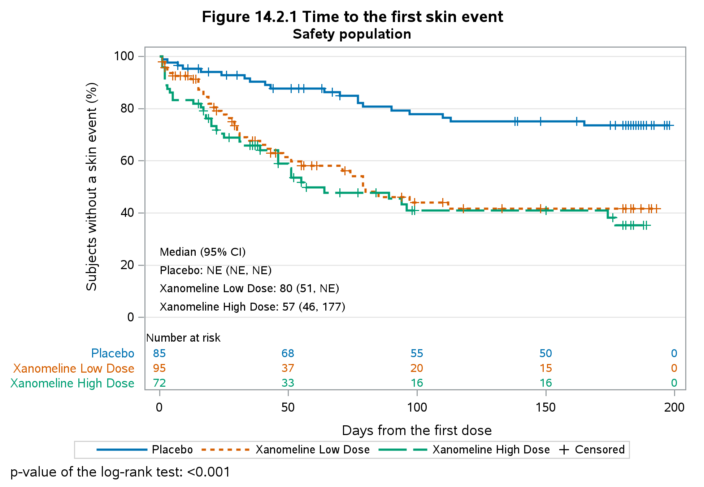

# Make a Kaplan-Meier figure with the number at risk

This guide shows how to draw the Kaplan-Meier curves of a time to an event by treatment, with the number at risk
under the axis, the median of each group, and the log-rank p-value in a footnote. You get a PNG file and an RTF file.

## Before you start

- Submit `examples/setup.sas`, or start your own program as [Use the macros in your own program](own-program.md)
  shows.
- Have one record per subject with the time (`aval`) and the censoring variable (`cnsr`, 1 = censored). If your
  data have no such parameter yet, step 1 derives it.
- Have the population, one row per subject (`adsl`), for the order of the curves.

## Steps

### 1. Derive the time to the event

Skip this step if your ADTTE has the parameter. The guide derives the time to the first treatment-emergent skin
event, from the first dose. A subject without an event is censored at the date of the last dose (`censor_date =
trtedt`). The call has no `end=`, so an event after the last dose still counts; give `end = trtedt` to count only
the events up to the end of treatment:

```sas
%tte(
     subjects      = adsl
   , events        = adae
   , event         = trtemfl = 'Y' AND aebodsys = 'SKIN AND SUBCUTANEOUS TISSUE DISORDERS'
   , date          = astdt
   , start         = trtsdt
   , censor_date   = trtedt
   , seq           = aeseq
   , censor_desc   = "End of treatment"
   , censor_source = "ADSL"
   , event_desc    = aedecod
   , source        = "ADAE"
   , paramcd       = "TTSKIN"
   , out           = ttskin
 )
```

```text
ttskin: the first 4 of 252 rows
USUBJID      TRT01A                PARAMCD  ADT        CNSR  AVAL  EVNTDESC
01-701-1015  Placebo               TTSKIN   02JUL2014     1   182  End of treatment
01-701-1023  Placebo               TTSKIN   07AUG2012     0     3  ERYTHEMA
01-701-1028  Xanomeline High Dose  TTSKIN   14JAN2014     1   180  End of treatment
01-701-1033  Xanomeline Low Dose   TTSKIN   31MAR2014     1    14  End of treatment
```

A subject with no event and no date of the last dose (`trtedt` missing) has neither an event nor a censoring, so
`%tte` writes no record for it. Find such subjects before you draw. The example data have two:

```sas
PROC SORT DATA=ttskin OUT=tte_ids(KEEP=usubjid) NODUPKEY; BY usubjid; RUN;
PROC SORT DATA=adsl OUT=adsl_ids(KEEP=usubjid trt01a trtsdt trtedt); BY usubjid; RUN;
DATA no_record;
  MERGE adsl_ids tte_ids(IN=in_tte);
  BY usubjid;
  IF NOT in_tte;
RUN;
```

```text
no_record: 2 rows
USUBJID      TRT01A               TRTSDT   TRTEDT
01-705-1018  Placebo              05JUL13
01-705-1382  Xanomeline Low Dose  13MAY13
```

These two subjects are in the N of their columns, which comes from `adsl`, but not in the curves: at day 0 the
Placebo curve has 85 subjects at risk of N=86, and the Xanomeline Low Dose curve 95 of N=96.

### 2. Summarize the curves and make the columns

Call `%km` for the median of each group and its confidence interval:

```sas
%km(data=ttskin, var=aval, by=trt01a, label="Time to the first skin event (days)", out=t_km)
```

```text
t_km where stat NE 'n' AND stat NE 'events': 9 rows
TRT01A                STAT    VALUE  TEXT
Placebo               median         NE
Placebo               lcl            NE
Placebo               ucl            NE
Xanomeline High Dose  median     57  57.0
Xanomeline High Dose  lcl        46  46.0
Xanomeline High Dose  ucl       177  177.0
Xanomeline Low Dose   median     80  80.0
Xanomeline Low Dose   lcl        51  51.0
Xanomeline Low Dose   ucl            NE
```

`NE` is a median or a limit that the curve does not reach: the Placebo curve stays above 50%. Then call `%columns` on
the result of `%km`: the columns give the order of the curves and their colors.

```sas
%columns(data=t_km, n=adsl, var=trt01a, order=trt01an, out=t_km_cols)
```

```text
t_km_cols: 3 rows
COL  COLVALUE              BIGN
  1  Placebo                 86
  2  Xanomeline Low Dose     96
  3  Xanomeline High Dose    72
```

### 3. Put the log-rank p-value into a footnote

Call `%logrank`, then keep the printed text of its p-value in a macro variable:

```sas
%logrank(data=ttskin, var=aval, by=trt01a, out=t_logrank)
DATA _NULL_;
  SET t_logrank;
  CALL SYMPUTX('pval', text);
RUN;
```

```text
t_logrank: 1 row
STAT        VALUE  TEXT
pval  3.216126E-6  <0.001
```

### 4. Draw the figure

Write the titles and the footnotes, then call `%kmplot`. `median = yes` writes the median of each group and its
confidence interval in the plot. `xlabel=` and `ylabel=` name the axes:

```sas
TITLE1 "Figure 14.2.1 Time to the first skin event";
TITLE2 "Safety population";
FOOTNOTE1 J=L "p-value of the log-rank test: &pval.";
%kmplot(
     data    = ttskin
   , columns = t_km_cols
   , time    = aval
   , by      = trt01a
   , median  = yes
   , xlabel  = "Days from the first dose"
   , ylabel  = "Subjects without a skin event (%)"
   , file    = &spl_out./figures/f_ttskin
   , out     = f_ttskin
 )
```



The number at risk under the axis counts the subjects whose time is the time of the tick or later. To choose the
ticks, give their times in `times=`, such as `times = 0 30 60 90 120 150 180`.

### 5. Check the numbers that the figure draws

`out=` keeps every number of the figure. Print the number at risk of each group:

```sas
PROC PRINT DATA=f_ttskin NOOBS;
  WHERE kind = 'atrisk';
  VAR trt01a x n;
RUN;
```

```text
f_ttskin where kind = 'atrisk': 15 rows
TRT01A                  X   N
Placebo                 0  85
Placebo                50  68
Placebo               100  55
Placebo               150  50
Placebo               200   0
Xanomeline High Dose    0  72
Xanomeline High Dose   50  33
Xanomeline High Dose  100  16
Xanomeline High Dose  150  16
Xanomeline High Dose  200   0
Xanomeline Low Dose     0  95
Xanomeline Low Dose    50  37
Xanomeline Low Dose   100  20
Xanomeline Low Dose   150  15
Xanomeline Low Dose   200   0
```

## Related

- Reference: [%tte](../reference/tte.md), [%km](../reference/km.md), [%columns](../reference/columns.md),
  [%logrank](../reference/logrank.md), [%kmplot](../reference/kmplot.md), [%cox](../reference/cox.md).
- Explanation: [How a program reads](../explanation/program.md).
