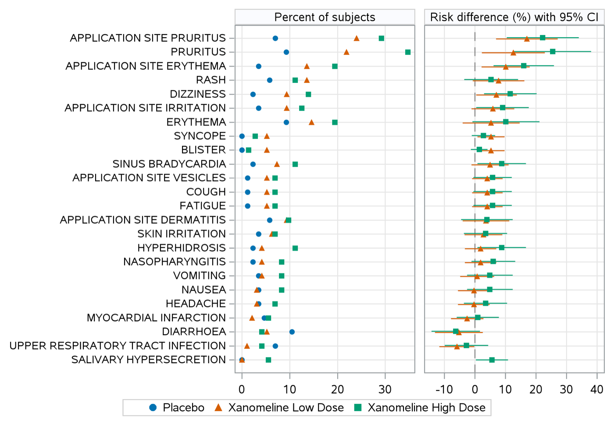

# %aeplot

Draws the percent and risk difference of each adverse event as PNG and RTF files and returns the numbers drawn.

**Procedure:** PROC SUMMARY, PROC SGPANEL (and PROC FREQ in %risk) · **Family:** [Figures](index.md#figures)

## Syntax

```sas
%aeplot(
     data      =
   , plot      =
   , par       =
   , columns   =
   , denom     =
   , where     =
   , term      = AEDECOD
   , by        =
   , reference =
   , threshold =
   , sort      = difference
   , ci        = wald
   , level     = 0.95
   , max       = 30
   , xlabel    =
   , file      =
   , width     = 6.5in
   , height    = 4.5in
   , out       =
   , outpar    =
   , debug     = no
 )
```

## Parameters

`data=`
:   The input data set: the adverse event records. *(required)*

`plot=`
:   Draw again: the `out=` of an earlier %aeplot call, changed or not. It is drawn as it is, and no statistic is computed. Give it instead of `data=`. *(optional)*

`par=`
:   The drawing parameters of an earlier %aeplot call: its `outpar=`. A drawing parameter given in the call wins over its row of `par=`. *(optional)*

`columns=`
:   The data set of [%columns](columns.md): it gives the order of the groups and their colours. When not given, the groups come in the order of `denom=`. *(optional)*

`denom=`
:   The population: a data set with one row per subject and the variable of `by=`. *(required)*

`where=`
:   The records to use: a condition in parentheses, such as where = (`trtemfl = 'Y'`). *(optional)*

`term=`
:   The term of a row: one variable of `data=` (`term = aebodsys`). *(optional, default `AEDECOD`)*

`by=`
:   The groups: one character variable of `denom=`. *(required)*

`reference=`
:   The reference group of the risk difference: a value of `by=`, in quotes (`reference = 'Placebo'`). *(required)*

`threshold=`
:   A percent: only the terms that this percent of the subjects of a group or more have, in at least one group (`threshold = 5`). *(optional)*

`sort=`
:   The order of the terms from the top: difference (the risk difference of the first group that is not the reference, the largest first), frequency (the percent of all subjects, the largest first) or alphabetical. *(optional, default `difference`)*
    Accepts: `difference`, `frequency`, `alphabetical`.

`ci=`
:   The type of the interval of the risk difference, as `ci=` of [%risk](risk.md). *(optional, default `wald`)*

`level=`
:   The confidence level: a number between 0 and 1. *(optional, default `0.95`)*

`max=`
:   The most terms to show: a positive whole number. The first terms in the order of `sort=` are shown. *(optional, default `30`)*

`xlabel=`
:   The heading of the right panel: a text in quotes. When not given, Risk difference (%) with 95% CI, with the level of `level=`. *(optional)*

`file=`
:   The output file without its extension: the macro writes &lt;file&gt;.png (300 dpi) and &lt;file&gt;.rtf. *(required)*

`width=`
:   The width of the figure: a length with its unit (`width = 9in`). *(optional, default `6.5in`)*

`height=`
:   The height of the figure: a length with its unit (`height = 6in`). *(optional, default `4.5in`)*

`out=`
:   The name of the data set of the numbers drawn. When not given, they are not kept. *(optional)*

`outpar=`
:   The name of the data set of the drawing parameters, one row each. Give it to `par=` of a later call to draw the figure again. *(optional)*

`debug=`
:   yes: keep the work data sets _aeplot_*. *(optional, default `no`)*
    Accepts: `yes`, `no`.

## Result

The data set of `out=`: the variable of `term=`, the variable of `by=`, KIND, X, LOWER, UPPER and N. A row of KIND percent is one term and group: X is the percent of its subjects and N the subjects with the term. A row of KIND difference is one term and group that is not the reference: X is the risk difference in percent (100 x RD of [%risk](risk.md)), and LOWER and UPPER its limits in percent. The data set of `outpar=`: one row per drawing parameter, in the order of the table: PARAMETER ($32), its name, and VALUE ($500), its value as drawn (a label in quotes). The files: &lt;file&gt;.png and &lt;file&gt;.rtf.

## Details

Use [%barplot](barplot.md) for the percents of the categories of one variable without a difference. The figure has two panels side by side that share the axis of the terms. The left panel shows the percent of the subjects of each group with the term, as dots. The right panel shows the risk difference of each group against the reference group, with its confidence interval and a line at 0. The flags are those of [%termflags](termflags.md) and the risk differences those of [%risk](risk.md) (ci=, `level=`), so the figure and a table made with them cannot differ. The terms are those that reach `threshold=`, in the order of `sort=`, at most `max=` of them. To draw the figure again without computing, give `plot=` the `out=` and `par=` the `outpar=` of an earlier call.

!!! note "Good to know"

    Draw again: `plot=` takes the `out=` of an earlier %aeplot call, changed or not, and draws it as it is, with no statistic computed: the terms from the top in the order of their first row (to drop or move a term, change its rows). `par=` takes the `outpar=` of that call and gives the drawing parameters: columns, term, by, xlabel, file, width, height. These change the picture, not the numbers. The other parameters compute (sort= and `max=` choose the rows of `out=` and their order); with `plot=` the log has a NOTE for each one given, as it is not used. A drawing parameter given in the call wins over its row of `par=`, and the row wins over the default of the table.

## Examples

The examples run on the [example data](../tutorial/index.md#the-example-data) after `examples/setup.sas`. The output under each call is the output of that run. They also read `t14_2_1_cols` (made by the [example of %columns](columns.md#examples)).

```sas
%aeplot(
     data      = adae
   , columns   = t14_2_1_cols
   , denom     = adsl
   , where     = (trtemfl = 'Y')
   , term      = aedecod
   , by        = trt01a
   , reference = "Placebo"
   , threshold = 5
   , file      = &spl_out./figures/f_ae_risk
   , out       = f_ae_risk
 )
```



## Messages

A wrong call writes the message and its fix to the log and stops. The macro also gives the [messages every macro shares](index.md#messages-every-macro-shares).

| Message | Fix |
|---|---|
| max=&lt;max&gt; is not a positive whole number | give max= the most terms to show, such as 30. |
| reference=&lt;reference&gt; is not a group of by=&lt;by&gt; in denom=&lt;denom&gt; | give reference= a value of &lt;by&gt; in quotes. |

## See also

Figures: [%kmplot](kmplot.md), [%forestplot](forestplot.md), [%meanplot](meanplot.md), [%lineplot](lineplot.md), [%boxplot](boxplot.md), [%barplot](barplot.md), [%profileplot](profileplot.md), [%scatterplot](scatterplot.md).

Named on this page: [%termflags](termflags.md), [%risk](risk.md), [%columns](columns.md).

## Proof

Checked against its known answers: numbers worked out independently in R, compared on SAS by the tests of the library.

The examples of this page ran on SAS 9.4M9 on 2026-11-27, with a log free of ERROR and WARNING.

[Source of %aeplot](https://github.com/datastep-labs/sapling-sas/blob/main/macros/aeplot.sas)
