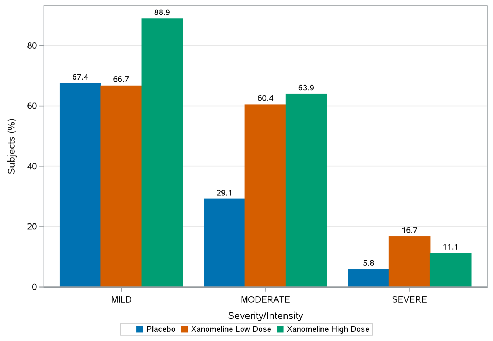

# %barplot

Draws bars of the percent of each category by group as PNG and RTF files and returns the numbers drawn.

**Procedure:** PROC FREQ, PROC SGPANEL · **Family:** [Figures](index.md#figures)

## Syntax

```sas
%barplot(
     data    =
   , plot    =
   , par     =
   , columns =
   , denom   =
   , where   =
   , var     =
   , by      =
   , panel   =
   , stat    = percent
   , stacked = no
   , labels  = yes
   , xlabel  =
   , ylabel  =
   , ref     =
   , file    =
   , width   = 6.5in
   , height  = 4.5in
   , out     =
   , outpar  =
   , debug   = no
 )
```

## Parameters

<a id="data"></a>`data=`
:   The input data set: one record per subject and category, or per event. *(required)*

<a id="plot"></a>`plot=`
:   Draw again: the `out=` of an earlier %barplot call, changed or not. It is drawn as it is, and no statistic is computed. Give it instead of `data=`. *(optional)*

<a id="par"></a>`par=`
:   The drawing parameters of an earlier %barplot call: its `outpar=`. A drawing parameter given in the call wins over its row of `par=`. *(optional)*

<a id="columns"></a>`columns=`
:   The data set of [%columns](columns.md): it gives the order of the groups and their colours. When not given, the groups come in the order of the data. *(optional)*

<a id="denom"></a>`denom=`
:   The population: a data set with one row per subject (USUBJID) and the variable of `by=`. Its subjects in a group are the N of the percent. When not given, the N is the records of the group. *(optional)*

<a id="where"></a>`where=`
:   The records to use: a condition in parentheses, such as `where = (anl01fl = 'Y')`. *(optional)*

<a id="var"></a>`var=`
:   The category: one variable (`var = aesev`). *(required)*

<a id="by"></a>`by=`
:   The groups: one variable, one colour per group. *(required)*

<a id="panel"></a>`panel=`
:   A variable: one panel per value (`panel = sex`). *(optional)*

<a id="stat"></a>`stat=`
:   The statistic of a bar: percent or count. *(optional, default `percent`)*
    Accepts: `percent`, `count`.

<a id="stacked"></a>`stacked=`
:   yes: stack the groups in one bar. *(optional, default `no`)*
    Accepts: `yes`, `no`.

<a id="labels"></a>`labels=`
:   yes: write the value on each bar. *(optional, default `yes`)*
    Accepts: `yes`, `no`.

<a id="xlabel"></a>`xlabel=`
:   The label of the x axis: a text in quotes. When not given, the label of `var=` (or its name). *(optional)*

<a id="ylabel"></a>`ylabel=`
:   The label of the y axis: a text in quotes. When not given, Subjects (%) or Records (%) for a percent, Subjects or Records for a count. *(optional)*

<a id="ref"></a>`ref=`
:   Reference lines on the y axis: one value or several, separated by blanks (`ref = 0 50`). *(optional)*

<a id="file"></a>`file=`
:   The output file without its extension: the macro writes &lt;file&gt;.png (300 dpi) and &lt;file&gt;.rtf. *(required)*

<a id="width"></a>`width=`
:   The width of the figure: a length with its unit (`width = 9in`). *(optional, default `6.5in`)*

<a id="height"></a>`height=`
:   The height of the figure: a length with its unit (`height = 6in`). *(optional, default `4.5in`)*

<a id="out"></a>`out=`
:   The name of the data set of the numbers drawn. When not given, they are not kept. *(optional)*

<a id="outpar"></a>`outpar=`
:   The name of the data set of the drawing parameters, one row each. Give it to `par=` of a later call to draw the figure again. *(optional)*

<a id="debug"></a>`debug=`
:   yes: keep the work data sets _barplot_*. *(optional, default `no`)*
    Accepts: `yes`, `no`.

## Result

The data set of `out=`: one row per bar: the variables of `panel=` and `by=`, KIND (bar), X (the category as printed), Y (the percent or the count), N (the subjects or the records of the bar) and DENOM (the N of the percent). A category with no record in a group has no bar. The data set of `outpar=`: one row per drawing parameter, in the order of the table: PARAMETER ($32), its name, and VALUE ($500), its value as drawn (a label in quotes). The files: &lt;file&gt;.png and &lt;file&gt;.rtf.

## Details

Use [%aeplot](aeplot.md) for adverse events with their risk differences. With `denom=`, a bar is the percent of the subjects of the group in the population, and a subject counts once in a category; without it, the percent of the records of the group. stat=count gives the count instead of the percent. The groups stand side by side, or stacked in one bar with stacked=yes; the value is written on each bar. A record with a missing category, group or panel is not used. To draw the figure again without computing, give `plot=` the `out=` and `par=` the `outpar=` of an earlier call.

!!! note "Good to know"

    Draw again: `plot=` takes the `out=` of an earlier %barplot call, changed or not, and draws it as it is, with no statistic computed: the categories in the order of their first row, and the value on a bar with one decimal unless every Y is its N (a count). `par=` takes the `outpar=` of that call and gives the drawing parameters: columns, by, panel, stacked, labels, xlabel, ylabel, ref, file, width, height. These change the picture, not the numbers. The other parameters compute; with `plot=` the log has a NOTE for each one given, as it is not used. A drawing parameter given in the call wins over its row of `par=`, and the row wins over the default of the table.

## Examples

The examples run on the [example data](../tutorial/index.md#the-example-data) after `examples/setup.sas`. The output under each call is the output of that run. They also read `t14_2_1_cols` (made by the [example of %columns](columns.md#ex-t14_2_1_cols)). All examples of the reference run as one program: [examples/reference.sas](https://github.com/datastep-labs/sapling-sas/blob/main/examples/reference.sas).

??? note "Before these examples: the calls that make their inputs"

    Run `examples/setup.sas`, then these calls from the examples of %describe, %anova, %freq, %chisq, %stack, %columns, in this order. Then the examples of this page run as shown.

    ```sas
    /* from the example of %describe */
    * Summarizes age in each group and in the Total: n, mean, SD, median, minimum and maximum.;
    %describe(
         data  = adsl
       , var   = age
       , by    = trt01a
       , total = yes
       , label = "Age (years)"
       , out   = age_describe
     )
    /* from the example of %anova */
    * Tests age across the three groups: one row, the p value of the F test.;
    %anova(
         data  = adsl
       , var   = age
       , by    = trt01a
       , label = "Age (years)"
       , out   = age_anova
     )
    /* from the example of %freq */
    * Counts each sex in each group and in the Total: n and the percent of the subjects of the group.;
    %freq(
         data  = adsl
       , var   = sex
       , by    = trt01a
       , total = yes
       , label = "Sex"
       , out   = sex_freq
     )
    /* from the example of %chisq */
    * Tests sex across the groups: one row, the p value of the chi square test.;
    %chisq(
         data  = adsl
       , var   = sex
       , by    = trt01a
       , label = "Sex"
       , out   = sex_chisq
     )
    /* from the example of %stack */
    * Stacks four results in the order of the table: RESULT and ORD tell where each row came from.;
    %stack(age_describe age_anova sex_freq sex_chisq, out=t14_2_1)
    /* from the example of %columns */
    * Makes the four columns with their N from adsl, the Total last, in the order of TRT01AN.;
    %columns(
         data  = t14_2_1
       , n     = adsl
       , var   = trt01a
       , order = trt01an
       , total = yes
       , out   = t14_2_1_cols
     )
    ```

<a id="ex-f_ae_sev"></a>

Draws the percent of the subjects with each severity in each group, of the N of denom=.

```sas
%barplot(
     data    = adae
   , columns = t14_2_1_cols
   , denom   = adsl
   , where   = (trtemfl = 'Y')
   , var     = aesev
   , by      = trt01a
   , file    = &spl_out./figures/f_ae_sev
   , out     = f_ae_sev
 )
```



## Messages

A wrong call writes the message and its fix to the log and stops. The macro also gives the [messages every macro shares](index.md#messages-every-macro-shares).

| Message | Fix |
|---|---|
| data= and plot= are both given | give data= to compute, or plot= to draw an out= again. |
| plot=&lt;plot&gt; does not exist | give plot= an out= of %barplot (make it first). |
| plot=&lt;plot&gt; has no variable &lt;variable&gt; | give plot= the shape of out=: &lt;the variables of out=&gt;. |
| par=&lt;par&gt; does not exist | give par= an outpar= of %barplot (make it first). |
| par=&lt;par&gt; has no variables PARAMETER and VALUE | give par= an outpar= of %barplot. |
| par=&lt;par&gt; has a row of no drawing parameter (with the PARAMETER of the record) | give par= rows of outpar= of %barplot only. |

## See also

Figures: [%kmplot](kmplot.md), [%forestplot](forestplot.md), [%meanplot](meanplot.md), [%lineplot](lineplot.md), [%boxplot](boxplot.md), [%aeplot](aeplot.md), [%profileplot](profileplot.md), [%scatterplot](scatterplot.md).

Named on this page: [%columns](columns.md).

## Proof

Its known answer: the counts and the percents, worked out by hand; ran on SAS 9.4 M9, 2026-11-27 (the cases of the 9 figure macros: 103 of 103 the same).

The known answers and test cases are kept with the development of the library, not in this repository.

The examples of this page ran on SAS 9.4 M9 on 2026-11-27, with a log free of ERROR and WARNING.

[Source of %barplot](https://github.com/datastep-labs/sapling-sas/blob/main/macros/barplot.sas)
