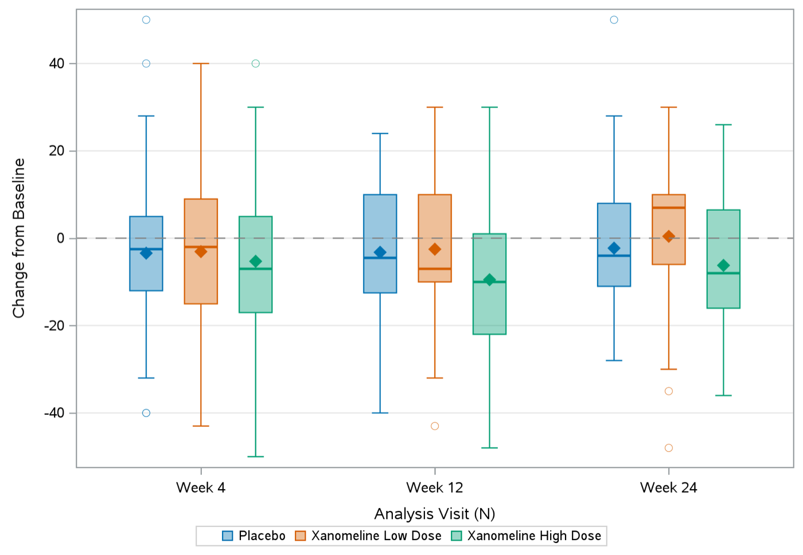

# %boxplot

Draws box plots of a variable in each group as PNG and RTF files and returns the numbers drawn.

**Procedure:** PROC MEANS, PROC SGPANEL · **Family:** [Figures](index.md#figures)

## Syntax

```sas
%boxplot(
     data     =
   , plot     =
   , par      =
   , columns  =
   , where    =
   , y        =
   , x        =
   , by       =
   , panel    =
   , outliers = yes
   , mean     = yes
   , xformat  =
   , xlabel   =
   , ylabel   =
   , ref      =
   , file     =
   , width    = 6.5in
   , height   = 4.5in
   , out      =
   , outpar   =
   , debug    = no
 )
```

## Parameters

`data=`
:   The input data set: one record per value. *(required)*

`plot=`
:   Draw again: the `out=` of an earlier %boxplot call, changed or not. It is drawn as it is, and no statistic is computed. Give it instead of `data=`. *(optional)*

`par=`
:   The drawing parameters of an earlier %boxplot call: its `outpar=`. A drawing parameter given in the call wins over its row of `par=`. *(optional)*

`columns=`
:   The data set of [%columns](columns.md): it gives the order of the groups and their colours. When not given, the groups come in the order of the data. *(optional)*

`where=`
:   The records to use: a condition in parentheses, such as where = (`anl01fl = 'Y'`). *(optional)*

`y=`
:   The variable of the boxes: one numeric variable (`y = aval`). *(required)*

`x=`
:   The category of the x axis: one variable, such as the visit (`x = avisitn`). When not given, there is one box per group. *(optional)*

`by=`
:   The groups: one variable, one box per group. *(required)*

`panel=`
:   A variable: one panel per value, one under the other, each with its own y axis (`panel = paramcd`). *(optional)*

`outliers=`
:   yes: show the values beyond the whiskers as markers. *(optional, default `yes`)*
    Accepts: `yes`, `no`.

`mean=`
:   yes: show the mean as a marker in the box. *(optional, default `yes`)*
    Accepts: `yes`, `no`.

`xformat=`
:   The format of the categories of x, as in a FORMAT statement (`xformat = visfmt.`). When not given, the format of x. *(optional)*

`xlabel=`
:   The label of the x axis: a text in quotes. When not given, the label of `x=` (or its name). *(optional)*

`ylabel=`
:   The label of the y axis: a text in quotes. When not given, the label of `y=` (or its name). *(optional)*

`ref=`
:   Reference lines on the y axis: one value or several, separated by blanks (`ref = 0 50`). *(optional)*

`file=`
:   The output file without its extension: the macro writes &lt;file&gt;.png (300 dpi) and &lt;file&gt;.rtf. *(required)*

`width=`
:   The width of the figure: a length with its unit (`width = 9in`). *(optional, default `6.5in`)*

`height=`
:   The height of the figure: a length with its unit (`height = 6in`). *(optional, default `4.5in`)*

`out=`
:   The name of the data set of the numbers drawn. When not given, they are not kept. *(optional)*

`outpar=`
:   The name of the data set of the drawing parameters, one row each. Give it to `par=` of a later call to draw the figure again. *(optional)*

`debug=`
:   yes: keep the work data sets _boxplot_*. *(optional, default `no`)*
    Accepts: `yes`, `no`.

## Result

The data set of `out=`: one row per box: the variables of `panel=` and `by=`, KIND (box), X (the category; missing without `x=`), N, MEAN, MEDIAN, Q1, Q3, MIN, MAX, WLOW and WHIGH. WLOW and WHIGH are the ends of the whiskers: the smallest and the largest value within Q1 - 1.5 IQR and Q3 + 1.5 IQR. The data set of `outpar=`: one row per drawing parameter, in the order of the table: PARAMETER ($32), its name, and VALUE ($500), its value as drawn (a label in quotes). The files: &lt;file&gt;.png and &lt;file&gt;.rtf.

## Details

Use [%meanplot](meanplot.md) for the mean and its error bars only. With `x=`, there is one box per group at each visit. The box goes from Q1 to Q3, with a line at the median and a marker at the mean. The whiskers go to the most extreme values within 1.5 times the interquartile range of the box; the values beyond them are outliers. The quantiles are those of PROC MEANS with QNTLDEF=5 and of VBOX (its default PERCENTILE=5; R quantile type 2). A record with a missing value, category, group or panel is not used. To draw the figure again without computing, give `plot=` the `out=` and `par=` the `outpar=` of an earlier call.

!!! note "Good to know"

    Draw again: `plot=` takes the `out=` of an earlier %boxplot call, changed or not, and draws it as it is, with no statistic computed, each box from its statistics: the whiskers from WLOW to WHIGH, the box from Q1 to Q3 with the line of the MEDIAN, the MEAN, and as outliers only MIN and MAX when they are beyond a whisker (out= has no other value; from `data=` every outlier is drawn). `par=` takes the `outpar=` of that call and gives the drawing parameters: columns, by, panel, outliers, mean, xformat, xlabel, ylabel, ref, file, width, height. These change the picture, not the numbers. The other parameters compute; with `plot=` the log has a NOTE for each one given, as it is not used. A drawing parameter given in the call wins over its row of `par=`, and the row wins over the default of the table.

## Examples

The examples run on the [example data](../tutorial/index.md#the-example-data) after `examples/setup.sas`. The output under each call is the output of that run. They also read `t14_2_1_cols` (made by the [example of %columns](columns.md#examples)).

```sas
%boxplot(
     data    = advs
   , columns = t14_2_1_cols
   , where   = (paramcd = 'SYSBP' AND anl01fl = 'Y' AND avisitn IN (4 12 24))
   , y       = chg
   , x       = avisitn
   , by      = trt01a
   , xformat = VISIT.
   , ref     = 0
   , file    = &spl_out./figures/f_sbp_box
   , out     = f_sbp_box
 )
```



## Messages

The macro gives only the [messages every macro shares](index.md#messages-every-macro-shares).

## See also

Figures: [%kmplot](kmplot.md), [%forestplot](forestplot.md), [%meanplot](meanplot.md), [%lineplot](lineplot.md), [%barplot](barplot.md), [%aeplot](aeplot.md), [%profileplot](profileplot.md), [%scatterplot](scatterplot.md).

Named on this page: [%columns](columns.md).

## Proof

Checked against its known answers: numbers worked out independently in R, compared on SAS by the tests of the library.

The examples of this page ran on SAS 9.4M9 on 2026-11-27, with a log free of ERROR and WARNING.

[Source of %boxplot](https://github.com/datastep-labs/sapling-sas/blob/main/macros/boxplot.sas)
