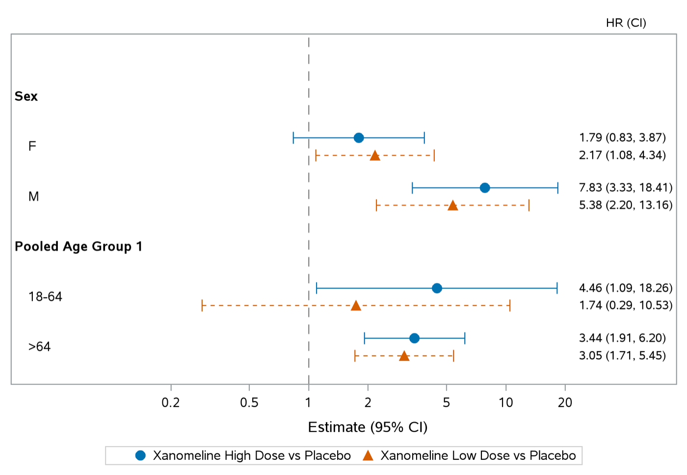

# %forestplot

Draws a forest plot of estimates in subgroups as PNG and RTF files and returns the numbers drawn.

**Procedure:** PROC SUMMARY, PROC SGPLOT · **Family:** [Figures](index.md#figures)

## Syntax

```sas
%forestplot(
     data     =
   , plot     =
   , par      =
   , columns  =
   , where    =
   , estimate =
   , lower    = lcl
   , upper    = ucl
   , within   =
   , group    =
   , by       =
   , scale    = log
   , text     = yes
   , xlabel   = "Estimate (95% CI)"
   , ref      = 1
   , file     =
   , width    = 6.5in
   , height   = 4.5in
   , out      =
   , outpar   =
   , debug    = no
 )
```

## Parameters

`data=`
:   The input data set: a result (rows of STAT and VALUE) of a comparison called with `within=`, with the variables of `within=`. *(required)*

`plot=`
:   Draw again: the `out=` of an earlier %forestplot call, changed or not. It is drawn as it is, and no statistic is computed. Give it instead of `data=`. *(optional)*

`par=`
:   The drawing parameters of an earlier %forestplot call: its `outpar=`. A drawing parameter given in the call wins over its row of `par=`. *(optional)*

`columns=`
:   The data set of [%columns](columns.md): it gives the order of the groups and their colours. When not given, the groups come in the order of the data. *(optional)*

`where=`
:   The rows of the result to use: a condition in parentheses, such as `where = (versus = 'Placebo')`. *(optional)*

`estimate=`
:   The statistic of the estimate: a value of STAT, such as hr, or, irr, rr, rd or diff. *(required)*

`lower=`
:   The statistic of the lower limit: a value of STAT. *(optional, default `lcl`)*

`upper=`
:   The statistic of the upper limit: a value of STAT. *(optional, default `ucl`)*

`within=`
:   The factors: variables of the result separated by blanks, one per factor, in the order of the rows (`within = sex agegr1`). A row belongs to the first of them that has a value. *(required)*

`group=`
:   A variable with the heading of each factor. When not given, the heading is the label of the variable of `within=`. *(optional)*

`by=`
:   The group of a pair: a variable of the result. When the result has VERSUS, the pair is the group of `by=` against VERSUS. Each pair has its own colour. *(optional)*

`scale=`
:   The scale of the x axis: log (for a ratio) or linear (for a difference). *(optional, default `log`)*
    Accepts: `log`, `linear`.

`text=`
:   yes: write the estimate and its limits, as "estimate (lower, upper)", at the right under the name of the statistic, with the n when the result has a statistic n. *(optional, default `yes`)*
    Accepts: `yes`, `no`.

`xlabel=`
:   The label of the x axis: a text in quotes. *(optional, default `"Estimate (95% CI)"`)*

`ref=`
:   The line of no difference on the x axis: one value, 1 for a ratio or 0 for a difference. *(optional, default `1`)*

`file=`
:   The output file without its extension: the macro writes &lt;file&gt;.png (300 dpi) and &lt;file&gt;.rtf. *(required)*

`width=`
:   The width of the figure: a length with its unit (`width = 9in`). *(optional, default `6.5in`)*

`height=`
:   The height of the figure: a length with its unit (`height = 6in`). *(optional, default `4.5in`)*

`out=`
:   The name of the data set of the numbers drawn. When not given, they are not kept. *(optional)*

`outpar=`
:   The name of the data set of the drawing parameters, one row each. Give it to `par=` of a later call to draw the figure again. *(optional)*

`debug=`
:   yes: keep the work data sets _forestplot_*. *(optional, default `no`)*
    Accepts: `yes`, `no`.

## Result

The data set of `out=`: one row per level and pair: FACTOR (the variable of `within=`), LEVEL (its value as printed), PAIR (the group of `by=` against VERSUS; blank without `by=`), KIND (estimate), X (the estimate), LOWER, UPPER and N (missing when the result has no statistic n). The data set of `outpar=`: one row per drawing parameter, in the order of the table: PARAMETER ($32), its name, and VALUE ($500), its value as drawn (a label in quotes). The files: &lt;file&gt;.png and &lt;file&gt;.rtf.

## Details

It computes no statistic: it draws a result of [%cox](cox.md), [%logistic](logistic.md), [%rateratio](rateratio.md), [%lsmeans](lsmeans.md) or [%risk](risk.md) called with `within=`, so the figure and the table of the same result cannot differ. A result is the data set a statistics macro writes, one row per number. For the test of the treatment-by-subgroup interaction, use the %interaction_* macros. Each factor of `within=` has a heading row, with one row per level under it. The estimate is a marker and its confidence interval a bar; a line marks no difference. A ratio has a log axis (scale=log). With text=yes, the estimate and its limits are also written as text at the right. To draw the figure again without computing, give `plot=` the `out=` and `par=` the `outpar=` of an earlier call.

!!! note "Good to know"

    Draw again: `plot=` takes the `out=` of an earlier %forestplot call, changed or not, and draws it as it is, with no statistic computed: the factors, levels and pairs in the order of its rows, each factor under the heading of its name. `par=` takes the `outpar=` of that call and gives the drawing parameters: columns, estimate (with `plot=` only for the name over the text column), scale, text, xlabel, ref, file, width, height. These change the picture, not the numbers. The other parameters compute; with `plot=` the log has a NOTE for each one given, as it is not used. A drawing parameter given in the call wins over its row of `par=`, and the row wins over the default of the table.

## Examples

The examples run on the [example data](../tutorial/index.md#the-example-data) after `examples/setup.sas`. The output under each call is the output of that run. They also read `hr_sub` (made by the [example of %stack](stack.md#examples)), `t14_2_1_cols` (made by the [example of %columns](columns.md#examples)). All examples of the reference run as one program: [examples/reference.sas](https://github.com/datastep-labs/sapling-sas/blob/main/examples/reference.sas).

Draws the hazard ratios of each subgroup on a log scale, with the reference line at 1.

```sas
%forestplot(
     data     = hr_sub
   , columns  = t14_2_1_cols
   , estimate = hr
   , within   = sex agegr1
   , by       = trt01a
   , scale    = log
   , ref      = 1
   , file     = &spl_out./figures/f_hr_sub
   , out      = f_hr_sub
 )
```



## Messages

A wrong call writes the message and its fix to the log and stops. The macro also gives the [messages every macro shares](index.md#messages-every-macro-shares).

| Message | Fix |
|---|---|
| data=&lt;data&gt; has no STAT and VALUE: it is not a result | give data= the out= of a comparison with within=. |
| estimate=&lt;estimate&gt; is not a statistic (STAT) of data=&lt;data&gt;. | give estimate= a statistic of the results (hr, or, rd). |
| data= and plot= are both given | give data= to compute, or plot= to draw an out= again. |
| plot=&lt;plot&gt; does not exist | give plot= an out= of &lt;macro&gt; (make it first). |
| plot=&lt;plot&gt; has no variable &lt;miss&gt; | give plot= the shape of out=: &lt;shape&gt;. |
| par=&lt;par&gt; does not exist | give par= an outpar= of &lt;macro&gt; (make it first). |
| par=&lt;par&gt; has no variables PARAMETER and VALUE | give par= an outpar= of &lt;macro&gt;. |
| par=&lt;par&gt; has a row of no drawing parameter (with the PARAMETER of the record) | give par= rows of outpar= of &lt;macro&gt; only. |

## See also

Figures: [%kmplot](kmplot.md), [%meanplot](meanplot.md), [%lineplot](lineplot.md), [%boxplot](boxplot.md), [%barplot](barplot.md), [%aeplot](aeplot.md), [%profileplot](profileplot.md), [%scatterplot](scatterplot.md).

Named on this page: [%columns](columns.md), [%cox](cox.md), [%logistic](logistic.md), [%rateratio](rateratio.md), [%lsmeans](lsmeans.md), [%risk](risk.md).

## Proof

Its known answer: made-up results, arranged by hand; ran on SAS 9.4 M9, 2026-11-27 (the cases of the 9 figure macros: 103 of 103 the same).

The known answers and test cases are kept with the development of the library, not in this repository.

The examples of this page ran on SAS 9.4 M9 on 2026-11-27, with a log free of ERROR and WARNING.

[Source of %forestplot](https://github.com/datastep-labs/sapling-sas/blob/main/macros/forestplot.sas)
