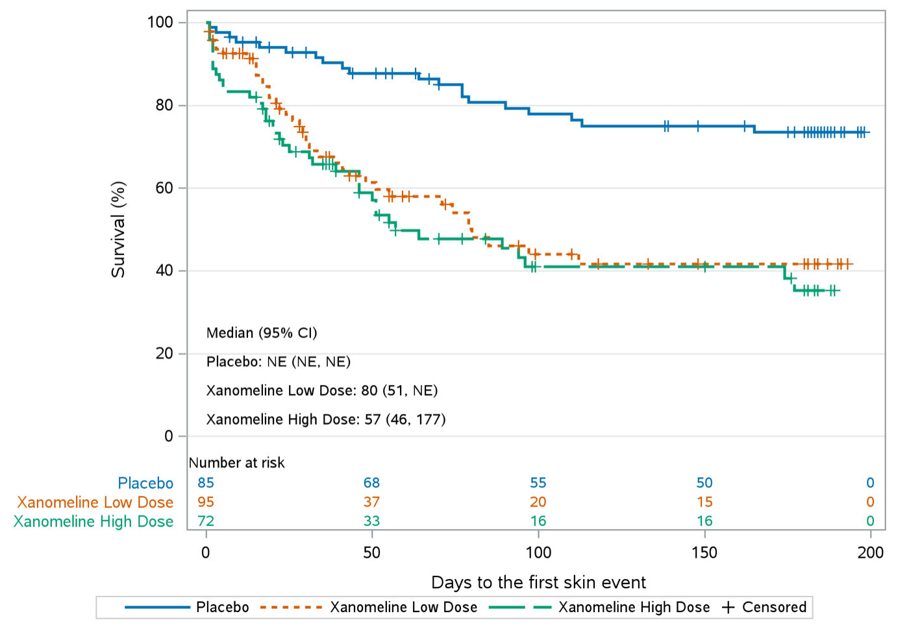
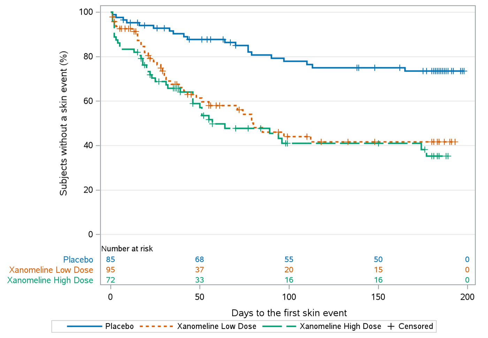

# %kmplot

Draws the Kaplan-Meier curve of each group as PNG and RTF files and returns the numbers drawn.

**Procedure:** PROC LIFETEST, PROC SUMMARY, PROC SGPANEL · **Family:** [Figures](index.md#figures)

## Syntax

```sas
%kmplot(
     data     =
   , plot     =
   , par      =
   , columns  =
   , where    =
   , time     =
   , cnsr     = CNSR
   , by       =
   , panel    =
   , atrisk   = yes
   , times    =
   , median   = no
   , conftype = linear
   , level    = 0.95
   , xlabel   =
   , ylabel   = "Survival (%)"
   , ref      =
   , file     =
   , width    = 6.5in
   , height   = 4.5in
   , out      =
   , outpar   =
   , debug    = no
 )
```

## Parameters

`data=`
:   The input data set: one record per subject, such as a time-to-event data set. Required unless `plot=` is given. *(required unless plot= is given)*

`plot=`
:   Draw again: the `out=` of an earlier %kmplot call, changed or not. It is drawn as it is, and no statistic is computed. Give it instead of `data=`. *(optional)*

`par=`
:   The drawing parameters of an earlier %kmplot call: its `outpar=`. A drawing parameter given in the call wins over its row of `par=`. *(optional)*

`columns=`
:   The data set of [%columns](columns.md): it gives the order of the groups and their colours. When not given, the groups come in the order of the data. *(optional)*

`where=`
:   The records to use: a condition in parentheses, such as `where = (anl01fl = 'Y')`. *(optional)*

`time=`
:   The time variable: one numeric variable (`time = aval`). Required unless `plot=` is given. *(required unless plot= is given)*

`cnsr=`
:   The censoring variable: one numeric variable, 0 for an event and a positive value for a censoring (the ADaM CNSR: 1, 2 ... name the reason). A missing or negative value on a record used stops the macro with an ERROR. *(optional, default `CNSR`)*

`by=`
:   The groups: one variable, one curve per group. *(required)*

`panel=`
:   A variable: one panel per value (`panel = sex`). *(optional)*

`atrisk=`
:   yes: show the number at risk under the axis. *(optional, default `yes`)*
    Accepts: `yes`, `no`.

`times=`
:   The ticks of the x axis and the times of the number at risk: numbers separated by blanks (`times = 0 30 60 90`). When not given, the ticks go from 0 by a round step (1, 2, 2.5 or 5 times a power of 10) to the first tick at or after the longest time. *(optional)*

`median=`
:   yes: show the median time of each group and its confidence interval as text in the plot. *(optional, default `no`)*
    Accepts: `yes`, `no`.

`conftype=`
:   The type of the confidence interval of the median, as CONFTYPE= of PROC LIFETEST: linear, log, loglog, asinsqrt or logit. *(optional, default `linear`)*
    Accepts: `linear`, `log`, `loglog`, `asinsqrt`, `logit`.

`level=`
:   The confidence level of the interval of the median: a number between 0 and 1. *(optional, default `0.95`)*

`xlabel=`
:   The label of the x axis: a text in quotes. When not given, the label of `time=` (or its name). *(optional)*

`ylabel=`
:   The label of the y axis: a text in quotes. *(optional, default `"Survival (%)"`)*

`ref=`
:   Reference lines on the y axis: one value or several, separated by blanks (`ref = 0 50`). *(optional)*

`file=`
:   The output file without its extension: the macro writes &lt;file&gt;.png (300 dpi) and &lt;file&gt;.rtf. *(required)*

`width=`
:   The width of the figure: a length with its unit (`width = 9in`). *(optional, default `6.5in`)*

`height=`
:   The height of the figure: a length with its unit (`height = 6in`). *(optional, default `4.5in`)*

`out=`
:   The name of the data set of the numbers drawn. When not given, they are not kept. *(optional)*

`outpar=`
:   The name of the data set of the drawing parameters, one row each. Give it to `par=` of a later call to draw the figure again. *(optional)*

`debug=`
:   yes: keep the work data sets _kmplot_*. *(optional, default `no`)*
    Accepts: `yes`, `no`.

## Result

The data set of `out=`: one row per number drawn, with the variables of `panel=` and `by=`, KIND, X, Y, LOWER, UPPER, N and CENSORED. In a row of KIND curve, X is a time (0 and each time with an event or a censoring), Y the survival in percent after it, and CENSORED is 1 when a subject is censored at it. In a row of KIND atrisk, X is a tick and N the number at risk. In a row of KIND median, X is the median and LOWER and UPPER its limits (missing: not reached). The data set of `outpar=`: one row per drawing parameter, in the order of the table: PARAMETER ($32), its name, and VALUE ($500), its value as drawn (a label in quotes). The files: &lt;file&gt;.png and &lt;file&gt;.rtf.

## Details

Use [%km](km.md) for the Kaplan-Meier estimates in a table; %kmplot computes its own curve with PROC LIFETEST. The survival is in percent, drawn as steps, with a mark at each censored time. Under the axis is the number at risk at each tick: the subjects whose time is that tick or later. With median=yes, the plot also shows the median time of each group and its confidence interval (NE: not reached). A record with a missing time, group or panel is not used. CNSR 0 is an event and any positive value is a censoring, as in ADaM, where the value names the reason of the censoring: a CNSR of 2 is censored as 1 is. A record used with a missing or negative CNSR stops the macro with an ERROR. To draw the figure again without computing, give `plot=` the `out=` and `par=` the `outpar=` of an earlier call.

!!! note "Good to know"

    Draw again: `plot=` takes the `out=` of an earlier %kmplot call, changed or not, and draws it as it is, with no statistic computed. `par=` takes the `outpar=` of that call and gives the drawing parameters: columns, by, panel, atrisk, median, level (with `plot=` only for the heading of the medians), xlabel, ylabel, ref, file, width, height. These change the picture, not the numbers. The other parameters compute; with `plot=` the log has a NOTE for each one given, as it is not used. A drawing parameter given in the call wins over its row of `par=`, and the row wins over the default of the table. With `plot=`, the ticks are the X of the rows of KIND atrisk.

## Examples

The examples run on the [example data](../tutorial/index.md#the-example-data) after `examples/setup.sas`. The output under each call is the output of that run. They also read `adttde` (made by the [example of %tte](tte.md#examples)), `t14_2_1_cols` (made by the [example of %columns](columns.md#examples)). All examples of the reference run as one program: [examples/reference.sas](https://github.com/datastep-labs/sapling-sas/blob/main/examples/reference.sas).

Draws the curves with the number at risk and the median of each group, and keeps the numbers.

```sas
%kmplot(
     data    = adttde
   , columns = t14_2_1_cols
   , time    = aval
   , by      = trt01a
   , median  = yes
   , xlabel  = "Days to the first skin event"
   , file    = &spl_out./figures/f_ttde
   , out     = f_ttde
   , outpar  = f_ttde_par
 )
```



Draws the figure again from out= and outpar= of the call before: no median, another label.

```sas
%kmplot(
     plot   = f_ttde
   , par    = f_ttde_par
   , by     = trt01a
   , median = no
   , ylabel = "Subjects without a skin event (%)"
   , file   = &spl_out./figures/f_ttde_again
 )
```



## Messages

A wrong call writes the message and its fix to the log and stops. The macro also gives the [messages every macro shares](index.md#messages-every-macro-shares).

| Message | Fix |
|---|---|
| times=&lt;times&gt; is not a list of numbers | give times= the ticks separated by blanks: 0 30 60 90. |
| plot=&lt;plot&gt; has no row of KIND atrisk: its X are the ticks | give plot= its rows of KIND atrisk (atrisk=no hides them). |
| cnsr=&lt;cnsr&gt; is missing or negative on &lt;nbad&gt; record(s) used | give each record CNSR 0 (an event) or more (a censoring). |
| data= and plot= are both given | give data= to compute, or plot= to draw an out= again. |
| plot=&lt;plot&gt; does not exist | give plot= an out= of &lt;macro&gt; (make it first). |
| plot=&lt;plot&gt; has no variable &lt;miss&gt; | give plot= the shape of out=: &lt;shape&gt;. |
| par=&lt;par&gt; does not exist | give par= an outpar= of &lt;macro&gt; (make it first). |
| par=&lt;par&gt; has no variables PARAMETER and VALUE | give par= an outpar= of &lt;macro&gt;. |
| par=&lt;par&gt; has a row of no drawing parameter (with the PARAMETER of the record) | give par= rows of outpar= of &lt;macro&gt; only. |

## See also

Figures: [%forestplot](forestplot.md), [%meanplot](meanplot.md), [%lineplot](lineplot.md), [%boxplot](boxplot.md), [%barplot](barplot.md), [%aeplot](aeplot.md), [%profileplot](profileplot.md), [%scatterplot](scatterplot.md).

Named on this page: [%columns](columns.md), [%km](km.md).

Guides that use %kmplot: [Make a Kaplan-Meier figure with the number at risk](../how-to/kaplan-meier-figure.md).

## Proof

Its known answer: the survival and the number at risk, worked out by hand; ran on SAS 9.4 M9, 2026-11-27 (the cases of the 9 figure macros: 103 of 103 the same).

The known answers and test cases are kept with the development of the library, not in this repository.

The examples of this page ran on SAS 9.4 M9 on 2026-11-27, with a log free of ERROR and WARNING.

Used in the proof against pharmaverse: [f14_1](https://github.com/datastep-labs/sapling-sas/blob/main/proof/pilot1/programs/f14_1.sas) (R Submission Pilot 1). See [what the proof shows](../explanation/proof.md).

[Source of %kmplot](https://github.com/datastep-labs/sapling-sas/blob/main/macros/kmplot.sas)
