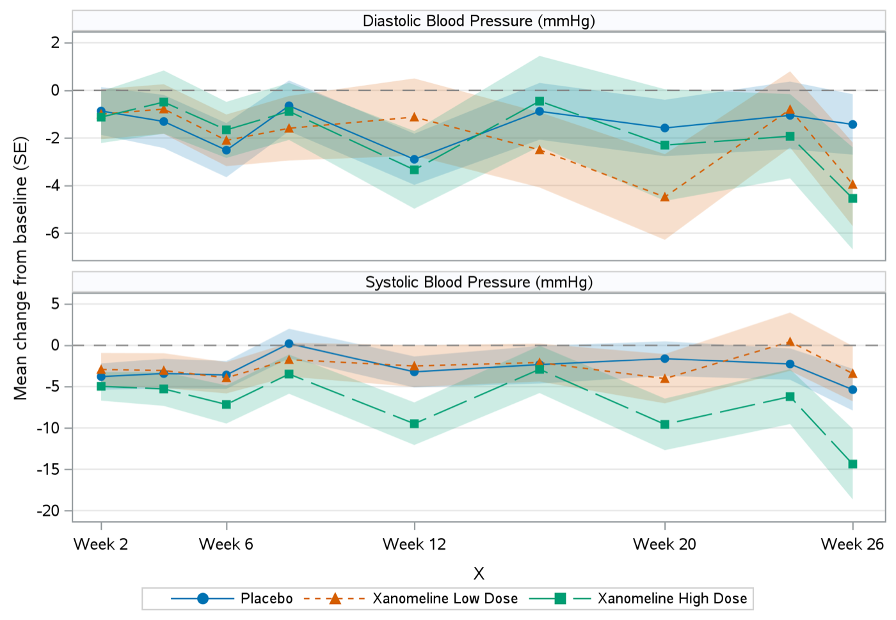

# %lineplot

Draws lines through given values, one line per group, as PNG and RTF files and returns the numbers drawn.

**Procedure:** PROC SGPANEL · **Family:** [Figures](index.md#figures)

## Syntax

```sas
%lineplot(
     data    =
   , plot    =
   , par     =
   , columns =
   , where   =
   , x       =
   , y       =
   , by      =
   , panel   =
   , lower   =
   , upper   =
   , band    = no
   , xformat =
   , xlabel  =
   , ylabel  =
   , ref     =
   , file    =
   , width   = 6.5in
   , height  = 4.5in
   , out     =
   , outpar  =
   , debug   = no
 )
```

## Parameters

`data=`
:   The input data set: one row per group and x. *(required)*

`plot=`
:   Draw again: the `out=` of an earlier %lineplot call, changed or not. It is drawn as it is, and no statistic is computed. Give it instead of `data=`. *(optional)*

`par=`
:   The drawing parameters of an earlier %lineplot call: its `outpar=`. A drawing parameter given in the call wins over its row of `par=`. *(optional)*

`columns=`
:   The data set of [%columns](columns.md): it gives the order of the groups and their colours. When not given, the groups come in the order of the data. *(optional)*

`where=`
:   The rows to use: a condition in parentheses, such as `where = (paramcd = 'SYSBP')`. *(optional)*

`x=`
:   The x: one numeric variable (`x = avisitn`). *(required)*

`y=`
:   The value: one numeric variable (`y = estimate`). *(required)*

`by=`
:   The groups: one variable, one line per group. *(required)*

`panel=`
:   A variable: one panel per value, one under the other, each with its own y axis (`panel = paramcd`). *(optional)*

`lower=`
:   The lower end of the interval: one numeric variable. Give `upper=` with it. *(optional)*

`upper=`
:   The upper end of the interval: one numeric variable. Give `lower=` with it. *(optional)*

`band=`
:   yes: draw the interval as a band; no: as error bars. *(optional, default `no`)*
    Accepts: `yes`, `no`.

`xformat=`
:   The format of the ticks of x, as in a FORMAT statement (`xformat = visfmt.`). When not given, the format of x. *(optional)*

`xlabel=`
:   The label of the x axis: a text in quotes. When not given, the label of `x=` (or its name). *(optional)*

`ylabel=`
:   The label of the y axis: a text in quotes. When not given, the label of `y=` (or its name). *(optional)*

`ref=`
:   Reference lines on the y axis: one value or several, separated by blanks (`ref = 0 50`). *(optional)*

`file=`
:   The output file without its extension: the macro writes &lt;file&gt;.png (300 dpi) and &lt;file&gt;.rtf. *(required)*

`width=`
:   The width of the figure: a length with its unit (`width = 9in`). *(optional, default `6.5in`)*

`height=`
:   The height of the figure: a length with its unit (`height = 6in`). *(optional, default `4.5in`)*

`out=`
:   The name of the data set of the numbers drawn. When not given, they are not kept. *(optional)*

`outpar=`
:   The name of the data set of the drawing parameters, one row each. Give it to `par=` of a later call to draw the figure again. *(optional)*

`debug=`
:   yes: keep the work data sets _lineplot_*. *(optional, default `no`)*
    Accepts: `yes`, `no`.

## Result

The data set of `out=`: one row per panel, group and x: the variables of `panel=` and `by=`, KIND (line), X, Y, LOWER and UPPER. The data set of `outpar=`: one row per drawing parameter, in the order of the table: PARAMETER ($32), its name, and VALUE ($500), its value as drawn (a label in quotes). The files: &lt;file&gt;.png and &lt;file&gt;.rtf.

## Details

It computes nothing: use it for values computed before (the LS means of [%lsmeans](lsmeans.md) or [%mmrm](mmrm.md) by visit, a rate by month), and [%meanplot](meanplot.md) to compute the mean of the records. The interval of `lower=` and `upper=` is drawn as error bars, with the groups a little apart on the x axis, or as a band. A row with a missing x, group or panel is not used. To draw the figure again without computing, give `plot=` the `out=` and `par=` the `outpar=` of an earlier call.

!!! note "Good to know"

    Draw again: `plot=` takes the `out=` of an earlier %lineplot call, changed or not, and draws it as it is, with no statistic computed (an interval where LOWER has a value). `par=` takes the `outpar=` of that call and gives the drawing parameters: columns, by, panel, band, xformat, xlabel, ylabel, ref, file, width, height. These change the picture, not the numbers. The other parameters choose the values; with `plot=` the log has a NOTE for each one given, as it is not used. A drawing parameter given in the call wins over its row of `par=`, and the row wins over the default of the table.

## Examples

The examples run on the [example data](../tutorial/index.md#the-example-data) after `examples/setup.sas`. The output under each call is the output of that run. They also read `f_bp_mean` (made by the [example of %meanplot](meanplot.md#examples)), `t14_2_1_cols` (made by the [example of %columns](columns.md#examples)).

Draws the means that meanplot kept as lines, with a band between the limits.

```sas
%lineplot(
     data    = f_bp_mean
   , columns = t14_2_1_cols
   , x       = x
   , y       = y
   , by      = trt01a
   , panel   = param
   , lower   = lower
   , upper   = upper
   , band    = yes
   , xformat = VISIT.
   , ylabel  = "Mean change from baseline (SE)"
   , ref     = 0
   , file    = &spl_out./figures/f_bp_line
   , out     = f_bp_line
 )
```



## Messages

A wrong call writes the message and its fix to the log and stops. The macro also gives the [messages every macro shares](index.md#messages-every-macro-shares).

| Message | Fix |
|---|---|
| lower= and upper= come together | give both ends of the interval, or neither. |
| x=&lt;x&gt; is a character variable | give x= a numeric variable (AVISITN), xformat= labels. |

## See also

Figures: [%kmplot](kmplot.md), [%forestplot](forestplot.md), [%meanplot](meanplot.md), [%boxplot](boxplot.md), [%barplot](barplot.md), [%aeplot](aeplot.md), [%profileplot](profileplot.md), [%scatterplot](scatterplot.md).

Named on this page: [%columns](columns.md), [%lsmeans](lsmeans.md), [%mmrm](mmrm.md).

Guides that use %lineplot: [Run the examples of the reference](../how-to/run-the-examples.md).

## Proof

Checked against its known answers: numbers worked out independently in R and compared on SAS by the tests of the library (the tests are kept with the development of the library, not in this repository).

The examples of this page ran on SAS 9.4M9 on 2026-11-27, with a log free of ERROR and WARNING.

[Source of %lineplot](https://github.com/datastep-labs/sapling-sas/blob/main/macros/lineplot.sas)
