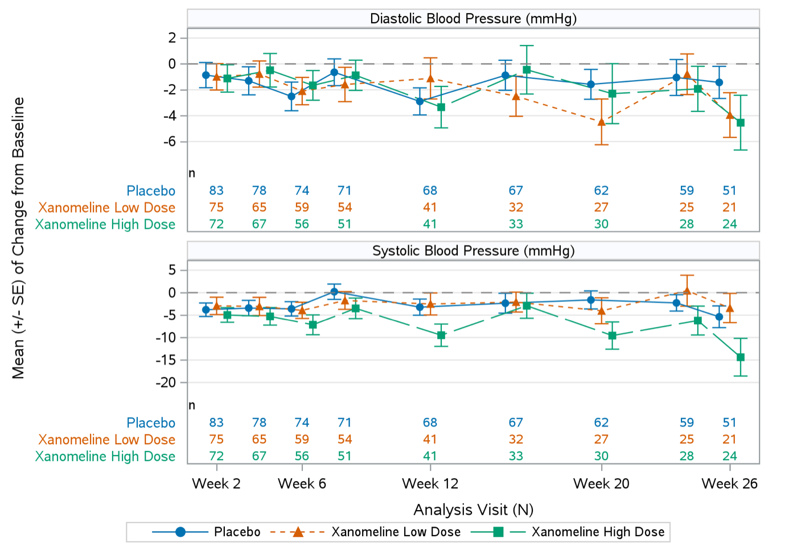

# %meanplot

Draws the mean or median of each group by visit as PNG and RTF files and returns the numbers drawn.

**Procedure:** PROC MEANS, PROC SGPANEL · **Family:** [Figures](index.md#figures)

## Syntax

```sas
%meanplot(
     data    =
   , plot    =
   , par     =
   , columns =
   , where   =
   , y       =
   , x       =
   , by      =
   , panel   =
   , stat    = mean
   , error   = se
   , level   = 0.95
   , connect = yes
   , ntable  = no
   , xformat =
   , xlabel  =
   , ylabel  =
   , ref     =
   , file    =
   , width   = 6.5in
   , height  = 4.5in
   , out     =
   , outpar  =
   , debug   = no
 )
```

## Parameters

`data=`
:   The input data set: one record per subject and visit. *(required)*

`plot=`
:   Draw again: the `out=` of an earlier %meanplot call, changed or not. It is drawn as it is, and no statistic is computed. Give it instead of `data=`. *(optional)*

`par=`
:   The drawing parameters of an earlier %meanplot call: its `outpar=`. A drawing parameter given in the call wins over its row of `par=`. *(optional)*

`columns=`
:   The data set of [%columns](columns.md): it gives the order of the groups and their colours. When not given, the groups come in the order of the data. *(optional)*

`where=`
:   The records to use: a condition in parentheses, such as where = (`anl01fl = 'Y'`). *(optional)*

`y=`
:   The variable to summarize: one numeric variable (`y = aval`). *(required)*

`x=`
:   The visit: one numeric variable (`x = avisitn`). Its values are the ticks, printed with `xformat=`. *(required)*

`by=`
:   The groups: one variable, one line per group. *(required)*

`panel=`
:   A variable: one panel per value, one under the other, each with its own y axis (`panel = paramcd`). *(optional)*

`stat=`
:   The statistic: mean or median. *(optional, default `mean`)*
    Accepts: `mean`, `median`.

`error=`
:   The error bars: se, sd or ci for the mean; iqr (Q1 and Q3) for the median; or none. *(optional, default `se`)*
    Accepts: `se`, `sd`, `ci`, `iqr`, `none`.

`level=`
:   The confidence level of error=ci: a number between 0 and 1. *(optional, default `0.95`)*

`connect=`
:   yes: join the points of a group by a line. *(optional, default `yes`)*
    Accepts: `yes`, `no`.

`ntable=`
:   yes: show the n of each visit and group under the axis. *(optional, default `no`)*
    Accepts: `yes`, `no`.

`xformat=`
:   The format of the ticks of x, as in a FORMAT statement (`xformat = visfmt.`). When not given, the format of x. *(optional)*

`xlabel=`
:   The label of the x axis: a text in quotes. When not given, the label of `x=` (or its name). *(optional)*

`ylabel=`
:   The label of the y axis: a text in quotes. When not given, the statistic, the error bars and the label of `y=`. *(optional)*

`ref=`
:   Reference lines on the y axis: one value or several, separated by blanks (`ref = 0 50`). *(optional)*

`file=`
:   The output file without its extension: the macro writes &lt;file&gt;.png (300 dpi) and &lt;file&gt;.rtf. *(required)*

`width=`
:   The width of the figure: a length with its unit (`width = 9in`). *(optional, default `6.5in`)*

`height=`
:   The height of the figure: a length with its unit (`height = 6in`). *(optional, default `4.5in`)*

`out=`
:   The name of the data set of the numbers drawn. When not given, they are not kept. *(optional)*

`outpar=`
:   The name of the data set of the drawing parameters, one row each. Give it to `par=` of a later call to draw the figure again. *(optional)*

`debug=`
:   yes: keep the work data sets _meanplot_*. *(optional, default `no`)*
    Accepts: `yes`, `no`.

## Result

The data set of `out=`: one row per panel, group and visit: the variables of `panel=` and `by=`, KIND (mean or median), X (the visit), Y (the statistic), LOWER and UPPER (the ends of the error bar; missing for se, sd and ci when there is one value) and N. The data set of `outpar=`: one row per drawing parameter, in the order of the table: PARAMETER ($32), its name, and VALUE ($500), its value as drawn (a label in quotes). The files: &lt;file&gt;.png and &lt;file&gt;.rtf.

## Details

It computes the statistic from the records; use [%lineplot](lineplot.md) for values computed before (the LS means of [%mmrm](mmrm.md) by visit) and [%profileplot](profileplot.md) for the line of each subject. The error bars are the SE, the SD or the confidence interval of the mean, or Q1 and Q3 of the median. The points of a group are joined by a line, and the groups stand a little apart on the x axis so that their bars do not overlap. With ntable=yes, the n of each visit and group is shown under the axis. The quantiles are those of PROC MEANS with QNTLDEF=5 (R quantile type 2). A record with a missing value, visit, group or panel is not used. To draw the figure again without computing, give `plot=` the `out=` and `par=` the `outpar=` of an earlier call.

!!! note "Good to know"

    Draw again: `plot=` takes the `out=` of an earlier %meanplot call, changed or not, and draws it as it is, with no statistic computed (error bars where LOWER has a value). `par=` takes the `outpar=` of that call and gives the drawing parameters: columns, by, panel, connect, ntable, xformat, xlabel, ylabel, ref, file, width, height. These change the picture, not the numbers. The other parameters compute; with `plot=` the log has a NOTE for each one given, as it is not used. A drawing parameter given in the call wins over its row of `par=`, and the row wins over the default of the table.

## Examples

The examples run on the [example data](../tutorial/index.md#the-example-data) after `examples/setup.sas`. The output under each call is the output of that run. They also read `t14_2_1_cols` (made by the [example of %columns](columns.md#examples)).

```sas
%meanplot(
     data    = advs
   , columns = t14_2_1_cols
   , where   = (paramcd IN ('SYSBP' 'DIABP') AND anl01fl = 'Y' AND avisitn < 99)
   , y       = chg
   , x       = avisitn
   , by      = trt01a
   , panel   = param
   , ntable  = yes
   , xformat = VISIT.
   , ref     = 0
   , file    = &spl_out./figures/f_bp_mean
   , out     = f_bp_mean
 )
```



## Messages

A wrong call writes the message and its fix to the log and stops. The macro also gives the [messages every macro shares](index.md#messages-every-macro-shares).

| Message | Fix |
|---|---|
| error=&lt;error&gt; does not go with stat=&lt;stat&gt; | give the mean error=se, sd or ci, the median iqr or none. |
| x=&lt;x&gt; is a character variable | give x= the numeric visit (AVISITN), xformat= its labels. |

## See also

Figures: [%kmplot](kmplot.md), [%forestplot](forestplot.md), [%lineplot](lineplot.md), [%boxplot](boxplot.md), [%barplot](barplot.md), [%aeplot](aeplot.md), [%profileplot](profileplot.md), [%scatterplot](scatterplot.md).

Named on this page: [%mmrm](mmrm.md), [%columns](columns.md).

## Proof

Checked against its known answers: numbers worked out independently in R, compared on SAS by the tests of the library.

The examples of this page ran on SAS 9.4M9 on 2026-11-27, with a log free of ERROR and WARNING.

[Source of %meanplot](https://github.com/datastep-labs/sapling-sas/blob/main/macros/meanplot.sas)
