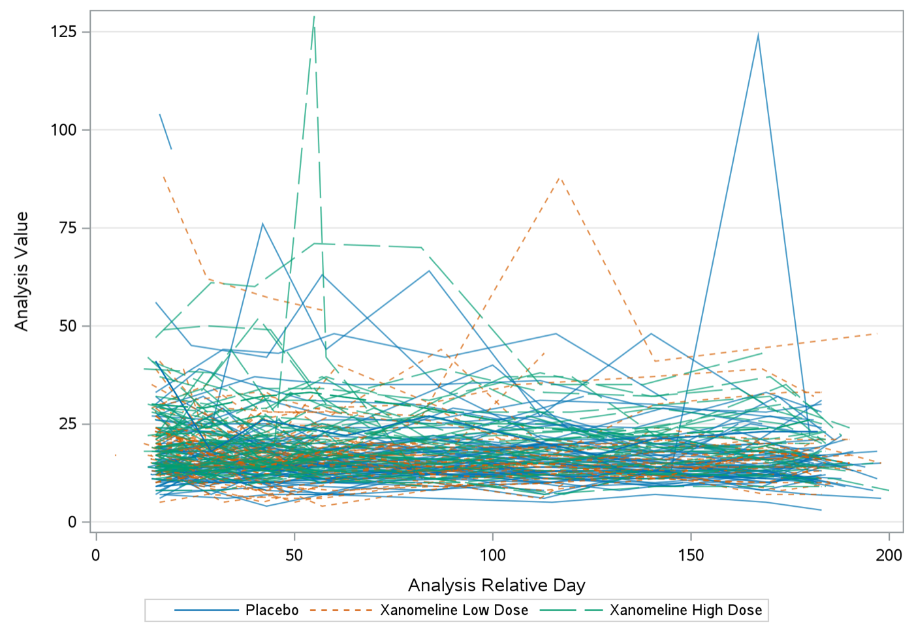

# %profileplot

Draws one line per subject through its values by visit as PNG and RTF files and returns the numbers drawn.

**Procedure:** PROC MEANS, PROC SGPANEL · **Family:** [Figures](index.md#figures)

## Syntax

```sas
%profileplot(
     data    =
   , plot    =
   , par     =
   , columns =
   , where   =
   , x       =
   , y       =
   , subject = USUBJID
   , by      =
   , panel   =
   , mean    = no
   , xformat =
   , xlabel  =
   , ylabel  =
   , ref     =
   , file    =
   , width   = 6.5in
   , height  = 4.5in
   , out     =
   , outpar  =
   , debug   = no
 )
```

## Parameters

`data=`
:   The input data set: one record per subject and visit. *(required)*

`plot=`
:   Draw again: the `out=` of an earlier %profileplot call, changed or not. It is drawn as it is, and no statistic is computed. Give it instead of `data=`. *(optional)*

`par=`
:   The drawing parameters of an earlier %profileplot call: its `outpar=`. A drawing parameter given in the call wins over its row of `par=`. *(optional)*

`columns=`
:   The data set of [%columns](columns.md): it gives the order of the groups and their colours. When not given, the groups come in the order of the data. *(optional)*

`where=`
:   The records to use: a condition in parentheses, such as `where = (anl01fl = 'Y')`. *(optional)*

`x=`
:   The visit: one numeric variable (`x = avisitn` or `x = ady`). *(required)*

`y=`
:   The value: one numeric variable (`y = aval`). *(required)*

`subject=`
:   The subject: one variable, one line per subject. *(optional, default `USUBJID`)*

`by=`
:   The groups: one variable, one colour per group. *(required)*

`panel=`
:   A variable: one panel per value, one under the other, each with its own y axis (`panel = paramcd`). *(optional)*

`mean=`
:   yes: also draw the mean of each group as a thick line. *(optional, default `no`)*
    Accepts: `yes`, `no`.

`xformat=`
:   The format of the ticks of x, as in a FORMAT statement (`xformat = visfmt.`). When not given, the format of x. *(optional)*

`xlabel=`
:   The label of the x axis: a text in quotes. When not given, the label of `x=` (or its name). *(optional)*

`ylabel=`
:   The label of the y axis: a text in quotes. When not given, the label of `y=` (or its name). *(optional)*

`ref=`
:   Reference lines on the y axis: one value or several, separated by blanks (`ref = 0 50`). *(optional)*

`file=`
:   The output file without its extension: the macro writes &lt;file&gt;.png (300 dpi) and &lt;file&gt;.rtf. *(required)*

`width=`
:   The width of the figure: a length with its unit (`width = 9in`). *(optional, default `6.5in`)*

`height=`
:   The height of the figure: a length with its unit (`height = 6in`). *(optional, default `4.5in`)*

`out=`
:   The name of the data set of the numbers drawn. When not given, they are not kept. *(optional)*

`outpar=`
:   The name of the data set of the drawing parameters, one row each. Give it to `par=` of a later call to draw the figure again. *(optional)*

`debug=`
:   yes: keep the work data sets _profileplot_*. *(optional, default `no`)*
    Accepts: `yes`, `no`.

## Result

The data set of `out=`: one row per point: the variables of `panel=`, `by=` and `subject=`, KIND, X, Y and N. KIND is subject for a value of a subject, or mean for the mean of a group (the subject is then blank); N is the number of values of a mean. The data set of `outpar=`: one row per drawing parameter, in the order of the table: PARAMETER ($32), its name, and VALUE ($500), its value as drawn (a label in quotes). The files: &lt;file&gt;.png and &lt;file&gt;.rtf.

## Details

Use [%meanplot](meanplot.md) for the mean of each group alone, with error bars. Each line is thin, in the colour and line pattern of the group of the subject. With mean=yes, the mean of each group at each visit is also drawn, as a thick line with markers. A record with a missing visit, value, group or panel is not used. To draw the figure again without computing, give `plot=` the `out=` and `par=` the `outpar=` of an earlier call.

!!! note "Good to know"

    Draw again: `plot=` takes the `out=` of an earlier %profileplot call, changed or not, and draws it as it is, with no statistic computed. `par=` takes the `outpar=` of that call and gives the drawing parameters: columns, subject, by, panel, mean (no: the rows of KIND mean are not drawn), xformat, xlabel, ylabel, ref, file, width, height. These change the picture, not the numbers. The other parameters compute; with `plot=` the log has a NOTE for each one given, as it is not used. A drawing parameter given in the call wins over its row of `par=`, and the row wins over the default of the table.

## Examples

The examples run on the [example data](../tutorial/index.md#the-example-data) after `examples/setup.sas`. The output under each call is the output of that run. They also read `t14_2_1_cols` (made by the [example of %columns](columns.md#examples)).

Draws the ALT of each subject over the study days: one line per subject, no mean.

```sas
%profileplot(
     data    = adlb
   , columns = t14_2_1_cols
   , where   = (paramcd = 'ALT' AND anl01fl = 'Y' AND MISSING(dtype))
   , x       = ady
   , y       = aval
   , by      = trt01a
   , mean    = no
   , file    = &spl_out./figures/f_alt_prof
   , out     = f_alt_prof
 )
```



## Messages

A wrong call writes the message and its fix to the log and stops. The macro also gives the [messages every macro shares](index.md#messages-every-macro-shares).

| Message | Fix |
|---|---|
| x=&lt;x&gt; is a character variable | give x= a numeric visit (AVISITN, ADY). |

## See also

Figures: [%kmplot](kmplot.md), [%forestplot](forestplot.md), [%meanplot](meanplot.md), [%lineplot](lineplot.md), [%boxplot](boxplot.md), [%barplot](barplot.md), [%aeplot](aeplot.md), [%scatterplot](scatterplot.md).

Named on this page: [%columns](columns.md).

Guides that use %profileplot: [Run the examples of the reference](../how-to/run-the-examples.md).

## Proof

Checked against its known answers: numbers worked out independently in R and compared on SAS by the tests of the library (the tests are kept with the development of the library, not in this repository).

The examples of this page ran on SAS 9.4M9 on 2026-11-27, with a log free of ERROR and WARNING.

[Source of %profileplot](https://github.com/datastep-labs/sapling-sas/blob/main/macros/profileplot.sas)
