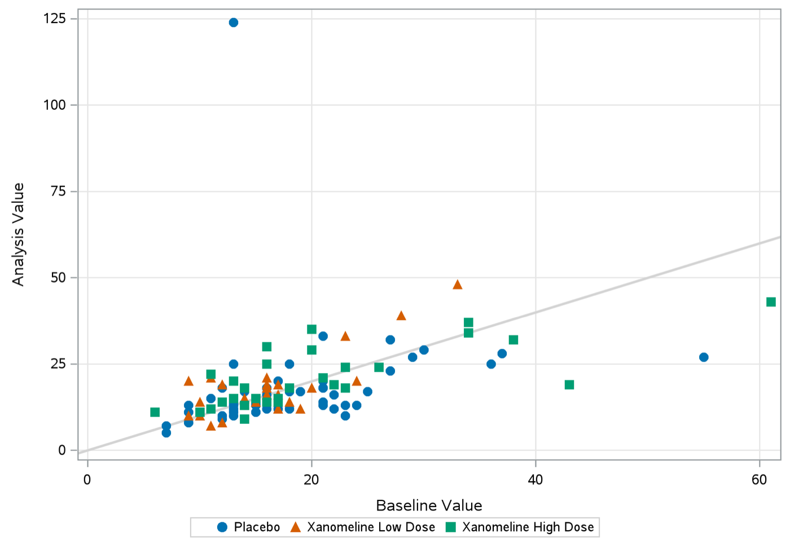

# %scatterplot

Draws the values of two variables against each other as PNG and RTF files and returns the numbers drawn.

**Procedure:** PROC REG, PROC SGPANEL · **Family:** [Figures](index.md#figures)

## Syntax

```sas
%scatterplot(
     data     =
   , plot     =
   , par      =
   , columns  =
   , where    =
   , x        =
   , y        =
   , by       =
   , panel    =
   , fit      = none
   , identity = no
   , xlabel   =
   , ylabel   =
   , ref      =
   , file     =
   , width    = 6.5in
   , height   = 4.5in
   , out      =
   , outpar   =
   , debug    = no
 )
```

## Parameters

`data=`
:   The input data set: one record per point. *(required)*

`plot=`
:   Draw again: the `out=` of an earlier %scatterplot call, changed or not. It is drawn as it is, and no statistic is computed. Give it instead of `data=`. *(optional)*

`par=`
:   The drawing parameters of an earlier %scatterplot call: its `outpar=`. A drawing parameter given in the call wins over its row of `par=`. *(optional)*

`columns=`
:   The data set of [%columns](columns.md): it gives the order of the groups and their colours. When not given, the groups come in the order of the data. *(optional)*

`where=`
:   The records to use: a condition in parentheses, such as where = (`anl01fl = 'Y'`). *(optional)*

`x=`
:   The variable of the x axis: one numeric variable (`x = base`). *(required)*

`y=`
:   The variable of the y axis: one numeric variable (`y = aval`). *(required)*

`by=`
:   The groups: one variable, one colour and marker per group. *(required)*

`panel=`
:   A variable: one panel per value (`panel = sex`). *(optional)*

`fit=`
:   The line of each group: none, linear (the least squares line) or loess. *(optional, default `none`)*
    Accepts: `none`, `linear`, `loess`.

`identity=`
:   yes: draw the line `y = x`. *(optional, default `no`)*
    Accepts: `yes`, `no`.

`xlabel=`
:   The label of the x axis: a text in quotes. When not given, the label of `x=` (or its name). *(optional)*

`ylabel=`
:   The label of the y axis: a text in quotes. When not given, the label of `y=` (or its name). *(optional)*

`ref=`
:   Reference lines on the y axis: one value or several, separated by blanks (`ref = 0 50`). *(optional)*

`file=`
:   The output file without its extension: the macro writes &lt;file&gt;.png (300 dpi) and &lt;file&gt;.rtf. *(required)*

`width=`
:   The width of the figure: a length with its unit (`width = 9in`). *(optional, default `6.5in`)*

`height=`
:   The height of the figure: a length with its unit (`height = 6in`). *(optional, default `4.5in`)*

`out=`
:   The name of the data set of the numbers drawn. When not given, they are not kept. *(optional)*

`outpar=`
:   The name of the data set of the drawing parameters, one row each. Give it to `par=` of a later call to draw the figure again. *(optional)*

`debug=`
:   yes: keep the work data sets _scatterplot_*. *(optional, default `no`)*
    Accepts: `yes`, `no`.

## Result

The data set of `out=`: the variables of `panel=` and `by=`, KIND, X and Y. A row of KIND point is one value. With fit=linear, a row of KIND fit is one panel and group, with SLOPE, INTERCEPT, RSQUARE and N (X and Y missing). The data set of `outpar=`: one row per drawing parameter, in the order of the table: PARAMETER ($32), its name, and VALUE ($500), its value as drawn (a label in quotes). The files: &lt;file&gt;.png and &lt;file&gt;.rtf.

## Details

Use [%profileplot](profileplot.md) for the values of each subject over time. Typical uses are a shift plot of the baseline and post-baseline values, or two measures of a subject. Each group has its own colour and marker. With fit=linear, the least squares line of each group is drawn, and its slope, intercept and R-square are in `out=`. With fit=loess, the loess curve of SGPLOT is drawn; SGPLOT chooses its smoothing, and the curve is not in `out=`. With identity=yes, the line `y = x` is drawn. A record with a missing x, y, group or panel is not used. To draw the figure again without computing, give `plot=` the `out=` and `par=` the `outpar=` of an earlier call.

!!! note "Good to know"

    Draw again: `plot=` takes the `out=` of an earlier %scatterplot call, changed or not, and draws it as it is, with no statistic computed: its points, and the line of each row of KIND fit over the X of the points of its group (a loess curve is not in `out=` and is not drawn again). `par=` takes the `outpar=` of that call and gives the drawing parameters: columns, by, panel, identity, xlabel, ylabel, ref, file, width, height. These change the picture, not the numbers. The other parameters compute; with `plot=` the log has a NOTE for each one given, as it is not used. A drawing parameter given in the call wins over its row of `par=`, and the row wins over the default of the table.

## Examples

The examples run on the [example data](../tutorial/index.md#the-example-data) after `examples/setup.sas`. The output under each call is the output of that run. They also read `t14_2_1_cols` (made by the [example of %columns](columns.md#examples)).

```sas
%scatterplot(
     data     = adlb
   , columns  = t14_2_1_cols
   , where    = (paramcd = 'ALT' AND avisit = 'Week 24')
   , x        = base
   , y        = aval
   , by       = trt01a
   , identity = yes
   , file     = &spl_out./figures/f_alt_scat
   , out      = f_alt_scat
 )
```



## Messages

The macro gives only the [messages every macro shares](index.md#messages-every-macro-shares).

## See also

Figures: [%kmplot](kmplot.md), [%forestplot](forestplot.md), [%meanplot](meanplot.md), [%lineplot](lineplot.md), [%boxplot](boxplot.md), [%barplot](barplot.md), [%aeplot](aeplot.md), [%profileplot](profileplot.md).

Named on this page: [%columns](columns.md).

## Proof

Checked against its known answers: numbers worked out independently in R, compared on SAS by the tests of the library.

The examples of this page ran on SAS 9.4M9 on 2026-11-27, with a log free of ERROR and WARNING.

[Source of %scatterplot](https://github.com/datastep-labs/sapling-sas/blob/main/macros/scatterplot.sas)
